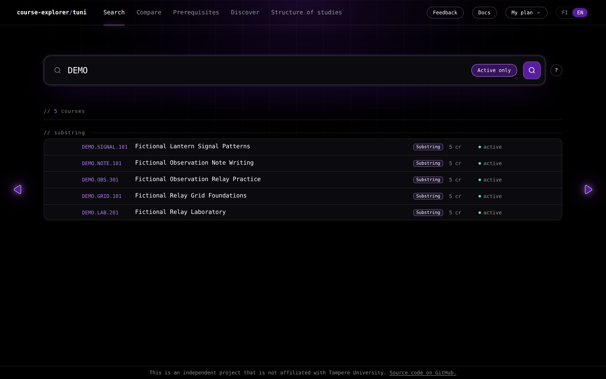
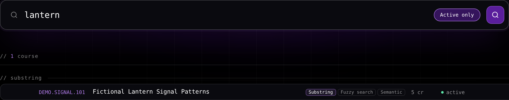
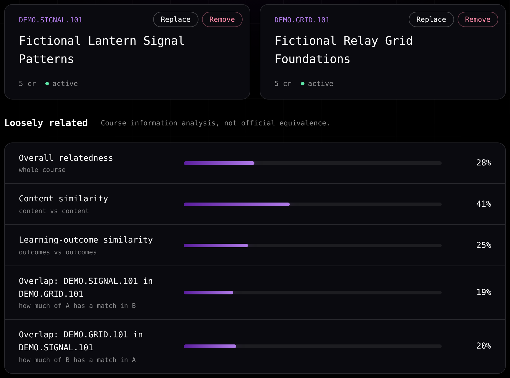
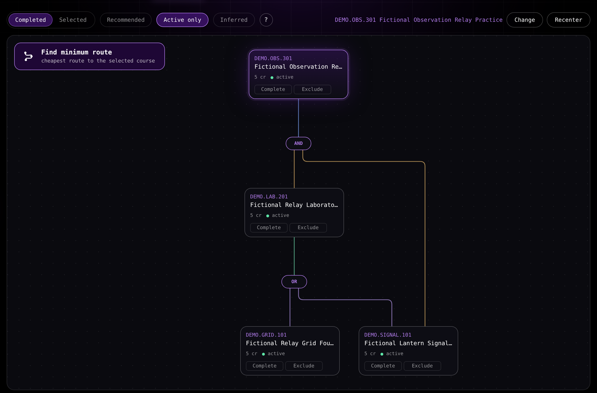
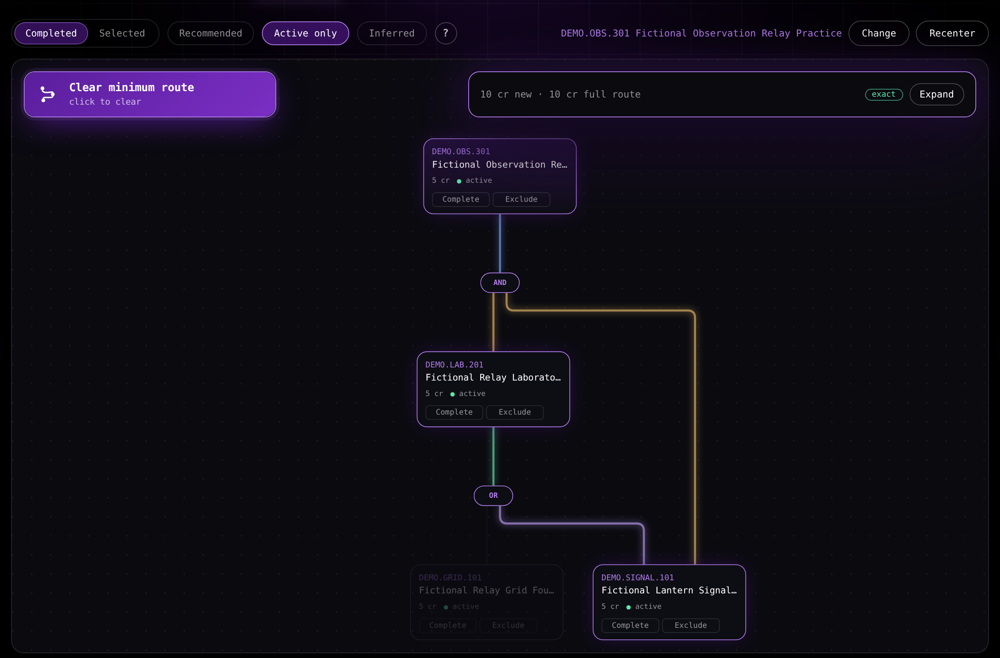
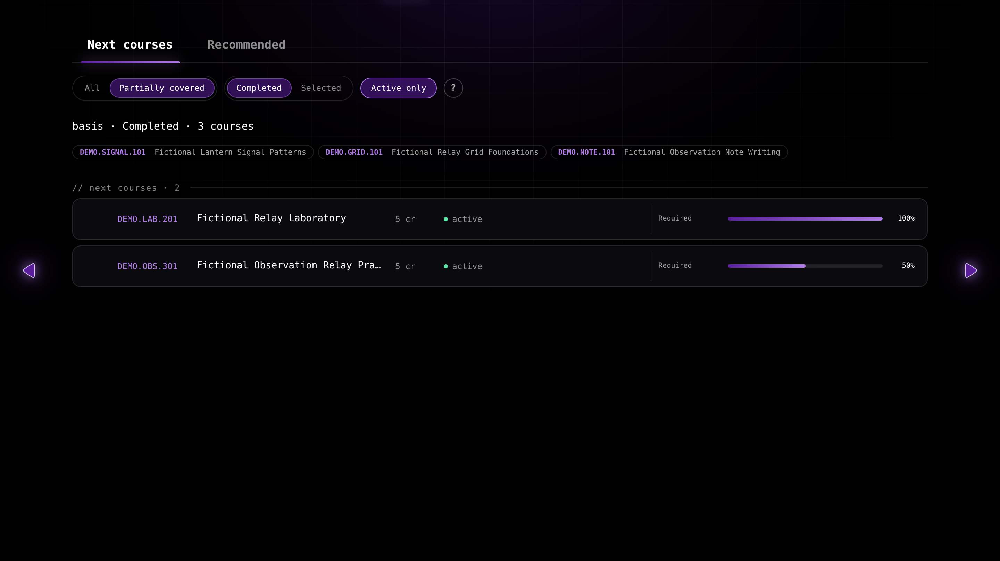
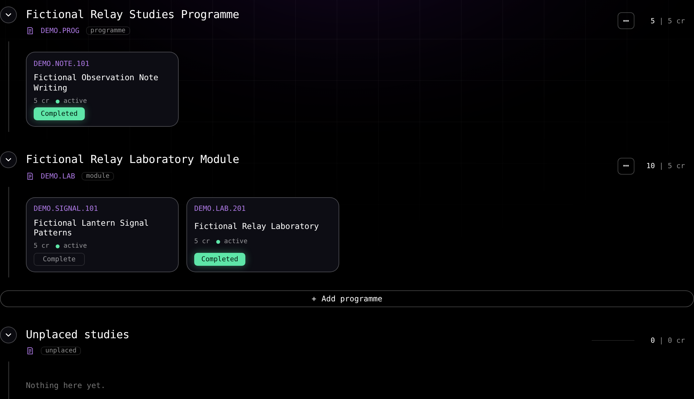
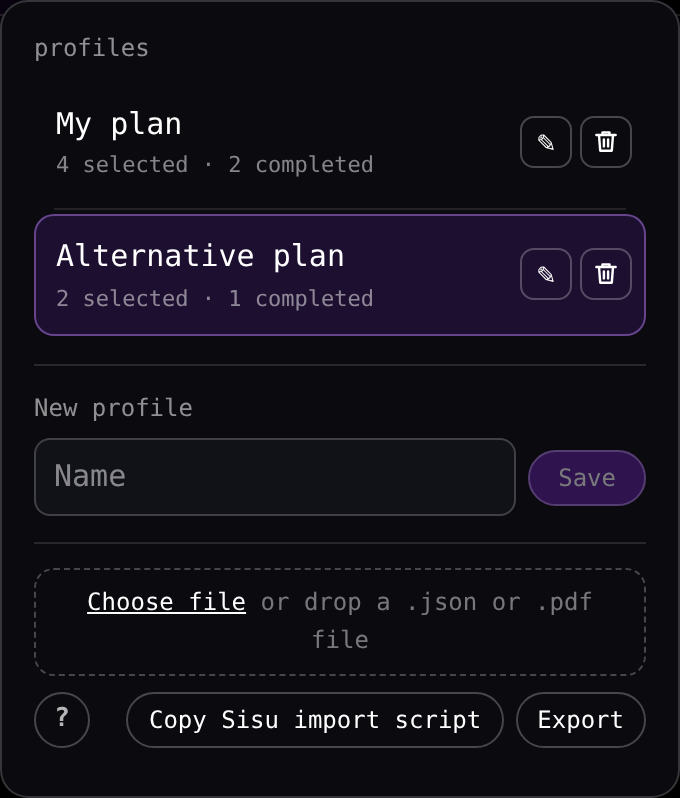
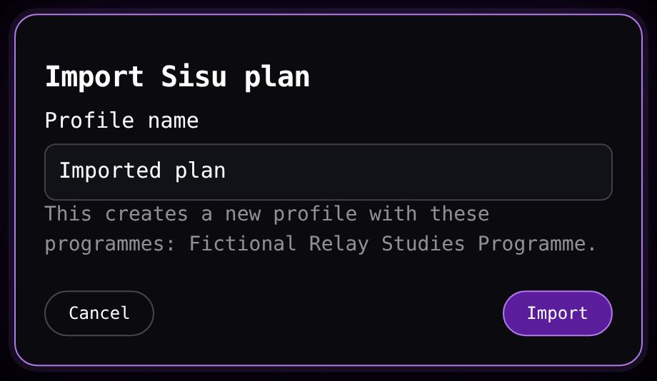
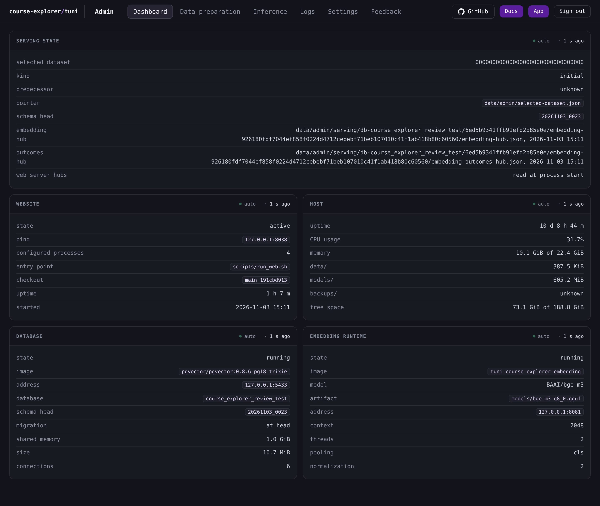

# course-explorer

course-explorer explores Tampere University curriculum data through a React browser app and a read-only FastAPI backend, with an offline Python pipeline over PostgreSQL and pgvector.

The browser application searches courses by code, name and meaning, compares courses, draws official prerequisite structures and separately marked inferred ones, computes a minimum-new-credit route, lists what can be studied next, and keeps one browser-local study plan across every tab.

The app is available at [course-explorer.duckdns.org](https://course-explorer.duckdns.org/). Its [wiki](https://course-explorer.duckdns.org/docs) holds the guides to each tab and the documentation of how the system behaves. Installation, self-hosting and the code-level documentation are read in [`docs/`](/docs/) in this repository.

The example setup in this repository runs on an invented dataset, not on university data.



## Features

The application has five tabs that share one browser-local study plan. A site sets in `config/web.toml` whether it serves the embedding features (the **Compare** tab, the **Recommended** list and semantic search) and the inference features (the **Inferred** toggle and inferred prerequisites), and the app leaves out what the site does not serve.

### Search

Search matches a query against course codes, course names and the teaching text. Exact code, substring and fuzzy name matching run for every query, semantic matching runs as well on a site that serves the embedding features, and the results are merged into one entry per course that lists each way the course matched.



### Compare

Compare places two courses side by side and measures how much their teaching text overlaps. Five meters show overall relatedness, content similarity, learning-outcome similarity, and, in each direction, how much of one course has a match in the other. One verdict summarizes them.



### Prerequisites

The graph shows the layered prerequisite structure of a course as AND and OR groups, with the completed or selected courses as the basis. The **Recommended** toggle adds recommended prerequisites to the drawing and the route, and they draw with the same line style as the required ones. The **Inferred** toggle adds prerequisites found by analysis to the same graph, and a course reached only by inferred occurrences is marked **inferred**. **Find minimum route** computes the set of courses that needs the fewest new credits and highlights it on the graph.





### Discover

Discover has two lists. **Next courses** shows the courses that can be studied next from a basis of completed or selected courses, in an **All** mode or a **Partially covered** mode, with a coverage meter for each category that holds course prerequisites. **All** lists fully covered courses without a coverage meter. **Recommended** lists courses similar to the basis.



### Structure of studies

This tab shows an ordered list of programmes, each with the official structure of a degree programme or module and credit totals per node. **Add programme** ends the list, every programme row carries a menu that replaces, resets or deletes it, courses can be marked complete, and courses no programme or module holds appear under **Unplaced studies**. The structure can be edited in the browser to match a personal plan.



### Profiles and language

The profile menu in the top bar is named after the active profile (**My plan** by default). It lists the saved profiles and creates new ones. A profile stores the selected and completed courses, exclusions and graph marks, the ordered programmes with their edits, and the tab options. The open tab belongs to the browser tab instead, so switching a profile never moves it. The FI/EN switch sets the interface wording and the language of official course and module names.

The same menu exports one profile or all saved data as a file and imports those files for transfer between browsers or backup. [Profiles and language](/docs/guides/profiles-and-language.md#exporting-a-profile-or-the-saved-data) describes the file controls and their confirmations.



### Sisu plan import

A script copied from the profile menu reads an open plan in Sisu's **Structure of studies** view and downloads one capture file. Importing that file creates one browser-local profile with the plan's programmes, choices and completions, and the exact module versions Sisu showed.

The script runs in the Sisu browser tab. It reads the open page and asks the public Kori interface for the modules and courses the plan shows, without sending the Sisu login cookies. [Importing a Sisu plan](/docs/guides/sisu-import.md) gives the capture and PDF import steps.



### Feedback

The **Feedback** button beside **Docs** opens a form for anonymous feedback about the site, with optional images. The site saves every submission, and the form offers to also publish it as an issue in the GitHub repository the site configures. [Sending feedback](/docs/guides/feedback.md) describes the form and the publication choice.

## Admission control

The web server uses a browser cookie to apply admission control to nine fixed API POST paths. With `ADMISSION_ENABLED` true in `config/admission.toml`, reads are classified as free, light or heavy. Light reads have rate and concurrency limits. Heavy reads use a budget of estimated processing cost and wait in a queue for a shared slot.

The limits adjust to server load, using the host's CPU use and the admitted request activity. An admitted heavy read is charged its estimated processing cost, capped by the current budget, and a refused read returns HTTP 429 with a retry delay. [Admission control](/docs/backend/interfaces/admission-control.md) describes the classes, budgets, queues and settings.

## Data and limits

- Official facts come from Tampere University's public Kori curriculum data. Machine translations and inferred prerequisites are derived information, marked as such in the interface.
- Prerequisite inference runs separately from the website, on a model hosted by whoever operates the project. The website only shows the results.
- One browser `localStorage` store holds the profiles. Profiles stay in the browser that created them.
- Selection and completion use one canonical course identity in every tab.
- The application reads the catalogue without changing it, and it starts no ingestion, translation, embedding or inference. A feedback submission is stored in the site's separate feedback application store.
- The interface does not establish enrolment eligibility, and its analysis is not verified by the university.

## Administration console

The administration console is a separate signed-in browser application with its own backend, running the fixed administration commands. Its six tabs are **Dashboard**, **Data preparation**, **Inference**, **Logs**, **Settings** and **Feedback**.

The console reports the website, host, database and model runtime, controls the preparation stages, records inference decisions, reads logs and usage, manages configuration, datasets and backups, and reads, filters and deletes the saved feedback. The course application is a read-only API client. Preparation and maintenance run through the console or the administration command.



[Administration console](/docs/operations/admin-console/README.md) covers signing in, the tabs and their panels.

## Run your own copy

Requirements:

- Linux and a CPython 3.14.3 interpreter that exposes `os.memfd_create` and `os.MFD_CLOEXEC`. Not every build of that version does, so check the capability before selecting the interpreter.
- [uv](https://docs.astral.sh/uv/).
- Node.js `^22.22.2 || >=24.15.0` with npm.
- Docker with Docker Compose, which the administration command runs through `sudo docker compose`.
- The `libpq` and `libstdc++` shared libraries, which the compiled native modules load at run time. The native build itself runs in a container.
- Access to the Python and npm package registries, and to the pinned embedding model download.
- The GitHub CLI `gh` for a site that publishes feedback, from a release whose `gh issue create` supports `--attach` and `--body-file -`.

1. Prepare the environment from the checkout.

   ```bash
   python3.14 -c 'import os, sys; assert sys.version_info[:3] == (3, 14, 3); fd = os.memfd_create("course-explorer-preflight", os.MFD_CLOEXEC); os.close(fd); print(sys.executable)'
   uv sync --locked --no-managed-python --python "$(python3.14 -c 'import sys; print(sys.executable)')"
   npm --prefix web ci --engine-strict --no-audit --no-fund
   npm --prefix admin-web ci --engine-strict --no-audit --no-fund
   .venv/bin/python -c 'import os; fd = os.memfd_create("course-explorer-preflight", os.MFD_CLOEXEC); os.close(fd)'
   ```

2. Run the example setup workflow through the administration command.

   ```bash
   uv run python scripts/admin.py
   ```

   Choose **1 Setup/preflight**, then **12 Set up example site**, and answer the prompts. The workflow writes the working configuration, both database passwords and the administration account. It builds and starts the database and the embedding service, migrates and loads the invented example dataset, prepares the feedback application store, builds the native libraries and both frontends, starts the site and the administration console, and proves both. [Installation](/docs/getting-started/installation.md) lists every prompt and gives the non-interactive form of the same command.

3. Open the address the workflow prints.

The example setup serves invented data. Its courses, modules, prerequisites and structure rules are not university data, and its embedding vectors are bundled with it, so the import runs no embedding stage, and the workflow downloads the pinned model that the embedding service loads. A copy that serves real curriculum data runs the real-database workflow instead, which creates one empty Selected database and builds its serving artifacts on the same prepared checkout. [Self-hosting](/docs/getting-started/self-hosting.md) installs the copy as services behind a reverse proxy.

The lint, Python, database, browser application and console checks for a local checkout are in [Local checks](/docs/testing/local-checks.md).

## Architecture

- [`src/course_explorer/`](/src/course_explorer/): domain, ingestion, search, inference and persistence services.
- [`src/course_explorer_admin/`](/src/course_explorer_admin/): the administration command, with the operator menu, the four preparation stages and their lifecycle.
- [`src/course_explorer_web/`](/src/course_explorer_web/): the read-only FastAPI application that serves the browser application and its endpoints.
- [`src/course_explorer_admin_web/`](/src/course_explorer_admin_web/): the separate signed-in administration backend that runs the fixed administration commands for the console.
- [`scripts/`](/scripts/): the administration command, the example data loader, thin command-line adapters over the read commands, and the launchers of the web server and the administration backend.
- [`web/`](/web/): the React, TypeScript and Vite browser application.
- [`admin-web/`](/admin-web/): the React, TypeScript and Vite administration console.

Python services own behavior, PostgreSQL with pgvector stores normalized state and vectors, and Alembic owns schema changes. The browser application is a read-only client of the API. The offline pipeline that prepares the data runs outside the request path.

## License

This project is licensed under the MIT License. See [`LICENSE`](/LICENSE).

## Independent project

This is an independent project. It is not affiliated with, endorsed by, or connected to Tampere University. Tampere University curriculum data and other university material are not covered by this project's software license and remain subject to their own terms. The example dataset in `data/mock/` is invented for this project and is not university data.
