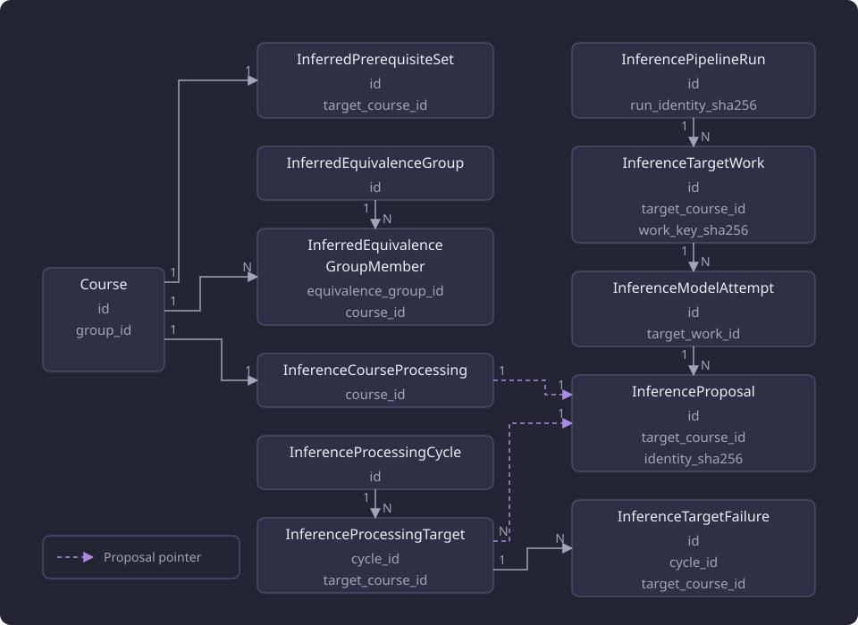

# Data model

The curriculum database holds the official catalogue, teaching text, embeddings, inferred data and inference pipeline state.

A separate feedback application store holds anonymous feedback submissions and their attachment metadata.

## Official catalogue

Every course and every module has one canonical identity, and all of its official versions share that identity. A course version records the credit range of the version, and its upper bound is empty when the source states no maximum. A module version owns its rule tree, in which at most one node sits at the root.

A version belongs to zero or more curriculum periods, and a period holds the versions of many courses and modules. A module version with no membership is selected by its validity bounds. The official prerequisites of a course version are stored as ordered groups of a required or recommended kind, and each group holds ordered members that name a canonical course or module. A member whose identity has no stored course or module is reported as an unresolved requirement. A [Substitution](/docs/reference/glossary.md) is stored the same way and applies in one direction only.

The diagram shows the catalogue entities with their identity and key columns and their relationships: the one official teaching-text row of a course version, and the many derived translation, embedding chunk, official prerequisite, official substitution, and module rule-node rows those versions own. The dataset-level derived tables that no version owns are listed in [Tables and migrations](/docs/backend/catalogue/tables-and-migrations.md).

## Capture records

One ingestion run records one capture with its status, and each captured object is one source snapshot with its response position and content hash. Every course version and module version names exactly one source snapshot, so each official version records the captured object it was normalized from.

## Teaching text

Official text lives with the exact version. Translations live in a separate table, one row per version, field, and target language, and each row records the SHA-256 hash of the source text it was made from. A translation whose recorded source text differs from the official text is a stale translation, reported and never used, and official text always takes precedence over a translation.

## Embeddings

Embedding chunks belong to representative versions, one row per version, field, language, and chunk index, and each row holds its vector and the identity of the inputs it was made from. The vector has 1024 components, a dimension fixed by the schema.

The configuration hash ties a chunk to the values that change what a vector means: `EMBEDDING_MODEL`, `EMBEDDING_ARTIFACT_SHA256`, `EMBEDDING_POOLING`, `EMBEDDING_NORMALIZATION`, and `EMBEDDING_RUNTIME_REVISION` in `config/search.toml`, together with the 1024-component dimension the schema fixes. A read selects chunks by the configuration hash of the settings in force, so chunks written under different values are never mixed. The chunk boundaries come from `EMBEDDING_CHUNK_MAX_CHARACTERS` and `EMBEDDING_CHUNK_OVERLAP_CHARACTERS` in the same file.

A chunk row is pending, completed, or failed. A completed row holds its vector and a pending or failed row holds none, and deleting a course version deletes its chunk rows.

On a site that serves the embedding features, a serving artifact build also writes derived tables beside the chunk rows: one hub-centred course centroid per represented course that has a descriptive content or outcomes chunk, the stored nearest-neighbour rows of the descriptive chunks, and the packed search groups, blocks, and one-row meta of the dataset. Each build replaces those sets as a whole. [Tables and migrations](/docs/backend/catalogue/tables-and-migrations.md#embeddings) lists their columns, keys, and constraints.

## Inferred prerequisites and equivalence groups

The inferred side has its own tables, apart from the official catalogue. An inferred set holds the current inferred prerequisites of one canonical target course with its coverage state and counts, and at most one set exists per target course. An equivalence group holds courses that analysis of teaching text treats as interchangeable, with one member row per course, and a course appears at most once in a group. Publication writes these results as a whole, so a target course has one set and a stored group is written in one step.

## Inference pipeline state

The pipeline has its own records. One run row holds the shared execution identity of a run. One work row per canonical target course and work key names the run that created it and holds the activity context and a status, with the transient input digest bound into the work key. Work with a matching key is reused instead of recomputed, and a changed digest creates a distinct row. One completion row per finished generation holds the completion payload. A proposal is immutable, names the completion it was composed from, and holds the composed expression and the equivalence candidates of one target course under a unique identity hash.

One processing marker per canonical course holds whether the course was processed, a pointer to the last accepted proposal, and the operator disposition (done, failed, or empty for automatic). One processing cycle holds the stage it has reached (multiview, rerank, inference, publication, or complete), and one checkpoint per cycle and target course holds the state of each stage and its proposal pointer. A failure summary records one failed episode of a target inside a cycle and holds the failing stage and the fixed reason, and failure summaries are written once and retained.

The diagram places the inferred tables beside the generation chain. It shows one set per target course, a group with its member courses, one marker per course with its accepted-proposal pointer, the run, work, attempt, and proposal chain, and the processing cycle with its checkpoints, each carrying a proposal pointer, and the failure summaries a checkpoint holds. Each entity lists its identity and key columns.

How the pipeline runs is described in [Inference](/docs/backend/inference/inference.md).

## The feedback application store

The feedback application store holds one row per stored submission with the answers by configured field ID, the explicit publication choice and its stored state, and one row per stored attachment with its field, submitted filename and detected image type. The image files live beneath `FEEDBACK_ATTACHMENTS_ROOT` of `config/feedback.toml`. No feedback table references a curriculum table, and the curriculum dataset lifecycle neither reads nor changes feedback records. [Tables and migrations](/docs/backend/catalogue/tables-and-migrations.md#the-feedback-application-store-schema) states the tables and their own migration chain.

## Datasets

A curriculum dataset is one whole database. A process resolves a dataset role outside the database from one pointer that names it and one receipt per enrolled dataset. Each receipt records the database name, the kind, the predecessor dataset, the dump hash, and a verification record that carries the schema head recorded at verification. The live head comes from that dataset's own Alembic revision, which the dataset verification and the schema check before a stage compare against the single head of the curriculum migration chain that the running code carries.

The Selected pointer names the database the web server serves, and the Working pointer names the database the stages write. A state root with neither pointer is bootstrap and serves the configured database directly. A database whose revision is not the single head of the migration chain is refused rather than migrated. The dataset lifecycle is described in [Datasets](/docs/operations/datasets.md), and the boundary between the administration side and the web server is described in [Boundaries](/docs/architecture/boundaries.md).

## Schema changes

The curriculum schema comes from one Alembic migration chain, which creates every curriculum table, and a curriculum table change is a revision in that chain. The feedback application store schema has its own metadata, migration chain and head. A database at the single head of its owning chain is used as it is, and any other revision fails with the schema mismatch error.

The columns of every table and both migration chains are documented in [Tables and migrations](/docs/backend/catalogue/tables-and-migrations.md).
