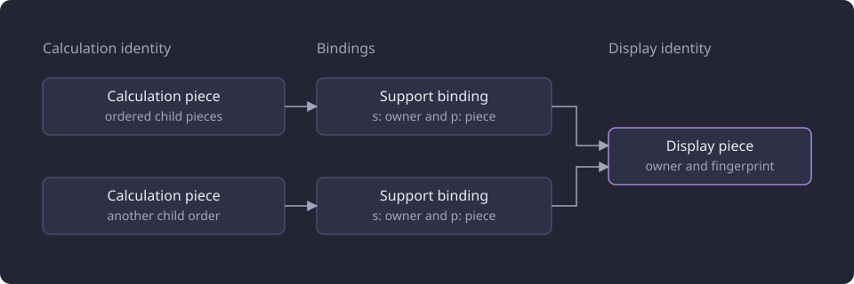
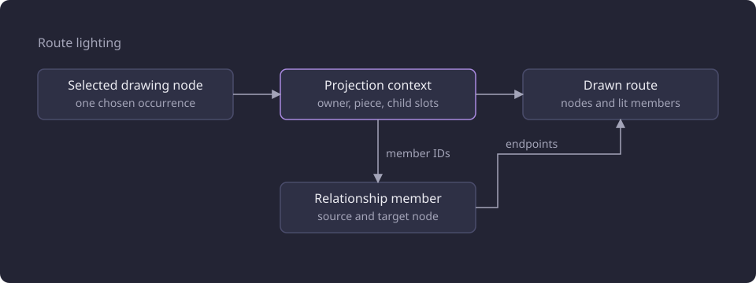

# Compact graph identity

This report asks whether one prerequisite graph report can serve the calculation and the drawing from two identities.

**Evidence status:** Corrected. **Run dates:** 19 and 20 October 2026.

## The question

The prerequisite graph of one course carried a full calculation tree beside a fully built drawing. Both recorded every occurrence of every requirement, and one occurrence could be reached by several paths. A refusal by the [drawing allowance](/docs/reference/glossary.md#prerequisites-and-routes) did not reduce that work, because the refused drawing was built, serialized and sent. The measured bodies and stages of that baseline are on [Graph report payload and projection](/docs/experiments/graph-and-route-algorithms/graph-report-payload-and-projection.md).

The design question was whether one report could serve the calculation and the drawing from two structures. The calculation would be one globally shared [solver structure](/docs/reference/glossary.md#prerequisites-and-routes) of content-addressed pieces with ordered child slots. The drawing would be a per-course set of order-independent boxes. The two needed one shared answer for box identity, saved marks, provenance, numeric multiplicity and cycles. Route lighting had to name the boxes and connections of the chosen route without sending every reaching path.

## Two structures

One graph read returns one solver structure, one drawing, the support bindings between them and the drawing allowance. The browser route worker reads the held solver structure with the live profile inputs, and it does not recompile the graph.

The solver structure is one global directed acyclic graph. A [calculation piece](/docs/reference/glossary.md#prerequisites-and-routes) is one provenance-free structural node. Its identity is a content digest of its kind, its kind-specific value and the ordered identities of its child pieces.

```text
calculation piece   p:<digest> = digest(kind, kind value, ordered child piece IDs)
calculation support s:<owner>:p:<piece>
display piece       s:<owner>:d:<fingerprint>
```

The applied identity also carries the manual credit minimum, the module rule and the cycle-closing marker. Equal structure therefore shares one piece, and two nodes with different evaluation values cannot share an answer. Children form an ordered list and may repeat, so arity and numeric multiplicity live in the slot list.

The owner is the canonical course of the nearest enclosing expanded-course branch, and the graph root owns its own tree. Owner is traversal context, not part of the piece. The same piece reached under two courses is one calculation piece and two scoped supports. The solver folds it once per owner, so a shared piece can have a different result for each owner and a mark applies only where its box is.

The display identity is separate. A [display piece](/docs/reference/glossary.md#prerequisites-and-routes) is identified by the course owner plus a fingerprint of the displayed kind, the displayed values and the sorted unique fingerprints of the drawn children. Courses are global terminals. A logical group whose children reach exactly one unique drawn target collapses to that target, even when several source occurrences lead to it. Nested groups with the same operator fold before any attachment is emitted.

The report carries both structures and the [support bindings](/docs/backend/prerequisites/display-projection.md#shared-drawing-identity). A binding maps one scoped calculation support to its source uses, its drawn node IDs and the markable boxes it stands for. A hidden head, an elided wrapper, a structural nested module and a module body bind to their nearest emitted containing box. No binding points at a node the projector did not emit. A support may bind several boxes when a shared course is reached from several owners. When the allowance refuses a drawing, the serialized display is absent and the bindings, contexts and members are serialized. The browser never assumes that a calculation identity and a display identity are the same string.

Each occurrence also carries a projection context. Its identity is a digest of its context key, its parent box and its nearest box. It records its owner, its piece, its ordered child slots and the member IDs the occurrence selects.

The diagram shows two calculation pieces with the same children in different order, each with its support binding, pointing at the one display piece for the course.



The native port re-proved these identities byte for byte against the Python implementation, as [Native prerequisite compilation and identity](/docs/experiments/graph-and-route-algorithms/native-prerequisite-compilation.md) records.

### Provenance and drawing equality

Provenance is the origin, official kind, inferred category and inference metadata of a source node. It is held on the source uses and facts and never enters the calculation digest. An official AND and an inferred AND of the same structure become one piece and one display piece. In the fixture that case had seven occurrences and four pieces.

The drawing shows provenance in two places. A course box carries the inferred marker only when inferred provenance reaches it and no official provenance does. A connection is dashed only when every relationship behind it is inferred, and any official relationship makes it solid. Required and recommended relationships use the same line style.

The fingerprint ignores provenance, official kind, inferred category, inference metadata, mark state, child order, multiplicity, unexpandable content work keys and localized names. That is what lets one box stand for several source occurrences. It also means a mixed box can have no single provenance. The fixture implementation took a located problem's provenance from a representative occurrence, and its fixture set had no case where two occurrences of one box would report different provenance.

### Numeric multiplicity

Ordered child slots may repeat. The calculation holds both `a` slots for a two-of-three cardinality requirement over `(a, a, b)`, and the route selects `a` with the same credits. A repeated OR branch is part of the calculation without changing the route.

The drawing may collapse those repeated slots into one display piece, because the fingerprint sorts and deduplicates its child fingerprints. The calculation holds both slots. Two unexpandable content blocks whose displayed values are equal can likewise be distinct calculation pieces under one display piece. A saved mark on that box reaches every one of them.

### Cycles

A genuine indirect cycle becomes one course piece with the cycle-closing marker and one course-cycle diagnostic at the actual closing use. Every ancestor piece that contains the closing occurrence differs from the ancestor of a normal occurrence.

Without that marker a memoized normal occurrence answers for the closing occurrence. The control without the marker returns an Exact minimum route with two credits and no blocker. The product returns Route unresolved with a course-cycle blocker on the root path through `a`. With the marker the case matches.

A cycle case can place a normal and a closing occurrence on one connection. In the fixture the product recorded one relationship member with both terminal occurrences, and the compact display split that member by terminal identity, carrying each part's own gate set. The fixture records two such splits. The applied report holds one member per endpoint pair and complete source fact, and a projection context records the members its occurrence selects.

### Marks and route lighting

A [node mark](/docs/reference/glossary.md#prerequisites-and-routes) names one markable display piece. The report binds every calculation support to the display pieces and markable boxes it represents. A mark on one box applies to every calculation piece behind it, including opposite child orders and repeated numeric slots. A saved key for a box the drawing does not emit has no effect and applies again when the same display identity returns. A structurally nested module has no box, so a saved key for one is inert.

Marking one box that stands for three source occurrences made the product expand the mark to three occurrence action keys, while the compact implementation applied it through one scoped support, because the three branches are one piece. Both results were No route exists, and each product mark group mapped to one box. Marking owner A's box excluded only A's occurrences, left B's box clear, and the route was exact through B. Marking a module excluded one module box, both results were No route exists, and one located excluded-node problem was reported.

A connection groups the relationships between one pair of boxes. The applied report holds one member per endpoint pair and complete source fact, `m:<digest>`, with `member_id`, `source_node_id`, `target_node_id` and `fact_id`. Route lighting selects one drawing derivation. `projectRoute` pairs each projection context with the drawing node the chosen route selected, requires that the context's owner and piece match the node, collects the member IDs that context owns, and follows only the child slots the node carries. The node set is the root plus the source and target endpoints of the lit members, so `selected_nodes` holds drawn `course:` and `s:<owner>:d:<fingerprint>` identities. An unchosen alternative contributes no member even when its calculation support lies in the route's evidence, so it is drawn dim.

The fixture implementation's member predicate was different. It tested the member's terminal identity and a gate set against the selected scoped supports. In the fixture, the product reported three identical excluded-node problems for the three sources of one box, and the compact result reported one. All 21 route cases had the same lit member set as the product, the predicate held for every lit member, and no gate lay outside its owner.

The diagram shows one chosen drawing node paired with its projection context, the member IDs that context owns, and the member endpoints that join the drawn route.



## The reversed-order counterexample

The design expected the two structures to share `(owner, piece)` and need no conversion table. A reversed-order case ended that expectation for display identity.

Official `OR(a, b)` and inferred `OR(b, a)` under one AND draw one OR box, because the drawing fingerprint sorts its children. The ordered calculation identity produces two piece IDs. The display conversion refused the box and reported that it spans two scoped identities.

```text
drawn_or_boxes: 1
first_piece: p:4fdf0085bdb57233fdcae362
second_piece: p:63755fb1db73d84c5c968269
ValueError: drawn node connector:r.0 spans scoped identities ['root|p:4fdf0085bdb57233fdcae362', 'root|p:63755fb1db73d84c5c968269']
```

Sorting child IDs fixes permutation alone. It does not fix numeric-slot multiplicity or two unexpandable content blocks with equal drawings. Those are separate calculation pieces that the required drawing equality can share.

The resolution is the support binding. Display identity keys the box by its drawing fingerprint, not by one piece. The graph report binds each `s:<owner>:p:<piece>` to the drawn node IDs and markable box IDs it represents. A box can stand for two ordered pieces. A mark on the box reaches every piece behind it. A route lights the boxes and members of one chosen drawing derivation.

The counterexample overturned the single-key assumption. The applied report carries ordered calculation identity and order-independent display identity side by side, with an explicit binding between them. The test was one small in-process fixture with no selected dataset, network request or product data write.

| Structure | Identity | Child order | Repeated slots | Provenance |
|---|---|---|---|---|
| Calculation | `p:<digest>` of kind, value and ordered child piece IDs | Ordered | Kept | Excluded |
| Display | `s:<owner>:d:<fingerprint>` of kind, values and sorted unique child fingerprints | Order-independent | Collapsed | Excluded |

## Fixture evidence

The design test ran 22 cases in process with no selected dataset, no catalogue scan and no HTTP request. Every run took a few seconds. Two cases compiled a small catalogue through the product compiler, and the other 20 were fixture trees. The compact implementation built the solver structure from the product's calculation tree, converted the product's drawing into display pieces, and solved and evaluated box states over the pieces. The comparison baseline was the product's own projection, minimum route and node states over the same tree.

The fixture set is independent of the shared matrix, hardware and measurement caps of the other graph and route experiments.

`occ` is the number of calculation-tree occurrences, `pieces` the global directed acyclic graph nodes, `scoped supports` the distinct `(owner, piece)` calculation supports and `evals` the compact route's memo entries. A scoped support is not a drawn box, so the drawn node count is a separate measure.

| Case | occ | pieces | scoped supports | evals | Lit compact/product | States | Status |
|---|---:|---:|---:|---:|---|---|---|
| Single AND and OR | 7 | 7 | 7 | 7 | 5/5 | equal | match |
| Single AND and OR with basis | 7 | 7 | 7 | 7 | 5/5 | equal | match |
| Mixed provenance, identical AND | 7 | 4 | 4 | 4 | 5/5 | equal | match |
| Elided gate | 4 | 4 | 4 | 4 | 3/3 | equal | match |
| Repeated course leaf | 4 | 3 | 3 | 3 | 3/3 | equal | match |
| Repeated course leaf, partial basis | 4 | 3 | 3 | 3 | 3/3 | equal | match |
| Three identical AND siblings | 10 | 4 | 4 | 4 | 3/3 | equal | match |
| Three identical OR branches | 10 | 4 | 4 | 4 | 4/4 | equal | match |
| 25 identical OR branches | 76 | 4 | 4 | 4 | 4/4 | equal | match |
| Two owners, same inner AND | 11 | 8 | 11 | 9 | 5/5 | equal | match |
| Cardinality, repeated child | 4 | 3 | 3 | 3 | 2/2 | equal | match |
| Credits OR, repeated branch | 5 | 4 | 4 | 4 | 3/3 | equal | match |
| Unresolved alternative | 3 | 3 | 3 | 3 | 0/0 | equal | match |
| Unresolved alternative with basis | 3 | 3 | 3 | 0 | 0/0 | equal | match |
| Impossible credit bound | 2 | 2 | 2 | 2 | 0/0 | equal | match |
| Cycle at second copy | 3 | 3 | 3 | 3 | 0/0 | equal | match |
| Cycle control without marker | 3 | 2 | 2 | 2 | 2/0 | equal | expected mismatch |
| Cycle at second copy with basis | 3 | 3 | 3 | 0 | 0/0 | equal | match |
| Mark on three identical OR branches | 10 | 4 | 4 | 2 | 0/0 | equal | match |
| Mark on owner A's box only | 11 | 8 | 11 | 7 | 5/5 | equal | match |
| Product compiler, two owners | 11 | 8 | 11 | 9 | 5/5 | equal | match |
| Product compiler, module | 4 | 4 | 4 | 4 | 1/1 | equal | match |

The fixture set is 22 cases, 21 matches and one expected mismatch. It has zero core mismatches, zero state mismatches, 21 of 21 equal lit member sets, zero gate-scope violations, zero scoped-box conflicts and two member splits. All 22 cases have equal box states, including the cycle control without the marker.

The drawn node count differs from the scoped support count. The two-owner case drew eight nodes for 11 scoped supports, the repeated course leaf drew four nodes for three supports, the 25-branch scaling case drew five nodes for four supports and the compiled module case drew two nodes for four supports.

The two-owner case has one inner AND piece used under owners A and B, eight global pieces, 11 scoped supports, eight drawn nodes and three pieces that occur under more than one owner. The solver records nine evaluations for 11 occurrences. The compiled two-owner case reports the same counts. The scaling case has 76 occurrences in four pieces, four scoped supports and five drawn nodes, with 25 branches over one AND piece, two course leaf pieces and one root OR piece.

The fixture covers Exact minimum route, No route exists, Route unresolved and zero-credit results. Shortfall and approximation are not exercised. It uses small trees only. The scaled case is a synthetic 25-branch tree, not a catalogue measurement.

## What the fixture supports

The 21 matching fixtures are evidence for the identity, mark and lighting rules on small trees. They are not a validity proof for the measured report. The compact display was converted from the product projection, so the fixtures prove the identifiers and the lighting, not a projector that computes every inferred flag, ignored annotation and synthetic diagnostic connection from the piece graph. The compact implementation also built its piece graph by walking every occurrence, which is not the compiler's construction path.

Within that scope, the fixture supports the identity rules. Ordered calculation pieces that ignore provenance preserve route outcomes, box states and lit member sets against the product. A cycle-closing occurrence needs its own piece. A saved mark on one display box reaches every calculation piece the binding gives it. In the fixture implementation, gates and terminals lit per member, and located problems collapsed per box. The applied route result lights the members that the chosen derivation's projection contexts own and reports drawn course and display identities.

## Limitations

- The fixture set covers small trees, with one synthetic 25-branch case. It does not exercise a large course, a dataset read or a browser.
- The fixture display was converted from the product projection. It proves identifiers and lighting, not the measured projector that computes every display flag from the pieces.
- The compact implementation built its piece graph by walking every occurrence. The identity contract does not depend on that build path, but the fixture does not measure the compiler's construction.
- A mixed display box's located problem took its provenance from one representative occurrence. No fixture distinguishes two provenance choices for one box. The applied route result reports one problem per local failure, once for each distinct provenance fact bound to its support.
- The fixture scoped a calculation support by the nearest expanded course, and its fixture set had no course with two identical module bodies. The applied display identity is the course owner plus the drawing fingerprint, so equal drawn module bodies under one course share one box.
- The fixture set exercised one gated member on a connection and never two members with different gate sets. The applied report has no gate field, and its contexts record the members each occurrence selects.

## Open questions

- Whether the mark rules hold for a course with two identical module bodies, and across a full client-state migration, is untested.
- Whether equal drawn module bodies under one course share one box and one mark under a larger catalogue is untested.
- Whether the configured [allocation limit](/docs/reference/glossary.md#prerequisites-and-routes) can move an outcome from Approximate route to Exact minimum route when the deduplicated structure is smaller is untested.
- Whether a mixed box's located problem reports one provenance choice when two occurrences carry different provenance facts is untested.
