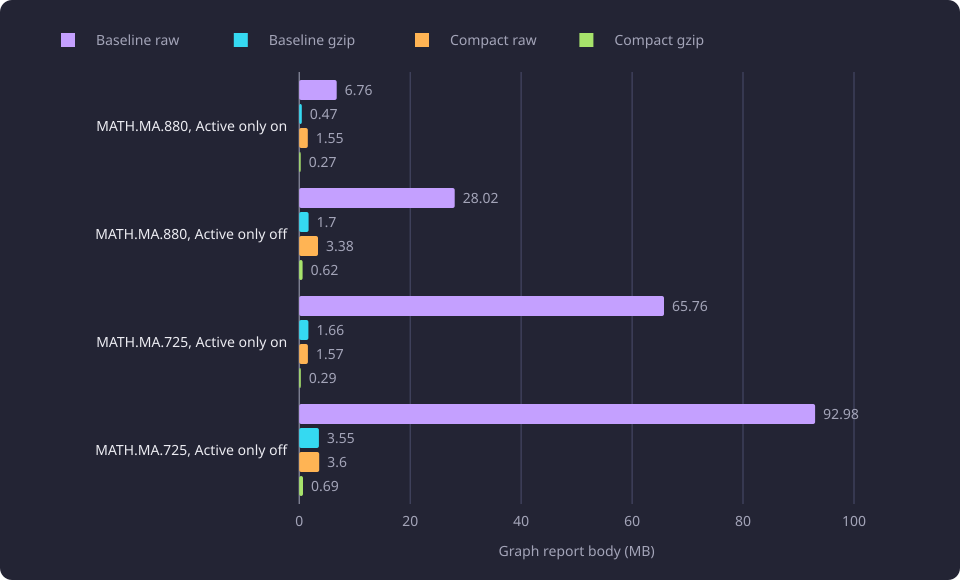
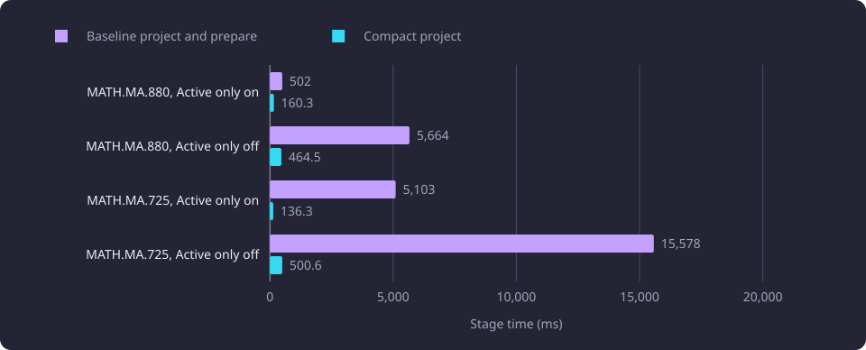

# Graph report payload and projection

This report measures the graph report body, its projection cost, its drawing allowance and its route parity against the earlier report.

**Evidence status:** Comparative. **Run dates:** 20 October 2026, against a baseline profile recorded on 19 October 2026.

## The question

One graph read returns one report body to the browser. The body carries a [solver structure](/docs/reference/glossary.md#prerequisites-and-routes), a drawing of [display pieces](/docs/reference/glossary.md#prerequisites-and-routes) and connections, the [support bindings](/docs/reference/glossary.md#prerequisites-and-routes) between them, and a [drawing allowance](/docs/reference/glossary.md#prerequisites-and-routes). The earlier report carried a full calculation tree beside a fully built drawing. On the largest measured target its body reached 92.98 MB, and a project-and-prepare stage took 15,578 ms before serialization. The measured two-structure report is called the compact report here.

The drawing limit did not reduce that work. Most large targets were refused by the 500-element limit, and the refused drawing was fully built, serialized and sent. The projector builds the drawing and its counts before the allowance decides. A refused row reports no display, and it keeps its solver structure, support bindings, projection contexts and members. The limit bounds what the browser may draw. It does not bound compilation, projection or solving.

The measurement asked four questions. How large is the compact body against the earlier body? What does its projection stage cost? What does the drawing limit allow and refuse? Does the report keep the earlier route result? The identity model that joins the two structures is a separate question, answered in [Compact graph identity](/docs/experiments/graph-and-route-algorithms/compact-graph-identity.md).

## Method and setup

The measured matrix is the folder's shared 110-case matrix: eleven courses, five toggle combinations and two bases. The courses, combinations, bases, dataset, server and limits are described in [Graph and route algorithm experiments](/docs/experiments/graph-and-route-algorithms/README.md#the-matrix-the-samples-and-what-they-share).

Each case resolved its target, compiled the solver structure, projected once with the configured 500-element limit, evaluated presentation states when the drawing was permitted, serialized the graph report, solved the route and serialized the route. Each case ran in its own process, one at a time, under a 120-second timeout and a 4.295 GB address-space cap. The matrix ran in process with no HTTP request, no catalogue scan and no concurrent heavy job.

The measured matrix applied the structural module rule. A structurally nested module contributes its cards and external obligations to one enclosing module box, and an independent member occurrence keeps its own closure.

The baseline values are the four largest bodies and their stages from the earlier graph profile. The full 20-row stage table is in [Cyclic graph compilation](/docs/experiments/graph-and-route-algorithms/cyclic-graph-compilation.md#initial-request-profile). That profile ran over HTTP with one repetition and an empty course state, and its request time includes response transfer. The compact stages are in process. The two are not an end-to-end comparison.

The compact body is a different schema from the baseline. It carries the solver structure, the drawing, the support bindings and the drawing allowance. The baseline carried the calculation tree and the full drawing. The comparison is whole body against whole body, not field by field.

The matrix recorded raw and gzip body sizes, stage timers, drawing elements against the limit, and the route outcome, credits and saved course set.

The diagram shows the two bodies one measured case produces. The accent marks the projection stage.

## Payload size

The four largest baseline bodies are compared with the compact bodies for the same course and activity settings, with the empty basis and Recommended and Inferred on.

| Course | Setting | Baseline raw (MB) | Baseline gzip (MB) | Compact raw (MB) | Compact gzip (MB) |
|---|---|---:|---:|---:|---:|
| MATH.MA.880 | Active only on | 6.76 | 0.47 | 1.55 | 0.27 |
| MATH.MA.880 | Active only off | 28.02 | 1.70 | 3.38 | 0.62 |
| MATH.MA.725 | Active only on | 65.76 | 1.66 | 1.57 | 0.29 |
| MATH.MA.725 | Active only off | 92.98 | 3.55 | 3.60 | 0.69 |

On MATH.MA.725 with Active only off, the body fell from 92.98 MB raw and 3.55 MB gzip to 3.60 MB raw and 0.69 MB gzip. On MATH.MA.880 with Active only off, it fell from 28.02 MB to 3.38 MB raw. The compact body is smaller in raw and gzip size in all four cases.

Across the measured matrix the graph body ranged from 1,766 bytes to 4.47 MB raw and from 690 bytes to 0.75 MB gzip. The largest body was YKT.SOA.303 with Recommended and Inferred on and Active only off. The route body ranged from 470 bytes to 78,411 bytes raw and from 268 bytes to 12,030 bytes gzip.

The gzip values are `gzip -9` of the serialized body. The earlier profile sent no compression, and no measured case delivered either body over a network.

The chart compares the baseline and compact bodies for the four cases.

## Projection cost

The measured projection stage is the time to build the drawing, the support bindings, the projection contexts, the members and the allowance from the solver structure. Across the measured matrix it ranged from 0.1 ms to 600.5 ms with a median of 12.4 ms. The maximum is YKT.SOA.303 with Recommended and Inferred on and Active only off.

| Course | Setting | Baseline project and prepare (ms) | Compact project (ms) |
|---|---|---:|---:|
| MATH.MA.880 | Active only on | 502 | 160.3 |
| MATH.MA.880 | Active only off | 5,664 | 464.5 |
| MATH.MA.725 | Active only on | 5,103 | 136.3 |
| MATH.MA.725 | Active only off | 15,578 | 500.6 |

The baseline column includes preparation and the compact column does not. The comparison is of server stages.

On MATH.MA.725 with Active only off, the baseline project-and-prepare stage was 15,578 ms and the compact project stage was 500.6 ms. On MATH.MA.880 with Active only off, 5,664 ms became 464.5 ms.

The chart compares the measured stage with the baseline stage for the four cases.

The measured projector was Python. The product's projector is native, and [Native prerequisite compilation](/docs/experiments/graph-and-route-algorithms/native-prerequisite-compilation.md) records its cost.

The compile stage ranged 33.6 to 4,739.9 ms with a median of 320.1 ms, and the solve stage ranged 0.1 to 6,829.2 ms with a median of 22.0 ms. The per-case total ranged 304.4 to 12,195.3 ms with a median of 638.1 ms. The stage timers do not sum to the per-case total. The sum of per-case totals is 234.6 s.

### The gate table

The measured projections carried a gate table. Each record names one condition or condition chain under which a connection the drawing does not emit applies. The table is keyed by the connection and its condition chain.

A gate record per hidden member is one measured design. A hidden member is a member occurrence that the drawing does not emit, and the same member can be reached through more than one enclosing module context. Recording each occurrence separately produced 38,523 gate records on YKT.SOA.303 with Recommended and Inferred on and Active only off, with 4,377 members and 5,679 elements. The same pass reached a 15,706.5 ms maximum project stage. The design did not scale, because the record count followed the occurrence paths through nested modules rather than the number of distinct conditions.

The applied table stored each distinct condition chain once and bounded repeated traversal contexts. The same target carried 2,845 gate records and 4,685 members, and the pass's maximum project stage was 593.5 ms. The projection in that pass reached a wider source closure, and the element count rose from 5,679 to 6,039.

The structural module rule produced a different drawing contract. The same target carried 5,913 elements. On YKT.SOA.303 with Recommended and Inferred on the applied table carried 4,147 gate records, and the pass's maximum project stage was 600.5 ms on the Active only off row. The three designs come from different measured passes, and the last two also use different combinations, so the counts are not one matrix.

| Design | Target | Gate records | Elements |
|---|---|---:|---:|
| Gate record per hidden member | YKT.SOA.303, `recommended+inferred-active-off` | 38,523 | 5,679 |
| Gates stored once by condition chain | YKT.SOA.303, `recommended+inferred-active-off` | 2,845 | 6,039 |

In the applied matrix, the largest table is 4,147 records on YKT.SOA.303 with Recommended and Inferred on. The same target with Active only off carries 3,348 records in both bases.

| Row | Gate records |
|---|---:|
| YKT.SOA.303, `recommended+inferred`, both bases | 4,147 |
| YKT.SOA.303, `recommended+inferred-active-off`, both bases | 3,348 |

The gate table belongs to the measured projection. The applied report carries no gate field, and [route lighting](/docs/backend/prerequisites/prerequisite-graph.md#route-lighting) reads the projection contexts.

## Drawing allowance

The drawing limit is `PREREQUISITE_GRAPH_MAX_ELEMENTS`, set to 500 elements. It counts every node plus every edge. The projector builds the display graph and its node and edge counts first, and the allowance compares those counts with the limit. The [prerequisite graph](/docs/backend/prerequisites/prerequisite-graph.md#the-drawing-limit) states the limit.

The measured matrix allowed 82 rows and refused 28. The 28 refusals are 14 course-and-combination pairs in both bases.

| Course | Combination | Drawing elements |
|---|---|---:|
| KAT.MARK.304 | `recommended+inferred-active-off` | 505 |
| KAT.MARK.310 | `recommended+inferred-active-off` | 545 |
| KAT.MARK.399 | `inferred` | 516 |
| KAT.MARK.399 | `recommended+inferred` | 685 |
| KAT.MARK.399 | `recommended+inferred-active-off` | 1,663 |
| MATH.MA.725 | `recommended` | 754 |
| MATH.MA.725 | `recommended+inferred` | 950 |
| MATH.MA.725 | `recommended+inferred-active-off` | 3,859 |
| MATH.MA.880 | `recommended` | 739 |
| MATH.MA.880 | `recommended+inferred` | 1,151 |
| MATH.MA.880 | `recommended+inferred-active-off` | 4,146 |
| PSY.324 | `recommended+inferred-active-off` | 1,544 |
| YKT.SOA.303 | `recommended+inferred` | 2,626 |
| YKT.SOA.303 | `recommended+inferred-active-off` | 5,913 |

A refused row sets `display` to null. It keeps its solver structure, every support binding with its `s:` support ID and its `course:` or `s:` node IDs, every projection context with its `c:` identity, owner, piece, ordered child context IDs and `m:` member IDs, every relationship member with its endpoints, the projection root context ID, its four counts and its located reasons. Only the display node and edge arrays are absent. The route result is available and separate. The drawing limit does not bound compilation, projection or solving.

KAT.MARK.399 with `recommended` projects 437 elements and fits the limit. YKT.SOA.303 with `recommended+inferred` projects 2,626 elements from 852 [calculation pieces](/docs/reference/glossary.md#prerequisites-and-routes) and is refused, because the independent member closure adds calculation pieces.

## Route parity

The route comparison records the outcome, total credits and saved course set. The baseline is the instrumented copy of the product exact search recorded in [Structural route deduplication](/docs/experiments/graph-and-route-algorithms/structural-route-deduplication.md). That search ran on its own compiled structures, with the same empty and fixed nonempty bases and the same 700,000 allocation limit. The measured matrix compiled its own structures with the module rule, so the comparison spans two builds and two compiled structures.

The measured matrix has 104 identical rows and six rows with a higher-credit Approximate route. No row differs in the Exact minimum route. The table gives both groups.

| Course | Combination | Bases | Baseline route | Measured route | Change | Rows |
|---|---|---|---|---|---:|
| MATH.MA.880 | `recommended` | empty, nonempty | Approximate, 194 cr | Approximate, 204 cr | 2 courses added | 2 |
| MATH.MA.880 | `recommended+inferred` | empty, nonempty | Approximate, 198 cr | Approximate, 203 cr | 1 course replaced by 2 | 2 |
| YKT.SOA.303 | `recommended+inferred` | empty, nonempty | Approximate, 55 cr | Approximate, 60 cr | 1 course added | 2 |
| All other rows | | | Same result kind and saved course set | Same | None | 104 |

Every measured route satisfies the compiled structure in its own case. Loading the baseline course set as the basis also satisfies each measured structure, so the extra courses are not additional obligations. Interpreted: the compact structure may have changed which valid route the bounded approximate search returned. The comparison does not establish that cause, because the baseline and the measured matrix used different builds and compiled structures, and the greedy ordering was not isolated.

The Approximate route outcome carries no minimum guarantee. No Approximate route became an Exact minimum route. The six rows are valid higher-credit approximate routes, not equal-cost alternatives and not optimality evidence.

The 204 credits on the MATH.MA.880 `recommended` row is a separate measurement from the 204.00 credits of the MATH.MA.880 active-only result in [Minimum-credit routes](/docs/experiments/graph-and-route-algorithms/minimum-credit-routes.md). The two runs used different builds and measurement cohorts. Both belong to the eleven-course, five-combination, two-basis family, but the seven-case acceptance and the 110-case matrix are different samples. An Approximate route carries no minimum guarantee, so the equal total does not confirm either result. The comparison also does not establish that the measured build or compiled structure matches the seven-case acceptance in Minimum-credit routes.

## Interpretation

Observed: the compact body is smaller than the baseline in the four large cases, and the measured project stage is below the baseline project-and-prepare stage on the same four, as a server-stage comparison. The measured matrix allowed 82 drawings and refused 28, and 104 rows kept the baseline route result.

Failed design: a gate record per hidden member produced 38,523 records and a 15,706.5 ms maximum project stage on YKT.SOA.303 with Active only off, and the record count followed occurrence paths through nested modules rather than distinct conditions.

Observed: the route comparison spans two builds and two compiled structures.

The measured evidence does not establish an end-to-end latency gain, a network delivery gain or a browser rendering gain. The baseline profile included HTTP and response transfer, and the measured matrix did not.

## Limitations

- The matrix is in process. It measures compilation, projection, presentation states, serialization and solving, not HTTP transfer, browser parsing or rendering.
- The baseline profile ran over HTTP and included response transfer. The compact stages did not. The two are not an end-to-end comparison.
- The compact body is a different schema from the baseline. The comparison is whole body against whole body, not field by field.
- The compact matrix applied the structural module rule. The body and stage comparison therefore measures the compact report with that rule, not the two-structure report alone.
- The gzip values are `gzip -9` of the serialized body. The earlier profile sent no compression, and no measured case delivered a compressed response to a browser.
- The baseline has no unexpandable content field, so no parity of the new unexpandable content is claimed.
- The route baseline is a different build with a different compiled structure. The six differences cannot be attributed to the compact build, the compact structure or the greedy ordering.
- The six differing rows are higher-credit Approximate routes. They are valid routes, not equal-cost alternatives and not optimality evidence.
- The drawing is refused for 28 rows. Their display node and edge arrays are absent, and their solver structures, bindings, contexts, members and counts are retained.
- The measured projector was Python. The product's projector is native, and its cost is recorded in [Native prerequisite compilation](/docs/experiments/graph-and-route-algorithms/native-prerequisite-compilation.md). The measured stage does not transfer to the native projector.

## Open questions

- Whether the six higher-credit approximate routes persist on another catalogue, another basis or another module drawing. Untested.
- Whether the smaller compressed body produces an end-to-end gain in a browser, including transfer, parse and render. Untested.
- Whether a baseline report measured under the same structural module rule changes the body and stage comparison. Untested.
- Whether the native projector keeps the measured body sizes and the measured relation between the projection and baseline stages. Untested.
- Whether the interned gate table stays bounded on a structure with deeper nested modules. Untested.
- Whether the 82 allowed and 28 refused rows hold on another dataset or another drawing limit. Untested.
