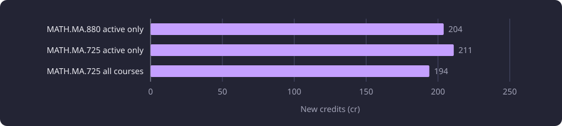
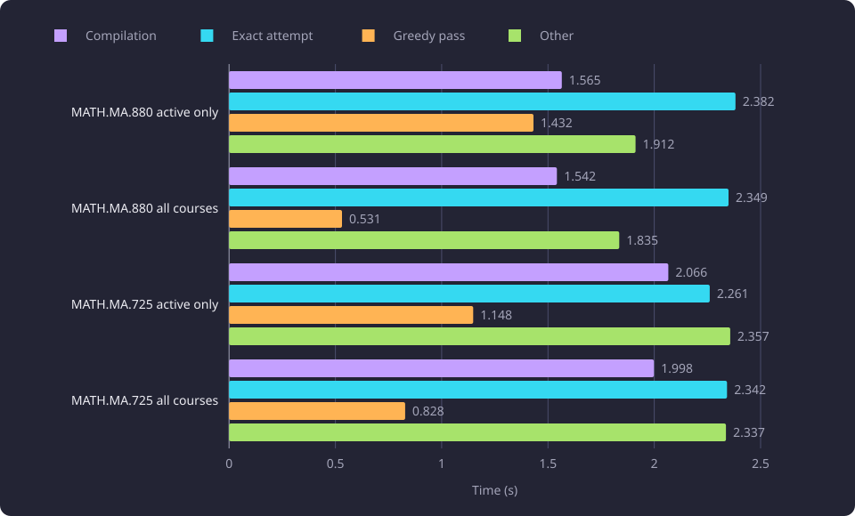

# Minimum-credit routes

This report records what the bounded minimum-credit route calculation returns, how its size limit and greedy restart behave, and whether ordinary route output changed.

**Evidence status:** Corrected. **Run dates:** 9 to 10 October 2026.

The standing result is a bounded exact search with one greedy restart at 700,000 compact nodes. The three approximate routes charge 204.00, 211.00 and 194.00 new credits, one all-courses case returns a marked `search_too_large` failure, the four ordinary route reports preserved their course, module and credit fields, two of them byte-identical to baselines captured before the change, and no unresolved-rate effect is established.

The [Experiments section](/docs/experiments/README.md) states the catalogue and the evidence labels. The [glossary](/docs/reference/glossary.md) defines new credits, route outcome and allocation limit. The [Minimum route](/docs/backend/prerequisites/minimum-route.md) page states every outcome, what a route charges and the preference order. The [Minimum route solver](/docs/backend/prerequisites/minimum-route-solver.md) page describes the calculation as it is built. The route solver the product runs is TypeScript, in `web/src/solver/route.ts`, and the measurements below ran on the Python implementation that served routes at the time.

## The question

A route calculation answers which courses meet a course's prerequisites with the fewest new credits. The calculation minimizes new credits, so two cheap courses can cost less than one expensive course. Every answer must also be explainable: which courses it charges, which requirements are unresolved, which course or node mark blocked a branch, and whether the answer is a proven minimum, an approximation or a refusal.

Four questions shaped the work:

1. Could the exact calculation be trusted on the captured catalogue, including where it must refuse to answer?
2. What happens when an exact attempt grows too large to finish, and what may the calculation claim then?
3. Does the size limit leave an ordinary route's output the same?
4. Did the unresolved rate of the calculation improve?

Two failure modes motivated the second question. An exact search that never finishes returns nothing, and an approximation that presents itself as a minimum is wrong. The work therefore separated three things that one timeout hides: the size of the exact search, the external wall clock of the command, and the outcome the calculation returns.

The comparison of the TypeScript route solver with the Python calculation that then existed is reported in [Route solver parity](/docs/experiments/graph-and-route-algorithms/route-solver-parity.md).

## What the calculation minimizes

A route costs the credits of every course it needs that the basis does not cover, each course counted once. The calculation minimizes that total. A course in the basis costs nothing, and the route does not expand that course's own prerequisites, so a basis course removes its requirement subtree from the calculation. A course that several branches need is charged once, and a distinct block of unexpandable content is charged its minimum credit once.

An exact candidate keeps two course sets apart. The witnesses are the courses that an enclosing credit or course-count requirement measures. The new-course closure is the complete set of not-basis courses the branch requires, and it is the only course cost set. A course can be a witness without being in the closure, and a shared course enters the closure once.

The logical and numeric rules are solved over those sets together, not branch by branch. An AND group needs every member, an OR group needs one, a cardinality node selects between its bounds, and a credit or course-count node measures its witnesses inside an inclusive bound. Expanded-course prerequisites and directional substitutions take part in the same global search. An unknown credit or count becomes a located unresolved problem instead of removing the known alternatives. A course cycle never becomes a takeable exact leaf, because a cycle is reported as a blocker rather than as a free course.

Two rules about unresolved structure follow from that. A known zero-cost candidate is exact even when an unresolved alternative went unused, because the known route already costs nothing. A positive known cost is unresolved when unknown structure could be cheaper. Incomplete inference coverage does not itself prevent an exact result for the published expression.

## The exact calculation

The calculation is one pure optimizer over the compiled requirement tree. It takes the caller's canonical completion set and no visibility, repository, configuration or persistence input. It returns selected-course occurrence evidence, the satisfaction evaluation, copied inferred coverage and one of the exact attempt's three outcomes: exact, unresolved or no solution. It also supports an active-only shortfall, carrying the maximum achievable under the activity scope and each deficient module rule. An unresolved or no-solution result carries no course list or credit total.

## The size limit and the restart

The exact attempt is bounded by an allocation size, not by elapsed time. The check counts the compact nodes, the interned family nodes and provenance trace nodes the exact attempt builds, and raises when that count first exceeds `PREREQUISITE_PATH_MAX_COMPACT_NODES`. The calculation then abandons the exact attempt once and runs a single greedy pass with no allocation cap.

The greedy pass builds one valid route from the ranking it can see. Its route satisfies the source rules but is not a global minimum, and an activity shortfall it reports lists actual witnesses rather than a proved maximum. When no valid route is found, the result is `approximation_failed`, with no route, no total, and one root problem whose reason is `search_too_large`. That reason is an application size limit, not a wall-clock event. The app presents an approximate result as **Approximate route**. A failed restart presents the message **The exact search was too large and the approximation gave up.** and the tag **timeout**.

```text
exact_attempt(structure, maxCompactNodes):
  count compact nodes and provenance traces while the exact PATH fold builds them
  abort once when the count first exceeds maxCompactNodes
  return the exact outcome

solve(structure):
  if the requirements are already satisfied or the root is excluded: return that outcome
  try exact_attempt(structure, PREREQUISITE_PATH_MAX_COMPACT_NODES)
  on the size-limit abort:
    run one scalar greedy pass with no allocation cap and no elapsed-time limit of its own
    if the greedy route is valid: return approximate route
    return approximation_failed with root problem reason search_too_large
```

The limit was calibrated by counting the compact nodes and traces allocated during the exact attempt, starting the clock when the exact attempt begins and giving the exact attempt a high temporary ceiling. Each command was capped externally at 10 seconds.

| Input | Flags | Sampled compact count | Solver seconds | Outcome under the cap |
|---|---|---|---:|---|
| MATH.MA.880 | recommended | 790,000 | 3.043 | unfinished at the cap |
| MATH.MA.880 | recommended, active only | 800,000 | 3.089 | unfinished at the cap |
| MATH.MA.725 | recommended | 320,000 | 1.338 | unfinished at the cap |
| MATH.MA.725 | recommended, active only | 140,000 | 0.632 | unfinished at the cap |
| KAT.MARK.310 | recommended, active only | under 20,000 | 0.134 | shortfall, total 0 |
| KAT.MARK.304 | recommended, active only | under 20,000 | 0.136 | shortfall, total 0 |
| KAT.MARK.399 | recommended, active only | about 60,000 | 1.533 | exact, total 180.00 |

A guarded profile of the largest structure reached 700,000 compact nodes and traces at 2.672 seconds, and the calibration sampled 700,000 at 2.8841 seconds and 740,000 at 3.0379 seconds. The selected value is 700000 for `PREREQUISITE_PATH_MAX_COMPACT_NODES`, so the trigger sits near three solver seconds. The instrumentation sampled every 10,000 entries and added small overhead, so the calibration is approximate.

## The seven cases

Seven cases ran with recommended prerequisites on, inferred prerequisites off, an empty basis, and no exclusion or node mark. Each command ran under a 10-second external cap that covered process start, the database read, compilation, the calculation and serialization. The table gives the standing result.

| Case | Outcome | New credits | Compilation (s) | Exact attempt (s) | Greedy pass (s) | Other (s) | Total (s) |
|---|---|---|---:|---:|---:|---:|---:|
| MATH.MA.880 active only | approximate | 204.00 | 1.565 | 2.382 | 1.432 | 1.912 | 7.291 |
| MATH.MA.880 all courses | `approximation_failed` (`search_too_large`) | none | 1.542 | 2.349 | 0.531 | 1.835 | 6.256 |
| MATH.MA.725 active only | approximate | 211.00 | 2.066 | 2.261 | 1.148 | 2.357 | 7.832 |
| MATH.MA.725 all courses | approximate | 194.00 | 1.998 | 2.342 | 0.828 | 2.337 | 7.505 |
| KAT.MARK.310 active only | shortfall | 0.00 | 0.289 | 0.069 | 0.000 | 0.531 | 0.889 |
| KAT.MARK.304 active only | shortfall | 0.00 | 0.301 | 0.068 | 0.000 | 0.527 | 0.896 |
| KAT.MARK.399 active only | exact | 180.00 | 0.746 | 0.559 | 0.000 | 0.773 | 2.078 |

Three cases return an approximate route. MATH.MA.880 all courses returns `approximation_failed` with no route and no total, and that is a marked failure returned under the cap rather than a latency miss. The two KAT shortfalls follow the activity-only semantics: the module rule is below its bound because only active courses are allowed. KAT.MARK.399 returns an exact route.

The three approximate routes charge the new credits below.



### Where the time goes

A whole-command time combines request compilation, the exact attempt, the greedy pass and the rest of the service time. The component timings wrapped those calls separately, so the components do not overlap, and each command's JSON output was byte-identical to the result the service returned.

The four mathematics commands divide their time as follows.



Compilation takes 1.542 to 2.066 seconds across the four mathematics cases, the exact attempt 2.261 to 2.382 seconds, and the greedy pass 0.531 to 1.432 seconds. An unprofiled compilation of the MATH.MA.880 all-courses structure took 1.541 seconds. A profiled attribution of the same kind of compilation took 6.883 seconds, of which 239 scoped course reads took 4.665 seconds. The profiled figure is an attribution, not normal elapsed time, and the two are not compared.

## Ordinary route output

The ordinary comparison asked whether the added report fields and the size limit change a normal route. Four ordinary cases appear in the evidence, and they divide into two pairs.

COMP.CS.110 and COMP.CS.200 kept their course, module and credit fields. Both were exact with one new course and 5.00 credits each, and their root, course nodes, module nodes and selected course and credit result were identical. The reports gained empty fields, and the drawing added availability locations for hidden inactive prerequisites, so connector nodes rose from two to 15 for COMP.CS.110 and from one to nine for COMP.CS.200. The empty fields and the availability locations are additions, and no course or credit changed.

COMP.CS.500 and KIE.SUY.420 were byte-identical to baselines captured before the change. The baselines and the reports ran with all courses, recommended prerequisites on, inferred prerequisites off and an empty basis. COMP.CS.500 returned 14 credits and three courses, and KIE.SUY.420 returned 35.00 credits and seven courses. Under active only, a capped report and an uncapped exact run of the same checkout were byte-identical. COMP.CS.500 returned 20.00 credits and KIE.SUY.420 returned 35.00 credits.

Only those two comparisons with baselines captured before the change were byte-identical. COMP.CS.110 and COMP.CS.200 are not byte-identical reports, because the empty fields and the availability locations are additions.

## The unresolved-rate samples

The unresolved rate is the share of sampled courses whose calculation ends `unresolved`. Two 200-course samples measured it, and they do not measure one population.

| Sample | Population | Size | Cap | Outcomes | Unresolved share |
|---|---|---|---|---|---|
| Option-bearing sample | active courses with a nonempty official prerequisite option, drawn with a fixed seed | 200 | 20 s per route | 163 exact, 5 no solution, 28 unresolved, 4 timeouts | 28 of 196, 14.29% |
| All-active sample | active courses in a deterministic order derived from each identity | 200 | 10 s per whole command | 192 exact, 4 no solution, 3 unresolved, 1 timeout | 3 of 200, 1.5% |

The conservative reading of the option-bearing sample counts the four timeouts with the unresolved cases and gives 32 of 200, or 16%. The conservative reading of the all-active sample gives four of 200, or 2.0%.

An effect-size claim from 14.29% to 1.5% does not stand. The samples differ in population, draw method, denominator and cap, and no course is followed from one sample to the other. Each rate describes its own sample and cap.

### The source-bearing subset

The all-active sample has 43 courses whose representative version carries at least one official prerequisite option. Those are the courses whose result can be traced to an official prerequisite of their own rather than to an empty requirement set.

| Metric | Count |
|---|---:|
| Sampled | 200 |
| Not represented | 0 |
| With an official prerequisite option | 43 |
| Attempted | 43 |
| Completed | 42 |
| Exact, no solution and unresolved among the completed | 35, 4 and 3 |
| Timed out at the 10 s cap | 1 (MATH.MA.721) |
| Errors and unattempted | 0 and 0 |

The shares are three of 42, or 7.14%, three of 43, or 6.98%, and four of 43, or 9.30% when the timeout joins the unresolved cases. These describe the build that was sampled and are not compared with the corrected calculation for effect size.

### The three unresolved cases

The all-active sample left KIE.SUY.420, PSY.324 and YKT.SOA.303 unresolved. On the corrected calculation, KIE.SUY.420 returns an exact route at 35.00 credits with seven courses and no unexpandable charge, and YKT.SOA.303 returns an exact route at 45.00 credits with nine courses. PSY.324 exceeded the 10-second cap and has no route to report.

The seven-course KIE.SUY.420 route follows the tie order: after equal new credits, the sorted new unexpandable-content identities decide, and the empty tuple of the seven-course route wins. The 35-credit block is in the graph with its source classification, and no course is invented for it. YKT.SOA.303 draws two occurrences of a 25-credit module with no expandable members and one 20-credit nested constraint as obligations, and the chosen route charges neither.

These are the three outcomes of the all-active sample, measured individually rather than resampled, so they give no corrected rate for the 200 courses.

## Failed approaches

### A whole-command time limit measured compilation

An acceptance assertion required each route command to finish inside 10 seconds, with that time read as routing cost. The calculation itself was cheap on the selected dataset. It returned an unresolved result with no courses and no total for one target, its solver work measured 0.38 to 0.48 seconds, and two other targets solved exactly below 0.01 seconds. The bulk compiler reads that ran before the calculation consumed roughly 10 to 15 seconds. The assertion therefore measured compilation, not routing, and it could pass or fail on compilation alone.

A bounded diagnostic divided MATH.MA.880 active only into 5.5 seconds of compilation and 59.0 seconds of exact PATH search, and the search returned an exact route. The 30-second cap was reached inside the exact PATH fold, not during compilation. The two component times exceed 30 seconds, so the diagnostic did not establish that the complete command fits a 30-second command budget, and no whole-command time is inferred from it. A profiled run that forced only the approximate pass spent 7.136 seconds compiling under profiler overhead and was filtering inside the greedy pass at the cap.

The lesson is that a wall-clock limit on the whole command cannot attribute time to the route calculation. Stage timers can, and the exact search can exceed a short command budget on its own.

### The size-bounded restart left four commands over the cap

The size limit was expected to bring every measured command under a 10-second whole-command cap: bound the exact attempt at 700,000 compact nodes and run one greedy pass. Seven cases ran under that setting, and the four mathematics commands produced no complete report. They were stopped at 10.005 to 10.012 seconds. The three KAT commands completed: two shortfalls at zero credits in 2.326 and 2.386 seconds, and an exact route at 180.00 credits in 5.081 seconds.

The limit bounds the exact attempt only. Compilation, the greedy pass and the rest of the command sit outside it, so a bounded search does not bound the command. A bounded stage diagnostic measured MATH.MA.880 tree compilation at about 5.8 seconds on that build, before the exact attempt ran. The four rows are latency misses, not approximation failures, and the size trigger and the `search_too_large` failure contract were not changed. The standing results above come from a build whose compilation took 1.542 to 2.066 seconds for the four mathematics cases.

## Interpretation

The contract is bounded by allocation size, not by elapsed time. A calculation past the limit returns an approximate route that satisfies the source rules, or a marked failure, and it never presents an approximation as a minimum. The bounded attempt and the greedy pass together leave the whole-command time dependent on compilation and on the structure.

The approximate totals are what one greedy pass built from its ranking. They are not minima, and their values are not a measure of approximation quality against an exact route, because no exact route was computed for those three cases.

The marked all-courses failure shows that a size-triggered restart can find no valid route for a structure that compiles. It is a returned outcome with no route and no total, not a timeout.

## Limitations

The shared dataset and repetition limits are described in [Graph and route algorithm experiments](/docs/experiments/graph-and-route-algorithms/README.md). The external cap is a measurement limit, so a capped row proves only that the command did not finish in time.

The allocation trigger bounds search size, not compilation time or total command time. The approximate totals are not minima, and the greedy pass has no allocation cap of its own.

The unresolved-rate samples are small and unpaired, and their shares carry no reported interval. The three unresolved cases were measured individually, so they give no corrected rate for the 200-course sample.

## Baselines

A follow-up compares against the seven cases with recommended prerequisites on, inferred prerequisites off, an empty basis, no exclusion or node mark, `PREREQUISITE_PATH_MAX_COMPACT_NODES` at 700000 and a 10-second whole-command cap. The three approximate totals are 204.00, 211.00 and 194.00 credits, and MATH.MA.880 all courses is the marked `search_too_large` failure. The four ordinary results are COMP.CS.110 and COMP.CS.200 at 5.00 credits each, COMP.CS.500 at 14 credits and three courses, and KIE.SUY.420 at 35.00 credits and seven courses. The two unresolved shares are 28 of 196 (14.29%) and three of 200 (1.5%), each for its own sample.

## Setup

The dataset, the eleven-course matrix and the common cohort and basis rules are shared with the other reports in this folder and are described in [Graph and route algorithm experiments](/docs/experiments/graph-and-route-algorithms/README.md). The seven-case flags, basis and cap are stated under [The seven cases](#the-seven-cases). The whole-command times cover process startup, the database read, the request compilation, the calculation and serialization, and the component times wrapped the compilation, the exact attempt and the greedy pass separately.

## Untested questions

Each question below is untested.

1. Whether a course-count objective, or a course-count tie after credits, would select materially different requirement sets from the credit objective. The experiments measured credits only.
2. Whether a lower or higher `PREREQUISITE_PATH_MAX_COMPACT_NODES` would keep the same ordinary output while moving more large structures from a capped miss to an approximate route. Only 700,000 was measured for acceptance.
3. How far the three approximate totals sit from an exact minimum for the same structures. No exact route was computed for them.
