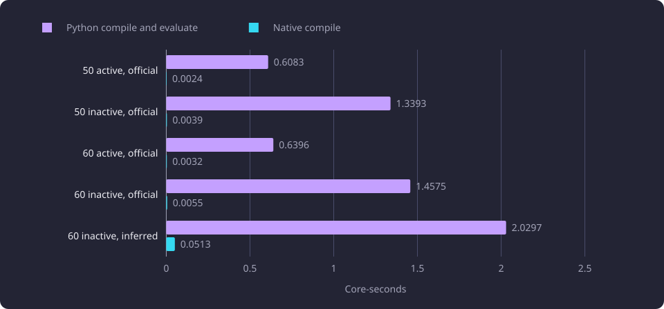
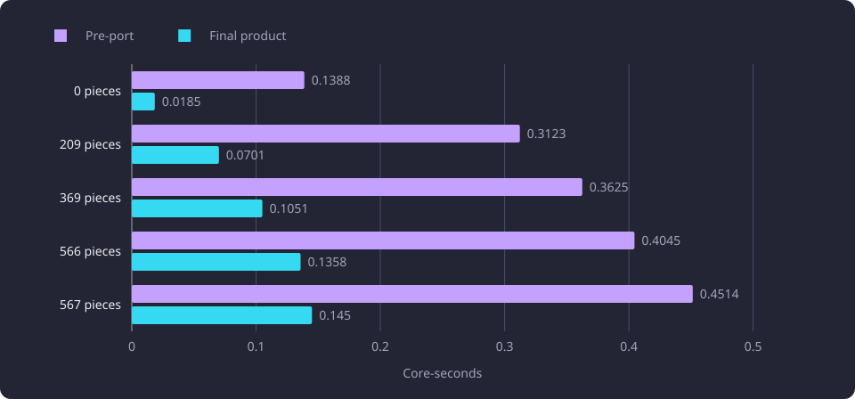

# Native prerequisite compilation and identity

This report measures five native prerequisite stages against the Python implementations they replaced.

**Evidence status:** Comparative. **Run dates:** 28 to 31 October 2026.

## The question

The prerequisite compiler turns a course's official and inferred requirements into one [solver structure](/docs/reference/glossary.md#prerequisites-and-routes). The graph response carries the [calculation pieces](/docs/reference/glossary.md#prerequisites-and-routes), their [support bindings](/docs/reference/glossary.md#prerequisites-and-routes), the drawn boxes and the [drawing allowance](/docs/reference/glossary.md#prerequisites-and-routes). A [node mark](/docs/reference/glossary.md#prerequisites-and-routes) names one display piece, and the browser holds calculation and display identities while a tab is open. A faster implementation therefore had to return the same strings, the same provenance, the same ordering, the same coverage values and the same drawing bytes.

[Compact graph identity](/docs/experiments/graph-and-route-algorithms/compact-graph-identity.md) established the two-identity model this port re-proved. An ordered calculation identity and an order-independent display identity are separate, and explicit support bindings join them. The question here is whether each stage of that model can move into C++ without changing a byte, and what each move costs.

Five stages moved. A native compiler builds the calculation graph. A native fact loader reads its input from PostgreSQL. The native library then owns the calculation identities, the drawing projection and the record view that Python reads. Python keeps the DTO boundary.

A second question asked whether a drawing that the 500-element allowance refuses can skip the projection work it never sends.

## Method and setup

The measurements ran on a disposable copy of the selected dataset, restored once into a disposable database from a 0.91 GB dump. The dataset holds 11,086 courses, 58,962 teaching-text chunks, 8,996 centroids and 4,709,120 stored neighbour rows. The server is an aarch64 Neoverse N1 machine with four logical cores and 24.1 GB of RAM. PostgreSQL is 18.6 with pgvector 0.8.6.

An endpoint total is the process core-seconds of the application call plus the database container's cgroup delta. A stage value is inclusive process core-seconds inside that call, or an inner timer where the table says milliseconds. Every row is the median of three samples unless a table says otherwise, and every process ran with one BLAS thread. The two checkouts of a pair received the same request bodies, the same database and the same harness. The next-course report cache was cleared before every measured miss, and the supervisor's lookup projection was preloaded. The [runtime, storage and serving experiments](/docs/experiments/runtime-storage-and-serving/README.md) state the shared serving measurement method.

Two fact inputs were measured. The compiler comparison read a recorded fact bundle per compilation, between 0.37 and 0.60 MB. The loader comparison read the same kind of facts from PostgreSQL through the native loader, 97 queries and 38,109 to 39,852 rows per scenario.

The prototype is a separate experiment implementation, applied in the same process, route, database and harness as the product. Its compiler omitted the product's source-component index, its cycle-closing filter, its mandatory expansion pruning, its provenance facts and diagnostics, and its emitted structure bundle. The stage comparison therefore classifies each difference instead of treating the prototype as a target.

The runs used one disposable dataset on one host. The [graph and route experiments overview](/docs/experiments/graph-and-route-algorithms/README.md#what-the-line-does-not-establish) states the limits the reports share, and these runs cover no browser render and no x86 host.

## The native boundary in the product

The prerequisite library `libcourse_prerequisite.so` at format version 5 compiles the graph, hashes the calculation and display identities with SHA-256 over canonical JSON, projects the drawing and freezes the record view. The record view is the frozen C record array that the library exposes and Python materializes into DTOs. A missing or mismatched library raises one `ValueError` that names the build command. [Native libraries](/docs/architecture/native-libraries.md) lists the units and the build, and [Prerequisite compiler](/docs/backend/prerequisites/prerequisite-compiler.md#compiler-and-fact-loader) states what each unit does.

Python loads the library, materializes the frozen DTOs and computes the drawing allowance from the native counts. One worker keeps one native fact handle, so a repeated request on the same database reads no prerequisite fact. The native code is therefore the authority for the compiler, the calculation identities, the projection and the record view, and Python holds one implementation of the DTO boundary.

The diagram shows the native units in sequence and the Python boundary that receives the frozen record view.

## The native compiler against the Python replay

The first comparison replayed the same recorded facts through the product Python compiler and through the native compiler. The capture proved that the replay and the database-backed run returned identical outcomes and fingerprints, so the replay is a valid reference for the native side.

| Scenario | Candidates | Pieces | Python compile and evaluate | Native compile | Native evaluate | Database read | Read and decode |
|---|---:|---:|---:|---:|---:|---:|---:|
| 50 active, official | 61 | 2,646 | 0.6083 | 0.0024 | 0.0005 | 0.247 | 0.415 |
| 50 inactive, official | 79 | not recorded | 1.3393 | 0.0039 | 0.0007 | 0.255 | 0.544 |
| 60 active, official | 78 | 2,952 | 0.6396 | 0.0032 | 0.0005 | 0.252 | 0.446 |
| 60 inactive, official | 107 | 6,626 | 1.4575 | 0.0055 | 0.0005 | 0.257 | 0.546 |
| 60 inactive, inferred | 173 | not recorded | 2.0297 | 0.0513 | 0.0060 | 0.374 | 0.883 |

Every value in the last five columns is core-seconds.

On the four official scenarios the native compile cost 0.0024 to 0.0055 core-seconds against 0.6083 to 1.4575 for the Python compile and evaluation. The inferred scenario cost 0.0513 against 2.0297. Every candidate had an identical outcome presence, required coverage, recommended coverage and piece fingerprint. All five scenarios reported zero outcome mismatches, zero fingerprint mismatches and a maximum coverage delta of 0.0. The inferred scenario had 39 eligible candidates and 28 whose eligibility depends on an inferred contribution, and the native set matched the product set exactly.

In this comparison the native side performed no JSON serialization, SHA-256 identity interning or diagnostic traversal. Part of the measured reduction is that bookkeeping, so this comparison bounds the calculation core and not the endpoint.

The Python compile and evaluation is plotted against the native compile for the five scenarios.

Full-ancestor compilation used five real targets with `direct_only=false`. The targets hold 0, 567, 566, 369 and 209 pieces. The Python compiler and its satisfaction evaluation cost 0.0858 core-seconds for the set, and the native compiler and evaluator cost 0.0084. Every structural fingerprint and every satisfaction state matched. The zero-piece target's root has no requirement use, which both sides represent as a null fingerprint.

## The database fact loader

The native loader links libpq and builds the compiler's fact bundle directly from PostgreSQL rows. A fact bundle is the compiler's in-memory facts for one compilation. The loader reads courses, versions, periods, the representative selection, prerequisite and substitution options, modules, versions, rule trees, inferred sets and equivalence groups. The closure follows option course members, module references and substitution members to a fixed point. The compile and evaluate functions are shared with the recorded-bundle path, so the arithmetic is identical.

| Scenario | Candidates | Client load and compile | Database | Evaluate | Wall time | Queries | Rows | Mismatches |
|---|---:|---:|---:|---:|---:|---:|---:|---:|
| 50 active, official | 61 | 0.142 | 0.550 | 0.011 | 0.677 | 97 | 38,109 | 0 |
| 50 inactive, official | 79 | 0.149 | 0.557 | 0.028 | 0.697 | 97 | 38,383 | 0 |
| 60 active, official | 78 | 0.147 | 0.559 | 0.011 | 0.689 | 97 | 38,816 | 0 |
| 60 inactive, official | 107 | 0.155 | 0.557 | 0.030 | 0.698 | 97 | 39,127 | 0 |
| 60 inactive, inferred | 173 | 0.163 | 0.559 | 0.039 | 0.709 | 97 | 39,852 | 0 |

A fresh loader had an empty fact cache and one handle per sample. Client, database and evaluate values are core-seconds, and wall time is seconds.

The loader reads a superset of the facts the earlier Python recorder saw, 3,796 courses and 568 modules for the 50 active case, because it also loads inferred and equivalence facts for every closure course. A fresh load is therefore slower than the product's scoped SQL read. After the first request the per-worker fact cache answers with zero queries. The composed endpoint calls recorded 0.017 to 0.021 core-seconds for load and compile, and 0.011 to 0.020 for evaluation.

With full-ancestor compilation the same loader matched every structure fingerprint and every satisfaction state for the five targets. A fresh load cost 0.108 client and 0.496 database core-seconds. A warm cached compile of all five cost 0.0112 core-seconds, the evaluation cost 0.0037, and the load issued no query.

## The next-course endpoint

The next-course report compiles each candidate's direct options into a narrow summary. The complete endpoint was measured through the real application with the report cache cleared before each sample, median of three.

| Request | Product total | Composed total | Product client | Composed client | Product database | Composed database | Ratio |
|---|---:|---:|---:|---:|---:|---:|---:|
| 50 official | 0.721 | 0.172 | 0.605 | 0.049 | 0.117 | 0.123 | 4.2 times fewer |
| 60 official | 0.847 | 0.175 | 0.726 | 0.052 | 0.119 | 0.123 | 4.8 times fewer |
| 50 inferred | 1.715 | 0.263 | 1.452 | 0.081 | 0.261 | 0.183 | 6.5 times fewer |
| 60 inferred | 1.822 | 0.277 | 1.545 | 0.087 | 0.275 | 0.190 | 6.6 times fewer |

All values are core-seconds. The composed responses are byte-identical to the product responses for all four requests and all three samples.

The product then ran the measured loader and compiler behind the same endpoint. The matched pair compares the pre-port checkout and the ported product on the same request bodies, database and provider.

| Request | Before | Final | Ratio |
|---|---:|---:|---:|
| Next 50 official, miss | 0.7187 | 0.2015 | 3.57 times fewer |
| Next 50 inferred, miss | 1.6973 | 0.3231 | 5.25 times fewer |
| Next 60 official, miss | 0.8578 | 0.2106 | 4.07 times fewer |
| Next 60 inferred, miss | 1.9179 | 0.3410 | 5.62 times fewer |

The final matrix over the 500-course workload pool is a separate cohort, and it records the same direction. Next-50 active reads 0.4987 core-seconds before and 0.1509 after, and next-60 inactive reads 1.5728 before and 0.2090 after. Each is a mean of three distinct report misses.

## Calculation identities, projection and record view

The three ports were measured as one migration. The projection needs the identities, and the record view has no separate producer once the identities move.

| Target | Before | After | Change | After range |
|---|---:|---:|---:|---|
| 0 pieces | 0.0181 | 0.0194 | +6.8% | 0.0187 to 0.0245 |
| 567 pieces | 0.3438 | 0.2327 | -32.3% | 0.1993 to 0.2627 |
| 566 pieces | 0.2937 | 0.1814 | -38.2% | 0.1778 to 0.1817 |
| 369 pieces | 0.2215 | 0.1351 | -39.0% | 0.1345 to 0.1357 |
| 209 pieces | 0.1475 | 0.0885 | -40.0% | 0.0882 to 0.1587 |

Values are drawing endpoint core-seconds, median of three samples. The change column is the paired difference. The zero-piece change of 6.8 percent is the recorded change from the unrounded medians. The printed 0.0181 and 0.0194 core-seconds would imply about 7.2 percent.

Four non-empty targets fall 32.3 to 40.0 percent. The zero-piece target rises 6.8 percent, an increase of 1.3 ms, and its printed values are 0.0181 and 0.0194 core-seconds. The next-course totals stayed at the pre-port level within their spread, with changes of -1.2, +0.4, -0.6 and +0.3 percent for 50 official, 50 inferred, 60 official and 60 inferred.

Two targets were split into stages, in milliseconds.

| Target | Old C compile and write | New C compile, identify, project and view | Old decode | New materialize | Old Python project |
|---|---:|---:|---:|---:|---:|
| 567 pieces | 118.5 | 71.0 | 104.2 | 94.3 | 140.2 |
| 209 pieces | 54.5 | 21.3 | 47.3 | 27.7 | 57.8 |

The Python projector's 140.2 ms and 57.8 ms stages disappear. The new C figure includes the identity, projection and record-view build and still falls from 118.5 to 71.0 ms on the 567-piece target. The Python decode fell 9.9 ms, and the new materializer adds about 3 ms on the same target.

The calculation identities are native canonical JSON and SHA-256, and they produce the same 24-hex strings on every saved target. The Python interner and its digest path were removed. An isolated identity share cannot be separated from the record-view share, because the C side also loses the byte writer, and it is not claimed as a separate endpoint gain. The native identity is kept because it is the one identity authority and the input the native projector reads.

The full drawing projection is materially better. Display, binding, context and member identities moved with it, and Python holds no second scheme or fallback. The record view replaces the bundle decoder, so the byte writer and the byte reader were removed. The narrow next-course view materializes the same root, year and course summary, and its endpoint stays inside the run spread.

## Byte parity

The port stands on byte equality, not on tolerance. Each item below compares the pre-port and ported outputs on the same request bodies.

- The five drawing targets produce identical `solver`, `display` and `drawing` JSON. The comparison covers every piece, use, fact, diagnostic, support-binding, projection-context, relationship-member, display-node and display-edge identity, every provenance field and every ordered field.
- The nine saved drawing and next-course response bodies have the same digest before and after the port.
- The eight `active_only=false` next-course bodies match the pre-port and earlier captures, so inactive exclusions are unchanged.
- The eight recommendation cases match with the same identities, order, meters and derived flag, with a maximum delta of 0.0.
- Regenerating the saved solver fixture from the native records produces byte-identical content, so every literal solver ID stays valid.
- A verification pass recomputed every materialized piece, fact and diagnostic identity with the former Python canonical-JSON payload algorithm on all five targets, with `include_inferred` off and on. Every recomputed identity matched. The inferred runs carry 302 inferred facts across three to 101 facts per structure, with confidence strings, requirement IDs and evidence references.
- Use identities cannot be recomputed from the DTO because the source key is not a DTO field. Their official-target parity comes from the full structure capture.
- All 101 final-matrix rows carry three samples on both sides. The five graph targets and their inferred twins are byte-identical after the dataset identity is removed.

## The drawing endpoint in the final product

The final matrix measured the completed product against the pre-port checkout on the same request bodies. Each value is the mean of three samples, and the drawing rows carry three samples on both sides.

| Pieces | Pre-port | Final product | Change |
|---|---:|---:|---:|
| 0 | 0.1388 | 0.0185 | -86.7% |
| 209 | 0.3123 | 0.0701 | -77.6% |
| 369 | 0.3625 | 0.1051 | -71.0% |
| 566 | 0.4045 | 0.1358 | -66.4% |
| 567 | 0.4514 | 0.1450 | -67.9% |

Values are drawing endpoint core-seconds.

The zero-piece target falls from 0.1388 to 0.0185 core-seconds. The largest target falls from 0.4514 to 0.1450. The official targets are 66.4 to 86.7 percent below pre-port, and their inferred twins are 76.6 to 87.7 percent below.

The matrix ran on a later build than the per-target step table above, so its product column is not that table's after column.

The zero-piece increase in the step table appears in the native compile stage on an almost empty structure. The pass measured that stage at 4.2 ms and did not separate allocator or record-build cost inside it, so the increase is attributed to the observed stage share and not to a proved cause inside the stage. On the matched pair that still carried its 0.093 to 0.096 core-second database read, the same row read 0.1334 before and 0.1404 after, 5.2 percent higher, with 4.2 ms in native compile and the rest in the shared lookup and residual stages. The completed product serves the drawing from the worker's retained fact handle and the preloaded lookup projection, and the per-request database read that dominated that pair is gone. The local step increase and the matched pair increase therefore sit beside a whole-port decrease. The final product row falls from 0.1388 to 0.0185 core-seconds, 86.7 percent.

## The 500-element allowance

`PREREQUISITE_GRAPH_MAX_ELEMENTS` is set to 500. The allowance counts drawn nodes and edges, reports the four counts and decides whether the browser may draw the result. The five measured targets hold one, 555, 892, 952 and 1,040 elements. Four are denied and the one-element target is allowed.

| Pieces | Allowed | Nodes | Edges | Elements | Bindings | Binding node refs | Mark refs | Contexts | Members |
|---|---|---|---:|---:|---:|---:|---:|---:|---:|---:|
| 0 | yes | 1 | 0 | 1 | 0 | 0 | 0 | 0 | 0 |
| 209 | no | 198 | 357 | 555 | 326 | 368 | 13 | 654 | 361 |
| 369 | no | 335 | 557 | 892 | 490 | 491 | 22 | 678 | 592 |
| 566 | no | 433 | 519 | 952 | 678 | 746 | 45 | 940 | 521 |
| 567 | no | 458 | 582 | 1,040 | 679 | 842 | 51 | 1,152 | 584 |

A denied response sets only `display` to null. The solver still carries every support binding with its `s:` support ID and its `course:` or `s:` node IDs, every projection context with its `c:` identity, owner, piece, ordered child context IDs and `m:` member IDs, every relationship member with its endpoints, and the projection root context ID. The report carries the four counts. Only the display node and edge arrays are absent.

### Why the denied projection cannot be skipped

The native projector builds the display graph before Python applies the allowance. A sampled call-tree profile of an earlier 567-piece drawing run attributed 27.06 percent of that request's samples to the `project_compilation` call tree, an inclusive call-tree share, and 11.52 percent to its dominant symbol, `append_json_string`, a self share. Those are sampled shares of that profile run's process samples, not measured CPU fractions of the final endpoint, and that run is separate from the stage table below, whose 567-piece row records 0.3457 core-seconds of web time and a 0.1412 core-second Python projection stage. The profile locates the projection work and is not a bound on what a skip could save.

A limit-aware native projection that skips the denied display work is a failed candidate. The counts are the sizes of the projected node and edge arrays, so the node records must exist before the allowance can be computed. The binding stage filters the markable box IDs against the node records that were emitted, and the finalize pass reads node records to decide whether an annotation duplicates an emitted module card. The support bindings, contexts and relationship members that the denied body carries are produced by the same projector.

Three parts of the display records do not reach a denied body. Each display edge carries an `e:` digest, a copy of its member IDs and an `inferred_only` flag. The projector copies and sorts the node and edge records into its output. The record view copies every display node and edge into C record arrays. All three operate on results the projector already holds, so skipping them would save a copy and not the identity or grouping work that the response consumes.

A native limit argument would also evaluate the allowance comparison in a second place beside `prerequisite_drawing_allowance`. Python decides the allowance after the native compile returns, and no caller-supplied flag knows that the drawing is denied. The pass added no interface and measured no gain.

## What the prototype omitted

The matched stage attribution compared the product and the prototype in one process, route and harness. `current` is the tested implementation before the native compile changes, `final` is the same request after those changes, and `prototype` is the experiment implementation.

| Case | Base total | Current total | Final total | Prototype total | Final web | Final database |
|---|---:|---:|---:|---:|---:|---:|
| 50 official | 0.8279 | 0.2048 | 0.1865 | 0.1831 | 0.0625 | 0.1240 |
| 50 inferred | 1.8954 | 0.3306 | 0.2899 | 0.2885 | 0.1032 | 0.1868 |
| 60 official | 0.8846 | 0.2155 | 0.1943 | 0.1872 | 0.0682 | 0.1261 |
| 60 inferred | 2.0102 | 0.3476 | 0.3025 | 0.2985 | 0.1104 | 0.1922 |

The inferred cases were split further.

| Case | Native compile | Decode | Native evaluate | Python read | Lookup | Candidate read |
|---|---:|---:|---:|---:|---:|---:|
| 50 inferred | 0.0642 | 0.0040 | 0.0055 | 0.0994 | 0.0058 | 0.0055 |
| 60 inferred | 0.0687 | 0.0046 | 0.0061 | 0.1062 | 0.0069 | 0.0059 |

All values are core-seconds. The prototype's web stages are native compile 0.0355 and evaluate 0.0203 at 50 inferred. Its database cost is 5 to 8 ms higher because it fetches represented summaries with one extra query. After the adopted changes the final total is 0.5 to 3.8 percent above the prototype, and the two implementations differ in native compile by about 0.03 core-seconds.

The drawing stages were split the same way.

| Target | Base web | Final web | Native compile | Decode | Project | Serialize | Lookup | Residual |
|---|---:|---:|---:|---:|---:|---:|---:|---:|
| 0 pieces | 0.0376 | 0.0471 | 0.0042 | 0.0003 | 0.0001 | 0.0001 | 0.0369 | 0.0055 |
| 567 pieces | 0.4087 | 0.3457 | 0.0161 | 0.1003 | 0.1412 | 0.0243 | 0.0355 | 0.0283 |
| 566 pieces | 0.3836 | 0.3235 | 0.0141 | 0.1009 | 0.1221 | 0.0226 | 0.0370 | 0.0268 |
| 369 pieces | 0.3162 | 0.3188 | 0.0127 | 0.0723 | 0.0878 | 0.0168 | 0.0422 | 0.0870 |
| 209 pieces | 0.2077 | 0.1773 | 0.0082 | 0.0469 | 0.0589 | 0.0113 | 0.0354 | 0.0166 |

The web values are core-seconds. `native compile` excludes the bundle copy and the Python decode, `decode` covers the bundle read, struct parsing, DTO construction and interning digests, `project` is the Python drawing projection, and `residual` is the application call minus the named stages.

The zero-piece row is 9.5 ms higher in web time, with 4.2 ms in native compile and the rest in the shared lookup and residual stages. The database cost is 0.093 to 0.096 core-seconds on every drawing row in both checkouts. On this matched pair the 567-piece, 566-piece and 209-piece targets are 12.7, 12.8 and 10.0 percent less, the 369-piece target is within 1 percent, and the zero-piece target is 5.2 percent more.

The measured differences were classified against the product source.

| Difference | Class |
|---|---|
| The prototype has no source component index or cycle-closing filter | Experiment fault. The pre-port compiler computed strong components and cycle ancestors, and the product keeps both. |
| The prototype has no mandatory expansion pruning | Experiment fault. The product keeps the mandatory head selection and the expansion pruning. |
| The prototype emits no structure bundle, facts, uses or diagnostics | Experiment fault. The product still records node kinds and emits one candidate summary per compilation. |
| The prototype fetches represented summaries in one query | Measurement and design difference. The prototype's database cost is higher and the product's decode is 4 to 5 ms, so the effect is neutral to slightly favourable to the product. |
| The prototype compile omits the product's richer node fields | Experiment fault. Those fields feed drawing records and identity, and discovery keeps only the summary projection. |
| The recorded 0.263 and 0.277 prototype totals against 0.323 and 0.341 current | Harness difference and experiment fault. Under the matched harness the same prototype costs 0.2885 and 0.2985 and the unoptimized product costs 0.3306 and 0.3476, so the recorded 23 percent is 14.6 to 16.4 percent under matching conditions. |

No prototype technique was adopted directly. The prototype number is not a target because its compiler omits the product's cycle and pruning work.

Four native changes were adopted, each with a measured effect.

| Change | What it removes | Measured effect |
|---|---|---|
| Allocation-free source key hash and visit key | One formatted marker string per graph visit and one prefixed string per hash lookup | 60 official 0.0872 to 0.0815, 60 inferred 0.1539 to 0.1477, drawings unchanged |
| Non-owning source identity views and integer Tarjan tables | Identity string copies in graph edges, component maps, on-stack sets and child vectors | 50 inferred 0.1421 to 0.1258, 60 inferred 0.1477 to 0.1347, 60 official 0.0815 to 0.0785 |
| Group rank map cached on the loaded fact bundle | A full sort and map build over the loaded course set on every compile | Empty drawing 0.0490 to 0.0470, 60 inferred 0.1347 to 0.1305 |
| Unused outcome fingerprints removed | Three recursive node folds and one sorted summary fold per outcome | 50 inferred web 0.1182 to 0.1032, 60 inferred web 0.1266 to 0.1104, evaluate 0.0203 to 0.0055 and 0.0215 to 0.0061 |

The changes are core-seconds. Cumulative next-course total CPU from the unoptimized product to the final build falls 8.9 percent for 50 official, 12.3 percent for 50 inferred, 9.8 percent for 60 official and 13.0 percent for 60 inferred. The fingerprint fields had no product reader.

One candidate was dropped. Building only credits and activity for non-candidate summaries in the discovery projection did not separate the endpoint medians from the build without it, and the empty drawing and 60 inferred rows measured worse. It was reverted.

## Dropped candidates

### One compile for an inferred request

The inferred next-course request compiles twice, once for the official-only pass and once for the inclusive pass. The expected 20 ms second compile is not present in the measured request. The official-only pass compiled 38 and 42 targets in 0.0081 to 0.0090 core-seconds against a 0.2899 to 0.3025 total. The inclusive pass compiled 122 and 142 targets in 0.0596 to 0.0635.

A native call that emits both outcome sets would still perform the official-only expansion, and the shared setup it could reuse is a small fraction of the 8 to 9 ms. The estimated gain was 2.8 to 3.1 percent of the endpoint, inside the measured run spread. No native change was made and the second compile stays.

### A zero-copy bundle read

The narrow next-course bundle is 0.011 to 0.040 MB. The whole-bundle copy is therefore tens of microseconds, against a 1.5 to 4.3 ms decode. The copy is not a measurable gain, so the reader keeps its single copy.

### A cheaper record materialization

The record materializer builds the frozen DTOs from the native record view. On the 567-piece target its inner split was measured with a temporary split in a disposable copy.

| Part | Records | Time (ms) |
|---|---:|---:|
| Structure total | | 51.57 |
| Contexts | 1,152 | 15.69 |
| Pieces | 567 | 8.96 |
| Uses | 814 | 8.70 |
| Bindings | 679 | 7.85 |
| Members | 584 | 3.40 |
| Courses | 303 | 2.98 |
| Modules, facts and diagnostics | 38 | 0.30 |

Pydantic `model_construct` accounts for about 30 to 35 ms of the 51.6. The helper costs were 6,205 calls and 10.05 ms for `_strings`, 14,341 calls and 4.28 ms for `_text`, and 1,701 calls and 0.32 ms for `_decimal`, so decimal memoization has no cost to remove.

Replacing `_strings` with a local items variable and a list comprehension cut the inner split from 51.57 to 47.47 ms. The matched launcher matrix moved the 567-piece target by -3.12 percent against a 3.75 percent standard deviation, and the other four drawings by +0.54, -0.46, -0.49 and -4.24 percent. The gain is not beyond run spread, so the change was reverted.

Validated `model_validate` construction was 1.6 to 1.8 times faster per record in a microbenchmark, but `CourseSummary` validation rejects its blank `official_url` path, and the checks would change which native records raise. That is a behavior change outside the pass and was rejected.

### A smaller closure seed

The per-request closure was seeded from every cached course. Stopping that seed left the native call at 0.0708 to 0.0703 core-seconds for next 60 inferred, 0.0449 to 0.0424 for official, 0.0806 to 0.0857 and 0.0532 to 0.0561 for the inactive cases, and 0.1155 to 0.1091 for the drawing. The mixed result is inside noise and the change was reverted.

## A replacement rule for a mapped library

A running process executes the mapped code of the library it loaded. A replacement must therefore be written to a separate file and renamed over the library path. An in-place copy rewrites the mapped bytes under the process, and the first call into a changed page executes a mix of two builds. The product build stages each library and renames it into place, so a running service keeps the build it mapped until its processes restart. A measurement stack that replaces a library by copying over the mapped file can fail in its native call and record a fault that belongs to the replacement and not to the code under test.

## What the port costs

| Artifact | Build wall time | Size | Placement |
|---|---:|---:|---|
| Native scorer and compiler library, no libpq | 6.586 s | 0.241 MB | Experiment process, loaded with ctypes |
| Native database loader library, libpq | 9.746 s | 0.33 MB | Experiment process inside the web container |
| Product prerequisite library at the build gate | not recorded | 0.48 MB | Loaded by the Python loader |

The product build runs `./.venv/bin/python scripts/build_native.py`, which stages each produced library and renames it into place. The prerequisite target links libpq, the library carries its own SHA-256, and the host supplies `libpq` and `libstdc++`.

Native compilation adds 5.57 MB of resident memory at peak on the 60 inactive inferred bundle. The 60 inactive official bundle adds no measurable resident growth after warm allocation.

## Interpretation

The observations are these. Every prerequisite step returned byte-identical identities, bodies and coverage values. The native compiler and evaluator cost 0.0024 to 0.0513 and 0.0005 to 0.0060 core-seconds where the Python compiler and evaluation cost 0.6083 to 2.0297. The complete next-course endpoint is 3.57 to 5.62 times fewer core-seconds on the matched product pair. The identity, projection and record-view step is 32.3 to 40.0 percent cheaper on four non-empty drawing targets.

The interpretation is that the compiler-only gain overstates the endpoint gain, because the native compiler skipped bookkeeping the product needs and the database read and serialization stay. The drawing endpoint's final reduction comes from removing the Python projection, the byte coder and the per-request fact read, not from the compile alone. The zero-piece increase is observed in the native compile stage on a structure with almost no work. The measurement does not separate the cause inside that stage, and the increase does not carry to the completed product, whose zero-piece row falls 86.7 percent.

## Limitations

The step tables are paired comparisons on one build step each, and the steps are not one series. The final matrix ran on a later build, so its values are not the step table's after values.

The 567-piece after range includes one 0.1993 sample beside 0.2327 and 0.2627, and the 209-piece range includes one 0.1587 sample beside 0.0882 and 0.0885. The medians are reported unchanged, and the ranges show that the step's percentage is not a tight estimate on those two rows.

The next-course totals in the identity step have a wider spread than their differences, which is why the step is read as unchanged within spread and not as a gain.

The first compiler comparison used recorded fact bundles and charged the unchanged 0.415 to 0.883 core-seconds of read and decode to the Python side. Its endpoint estimate, 0.67 to 0.81 against 0.86 to 1.72 core-seconds, was an estimate and not a built endpoint. The loader later replaced that read path.

The prototype comparison's recorded 23 percent is 14.6 to 16.4 percent under matched conditions. A prototype total is therefore not a target.

The [graph and route experiments overview](/docs/experiments/graph-and-route-algorithms/README.md#what-the-line-does-not-establish) states the limits the reports share. For this report, the native measurements establish no x86 result, and the compiler step tables remain paired comparisons at separate build steps rather than one series.

## Baselines

| Quantity | Value | Condition |
|---|---:|---|
| Python compile and evaluation | 0.6083 to 2.0297 core-seconds | Five recorded bundles |
| Native compile | 0.0024 to 0.0513 core-seconds | Same five bundles |
| Native evaluate | 0.0005 to 0.0060 core-seconds | Same five bundles |
| Full-ancestor set, Python | 0.0858 core-seconds | Five targets, 0 to 567 pieces |
| Full-ancestor set, native | 0.0084 core-seconds | Same five targets |
| Fresh native load and compile | 0.142 to 0.163 client core-seconds | 97 queries, one handle per sample |
| Fresh native database read | 0.550 to 0.559 core-seconds | Same five scenarios |
| Warm cached load and compile | 0.017 to 0.021 core-seconds | Zero loader queries |
| Complete next-course endpoint, experiment | 0.172 to 0.277 core-seconds | Recorded bundle composition |
| Complete next-course endpoint, product | 0.2015 to 0.3410 core-seconds | Matched pair, four misses |
| Drawing endpoint, final product | 0.0185 to 0.1450 core-seconds | Five targets, three samples |
| Native compile stage, empty structure | 4.2 ms | Matched pair at the compile step |
| Identity step change, empty structure | 1.3 ms more | Matched pair at the identity step |

The settings a follow-up repeats are one BLAS thread, three samples as the median, the 500-element allowance and the disposable dataset described above.

## Open questions

Each question below is untested.

- Whether the 4.2 ms native compile stage on the empty structure can be reduced. Allocator and record-build cost inside that stage were not measured.
- Whether a limit-aware native projection that skips the unused display record copies has a measured gain, and whether it can avoid a second allowance comparison.
- Whether a single inferred compile that shares setup can beat the estimated 2.8 to 3.1 percent of the endpoint.
- Whether the inferred bundle's 0.0513 core-second compile can be narrowed toward the 0.0024 to 0.0055 of the official bundles.
- Whether the record materializer's Pydantic construction, about 30 to 35 ms of 51.6 ms, can be reduced without changing which records raise.
- Whether an allowed large drawing, with the 500-element limit raised, costs the display arrays that a denied drawing never serializes.
