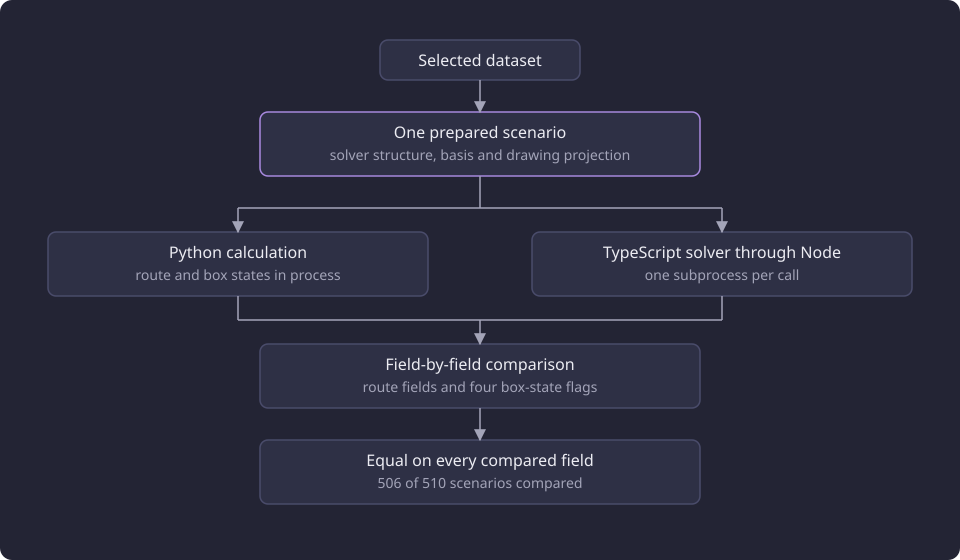

# Route solver parity

Two route implementations were compared scenario by scenario on one prepared solver structure, and this report states their agreement, their timings and what stayed untested.

**Evidence status:** Comparative. **Run date:** 20 October 2026.

The [experiments section](/docs/experiments/README.md) states the reports and their evidence labels. The [graph and route experiments overview](/docs/experiments/graph-and-route-algorithms/README.md) states the shared eleven-course matrix, its five toggle combinations, its two bases, the selected dataset and the machine. This report states the comparison that used that matrix and the sample it added.

## The question

The route calculation is one TypeScript solver. The browser runs it in a background worker, and the machine route command runs the same solver through Node. The [minimum route solver](/docs/backend/prerequisites/minimum-route-solver.md) page describes that calculation as it stands. When the comparison ran, a Python route calculation served the same purpose in the product.

The question was whether the two returned the same route from the same prepared structure. Equality covered the [route outcome](/docs/backend/prerequisites/minimum-route.md#route-outcomes), the total new credits, the new courses in order with their drawn nodes, new unexpandable content, selected nodes, lit members, shortfalls, blocked excluded courses and node keys, problems, facts by fact identity, covered courses by group identity, satisfaction, blockers and inferred coverage. The lit members are the drawing members that the chosen route selects.

The box states were compared as well, on four flags for every drawn node: excluded, manually completed, completed by courses and satisfied by the basis.

The Python calculation is not part of the product, so the parity is historical and cannot be repeated. It is evidence that the solver the product runs reproduced the Python result on the measured scenarios. The route search itself, its size limit and its greedy restart are covered by [Minimum-credit routes](/docs/experiments/graph-and-route-algorithms/minimum-credit-routes.md).

## Cohort and scenarios

The comparison read one selected dataset, whose catalogue counts the [experiments section](/docs/experiments/README.md#the-catalogue-the-experiments-read) states, and ran one scenario at a time with no HTTP connection. The shared matrix supplied 11 courses, each with two bases and five toggle combinations, which gives 110 scenarios. The [graph and route experiments overview](/docs/experiments/graph-and-route-algorithms/README.md#the-courses-and-the-bases) defines the courses and the two bases.

The comparison added a spot check of 200 distinct canonical course identities, drawn from the sorted active catalogue with the fixed seed 20261020. Each course ran two scenarios with the empty basis: required only with Active only on, and recommended and inferred with Active only on. That gives 400 scenarios.

The two cohorts hold 510 scenarios, and 506 of them were compared.

## Method

Each scenario was prepared once, with the drawing projection included, so both implementations read the same solver structure, the same basis and the same [allocation limit](/docs/reference/glossary.md#prerequisites-and-routes) of 700,000 compact nodes and traces. The Python side ran its route calculation in process and evaluated the drawn box states in the same process. The Node side ran one subprocess per call over standard input and read one JSON result from standard output.

The comparison ran under a 4.295 GB address-space cap, with a 120-second limit on each side and on preparation, and the Python runtime was 3.14.3. The matrix and the spot check each ran once.

The comparison ran each route result through the same normal form before matching fields. Each credit string was converted to exact hundredths, because the two wire forms render credit text differently. Box states were matched by node identity and compared on all four flags.

The diagram shows the comparison as it ran.

A difference was recorded with the dotted path of the field that differed, so a difference in one route field and a difference in one box flag were both reported by location.

## Results

| Run | Scenarios | Compared | Equal | Different | Uncompared |
|---|---:|---:|---:|---:|---:|
| Matrix, 11 courses | 110 | 110 | 110 | 0 | 0 |
| Spot check, 200 courses | 400 | 396 | 396 | 0 | 4 |
| Total | 510 | 506 | 506 | 0 | 4 |

No compared scenario differed in either run. The matrix outcomes were identical in both implementations.

| Recorded state | Route outcome | Scenarios |
|---|---|---:|
| `exact` | Exact minimum route | 76 |
| `approximate` | Approximate route | 16 |
| `unresolved` | Route unresolved | 14 |
| `approximation_failed` | No route found | 2 |
| `no_solution` | No route exists | 2 |
| Total | | 110 |

The spot-check required-only scenarios were 200 exact. Among the 196 compared recommended and inferred scenarios, 179 were exact, 16 unresolved and one approximate.

### The four uncompared scenarios

Four spot-check scenarios have no comparison. All four are the recommended and inferred scenario of their course. One preparation ended in `MemoryError` under the 4.295 GB address-space cap, and three exceeded the 120-second preparation timeout.

The required-only scenario of each of the four courses compared equal. Preparation builds the solver structure and the drawing projection before either implementation runs, so the four outcomes measure that build under the cap, not the route calculation. They are neither differences nor evidence of equality, and the cap was not raised.

## Timings

The comparison timed both sides of each matrix scenario. The Python time is the in-process route call. The Node time is the whole subprocess wall time, including process startup of about 42 to 54 milliseconds.

| Course | Python median (ms) | Node median (ms) | Python max (ms) | Node max (ms) |
|---|---:|---:|---:|---:|
| COMP.CS.110 | 0.4 | 46.8 | 1.5 | 53.9 |
| COMP.CS.200 | 0.4 | 46.2 | 1.4 | 63.4 |
| COMP.CS.500 | 1.1 | 53.7 | 5.8 | 66.9 |
| KIE.SUY.420 | 17.8 | 90.8 | 28.7 | 108.6 |
| MATH.MA.725 | 2665.7 | 1923.5 | 5132.3 | 3790.8 |
| MATH.MA.880 | 3656.1 | 3359.3 | 6665.9 | 6804.8 |

The table gives the six courses that carry the timing result. The other five courses have Python medians from 39.2 milliseconds for KAT.MARK.304 to 445.8 milliseconds for PSY.324, and Node medians from 132.8 milliseconds for KAT.MARK.310 to 545.9 milliseconds for PSY.324. The Node median was higher than the Python median on nine of the 11 courses and lower on MATH.MA.725 and MATH.MA.880.

On the smallest solves, the Node figure measures process startup rather than solving. COMP.CS.110 solves in a median 0.4 milliseconds in process and 46.8 milliseconds through Node, and COMP.CS.200 and COMP.CS.500 show the same pattern at 0.4 and 1.1 milliseconds against 46.2 and 53.7 milliseconds. Each Node median sits inside the startup band, so these rows say how long a process takes to start, not how long the route takes to calculate.

The large cases are dominated by the solve. MATH.MA.880 has a Python median of 3656.1 milliseconds against a Node median of 3359.3 milliseconds, and MATH.MA.725 has 2665.7 against 1923.5. The Node side was lower on both, and the comparison has no second run to test whether the difference persists.

The spot check ran two subprocesses per scenario, one for the route and one for the box states. Its median Node time was 45 milliseconds and its maximum 5302 milliseconds, against a Python median of 0.2 milliseconds and a maximum of 5321 milliseconds. No scenario came near the 120-second side timeout.

These are process wall times on [one server](/docs/experiments/graph-and-route-algorithms/README.md#the-dataset-and-the-machines), not browser latency. They say nothing about how quickly a route appears in the app.

## What the comparison establishes

Observation: 506 of the 510 scenarios were equal on every compared field, with no difference in either run. On this cohort the TypeScript solver reproduced the Python route and the Python box states, including the outcome mix and the credit totals.

Interpretation: because both sides read the same structure, basis and allocation limit, the equality is about the calculation and not about two different inputs.

The equality is empirical on the [measured inputs](/docs/experiments/graph-and-route-algorithms/README.md#what-the-line-does-not-establish), including one seeded sample of 200 active courses. It does not prove equality for every structure. The four uncompared scenarios leave their recommended and inferred results untested.

Because the Python calculation is not part of the product, this parity is historical evidence for the solver the product runs. The comparison covers the solver as it was measured, not a change to it.

## Limitations

- The comparison covers 11 fixed courses and one seeded sample of 200 active courses. The [graph and route experiments overview](/docs/experiments/graph-and-route-algorithms/README.md#what-the-line-does-not-establish) states the dataset, machine and run limits that apply to every equality result in the folder.
- The four uncompared scenarios are preparation failures in the Python build path, so the comparison says nothing about parity for them. The cap was not raised.
- Node time includes process startup and JSON handling, so the small-course rows measure startup, and no row separates startup from solving.
- The timings are process wall times, not browser latency, and each median covers the ten scenarios of one course in one run.
- The comparison covers route results and box states on a prepared structure. It does not cover preparation, the HTTP path or drawing in the browser.

## Baselines

A follow-up on another dataset compares against these values, with the allocation limit at 700,000 and the seed 20261020 for the 200-course sample.

- 510 scenarios, with 506 compared and equal, no difference and four uncompared.
- Matrix outcome mix: 76 exact, 16 approximate, 14 unresolved, two `approximation_failed` and two `no_solution`.
- Spot check: 200 required-only scenarios exact, and among 196 compared recommended and inferred scenarios 179 exact, 16 unresolved and one approximate.
- The six course medians and maxima in the timing table are the timing baseline.

The equality counts and the outcome mix are the baseline. No single timing stands for the comparison, because each median covers ten scenarios of one course.

## Open questions

Each question below is untested.

1. Whether the four uncompared scenarios compare equal if the preparation memory or time limit is raised.
2. Whether the equality holds on another dataset, another basis, or structures outside the 11 courses and the 200-course sample.
3. Whether the browser worker returns a route at a latency consistent with the Node subprocess times, since no browser route was timed.
4. Whether a second run of the same matrix separates the Node and Python median differences from run-to-run variation.
