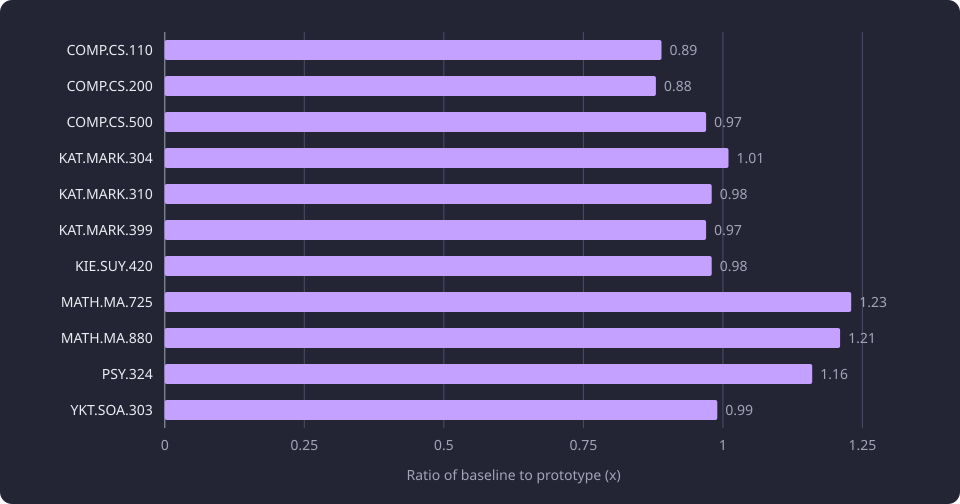
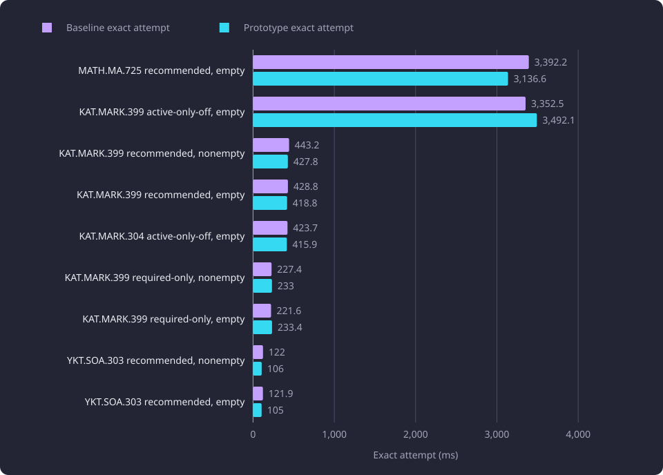
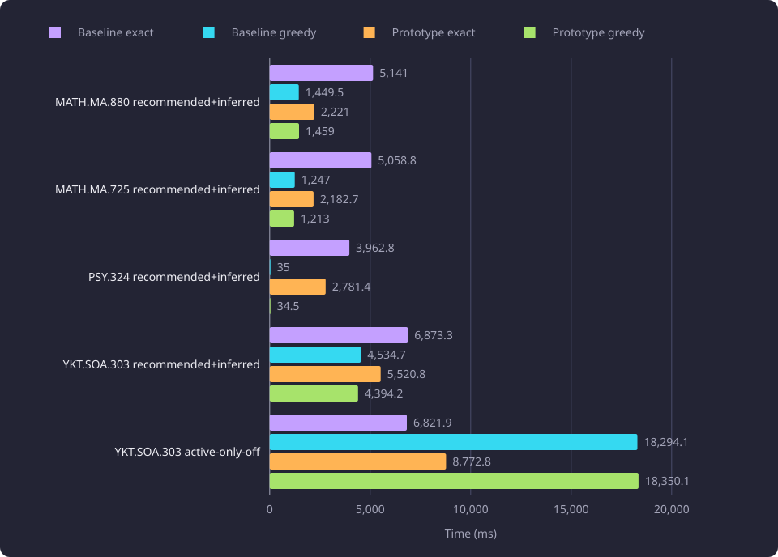
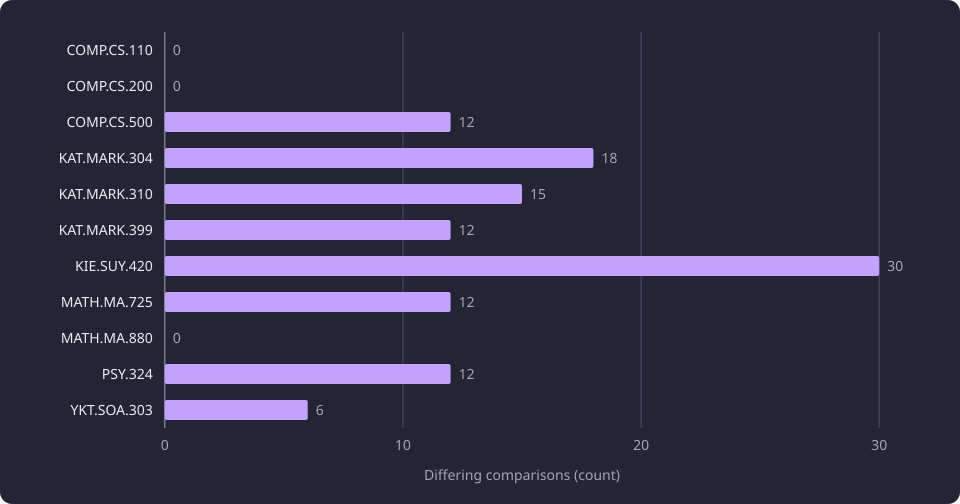

# Structural route deduplication

This report measures whether solving each identical structural subexpression once makes the minimum route search faster with the same route results.

**Evidence status:** Comparative. **Run date:** 19 October 2026.

## The question

A solver structure can contain the same subtree at several occurrences. The required and recommended option pools can hold identical alternatives, an official option and an inferred option can compile to the same structure, and several branches can reach the same requirement group. The exact search evaluates each occurrence in place.

The [minimum route](/docs/backend/prerequisites/minimum-route.md) is the set of courses that meets a course's prerequisites with the fewest new credits. The minimum route calculation folds the calculation pieces of one solver structure into a frontier. A frontier is the set of partial candidate routes one fold step keeps, with one partition for each distinct module shortfall. A repeated subtree is a candidate for one solve that serves every occurrence.

In this report, a structural subexpression is one subtree of a solver structure, with its provenance fields ignored, and an occurrence is one position where that subtree appears. Occurrence evidence is the set of occurrence labels that a route result selects and attributes to each course.

The experiment asked whether solving each identical structural subexpression once makes the exact search materially faster, and whether it returns exactly the same route fields and occurrence evidence.

The measured answer is negative for the exact search. The route fields match in every comparison, the occurrence evidence does not, and the mixed cases gain or lose depending on where the exact attempt reaches the allocation limit.

## The prototype

The baseline is an instrumented copy of the [product exact search](/docs/backend/prerequisites/minimum-route-solver.md), run on the same compiled tree and basis with the same allocation limit. The prototype wraps that evaluator and adds a memo that lives for one route calculation. A memo is a table of already solved subexpressions, keyed by structure and evaluation context.

Each subexpression receives one interned structural identity. The identity retains the expression kind and every semantic field that changes evaluation. It drops the fields that record provenance, which is what allows an official option and an inferred option, or a required alternative and a recommended alternative, to share one solve. Interning gives each distinct structure one integer and builds every parent key from its children's integers, so a key stays the same size at every occurrence and every depth.

| Kept in the structural identity | Dropped from the structural identity |
|---|---|
| Expression kind, course group, unexpandable content work key, credit bounds, count bounds, module group, unresolved reason, reference and detail, ordered child identities, and the role that separates an expanded-course branch from an ordinary AND | Origin, official kind, inferred category and inference metadata |

The memo key carries more than the structural identity. It also carries the basis course set, the activity-exception set, whether a module shortfall is allowed, whether graph marks apply, and a signature of the relative cyclic course occurrences under the subexpression. A course cycle is a chain of prerequisites that returns to a course already on the chain. Two identical structures that close a course cycle at different positions therefore do not share an entry.

One memo entry stores the representative occurrence, its solved frontier, every occurrence label it created and its located problems. A repeated occurrence copies the frontier, relabels shortfalls, problems and blockers to its own occurrence prefix, and replays each recorded label under that prefix. The trace therefore carries the representative's labels at each repeated place.

The memo is disabled when the tree carries canonical excluded course identities, completed node keys or excluded node keys. Any of them makes two structurally identical occurrences behave differently, so the evaluator falls back to the exact search without the memo for the whole calculation. A node mark or an excluded node key is checked before the memo lookup.

Provenance independence has a second effect. A reused obligation reconstructs one valid derivation from the representative occurrence's labels. The baseline exact search unions the labels of every valid derivation. A repeated occurrence can therefore light a different subset of duplicate occurrences while returning the same route.

## Method and setup

### Matrix and variants

The experiment used the shared matrix of the graph and route line on one read-only selected dataset: eight target courses, three controls, five toggle combinations and two bases. The [graph and route experiments overview](/docs/experiments/graph-and-route-algorithms/README.md#the-matrix-the-samples-and-what-they-share) lists the courses and the five combinations, and [the courses and the bases](/docs/experiments/graph-and-route-algorithms/README.md#the-courses-and-the-bases) states how the nonempty basis is chosen. That matrix gives 110 scenarios, and each scenario ran both variants three times, which gives 660 runs.

Two variants ran in every scenario. The baseline is an instrumented copy of the product exact search. The prototype is the same evaluator with the interned-ID memo. A nested tuple key representation was tried and did not complete the matrix, so every speed table in this report measures the baseline and the interned-ID prototype only. The [failed approaches](#failed-approaches) section states why the tuple representation failed.

Each comparison paired the same repetition number, and within a scenario the three baseline repetitions ran before the three prototype repetitions, with an explicit garbage collection before each run. A scenario's reported time is the median of its three runs per variant.

The control courses in the course table are COMP.CS.110, COMP.CS.200 and COMP.CS.500. MATH.MA.880 and YKT.SOA.303 had no eligible active official course leaf in their default tree, so their nonempty basis is empty and those rows repeat the empty basis.

### Measurement boundaries

The experiment separated four component measurements, one derived total and one fixed limit.

| Measurement | Covers | Does not cover |
|---|---|---|
| Tree build | One cold compile of the scenario's solver structure from the read-only dataset, run once per scenario before either variant | Route search, satisfaction, output projection, browser payload, cache |
| Satisfaction | One satisfaction evaluation of the tree and basis, run once per scenario before either variant | Route search, tree build, greedy fallback |
| Exact attempt | The exact fold from entry to return or to the allocation-limit exception, including frontier, trace and memo work | Satisfaction, tree build, greedy fallback |
| Greedy fallback | The scalar greedy search after the exact attempt exceeded the limit | Exact attempt, tree build, satisfaction |
| Total solve time | The median exact attempt plus the median greedy fallback for one scenario | Tree build and satisfaction |

Total solve time is a sum of two medians, not one continuous timer. The tree build and the satisfaction pass sit outside both solve totals. The exact attempt timer ends when the allocation limit raises its exception.

### Run conditions

The allocation limit was fixed at 700,000 for the whole matrix. It counts compact nodes and traces. The exact attempt stops when the count first exceeds the limit, and the greedy restart is not bounded by it.

The runs took one course at a time, with Python 3.14.3, under a 4.295 GB address-space cap and a 120 s per-solve timeout. The [graph and route experiments overview](/docs/experiments/graph-and-route-algorithms/README.md#the-dataset-and-the-machines) states the machine.

## Route outcomes

| Route outcome | Recorded state | Size limit exceeded | Scenarios |
|---|---|---|---:|
| Exact minimum route | `exact` | no | 76 |
| Approximate route | `approximate` | yes | 16 |
| Route unresolved | `unresolved` | no | 14 |
| No route found | `approximation_failed` | yes | 2 |
| No route exists | `no_solution` | no | 2 |
| Total | | | 110 |

Across the 330 paired comparisons the route outcome, total new credits, new course set and new unexpandable content matched in every case, while occurrence evidence differed in 117. Every scenario also has the same route outcome and credit total in both variants. No Shortfall outcome occurred.

## Solve time by course

The ratio is the baseline total divided by the prototype total. A value above one means the prototype is faster. Each total sums the ten scenario medians for one course, with the exact attempt and the greedy fallback included. The two totals measure the baseline and the interned-ID prototype, each with its exact attempt and greedy fallback. The ratio is computed from the unrounded millisecond totals, before the seconds are rounded to 0.01, so the two control rows can show 0.00 s and carry a ratio below one.

| Course | Build total, 10 scenarios (s) | Build median (s) | Baseline total (s) | Prototype total (s) | Ratio | Max occurrences | Max unique | Core mismatches | Evidence mismatches |
|---|---:|---:|---:|---:|---:|---:|---:|---:|---:|
| COMP.CS.110 | 2.44 | 0.25 | 0.00 | 0.00 | 0.89x | 16 | 14 | 0 | 0 |
| COMP.CS.200 | 2.40 | 0.24 | 0.00 | 0.00 | 0.88x | 12 | 12 | 0 | 0 |
| COMP.CS.500 | 2.87 | 0.29 | 0.07 | 0.07 | 0.97x | 88 | 41 | 0 | 12 |
| KAT.MARK.304 | 7.95 | 0.85 | 1.16 | 1.15 | 1.01x | 888 | 245 | 0 | 18 |
| KAT.MARK.310 | 7.99 | 0.87 | 1.20 | 1.22 | 0.98x | 846 | 251 | 0 | 15 |
| KAT.MARK.399 | 14.87 | 1.60 | 9.97 | 10.31 | 0.97x | 4,755 | 752 | 0 | 12 |
| KIE.SUY.420 | 6.15 | 0.67 | 0.48 | 0.49 | 0.98x | 423 | 149 | 0 | 30 |
| MATH.MA.725 | 30.97 | 1.54 | 30.15 | 24.60 | 1.23x | 54,633 | 1,192 | 0 | 12 |
| MATH.MA.880 | 18.78 | 1.26 | 35.98 | 29.65 | 1.21x | 34,335 | 779 | 0 | 0 |
| PSY.324 | 10.45 | 0.77 | 14.53 | 12.57 | 1.16x | 2,539 | 516 | 0 | 12 |
| YKT.SOA.303 | 108.84 | 0.50 | 73.25 | 74.30 | 0.99x | 477,533 | 962 | 0 | 6 |

Across all 110 scenarios the ratio runs from 0.53x to 1.86x. Exact minimum route and Route unresolved scenarios above 10 ms stay within 0.92x to 1.16x. The No route exists pair at PSY.324 recommended-only is outside that range, at 0.53x to 0.60x. The millisecond-scale control scenarios range from 0.83x to 1.00x.

The chart plots the ten-scenario ratio for each course.



Course totals mix exact, approximate, unresolved and no-solution scenarios, so a ratio above one does not show an exact-search gain. MATH.MA.725 at 1.23x and MATH.MA.880 at 1.21x draw their gain from the recommended+inferred approximate pairs, not from their exact scenarios. KAT.MARK.399 at 0.97x and YKT.SOA.303 at 0.99x are slightly slower overall.

## Exact search

The exact search did not become materially faster. Scenarios above 10 ms move in both directions, and the largest exact attempts sit close to parity. The two columns measure the baseline exact search and the interned-ID prototype. The table lists nine scenarios selected to span a range of times and both directions.

| Course | Combination | Basis | Baseline exact (ms) | Prototype exact (ms) | Ratio | Outcome |
|---|---|---|---:|---:|---:|---|
| MATH.MA.725 | recommended | empty | 3,392.2 | 3,136.6 | 1.08x | exact |
| KAT.MARK.399 | recommended+inferred-active-off | empty | 3,352.5 | 3,492.1 | 0.96x | unresolved |
| KAT.MARK.399 | recommended | nonempty | 443.2 | 427.8 | 1.04x | exact |
| KAT.MARK.399 | recommended | empty | 428.8 | 418.8 | 1.02x | exact |
| KAT.MARK.304 | recommended+inferred-active-off | empty | 423.7 | 415.9 | 1.02x | unresolved |
| KAT.MARK.399 | required-only | nonempty | 227.4 | 233.0 | 0.98x | exact |
| KAT.MARK.399 | required-only | empty | 221.6 | 233.4 | 0.95x | exact |
| YKT.SOA.303 | recommended | nonempty | 122.0 | 106.0 | 1.15x | exact |
| YKT.SOA.303 | recommended | empty | 121.9 | 105.0 | 1.16x | exact |

In the chart labels, active-only-off abbreviates recommended+inferred-active-off.

The chart compares the baseline and prototype exact attempt for those nine scenarios.



The largest exact solve is MATH.MA.725 recommended, with 4,645 occurrences and 504 unique expressions. Its empty-basis row is 3.39 s baseline against 3.14 s prototype. KAT.MARK.399 recommended, with 2,355 occurrences and 401 unique expressions, is 429 ms against 419 ms. YKT.SOA.303 recommended, with 1,448 occurrences and 99 unique expressions, is 122 ms against 105 ms, or 1.16x.

The two unresolved rows in the table, KAT.MARK.399 active-off and KAT.MARK.304 active-off, completed their exact attempt below the allocation limit. Their outcome is Route unresolved, not an exact route, and their ratio is close to parity.

Some exact scenarios are faster and some are slower. MATH.MA.725 recommended is 1.08x and YKT.SOA.303 recommended is 1.16x. KAT.MARK.399 required-only is 0.95x in the empty basis. Trace entries fall in some exact scenarios and rise in others because each reused occurrence adds an evidence overlay. The millisecond-scale control scenarios stay between 0.83x and 1.00x.

No consistent exact-speed gain appears. The measurements do not identify which part of the exact fold absorbs the cost that sharing does not remove.

## Approximate and no-route cases

The mixed cases split into gains and losses. The four recommended+inferred combinations gain, because the exact attempt reaches the 700,000 limit sooner in the prototype while the greedy fallback stays close. YKT.SOA.303 recommended+inferred-active-off loses because its greedy fallback dominates the total. PSY.324 recommended-only loses because the prototype does more work before returning No route exists. The four time columns measure the baseline and the interned-ID prototype, each with its exact attempt and greedy fallback. The table lists one empty-basis row for each of these six cases. The nonempty rows of the same combinations repeat the direction.

| Course | Combination | Basis | Baseline exact (ms) | Baseline greedy (ms) | Prototype exact (ms) | Prototype greedy (ms) | Ratio | Outcome |
|---|---|---|---:|---:|---:|---:|---:|---|
| MATH.MA.880 | recommended+inferred | empty | 5,141.0 | 1,449.5 | 2,221.0 | 1,459.0 | 1.79x | approximate |
| MATH.MA.725 | recommended+inferred | empty | 5,058.8 | 1,247.0 | 2,182.7 | 1,213.0 | 1.86x | approximate |
| PSY.324 | recommended+inferred | empty | 3,962.8 | 35.0 | 2,781.4 | 34.5 | 1.42x | approximate |
| YKT.SOA.303 | recommended+inferred | empty | 6,873.3 | 4,534.7 | 5,520.8 | 4,394.2 | 1.15x | approximate |
| YKT.SOA.303 | recommended+inferred-active-off | empty | 6,821.9 | 18,294.1 | 8,772.8 | 18,350.1 | 0.93x | approximate |
| PSY.324 | recommended | empty | 468.0 | 0.0 | 774.7 | 0.0 | 0.60x | no_solution |

The chart compares the exact attempt and the greedy fallback for five empty-basis mixed scenarios.



In MATH.MA.880 and MATH.MA.725 recommended+inferred, the baseline exact attempt reaches 700,000 after about 5.1 s and the prototype after about 2.2 s. The greedy fallback is close in both variants, about 1.45 s against 1.46 s on MATH.MA.880 and about 1.2 s in both variants on MATH.MA.725. The shortened exact attempt is the gain, and both outcomes are Approximate route. The same cause gives PSY.324 recommended+inferred its 1.42x to 1.44x and YKT.SOA.303 recommended+inferred its 1.15x to 1.16x.

The YKT.SOA.303 active-only-off case is the opposite. The greedy fallback takes about 18.3 s in both variants and dominates a total of 25.1 s to 27.2 s. The prototype exact attempt takes about 8.8 s against 6.8 s, so the ratio is 0.92x to 0.93x. A faster greedy search is not the cause of the measured gains, because the fallback times are close wherever both variants reach it.

The two MATH active-only-off pairs also lose slightly, at 0.95x to 0.97x. PSY.324 recommended-only is a No route exists outcome, not an approximate one. The baseline exact attempt returns it quickly, at 468.0 ms and 429.2 ms. The prototype does more label and reuse work before reaching the same state, at 774.7 ms and 803.7 ms, for 0.60x and 0.53x.

The allocation limit binds the largest trees. Eighteen scenarios exceed it, 16 ending in Approximate route and two in No route found. Both variants exceed it in every one of those scenarios. Deduplication does not bring the largest trees below 700,000. The compact count reaches the limit in those scenarios, with nodes and traces redistributed rather than reduced.

The gains are therefore not a general algorithmic gain. They come from where the exact attempt reaches the limit, and the largest case is governed by the greedy fallback.

## Occurrence evidence

The route fields matched everywhere, and the occurrence evidence did not. The evidence comparison covered the selected occurrence set and its count, the per-course evidence and the problem count.

The course table's evidence column gives the differing comparisons for each course. Eight courses show differences, from six differing comparisons on YKT.SOA.303 to 30 on KIE.SUY.420. MATH.MA.880, COMP.CS.110 and COMP.CS.200 show none.

The chart plots the differing comparisons for each course.



Interpretation: a reused obligation reconstructs one valid derivation from the representative occurrence's labels. The baseline exact search reconstructs evidence from every valid derivation. The reuse can therefore light a different subset of duplicate occurrences while selecting the same course set.

This is an evidence difference, not a route difference. The route fields are identical, and the occurrence-based reporting is not. A product mechanic that lights the graph from occurrence evidence, or reports which occurrence satisfied a requirement, cannot treat the two derivations as interchangeable. The experiment's conclusion is to keep the product occurrence reconstruction exact for any structural sharing.

## Tree build

The tree build is a separate cost and is not part of either solve total. Build total in the course table sums the ten scenario compiles. Build median is the median of those ten compiles.

| Scenario | Build (s) | Baseline total (s) | Prototype total (s) |
|---|---:|---:|---:|
| YKT.SOA.303 recommended+inferred-active-off, empty | 36.4 | 25.1 | 27.2 |
| MATH.MA.880 recommended+inferred, empty | 3.2 | 6.6 | 3.7 |
| MATH.MA.725 recommended+inferred, empty | 5.9 | 6.3 | 3.4 |

In several large cases the build is comparable to or larger than the solve. On YKT.SOA.303 active-only-off, the 36.4 s build is larger than either total solve. On MATH.MA.880 recommended+inferred, the 3.2 s build is close to the 3.7 s prototype total and about half the 6.6 s baseline total. On MATH.MA.725 recommended+inferred, the 5.9 s build is close to the 6.3 s baseline solve and exceeds the 3.4 s prototype solve.

The build is a cold compile per scenario. It is not a browser payload, a cache measurement or an HTTP measurement. A browser route solver meets the build and payload before any solve, and the browser cost of both is untested.

## Failed approaches

### Empty-support partitions

A reuse step that took every partition of a representative frontier, including partitions with empty support, promoted a discarded alternative to the neutral empty-set partition on the COMP.CS.500 control. That fabricated a zero-cost route, so the control validation failed. The failure produced a false route rather than a slow one. The applied rule skips every partition with empty support, so a discarded alternative cannot become the neutral empty set. The failed run is not part of the speed data, and the extra cost of skipping empty partitions was not measured.

### Nested tuple structural keys

A structural key built as a nested tuple per occurrence does not stay constant size. Each lookup builds a key that contains the whole subtree below the occurrence, so the key size follows the subtree size. The memo then holds a key of that size for every distinct structure it solves. On a tree with many occurrences the keys grow with the subtree, not with the number of distinct structures.

```text
nested key(node) = (kind, fields, nested key(child 0), nested key(child 1), ...)
interned key(node) = (kind, fields, child id 0, child id 1, ...)
```

The experiment ran this representation under the same 4.295 GB address-space cap and 700,000 allocation limit as the matrix reported here. On YKT.SOA.303 the run completed the 123,883-occurrence scenarios with approximate routes and ended before the 477,533-occurrence Active only off scenarios returned. The record names no single scenario that exhausted the address space. The run contributes no speed value, so every speed table in this report compares the baseline with the interned-ID prototype only.

The applied representation interns one integer per distinct structure and builds each parent key from its children's integers. A key is then the same size at every occurrence and every depth, and the memo holds one key per distinct structure and evaluation context rather than one nested key per occurrence. The interned-ID prototype completed the matrix where the tuple representation did not.

## Interpretation

Observation: the route fields matched in all comparisons, the occurrence evidence differed, the exact search showed no consistent direction above 10 ms, 18 scenarios exceeded the allocation limit in both variants, and tree build was comparable to or larger than solve in several large cases.

Interpretation: the sharing changes how much exact-attempt work occurs before the limit and how occurrence labels are reconstructed. It does not change whether the exact attempt succeeds, and the greedy fallback changes only slightly in either direction. On the largest tree the fallback dominates, so the exact-attempt difference contributes little to the total, and the prototype's longer exact attempt there makes the total slower.

Failed hypothesis: solving each structural subexpression once would make the exact search materially faster while preserving the same route and the same occurrence evidence. The route half held. The exact-speed half and the evidence half did not.

The nested tuple representation failed on memory before it completed the matrix, so the exact-speed result rests on the interned-ID prototype.

## Limitations

- Within a scenario the three baseline repetitions ran before the three prototype repetitions, with an explicit garbage collection before each run. A drift across the six runs would load onto one variant, and no interleaving or randomization was measured.
- The structural identity drops origin, official kind, inferred category and inference metadata. Two occurrences that differ only in provenance share one solve, so the evidence comparison is the check on what that sharing changes.
- The memo is disabled when the tree carries canonical excluded course identities, completed node keys or excluded node keys. The measured cases do not cover a tree with those marks.
- Total solve time is the sum of two medians, not one continuous timer. The exact attempt timer ends when the allocation limit raises its exception, and tree build and satisfaction sit outside the total.
- The approximate times depend on the fixed 700,000 allocation limit and on where the exact attempt stops.
- The medians carry no distribution test, confidence interval or outlier removal.
- The tree build is a cold compile per scenario, not a browser payload or cache measurement. No browser, HTTP request, payload size or per-solve memory peak was measured.
- The route comparison is a parity check on measured fields over these inputs. It does not establish a general equivalence between the two evaluators, route quality, teaching quality or a general timing bound.
- The occurrence evidence difference means occurrence-based reporting is not preserved, even where the route is identical.
- The nested tuple representation did not complete the matrix, so every speed comparison uses the interned-ID prototype. The empty-support failure produced a false route, and its cost is not in the speed data.

## Where the line ended

The deduplication mechanic was not promoted. On this evidence it did not make the exact search materially faster, did not avoid the 700,000 allocation limit and changed occurrence evidence.

The tree build and payload come before any browser solve. Their browser cost and sharing only large duplicate subtrees, with the product's occurrence reconstruction preserved exactly, are untested. The helping cases are MATH.MA.880 and MATH.MA.725 recommended+inferred at about 1.8x. The costly cases are YKT.SOA.303 active-only-off at about 0.92x and PSY.324 recommended-only at about 0.53x.

## Untested questions

- Whether sharing only large duplicate subtrees keeps the exact attempt below the allocation limit or lowers tree build and payload cost. Untested.
- Whether a memo entry can carry every occurrence's derivation, rather than one representative derivation, and preserve the selected occurrence set exactly at an acceptable cost. Untested.
- Whether a structural key represented by a fixed-size digest, rather than an interned integer or a nested tuple, keeps the memo identity exact while bounding memory. Untested.
- Whether a browser measurement of tree build, payload and cache changes the balance between the cases where the prototype helps and the cases where it costs. Untested.
