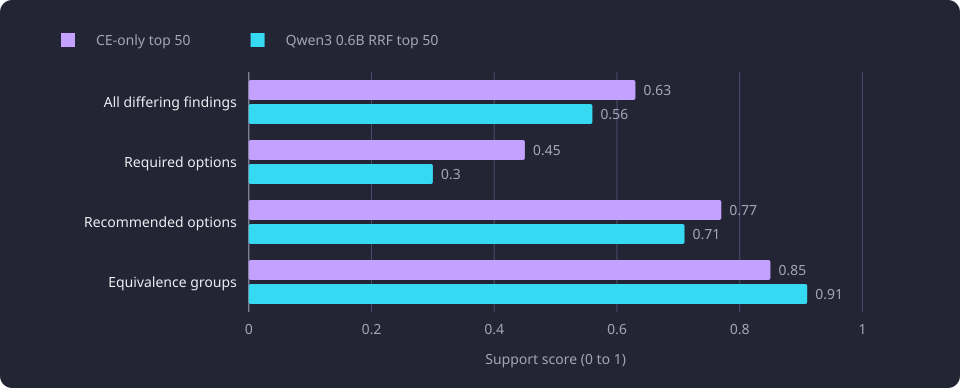
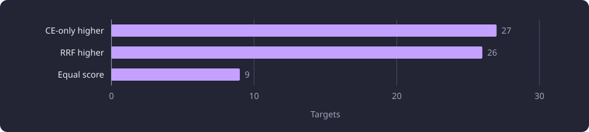

# Candidate packet selection

Two candidate packets for the same held-out target courses were compared through reference answers judged against the supplied teaching text.

**Evidence status:** Comparative. **Run dates:** 26 to 27 September 2026.

The [Experiments section](/docs/experiments/README.md#inference) states the catalogue, the hardware specifications and the evidence labels.

## The question

An inference call receives one target course and a bounded list of candidate courses. The model may cite only those candidates, and every stage before the call may rank candidates but may not emit a relation. The candidate packet is therefore the model's whole view of the catalogue for that target, and its contents decide what the model can possibly propose.

The cross-encoder-only (CE-only) packet was the top 50 of a cross-encoder ordering over a 1,000-candidate pool. The measured alternative added a ranking-only small model, Qwen3 0.6B at Q8_0, which scored the cross-encoder top 200. The two orderings were fused by reciprocal rank fusion (RRF), and the fused top 50 formed the RRF packet. [Candidate retrieval and reranking](/docs/experiments/inference/candidate-retrieval-and-reranking.md) states both constructions, their settings and the fusion formula.

The comparison asked whether the extra scoring pass changed the answers enough to justify running it on every target. Both packets were measured on the same targets, so the difference between them carries the claim.

## The two packets

| Packet | Candidates | Ordering |
|---|---|---|
| CE-only top 50 | 50 | Top 50 of the cross-encoder ranking of the 1,000-candidate pool |
| Qwen3 0.6B RRF top 50 | 50 | Top 50 by fused rank over the cross-encoder top 200 |

For one target the two packets shared the target, the prompt, the schema, the settings and the 1,000-candidate pool. They differed in which 50 candidates they carried and in their order, and in nothing else. The ranking stage's character bounds apply to its own input, and the answering model saw the target's teaching text and the 50 candidate descriptors in full.

## Cohort and answers

The paired comparison ran on the first 100 targets of a fixed set of 200 held-out target courses. The 200 are active courses with a representative version, chosen deterministically from one catalogue snapshot and spread across the catalogue. They are disjoint from the 100 development targets, and courses used in prompt examples are excluded from the set and from its candidate lists. A pair is the CE-only answer and the RRF answer for one target.

The pairs come from the shared reference corpus. [Reference answers and judging](/docs/experiments/inference/reference-answers-and-judging.md) states how it was produced: one DeepSeek V4.1 Flash answer for each of the 200 targets under prompt version 6, with a second answer under the RRF packet for the first 100. Both packets used the same prompt text, prompt version and strict result schema.

One answer exists per target and packet. The remaining 100 targets carry a CE-only answer only and play no part in the comparison.

The diagram shows the paired design for one target, from the two packets to the two judged support scores.


## Measurements

### Finding sets

A finding is one proposed option or one proposed equivalence group. The 100 pairs produced 257 distinct findings.

| Finding set | Findings |
|---|---|
| Distinct findings across the 100 pairs | 257 |
| Found by both answers of a pair | 52 |
| Found only by the CE-only answer | 98 |
| Found only by the RRF answer | 107 |

The two answers of a pair therefore differed on 205 findings and agreed on 52. In the 100 pairs, the CE-only answers emitted 150 findings in total and the RRF answers 159, so the 52 shared findings give a finding F1 of about 0.34 between the two answers for the same target, computed as twice the shared count divided by the sum of the two totals.

### Judged support

Each finding that only one of the two answers of a pair emitted was judged on its own against the teaching text the answering model had been given. Claude Opus 5.5 at the low variant judged them blind to the packet they came from and without official labels, and [reference answers and judging](/docs/experiments/inference/reference-answers-and-judging.md) states the rubric. The judge returned one of four verdicts: supported, partly supported, unsupported or unclear. The 52 shared findings were not judged and enter neither score.

A finding scored 1 when it was supported, 0.5 when partly supported and 0 when unsupported. An unclear finding is left out of the score's denominator, so the denominator counts only the supported, partly supported and unsupported findings. The rule is:

```text
score = (supported + 0.5 * partly) / (supported + partly + unsupported)
```

The tables give the verdict counts and the score of each category, first for the CE-only packet and then for the RRF packet.

| CE-only top 50 | Findings | Supported | Partly | Unsupported | Unclear | Score |
|---|---|---|---|---|---|---|
| All differing findings | 98 | 57 | 9 | 31 | 1 | 0.63 |
| Required options | 47 | 17 | 8 | 22 | 0 | 0.45 |
| Recommended options | 27 | 20 | 0 | 6 | 1 | 0.77 |
| Equivalence groups | 24 | 20 | 1 | 3 | 0 | 0.85 |

| Qwen3 0.6B RRF top 50 | Findings | Supported | Partly | Unsupported | Unclear | Score |
|---|---|---|---|---|---|---|
| All differing findings | 107 | 52 | 15 | 39 | 1 | 0.56 |
| Required options | 50 | 10 | 9 | 30 | 1 | 0.30 |
| Recommended options | 34 | 22 | 4 | 8 | 0 | 0.71 |
| Equivalence groups | 23 | 20 | 2 | 1 | 0 | 0.91 |

The CE-only row of all differing findings holds 57 supported, nine partly supported, 31 unsupported and one unclear finding, which scores 61.5 of 97, or 0.63. The same row for the RRF packet holds 52 supported, 15 partly supported, 39 unsupported and one unclear finding, which scores 59.5 of 106, or 0.56. These scores cover the differing findings only, and they are not the supported share over every finding a packet emitted. [Inference experiments](/docs/experiments/inference/README.md#shared-method-and-cohorts) states the difference between a score and a share.

The chart compares the judged support of the two packets by category.



The CE-only packet led on all findings, on required options and on recommended options. The RRF packet led on equivalence groups, where it scored 0.91 against 0.85.

### Per-target difference

Of the 100 targets, 62 had at least one finding that only one of the two answers emitted. On those 62 targets the score comparison is:

| Outcome across the 62 targets | Targets |
|---|---|
| CE-only answer scored higher | 27 |
| RRF answer scored higher | 26 |
| Equal score | 9 |

The chart splits the 62 targets by which answer scored higher.



The mean per-target score difference was 0.21, with a 95 percent bootstrap interval from -0.37 to 0.84. The interval spans zero, and the win counts are 27 against 26. The per-target comparison therefore does not separate the packets.

### Packet overlap

| Measure | Value |
|---|---|
| Mean candidates in common per target | 40 of 50 |
| Differing findings that involve a course in both packets | 178 of 205 |

Most of the variation between the two answers concerns courses that both packets supplied. The remaining 27 differences each involve at least one course that only one of the two packets carried.

## The decision

CE-only top 50 was selected as the packet policy. It emitted fewer unsupported required options, 22 of 47 against 30 of 50, and it needs no ranking-only scoring pass on any target. The applied pipeline carries 50 candidates selected by the cross-encoder alone, with `INFERENCE_SELECTION_FINAL_K` set to 50. [Candidate retrieval and rerank](/docs/backend/inference/inference.md#candidate-retrieval-and-rerank) states the applied pool depth and packet size. The RRF packet served this comparison only.

The selected packet does not win on the per-target measure. Its case rests on the required-option row and on the cost of the ranking stage, not on a decisive margin between the two answers.

The quality ranking this report uses places a right course in the right category first, a right course in the wrong required or recommended category second, and an omission third, and treats a course that is not a prerequisite at all as the error to refuse. An unsupported required option is therefore the costliest error this comparison can see, which is why the required row carried more weight than the near-tie in the per-target counts.

## What the comparison supports

Observed: the CE-only packet produced a higher judged support score on all differing findings and on required options, and fewer unsupported required options. The RRF packet produced a higher score on equivalence groups.

Interpreted: most of the variation between the two answers is consistent with single-sample variation in the answering model rather than with the packet. That reading rests on the overlap count and on the interval, and it is an interpretation rather than a measured decomposition of the two sources of variation.

Not supported: a claim that either packet is decisively better on the whole answer. The interval includes zero and the per-target counts differ by one target.

## Limitations

The category-wide limits apply to these verdicts. One judge and one rubric, a bounded rendering of each course and no official prerequisite record mean that a verdict records what the supplied text supports, not that the university requires the course, and that a true prerequisite both packets omitted is invisible to the comparison. [Inference experiments](/docs/experiments/inference/README.md#limitations) states these limits in full.

The shared limits also record 45 equivalence groups whose group-wide support was never judged, because their members were compared with the target instead of with one another. The equivalence rubric is strict, so that row reads as a lower bound, and the RRF lead on equivalence groups rests on the weakest verdicts in the comparison.

One sample per slot. Each answer is one DeepSeek V4.1 Flash sample, and no target was answered twice under the same packet. Both packets were answered by that model, so the comparison measures the two packets for it only. The 0.34 finding F1 across the paired answers and the 178 differences that involve courses in both packets are the available evidence about sampling variation, and both mix it with the packet difference.

The paired subset is the first 100 targets of the fixed target order, not a random sample. The 100 unpaired targets carry only a CE-only answer, so the comparison covers half of the held-out set.

One packet size and one pool. Both packets carried 50 candidates drawn from the 1,000-candidate pool. Neither a different packet size nor a different pool depth was measured, and the comparison says nothing about either.

The prompt was shaped partly by held-out answers, so the corpus is not an untouched prompt holdout. Both packets ran under one prompt, so the difference between them is measured under a prompt that held-out answers had shaped.

The corpus is conditioned on validity. An invalid answer was re-requested with the identical request until it validated, so each slot holds the first valid sample rather than a random one.

## Setup details

| Parameter | Value |
|---|---|
| Packet size | 50 candidates per packet |
| Answering model | DeepSeek V4.1 Flash, one sample per target and packet |
| Judging model | Claude Opus 5.5, low variant |
| Finding score | supported 1, partly 0.5, unsupported 0, unclear left out of the denominator |
| Per-target interval | 95 percent bootstrap over per-target score differences |

## Untested follow-ups

Whether repeated sampling under each packet would shrink the per-target interval enough to separate them. No self-agreement measurement was made, so it is untested.

Whether a rejudged equivalence comparison, with group members compared only with one another, would preserve the RRF lead on equivalence groups. Untested.

Whether a packet of 25 or 100 candidates would change the balance between the two packets. Both packets were measured at 50 only, so it is untested.

Whether a second answering model would rank the packets differently. Both packets were answered by DeepSeek V4.1 Flash only, so it is untested.
