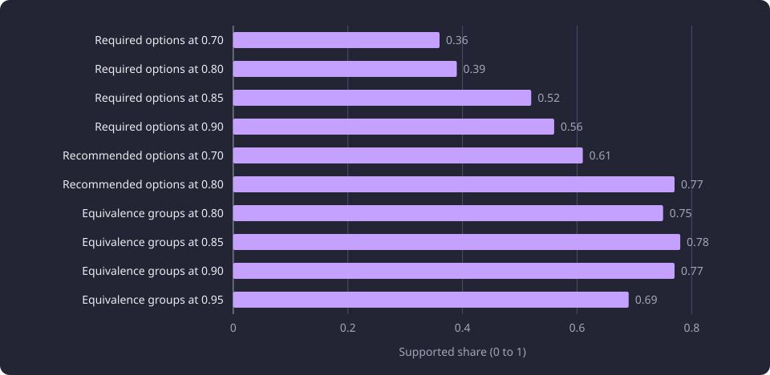
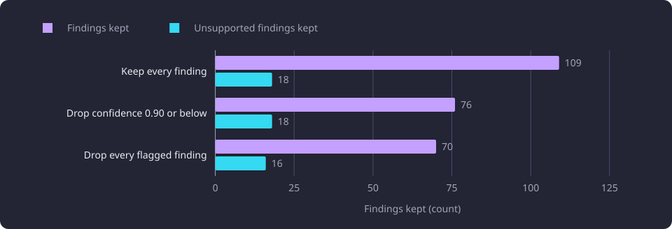

# Confidence and flag calibration

This report tests whether the confidence and the finding flags a model states can decide which inferred prerequisites reach publication.

**Evidence status:** Comparative. **Run dates:** 26, 28 and 29 September 2026.

The [Experiments section](/docs/experiments/README.md#inference) gives the catalogue, the evidence labels and the hardware specifications. This report covers one line of the inference work: the stated confidence and the finding flags as a gate on publication. The [Reference answers and judging](/docs/experiments/inference/reference-answers-and-judging.md) page states the reference answers, the blind judge, the four verdicts, the rubric and the correction of the reference. The [held-out local model quality](/docs/experiments/inference/held-out-model-quality.md) report states the model comparison and the policy that was selected from it.

## The question

Every option and every equivalence group in a reference answer carried a confidence between `0` and `1`, and the prompt told the model that the value was its own certainty rather than established truth. A [finding](/docs/backend/inference/inference.md#what-inference-produces) is one proposed required option, recommended option or equivalence group. The question was whether that stated certainty separated the findings a teaching-text judge would support from those it would reject, well enough to publish only findings above one cutoff.

A cutoff was attractive because of the two errors it could weigh. The judge's rubric treats an omitted true prerequisite as the lesser error and a wrong claim as the one to refuse. If confidence marked the doubtful claims, one threshold could remove them without reading every finding.

Two further questions had to be answered before any cutoff could be proposed. A confidence rule had to hold on targets and on a model that were not used to fit it. And the per-finding flags had to be tested as an alternative signal. The policy question therefore came last, on held-out output: whether any confidence or flag rule improved the output enough to justify removing findings.

## The judged findings

The measured set was the 386 findings of the 200 reference answers on the cross-encoder-only packet, one answer per target from DeepSeek V4.1 Flash under prompt v6. The findings covered 151 of the 200 targets. Required options were 199, recommended options 101 and equivalence groups 86. The other 49 targets proposed no direct option and no equivalence group, and carried routing or suppression only.

Each finding received one verdict against the teaching text the answering model had seen, with the producing model, its confidence and its flags withheld. [Reference answers and judging](/docs/experiments/inference/reference-answers-and-judging.md) states the judge and the four verdicts. Of the 386 findings, 230 were supported, 92 partly, 55 unsupported and nine unclear. The 98 verdicts reused from the [candidate packet selection](/docs/experiments/inference/candidate-packet-selection.md) measurement and the 288 judged for this measurement together cover all 386.

Two properties of a verdict matter for everything below. A `supported` verdict records what the supplied teaching text supports under the rubric, and the university's own prerequisite record stayed outside the judgment. An `unsupported` verdict records that the text did not support that claim in that category. Whether the answer omitted a true prerequisite is a separate question that the verdict leaves open.

The corrected reference built from these verdicts is evaluation evidence for the model comparisons, and its keep, demote and drop actions are on that page. The bins and the routing check below read the 386 verdicts directly, and only the F1 column of the held-out rule fit reads the corrected reference.

Confidence arrived in steps of 0.05 between 0.50 and 0.95, with one value at 0.78. The supported rate below is supported divided by the findings in the bin, and `partly` and `unclear` are shown and never folded into `supported`.

## The confidence bins

The table keeps the ten bins that hold at least 10 findings, because four bins hold one finding and several hold three or fewer. The category totals stand at the foot of the table.

| Category | Confidence | Findings | Supported | Supported rate | Partly | Unsupported | Unclear |
|---|---|---:|---:|---:|---:|---:|---:|
| Required options | 0.70 | 14 | 5 | 0.36 | 3 | 5 | 1 |
| Required options | 0.80 | 64 | 25 | 0.39 | 26 | 13 | 0 |
| Required options | 0.85 | 44 | 23 | 0.52 | 13 | 7 | 1 |
| Required options | 0.90 | 52 | 29 | 0.56 | 15 | 6 | 2 |
| Recommended options | 0.70 | 38 | 23 | 0.61 | 10 | 4 | 1 |
| Recommended options | 0.80 | 47 | 36 | 0.77 | 9 | 1 | 1 |
| Equivalence groups | 0.80 | 12 | 9 | 0.75 | 0 | 3 | 0 |
| Equivalence groups | 0.85 | 18 | 14 | 0.78 | 1 | 3 | 0 |
| Equivalence groups | 0.90 | 30 | 23 | 0.77 | 3 | 4 | 0 |
| Equivalence groups | 0.95 | 16 | 11 | 0.69 | 2 | 3 | 0 |
| All required options | All bins | 199 | 96 | 0.48 | 64 | 32 | 7 |
| All recommended options | All bins | 101 | 71 | 0.70 | 22 | 6 | 2 |
| All equivalence groups | All bins | 86 | 63 | 0.73 | 6 | 17 | 0 |

The chart plots the supported share of the ten large bins.

Required support stays between 0.36 and 0.56 across its four large bins. Recommended support sits at 0.61 and 0.77, and equivalence support moves from 0.75 to 0.78, 0.77 and 0.69.

The cumulative view asks what one threshold would keep.

| Cutoff | Required findings / rate | Recommended findings / rate | Equivalence findings / rate |
|---|---|---|---|
| 0.70 or above | 185 / 0.48 | 92 / 0.70 | 84 / 0.73 |
| 0.80 or above | 164 / 0.49 | 48 / 0.77 | 76 / 0.75 |
| 0.85 or above | 100 / 0.55 | 1 / 1.00 | 64 / 0.75 |
| 0.90 or above | 56 / 0.57 | 1 / 1.00 | 46 / 0.74 |
| 0.95 or above | 4 / 0.75 | 1 / 1.00 | 16 / 0.69 |

From 0.70 or above to 0.90 or above the required set falls from 185 findings to 56 while its supported share moves from 0.48 to 0.57.

### What the bins showed

For required options the supported rate rose only from 0.48 at 0.70 or above to 0.57 at 0.90 or above, by way of 0.49 at 0.80 or above and 0.55 at 0.85 or above. The individual bins were not monotone. The 64-finding 0.80 bin held 0.39, below the 0.50 of the six-finding 0.75 bin, and the seven-finding 0.60 bin held 0.57. At 0.90 or above, 24 of 56 required findings were not supported, 16 `partly`, six `unsupported` and two `unclear`, or 43 percent. The `partly` verdict also dominated several required cells, with 26 of the 64 findings at 0.80.

Recommended options were mildly better and improving, 0.61 at 0.70, 0.67 at 0.75 and 0.77 at 0.80. Only one recommended finding was emitted above 0.80, so no cutoff above 0.80 was usable for the category.

Equivalence groups were moderately supported at 0.73 overall and roughly flat with confidence, 0.75 at 0.80 or above, 0.74 at 0.90 or above and 0.69 at 0.95 or above. Unsatisfactory groups occurred at every level. At 0.95, 11 of 16 were supported and the other five were `partly` or `unsupported`, and the three-finding 0.75 bin held 0.33.

Interpreted: confidence behaved as a weak, not monotone signal. Any one numeric cutoff would either admit a material share of non-supported required and equivalence findings or discard many supported ones. A confident wrong claim was common at the top of the scale, and a lower confidence did not reliably mark a worse claim.

The measurement closed on 26 September 2026 with no finding-confidence cutoff, and it named no fallback filter. The question then moved to a local model's own per-finding confidence and flags, on targets that were not used to fit a rule.

## The target-level routing check

The reference answers also carried one routing confidence and zero or more routing flags per target, with up to five suppressed candidates. A check after the confidence run asked whether that target-level metadata, rather than per-finding confidence, marked the targets that held at least one unsupported finding. It read the same 386 verdicts and the same answers and changed neither.

In total, 161 of the 200 targets carried at least one routing flag. The 34 required findings on unflagged targets included 21 supported, and the 165 required findings on flagged targets included 75 supported.

Keeping required findings only at routing confidence 0.8 or above, with neither `directness_ambiguity` nor `substitute_overlap_ambiguity`, retained 44 findings: 29 supported, nine `partly`, four `unsupported` and two `unclear`. That is an in-sample observation and not a chosen filter.

A split-half check fitted the rule on one half of the 200 targets and scored it on the other. The halves were 100 targets each, sorted by identity and shuffled with seed 20260926, and the search covered routing cutoffs and the exclusion of zero to three of the five saved flags. Mean supported share on the fitting half was 0.75, and on the held-out half 0.57, against 0.48 with no filter. That is a weak out-of-sample signal.

Two observations closed this route. The reference model's evidence strings did not distinguish a correct claim from an incorrect one, so they were not turned into a text classifier. The routing flags were part of the result schema that prompt v6 used, and the per-finding flag schema replaced that form, so a rule fitted on the target-level flags could not be carried into the per-finding flags. The target-level metadata stayed raw evidence.

## The held-out rule fit

The test moved to a local model's own per-finding confidence and flags. Qwen3.8-27B IQ3_S ByteShape, with prompt v9 and schema version 2, answered all 150 held-out targets with 150 valid results, and its 168 findings were judged blind. Within the 150, the 50 shared comparison targets served as the distinct validation set, and the other 100 were the fit set. A drop or demote rule was fitted on the 100 and applied unchanged to the 50.

The search covered a baseline, a drop of findings at confidence 0.80 or below, 0.85 or below and 0.90 or below, a drop of any flagged finding, a demotion of required options flagged `requiredness_uncertain`, and one rule that combined a 0.90 cutoff with that demotion. Of the 168 findings, 109 sat on the fit 100, and 18 of those were unsupported.

Neither signal separated harmful claims, where a harmful claim is a finding judged unsupported.

Confidence ran the wrong way. All 18 unsupported findings on the fit 100 sat at confidence 0.95, and the 0.80, 0.85 and 0.90 bins carried none. Dropping findings at confidence 0.90 or below kept 76 of the 109 judged findings, kept all 18 unsupported ones, and scored F1 0.219 against the 0.230 baseline.

Flags ran the wrong way. No-flag findings carried 16 of the 18 unsupported findings. `requiredness_uncertain` carried none, and `group_scope_uncertain` carried two. Dropping every flagged finding kept 70 findings, including 16 unsupported ones, at F1 0.189. Demoting `requiredness_uncertain` changed nothing, because the flag sat almost entirely on recommended options.

| Rule on the ByteShape fit 100 | Findings kept | Unsupported kept | F1 |
|---|---:|---:|---:|
| Keep every finding | 109 | 18 | 0.230 |
| Drop confidence 0.90 or below | 76 | 18 | 0.219 |
| Drop every flagged finding | 70 | 16 | 0.189 |

The chart compares the findings kept and the unsupported findings kept under the baseline and the two candidate rules.

No candidate rule improved the fit 100 or the distinct 50, and several made F1 worse. The validation result was a failure. The F1 column is the secondary corrected-reference whole-result score, which counts exact option and equivalence findings, and it is a diagnostic rather than an acceptance gate.

### The routing signal on the held-out 150

The same target-level check was repeated on the 150. Of those targets, 107 held at least one finding and 43 emitted none. A target counted as harmful when it held at least one unsupported finding, and a routing confidence of 0.9 or above counted as high.

| Routing confidence and flags | Targets |
|---|---:|
| High, no flag, at least one unsupported finding | 15 |
| High, no flag, no unsupported finding | 77 |
| Below high, flagged, no unsupported finding | 10 |
| Below high, no flag, no unsupported finding | 5 |

Routing confidence was 0.9 on 147 of 168 findings, and routing flags were empty on 154 of 168. The metadata therefore marked targets with no unsupported finding rather than harmful ones, and no low-confidence target was harmful.

Qwen3.8-27B IQ3-MIX (MIX below) added the same observation. MIX ran the 50 and then the other 100, and its 150 targets held 15 unsupported required findings among 100 required findings. All 11 unsupported findings on the other 100 lacked both a finding flag and a routing flag. The ByteShape rule was not transferred to MIX and was not refitted to it, so a MIX-specific calibration is untested.

## The selected policy

Three signals were tested as a gate, and each ended without a rule. The diagram shows the sequence and the outcome of each test.

On 29 September 2026 the policy was selected and applied. It keeps inferred recommended options exactly as emitted, applies no confidence cutoff and no flag cutoff, drops no emitted finding and demotes no required finding to recommended. Per-finding confidence and flags, and target-level routing confidence and flags, are retained as raw evidence and never filter or transform published output. [Inference](/docs/backend/inference/inference.md#proposals-and-publication) states the applied configuration: `INFERENCE_RECOMMENDATION_POLICY` is `include`, and `INFERENCE_FINDING_FILTER_POLICY` is `none`.

No target is rerouted because its output looks uncertain. The one deduction against official data is composition, which absorbs an inferred option that an official option already names in full, removes from an inferred option the members that an official option of the other category covers, and drops an equivalence group that repeats the target course and one official single-course substitute. That deduction compares the output with official structure, and it is not a confidence or flag filter.

The fitted ByteShape rule was not transferred, because it had failed on distinct targets. A MIX-specific rule was neither fitted nor rejected on its own evidence. The [held-out local model quality](/docs/experiments/inference/held-out-model-quality.md) report states the selected configuration and the measured quality it keeps.

## What the numbers support

### Observed

- Required support moved from 0.48 at 0.70 or above to 0.57 at 0.90 or above, and the 64-finding 0.80 bin held 0.39.
- Recommended support rose from 0.61 to 0.77, and only one recommended finding sat above 0.80.
- Equivalence support stayed between 0.69 and 0.78 across its four large bins.
- The routing rule fitted at 0.75 and held out at 0.57, against 0.48 with no filter.
- On ByteShape's fit 100, all 18 unsupported findings sat at confidence 0.95 and 16 of them carried no finding flag.
- No candidate rule improved the fit 100 or the distinct 50.

### Interpreted

Confidence behaved as a weak, not monotone signal. Flags marked the required-or-recommended boundary rather than weak teaching-text support. Routing metadata marked targets with no unsupported finding rather than harmful ones. A filter built on confidence or on flags would have removed supported claims and kept most harmful ones.

### Failed hypotheses

- A confidence cutoff could publish only supported findings.
- A target-level routing rule could send harmful targets away from the model.
- A finding-flag drop or demotion could remove harmful claims without removing supported ones.

### Not supported

- A flat run of bin rates does not show that two confidence values are equally reliable. It shows no usable ordering in these bins.
- An `unsupported` verdict does not mean the named course is not a prerequisite, and the confidence result does not measure a true prerequisite that the answers omitted.
- The absence of a working MIX rule is untested rather than measured, because no MIX rule was fitted.

## Limitations

The bins are small. Four bins hold one finding and several hold three or fewer, and no per-bin interval was computed. The table and chart therefore keep the bins of 10 findings or more and state the smaller ones in prose. A flat run of bin rates is read as no usable ordering, not as proof that two probabilities are equal.

The category's [shared limitations](/docs/experiments/inference/README.md#limitations) also qualify the sampling and judgment behind these bins.

The bins describe the reference model's stated confidence. The held-out fit describes ByteShape's. A cutoff for the selected model would need its own measurement, and no MIX rule was fitted.

The 150 held-out targets also carried the model comparison, so the 50 validation targets are distinct from the 100 fit targets but not from the rest of the line's decisions. The rule result is a descriptive failure on both cohorts, not a selected threshold that was then confirmed.

## Setup details

| Item | Value |
|---|---|
| Reference answers | 200 cross-encoder-only answers from DeepSeek V4.1 Flash under prompt v6 |
| Findings judged | 386 over 151 targets, 199 required, 101 recommended and 86 equivalence |
| Verdicts | 230 supported, 92 partly, 55 unsupported and nine unclear |
| Verdict reuse | 98 reused, 288 judged in six batches of 48 |
| Judge | Claude Opus 5.5 at the low variant |
| Confidence scale | Model-stated, 0 to 1, in steps of 0.05 from 0.50 to 0.95, with one value at 0.78 |
| Table and chart bins | The ten bins that hold at least 10 findings |
| Routing inputs | One routing confidence and up to five routing flags per target |
| Fit cohort | 100 ByteShape held-out fit targets, 109 judged findings |
| Validation cohort | The distinct 50 held-out targets, 59 ByteShape findings |
| ByteShape | Qwen3.8-27B IQ3_S ByteShape, prompt v9, schema version 2, thinking off, temperature 0 |
| MIX | Qwen3.8-27B IQ3-MIX, prompt v9, schema version 2 |
| MIX unsupported required findings | 15 of 100 on the 150 |
| Hardware | AMD Radeon RX 9070 XT (16 GB model), ROCm 7.2.1 |

## Untested follow-up questions

1. A confidence and flag calibration fitted to MIX's own held-out output and validated on distinct targets. No such rule was fitted, so its absence is untested.
2. A second sample per reference target, which would separate sampling noise from an ordering in the bins. No repeat answer was generated, so the noise is unmeasured.
3. A routing rule built from the suppressed-candidate outcomes rather than from confidence and flags. The routing object carried up to five suppressed candidates, and no rule used them.
