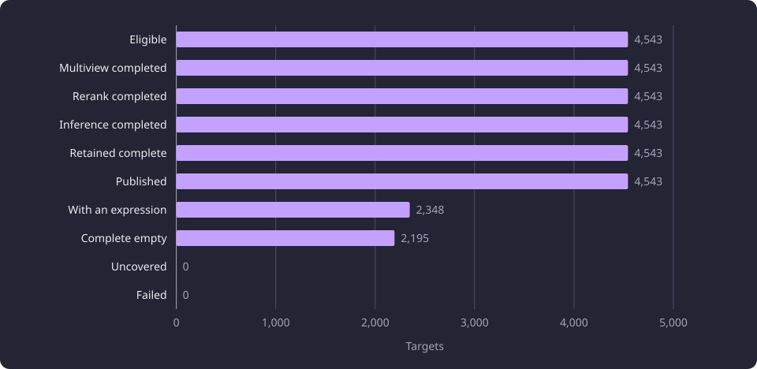
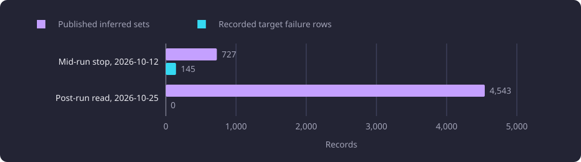

# Full-catalogue inference run

This report asks whether one inference cycle could finish over every active course without losing a target.

**Evidence status:** Observational. **Run dates:** acceptance 30 September 2026, model attempts 9 to 21 October 2026, post-run read 25 October 2026.

The [Experiments overview](/docs/experiments/README.md) states the catalogue, the evidence labels and the hardware specifications. The [Inference experiments](/docs/experiments/inference/README.md) overview places this report in the category. This report covers execution, coverage and recovery. The quality of the selected configuration is reported in [Held-out model quality](/docs/experiments/inference/held-out-model-quality.md), and its fit and speed in [Local model hardware and throughput](/docs/experiments/inference/local-model-hardware-and-throughput.md).

The coverage measurements are read-only observations of the completed run, with no variant measured against another.

## The question

Inference proposes prerequisites for one target course from its teaching text and a bounded candidate list. Every active canonical course is a target, an inactive course is a valid candidate source, and one cycle visits every target. The operational question was whether that cycle could complete over the whole active catalogue on a part-time worker without losing a target.

The catalogue holds 4,543 active targets among 11,086 courses. Each target needs a candidate pool, a rerank and one generation call, and the run had to finish inside a month from its start on an AMD Radeon RX 9070 XT (16 GB model), in a machine that also served other work outside the dedicated measurement periods. A defect in one target can go unseen at small scale, so the line checked publication, recovery and full-scale preparation before the whole catalogue ran.

The quality question is separate and is not re-measured here. The configuration had been judged on 150 held-out packets, and the run applied it. This report measures execution, [inference coverage](/docs/reference/glossary.md#inference) and recovery, not whether a proposed prerequisite is right.

## Setup

### The pipeline a run executes

One processing cycle advances through multiview, rerank, inference and publication and reaches complete when every target checkpoint is terminal and no target is failed. The three compute stages record a durable checkpoint per target, so a stopped run resumes at the first unfinished target unit, and publication runs once over the retained cohort. A stop finalizes on the worker, returns the worker's dataset copy and makes the verified copy the selected dataset. A completed cycle marks every catalogue course processed, the inactive candidate sources included. [Inference processing](/docs/backend/inference/README.md) states the cycle and its checkpoints, and [Stage lifecycle](/docs/operations/stage-lifecycle.md) states the stop and the return.

### The configuration the run applied

| Route | Model | Settings | Output contract |
|---|---|---|---|
| Local generation | Qwen3.8-27B | IQ3-MIX, 12.6 GB, 131,072 tokens with MTP and 163,840 without, `q4_0` KV | Prompt v9, schema v2, pipeline v1 |
| Rerank | BAAI/bge-reranker-v2-m3 | Q8_0, top 50 of a 1,000-course pool | Pair scores only |
| Oversize generation, the route this run supplied | DeepSeek V4.1 Flash | Thinking enabled at low reasoning effort, 40,000-token output cap, no temperature or seed sent | Prompt v9, schema v2, pipeline v1 |

The pipeline version was `v1`. No quality filter ran inside the run. Recommendations were kept, and every confidence and finding flag was retained as raw evidence. The full-catalogue run used the model, prompt and result schema whose quality the [held-out benchmark](/docs/experiments/inference/held-out-model-quality.md) judged before the run started.

The run's policies were the configured ones: `INFERENCE_ROUTING_POLICY` `solo_fit_only`, `INFERENCE_RECOMMENDATION_POLICY` `include` and `INFERENCE_FINDING_FILTER_POLICY` `none`. The routing policy is strict fit-only and supplies no fallback route, so the run added its oversize route explicitly. No operator decision narrowed the cohort and no target was skipped.

The local model and the rerank ran on an AMD Radeon RX 9070 XT (16 GB model) on ROCm 7.2.1, in a machine with 33.4 GB of usable RAM. The fit measurements ran under a 4.295 GB memory limit and 8.590 GB of swap, and no memory-cap record covers the full run. The generation rate per complete target is reported in [Local model hardware and throughput](/docs/experiments/inference/local-model-hardware-and-throughput.md).

### The cohort

The run read the fixed catalogue snapshot: 11,086 courses, of which 4,543 are active, and 58,962 teaching-text chunks. Every active canonical course is an eligible target and every course is a candidate source. The rerank kept 50 candidates per target, so the expected packet-candidate count was 50 for each of the 4,543 targets, or 227,150.

### What was and was not measured

The post-run read counted coverage, routes, published sets, groups and warnings on the selected dataset. It did not measure a per-target split of prefill, decode, load and transfer time. It did not reconstruct prompt-token counts for the oversize route, which the product does not retain. Three checks of the finished catalogue were not run: a representative command acceptance over published results, an unchanged-rerun proof and a changed-source recalculation proof.

### The retry rules the run used

Multiview selection, rerank and request preparation retry one target up to three times. After those attempts the stage is failed for that target, its downstream stages are blocked, and a following run retries it.

Whole-target local generation retries without a fixed attempt cap until one result is accepted or the run is stopped. A failure stays with its target, so the next entry resumes it at the failed stage instead of rebuilding it. The run supplied an explicit oversize route outside the fit rule, so a target that fitted no local key was sent whole to DeepSeek V4.1 Flash rather than failing as `context_exceeded`. [Inference scheduling and disposition](/docs/backend/inference/inference-scheduling.md#failures-retries-and-isolation) states the retry policy and its settings.

## Final coverage

The run finished as one processing cycle at the complete stage. Its model attempts ran from 2026-10-09 06:19 UTC to 2026-10-21 08:07 UTC.

| Measure | Value |
|---|---|
| Eligible active targets | 4,543 |
| Multiview, rerank and inference completed | 4,543 each, 0 skipped |
| Retained complete and published | 4,543, 4,543 |
| Uncovered, failed and pending targets | 0, 0, 0 |
| Operator dispositions | 0 done, 0 failed |
| Local route | 4,520 |
| Oversize DeepSeek route | 23 |
| Packet candidates observed and expected | 227,150, 227,150 |
| Equivalence groups | 345 |
| Strict-ancestor diagnostic warnings | 669 |

The 4,543 published sets split into two kinds.

| Published set | Count |
|---|---:|
| With a prerequisite expression | 2,348 |
| Complete empty | 2,195 |
| Total published | 4,543 |

Every eligible target was retained and published. Of the 4,543 published sets, 2,348 carry an expression and 2,195 are complete empty results. An empty set is a complete result that names no option, so it contributes no inferred prerequisite and is not counted as uncovered. The finished catalogue holds 345 equivalence groups.

The 669 strict-ancestor diagnostic warnings were recorded as review evidence only. A warning marks an accepted option that is also a strict ancestor of another accepted option for the same target, and it changes no stored result. The warnings scheduled no model work and triggered no rerun. All 11,086 catalogue processing markers are processed: the 4,543 active targets and 6,543 inactive courses that served as candidate sources without target attempts of their own.

The chart shows the target counts at each stage and the content of the published sets.



### Recovery across the run

The run stopped on 12 October and continued from its retained cycle. The two reads of the selected dataset are below.

| Measure | 12 October stop | 25 October post-run read |
|---|---:|---:|
| Published inferred sets | 727 | 4,543 |
| Recorded target failure rows | 145 | 0 |

The chart compares the two reads.



No failure survived the run. A target whose stage had failed would have blocked its downstream stages, and the run reported one complete cycle with no failed target, so every target that recorded a failure ended with an accepted result. That is an interpretation from the end state. The post-run read counts failure rows without classifying them, so which targets failed and how often is not known.

## Capacity routing

The fit rule tests each prepared packet against the local keys in configuration order. The prompt count from the prepared request, the 8,192-token output cap and the 1,024-token margin are added, and the total must fit the key:

```text
fits = prompt_tokens + 8192 + 1024 <= key_context
```

The first key holds 131,072 tokens and enables MTP speculation with two draft tokens. The larger key holds 163,840 tokens and runs without MTP. A packet that fits the first key is generated on that key, and a packet that fits only the larger key is generated on the larger key.

When neither key fits, the packet has no local route. The product records one capacity failure for the target with the reason `context_exceeded`, makes no generation request and writes no work or proposal for it, and blocks its downstream stages. The routing step does not shorten the packet.

The larger key leaves 154,624 tokens for the prompt, because it reserves the output cap and the margin:

```text
163840 - 8192 - 1024 = 154624
```

One measured oversize packet held 181,131 prompt tokens. This run supplied an explicit oversize route that sent each such target whole to DeepSeek V4.1 Flash, and 23 targets took it. The route sends the packet without truncation. Both routes call the same whole-target writer, which validates the result and records the attempt for the same target and cycle. The route opens only after a completed prompt count finds no fitting key, so a tokenizer failure, a refused admission or a local generation failure does not reach it.

The 23 oversize targets are the measured gap between the full-catalogue packets and the two local keys. The 4,520 local targets were served by Qwen3.8-27B under prompt v9 and schema v2.

The diagram shows the two fit tests, the product boundary and the route the run supplied outside the fit rule.


None of the 23 neither-fit targets ended at `context_exceeded`.

## Failed approaches

### A complete empty result re-read as schema v1

A bounded acceptance of 20 targets ran on 30 September 2026, with 50 candidates each and 1,000 packet candidates in total. All 20 targets took the local route, composition produced 12 proposals, the acceptance held three equivalence groups, and publication wrote nothing.

Eight of the 20 valid results were complete empty results. They named no required, recommended or equivalence finding, and their routing confidence was 0.3 with the routing flag `insufficient_course_information`. Each was validated and stored as a schema v2 result. Proposal composition rejected all eight with a message that composition requires a validated schema v2 result.

The stored read caused the refusal. A complete empty v2 document carries no per-finding flag anywhere, because its option and group lists are empty, and that makes it structurally identical to a v1 document. The stored result was re-read through a left-to-right union that tries v1 first, so exactly this shape came back as a v1 result and composition refused it. The composition path had been exercised only with the in-memory attempt, never with a re-read of the stored document.

Publication would have written the 12 non-empty targets and reported the eight empty ones as having no accepted result, so the partial publication would have looked complete. The acceptance halted before the publication writer was called, and the final stores held 0 inferred sets, 0 groups and 0 members.

Binding the stored-result read to the schema recorded on the run made the eight results compose, because a stored document is then validated against the schema that produced it. The 12 retained proposal identities did not change, and publication wrote 20 sets, three groups and 17 members. A read-back returned all 20 as current and complete, and a product command on one empty target returned complete coverage with 50 eligible, 50 processed and 0 accepted sources, no requirement nodes and no route courses.

The lesson is that a shape-only union cannot tell a complete empty v2 result from a v1 result, so a stored read must be bound to the schema that produced the document.

The acceptance completed from the stored works with no GPU, model, rerank, embedding or external call. Embedding rows and rerank scores were not recomputed.

### Readiness at full scale

At full scale, a restore of the catalogue failed because PostgreSQL's parallel index build could not allocate a 64 MB shared-memory segment in the database container's default shared-memory size, and raising that setting to 1 GB let the restore finish with a dataset verification identical to the enrolled receipt.

The worker session then failed after about 143 s with a database driver error, because two readiness reads built one statement over the whole catalogue: one held 294,810 bind parameters from 58,962 chunk identities, above the driver's 65,535-parameter ceiling, and the other held 11,086 course pairs, above PostgreSQL's statement-complexity limit. Both reads were changed to bounded batches of 1,000 identities or pairs, and the embedding-state digest kept the same record list, sort key and hash, so its bytes, the work identities and the reuse did not change.

## Interpretation

The operational path completed. Every eligible target reached retained complete and published, the uncovered, failed and pending counts are zero, the two route counts sum to the cohort, and the packet-candidate count equals 50 for each target. On the counts it reports, the run has no silent gap.

The empty share is the largest fact the run adds. 2,195 of the 4,543 published sets name no option. The coverage counts measure stored results, not correctness, so they cannot separate a correct no-prerequisite answer from a model omission. Judged support measures emitted findings only and inherits the same limit, as [reference answers and judging](/docs/experiments/inference/reference-answers-and-judging.md) states.

The blocking defects were found before the full run, and the run measured the corrected behavior. A full-scale preparation run measured the worker process at 575 MB resident set size and a 621 MB resident high-water mark, and the database container at about 2,000 MB, through its first multiview unit, all inside the 4.295 GB budget. This measured preparation, not a full run under load. No PostgreSQL memory tuning and no per-target lazy course text was applied.

The line does not support quality, per-target speed, rerun behavior or invalidation behavior. The coverage counts and the route split are the evidence, and the quality evidence is on the held-out report.

## Limits

Each limit below changes how a result is read. The limits shared by every inference report are on [Inference experiments](/docs/experiments/inference/README.md#limitations).

- No rerun or invalidation proof. The post-run check asked whether the inferred results exist. A representative command acceptance, an unchanged rerun and a changed-source recalculation were not run, so the finished catalogue has no measured rerun or invalidation behavior.
- No oversize token counts. The product does not retain prompt-token counts for the 23 oversize targets, and they were not reconstructed, so the oversize route has no token distribution.
- Unclassified failure rows. The run's failure history is known only from the two counts, so which targets failed and how often is not known.
- Unchanged-input completion. The 20-target acceptance completed from stored works, and embedding rows and rerank scores were not recomputed, so the completion is not evidence of fresh operational selection.
- Unadjudicated warnings. The 669 strict-ancestor warnings were not adjudicated and triggered no rerun.
- Unadjudicated empty sets. The 2,195 complete empty sets were not checked against the official record or a human reading, so a correct no-prerequisite answer and a model omission are not separated.
- Groups untested against official substitutes. The 345 equivalence groups were not tested against official substitutions.
- Memory under load unavailable. The reading failed for the 20-target acceptance and is recorded as unavailable, and no memory-cap record covers the full run.
- Elapsed span. The model attempts ran from 2026-10-09 06:19 UTC to 2026-10-21 08:07 UTC, across part-time runs, pauses, restarts and dataset transfers. The span says nothing about throughput, and the generation rate is on the hardware report.

## Open questions

Each question below is untested.

- An unchanged rerun on the finished catalogue, which would show that matching work is reused and no target is regenerated.
- A changed-source recalculation, which would show that only the affected targets re-enter and that unchanged courses which become candidates are picked up.
- A per-target time and token split, including the 23 oversize packets, which would separate prefill, decode, load and transfer from the elapsed span.
- An adjudication of the 669 strict-ancestor warnings, which would show what each warning marks and whether it needs a correction.
- A comparison of the 345 equivalence groups with the university's official substitutions.
- A check of the 2,195 complete empty sets against the official record or a human reading, which would separate a correct no-prerequisite answer from an omission.
- A fresh-input acceptance over 20 targets, which would repeat the publication path from newly computed embeddings and rerank scores.
- Memory under load on a full run, which the 20-target acceptance could not read.
