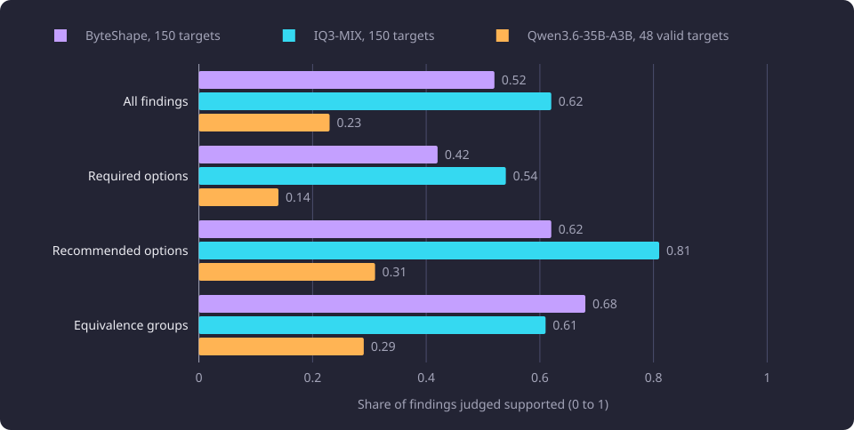

# Held-out local model quality

This report compares the local language models' judged prerequisite quality on held-out courses and states the selected model and policy.

**Evidence status:** Comparative. **Run dates:** 28 and 29 September 2026.

The [Experiments section](/docs/experiments/README.md#inference) states the catalogue, the hardware and the evidence labels. The [local model hardware and throughput](/docs/experiments/inference/local-model-hardware-and-throughput.md) report states the fit envelope, the context keys and the measured rates. [Reference answers and judging](/docs/experiments/inference/reference-answers-and-judging.md) states the reference answers, the judge and the verdict rubric. The [confidence and flag calibration](/docs/experiments/inference/confidence-and-flag-calibration.md) report states the rule fitted to confidence and finding flags. Candidate retrieval and packet selection are separate reports. The [Inference experiments limitations](/docs/experiments/inference/README.md#limitations) state the category-wide limits.

Three models produced judged findings on the held-out cohort, and the difference between their judged support carries the main claim. The [Inference experiments](/docs/experiments/inference/README.md) overview places this report in the category.

## The question

[Inference](/docs/backend/inference/inference.md#what-inference-produces) asks one local model to propose the prerequisites of one target course from 50 candidate courses. The packet bounds what the model can name, and the prompt and schema bound the form of the answer. One unit of an answer is a finding: one required option, one recommended option or one equivalence group. The remaining question is whether the answer is right: whether a named course is knowledge the target expects on entry, whether the required or recommended category is right, and whether an equivalence group is course-wide.

This line measured that question on courses the model had not been tuned on. It asked four things. Which local model produced the strongest supported findings? Was its answer valid often enough to run? Could its own confidence and finding flags remove harmful claims without removing supported ones? And which model and routing policy should produce the catalogue?

The quality ordering used here places a right course in the right category first, a right course in the wrong required or recommended category second, and an omission third. A course that is not a prerequisite at all is the error that matters. That ordering is why an unsupported required finding carries more weight than an omitted finding, and why unsupported counts stand beside every supported share in this report.

Quality here is not candidate recall. A course missing from the 50-candidate packet is invisible to every model, and no model quality can recover it. [Candidate retrieval and reranking](/docs/experiments/inference/candidate-retrieval-and-reranking.md) and [candidate packet selection](/docs/experiments/inference/candidate-packet-selection.md) measure that side. Speed is separate and is measured on [the hardware report](/docs/experiments/inference/local-model-hardware-and-throughput.md). Throughput did not decide the model, because the fastest models were not the best supported.

## Held-out packets and the comparison

The comparison used 200 active target courses with a representative version, fixed before any answer was generated. They are disjoint from the fixed 100-target development set, and every prompt-example target and candidate is excluded, as [candidate retrieval and reranking](/docs/experiments/inference/candidate-retrieval-and-reranking.md) states. Each target has a CE-only packet, meaning 50 candidates selected by the cross-encoder alone from a 1,000-candidate pool. The packet carries the target and the candidate descriptors with their teaching text. It carries no retrieval score, rank value or official prerequisite label.

The four local artifacts are Qwen3.8-27B IQ3_S ByteShape, Qwen3.8-27B IQ3-MIX (MIX below), Qwen3.6-35B-A3B UD-IQ3_S and gpt-oss-20b MXFP4. Nemotron-3-Nano-30B-A3B was dropped before the comparison, so no quality number covers it. [The hardware report](/docs/experiments/inference/local-model-hardware-and-throughput.md) records its probe.

The 200 split into two groups fixed before any output. The 50 tuning targets were used to tune ByteShape's prompt and were not part of the comparison. The other 150 were the held-out complement, never used to tune ByteShape. Before any output existed, the 150 were ordered by rendered CE user-prompt character length and target identity. The 50 comparison targets are the size quantiles at the integer-floor indices `(i * 149) // 49` for `i = 0` to `49`, so the smallest and largest packets are included. Their rendered user-prompt sizes span 38,967 to 270,860 characters. The 50 is the shared comparison cohort and the distinct-target validation set for any ByteShape drop or demote rule. The other 100 are the rule-fit set.

The cohort split and the models that ran each set are tabulated below.

| Set | Targets | Models that ran it |
|---|---:|---|
| Tuning targets | 50 | ByteShape for prompt tuning only, excluded from the comparison |
| Shared comparison cohort | 50 | ByteShape, MIX, Qwen3.6-35B-A3B, gpt-oss-20b |
| Other 100 targets | 100 | ByteShape, MIX |

MIX ran the shared 50 and the other 100 as separate cohorts, producing 178 judged findings in total.

Every model saw the same packet bytes, prompt text, schema and generation settings for a target. Every held-out trial used prompt version 9 and schema version 2, and version 8 was never run on the held-out cohort.

Official prerequisite labels were absent from every packet, prompt, request and judge item. The cohort's labels had been read in an earlier retrieval measurement, so the 200 are not an untouched holdout for ranking policy. No label entered an input and the judge read only teaching text, so the answer quality comparison does not read that earlier measurement.

## Models and answer validity

Validity here means the response parsed against the strict result schema. The table gives each model's targets, valid and invalid answers, and judged findings.

| Model | Targets | Valid | Invalid | Findings judged | Observation |
|---|---|---:|---:|---:|---|
| ByteShape | 150 | 150 | 0 | 168 | No skip and no truncation |
| MIX | 150 | 150 | 0 | 178 | 55 findings on the shared 50, 123 on the other 100 |
| Qwen3.6-35B-A3B | 50 | 48 | 2 | 109 | Two invalid answers retained, one further finding unjudgeable |
| gpt-oss-20b | 50 | 0 | 50 | 0 | Empty content on every attempt |

The gpt-oss failure is a model and runtime interaction, not a slow answer. All 50 attempts returned HTTP 200 with `finish_reason=length`, 8,192 completion tokens and empty content, because the harmony analysis channel consumed the whole output cap. [The hardware report](/docs/experiments/inference/local-model-hardware-and-throughput.md) states the request shapes tried and the runtime constraint. No valid gpt-oss result exists, and no substitute was used for it.

Qwen3.6 returned 48 valid answers from 50 targets. The two invalid responses were retained as invalid and were not repaired. Its 109 judged findings carry the supported shares below. An invalid answer cannot become a proposal.

## Judged support

Every finding that could be judged was judged blind against the teaching text the model had been given, by the same judge model and rubric as the reference corpus. The verdicts are `supported`, `partly`, `unsupported` and `unclear`. A `supported` verdict means the supplied teaching text supports the claim under the rubric. A `partly` verdict can mean a partial AND option or a wrong category, and the local `partly` findings were not re-judged at a finer grain. `partly` and `unclear` are never folded into `supported`. The supported share is supported findings divided by judged findings. The rubric and the limits it imposes are on [Reference answers and judging](/docs/experiments/inference/reference-answers-and-judging.md#limits-of-judged-support).

| Model | Findings | Supported | Partly | Unsupported | Unclear | Supported share | Required supported | Recommended supported | Equivalence supported | Outright unsupported |
|---|---:|---:|---:|---:|---:|---:|---|---|---|---|
| ByteShape | 168 | 88 | 52 | 26 | 2 | 0.52 | 41/97 = 0.42 | 15/24 = 0.62 | 32/47 = 0.68 | 22 required, 2 recommended, 2 equivalence |
| MIX | 178 | 111 | 51 | 15 | 1 | 0.62 | 54/100 = 0.54 | 38/47 = 0.81 | 19/31 = 0.61 | 15 required, 0 recommended, 0 equivalence |
| Qwen3.6-35B-A3B | 109 | 25 | 39 | 38 | 7 | 0.23 | 7/49 = 0.14 | 12/39 = 0.31 | 6/21 = 0.29 | 20 required, 12 recommended, 6 equivalence |

The chart compares the three models' supported shares for all findings and for each category.

Observed: MIX has the highest supported share on all findings and on required options. ByteShape has the highest equivalence share. Qwen3.6 is lowest in every category. All three models support recommended findings more often than required findings.

MIX's 150 combines the shared 50, where 37 of 55 findings were supported, a share of 0.67, and the other 100, where 74 of 123 were supported, a share of 0.60.

MIX leads ByteShape by 23 findings on all findings. ByteShape's equivalence lead is 13 findings on different denominators, and the equivalence rubric is strict enough that its verdicts were treated as a lower bound. Qwen3.6 is far below both, with 20 unsupported required findings out of 49.

## Secondary corrected-reference comparison

The second measure compares each complete answer with the corrected reference, canonically and independently of option order. Precision and recall count exact option or equivalence findings. Structural equality requires the whole result to match. This measure is secondary. The reference is single-sample and incomplete, and it carries more findings than any local model emits, as [the reference method](/docs/experiments/inference/reference-answers-and-judging.md) states. On the ByteShape 150 it holds 239 findings against 168 emitted, so a low F1 is expected by construction and is not an accuracy score.

| Model | Cohort | Precision | Recall | F1 | Structural equal |
|---|---|---:|---:|---:|---:|
| ByteShape | 150 | 0.286 | 0.201 | 0.236 | 47/150 |
| MIX | 150 | 0.225 | 0.167 | 0.192 | 45/150 |
| Qwen3.6-35B-A3B | 48 valid | 0.109 | 0.141 | 0.123 | 3/48 |

ByteShape's F1 was 0.230 on its 100 fit targets and 0.247 on the validation 50. MIX's F1 was 0.155 on the shared 50 and 0.211 on the other 100. MIX's combined 0.192 sits below ByteShape's 0.236, so this measure reverses the order of the two strongest models. That reversal is why the secondary measure did not decide the model. It is a disagreement diagnostic, and the primary measure is the blind judged support.

Over ByteShape's 150 targets, 47 results were structurally equal. The mean was 1.3 missing and 0.8 extra option findings per target, with 191 missing and 120 extra option findings in total. A count difference is not a judgment that each reference item is correct or that each extra item is harmful, and no numeric breakpoint was selected from these counts. The corrected reference's 45 target-not-member equivalence groups were judged against the target rather than only among the members, which affects the secondary comparison of those groups. [The reference method](/docs/experiments/inference/reference-answers-and-judging.md#the-equivalence-exception) states the exception.

## Required versus recommended

Required is the weak category for every model. The table gives the counts. MIX had no unsupported recommended finding at all, and its recommended share was 0.81.

The category difference is observed, not a decomposition of why. A `partly` verdict can mean a wrong category, and the local `partly` findings were not split into wrong-category and partial-AND cases. Whether a specific finding belongs in required or recommended is therefore measured only through the four verdicts, not separately.

A recommendation-skip option was available: publish the recommended set empty as a complete result. The selected policy publishes recommendations as emitted. MIX's recommended findings were supported at 0.81 and none was outright unsupported. No skip applied.

## Confidence and flags as a filter

A rule built from ByteShape's own confidence and finding flags was fitted on the 100 fit targets and applied as fitted to the distinct 50. It failed on both cohorts, because neither signal marked a harmful claim, and no candidate rule improved F1 on either cohort. Target-level routing confidence and routing flags marked targets with no unsupported finding rather than harmful ones, so they could not calibrate a reroute rule either. [Confidence and flag calibration](/docs/experiments/inference/confidence-and-flag-calibration.md) states the rule fit, its counts and the routing groups.

MIX adds no separation signal, and the ByteShape rule was not fitted to MIX, so a MIX-specific filter would need its own calibration. The selected policy applies no confidence cutoff, no finding drop, no demotion and no uncertainty-triggered reroute. Confidence and both flag sets are stored as raw evidence.

## The option-pool shape check

The selected product composition treats each category as one [option pool](/docs/reference/glossary.md#prerequisites-and-routes) of complete options. The 150 MIX results were read to see whether their top-level shape matches that composition. The check computed no quality measure.

| Category | Results with no set | Results with one set | Results with two or more sets |
|---|---:|---:|---:|
| Required | 77 | 73 | 0 |
| Recommended | 115 | 35 | 0 |

No parsed MIX result had two or more requirement sets in either category. The v9 prompt says that multiple top-level sets are an AND. A multi-set result is therefore refused at proposal composition rather than flattened into the selected per-category OR pool. The case did not occur in these 150 results, so the rejection path has not been exercised on measured output.

## The selected configuration

The model and policy below were selected on 2026-09-29 and applied to the full-catalogue run.

| Element | Selected value |
|---|---|
| Model | Qwen3.8-27B IQ3-MIX |
| Prompt and schema | v9 and version 2 |
| Routing | MIX runs solo. `INFERENCE_ROUTING_POLICY` is `solo_fit_only`. A packet that fits neither local key fails as one capacity failure with the reason `context_exceeded` when no explicit route is supplied, and no generation request is made for it |
| Quality filter | None. `INFERENCE_FINDING_FILTER_POLICY` is `none`. No confidence cutoff, no finding drop, no demotion and no quality-triggered reroute |
| Recommended findings | Included exactly as emitted. `INFERENCE_RECOMMENDATION_POLICY` is `include` |
| Measured quality | 111 of 178 findings supported (share 0.62), 54 of 100 required findings supported (share 0.54) |
| Known limit | 15 unsupported required findings treated as uncertainty, not as fact |
| Not selected | ByteShape, Qwen3.6-35B-A3B, gpt-oss-20b and Nemotron-3-Nano-30B-A3B |

The two local keys are on [the hardware report](/docs/experiments/inference/local-model-hardware-and-throughput.md), and [the fit rule](/docs/backend/inference/inference-scheduling.md#the-fit-rule) states the rule the product applies. The product routing policy supplies no fallback route. A caller can supply one explicit oversize route, and this run supplied one.

The 15 unsupported required findings are the part of the result a reader can act on in the product. A reader who finds an inferred course wrong can mark it [Excluded](/docs/guides/prerequisites.md#exclude-a-course-or-a-requirement), and the route then does not pass through it. That remedy does not make the remaining inferred output official data. The 15 findings are findings whose supplied text did not support the claim, not proof that the courses are not prerequisites.

The full-catalogue run applied this configuration with one explicit capacity route that sent a packet fitting neither local key whole to DeepSeek V4.1 Flash. [The full-catalogue inference run](/docs/experiments/inference/full-catalogue-inference-run.md) records that route and its count. That route is an example of the caller-supplied route, not a product fallback.

## What the numbers support

### Observed

- MIX has the highest supported share on all findings and on required findings. ByteShape has the highest equivalence share, and Qwen3.6 is lowest in every category.
- On the secondary corrected-reference measure ByteShape scored 0.236 and MIX 0.192, the reverse of the primary order. Qwen3.6 scored 0.123.
- No confidence or flag rule improved either ByteShape cohort, and no low-confidence target was harmful.
- Every MIX result had at most one requirement set per category.
- gpt-oss produced no valid answer, and Nemotron was dropped before the comparison.

### Interpreted

MIX is the strongest of the measured models on the primary measure, on all findings and on required findings. The lead is 0.10 on all findings, on one night of single samples, so it is a lead rather than a decisive separation. ByteShape's equivalence lead and secondary F1 lead do not make it the stronger overall model, because the secondary measure is a disagreement diagnostic and not truth.

Required is the weak category for every model. The selected policy publishes the measured output despite that weakness, rather than adding a filter that the ByteShape fit shows does not separate harmful claims. The supported shares are conditioned on emission and measure findings rather than recall, as the [category limitations](/docs/experiments/inference/README.md#limitations) state. Qwen3.6 emitted the fewest findings and scored lowest, so emission volume alone does not explain the ranking.

### Failed hypotheses

- A confidence threshold could remove harmful claims.
- A finding-flag filter could remove harmful claims.
- A target-level routing confidence or flag could route harmful targets away from the model.
- gpt-oss-20b could produce a valid complete answer on this runtime.
- Nemotron-3-Nano-30B-A3B could run at a usable speed and validity.

### Not supported

- An `unsupported` verdict does not mean the course is not a prerequisite. It means the supplied text did not support the claim under the rubric, and the judge may be wrong.
- A `supported` verdict does not mean the university publishes that prerequisite. It means the supplied text supports the claim.
- The supported shares are not exhaustive ground truth and they are not a recall measure, as the [category limitations](/docs/experiments/inference/README.md#limitations) state. They cover the findings a model emitted, and 43 of ByteShape's 150 targets emitted none.
- The MIX lead and ByteShape's equivalence lead are single-night observations on fixed cohorts, not guarantees. The equivalence rubric is strict, so its verdicts were treated as a lower bound.
- The Qwen3.6 result covers the 48 valid answers and the 50 packets it saw.

## Limitations

The [Inference experiments limitations](/docs/experiments/inference/README.md#limitations) state the category-wide limits that apply here, and [the reference method](/docs/experiments/inference/reference-answers-and-judging.md#limits-of-judged-support) states the judge, the truncated text and the reference limits. The limits below change how this comparison reads.

### Small denominators

MIX's required share rests on 100 findings, its recommended share on 47 and its equivalence share on 31. ByteShape's shares rest on 97, 24 and 47. Qwen3.6's shares rest on 49, 39 and 21. A difference of a few findings moves a share by several points, and no confidence interval is recorded for any supported share.

### The comparison cohorts are not random

The 50 comparison targets are deterministic size quantiles of the 150, chosen to span packet size, not a random sample. MIX's own two cohorts differ in share, which is consistent with the cohort mix moving the combined share, and each cohort was run and judged separately. Qwen3.6 and gpt-oss were measured on the 50 only, so their results are not a 150-target result. ByteShape and MIX were measured on 150.

### One judge and fixed cohorts rank the models

The ranking is a comparison on fixed cohorts under one judge. The judge is one model with one rubric, and no human re-read exists, so the judge's error rate is unknown. No second judge or cohort was run, so the order is relative to this judge and these cohorts.

### Validity was schema-only

The local runner checked the response against the strict result schema and did not require every named course to appear in the supplied packet. One Qwen3.6 finding named `HIS.HIA.100`, a course its packet did not carry. The judge had no supplied teaching text for that course, so the finding was recorded as unjudgeable and is excluded from the judged totals. A schema-valid answer can therefore cite an unsupplied course, and the 48 valid Qwen3.6 answers and the 150 valid answers of ByteShape and of MIX are schema-valid, not necessarily packet-membership-valid. The reference corpus used a stricter check that also required every named code to appear in its packet.

### The prompt family is not pristine

The 150 were never used to tune ByteShape, but the prompt family is not pristine, because the v6 wording that the v9 prompt inherits was shaped by held-out answers on the same 200-target packet set. A different prompt could change every share here, and no second prompt was measured on the 150.

## Measurement settings

| Parameter | Value |
|---|---|
| Generation | Thinking off, temperature 0, seed 0, output cap 8,192 tokens, timeout 300 seconds |
| Sampling | One sample per target, invalid answers retained |
| Judge | Claude Opus 5.5 at the low variant, blind to model, confidence, flags and labels |
| Hardware | AMD Radeon RX 9070 XT (16 GB model), ROCm 7.2.1 |

## Untested follow-up questions

The category overview lists the shared follow-ups for a second sample, a human re-read, a MIX-specific filter and a packet-membership check. [Inference experiments](/docs/experiments/inference/README.md#open-questions) states them. The questions below are specific to this comparison and are untested.

1. A second judge, or a human re-read of the same findings, would test whether the model order depends on this judge. No such measurement exists.
2. Running Qwen3.6-35B-A3B on the other 100 targets would test whether its 0.23 share is a property of the model or of the shared 50. It was measured on the 50 only.
3. A prompt comparison on the 150 would test whether the v9 shares hold under a different prompt. No second prompt was measured on the 150.
