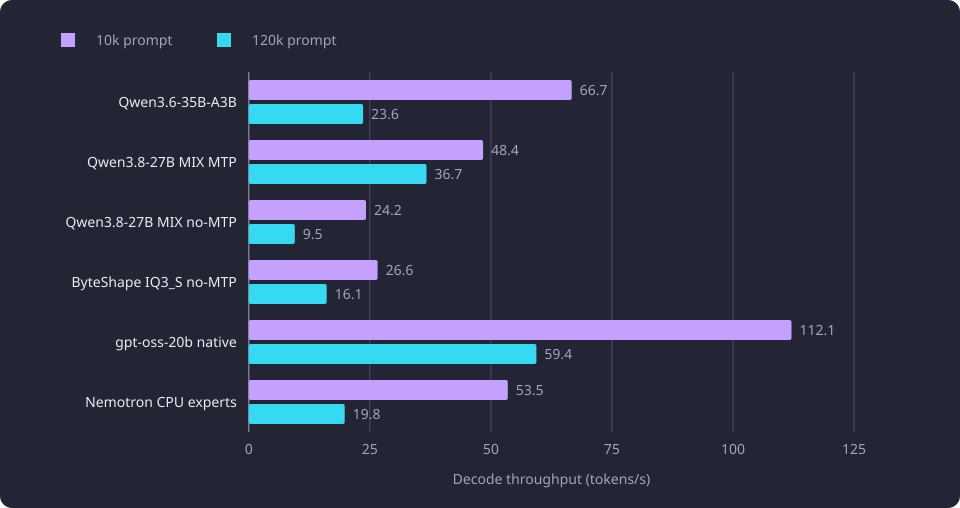

# Local model hardware and throughput

This report records which local language models fitted the inference GPU, how much context each key held, and how fast each ran.

**Evidence status:** Comparative. **Run dates:** 19 September 2026 for the fixed-prompt measurements, 28 and 29 September 2026 for the held-out packet measurements, and 14 October 2026 for the context estimate.

The [Experiments overview](/docs/experiments/README.md) states the catalogue, the evidence labels and the hardware. This report covers one line of the inference work: the fit, memory and speed measurements that decided which artifact, quantization and context the inference stage could use, and the two context keys the full run applied. The [held-out model quality](/docs/experiments/inference/held-out-model-quality.md) report owns the quality comparison, the cohort split and the model and policy selection. The [Inference experiments](/docs/experiments/inference/README.md) overview places this report in the category.

## The question

The [inference stage](/docs/backend/inference/inference.md) sends one complete target call per course. The call carries the target course, 50 candidate courses, a versioned system prompt and nine curated examples, and it must return one strict JSON result. On one AMD Radeon RX 9070 XT (16 GB model), the question was whether a 27B-class model, its KV cache for a long packet and the runtime could fit together, which quantization and KV cache type fitted, and how many seconds one complete target took.

The scale made the answer consequential. The catalogue holds 4,543 active target courses, and the run had to finish inside a month from its start. A rate that looked acceptable on a short prompt could still miss that ceiling once every packet carried tens of thousands of prompt tokens. The measurements therefore covered both fixed prompt lengths and the held-out packets.

## Setup

### Hardware and runtime

The runs used an AMD Radeon RX 9070 XT (16 GB model label) on ROCm 7.2.1, in a machine with 33.4 GB of usable RAM. The 16 GB is the card's model label, and the memory values converted from the counters use decimal MB and GB.

The device target was `gfx1201`. The displays were moved to the integrated GPU, so the discrete card carried no desktop composition during a run. The environment of the measured runs had a 4.295 GB memory limit and 8.590 GB of swap, set with `memory=4GB` and `swap=8GB`. The limit matters because the driver pages a model that nearly fills VRAM, the GPU's own memory, into system memory when it is idle, and the page cache plus those pages can exhaust system memory.

The runtime was llama.cpp, served by `llama-server` on loopback. Every launch used full GPU offload, flash attention, `--jinja`, `--offline`, `--no-webui`, `--cache-ram 0`, `--ctx-checkpoints 0`, `--parallel 1`, eight threads and 16 batch threads. The fixed-prompt measurements sent one `/completion` request per measurement with `cache_prompt=false` and temperature 0.

The packet runs used temperature 0, seed 0, a cap of 8,192 output tokens, thinking off and an active prefix cache. The shared system and examples prefix was about 13,000 tokens, and after the first request it was reused at about 800 to 880 prefill tokens per second.

### Models and artifacts

| Model | Artifact size | Keys, KV cache and context |
|---|---:|---|
| Qwen3.6-35B-A3B UD-IQ3_S | 13.7 GB | one key, `q4_0` KV, 212,992 tokens, n-gram speculation |
| Qwen3.8-27B IQ3-MIX | 12.6 GB | 131,072-token MTP key with `q4_0` KV, and 163,840-token no-MTP key with `q4_0` KV |
| Qwen3.8-27B IQ3_S ByteShape, 3.23 bits per weight | 11.0 GB | 118,784-token MTP key with `q8_0` KV, and 147,456-token no-MTP key with `q8_0` KV |
| gpt-oss-20b MXFP4 | 12.1 GB | 131,072-token native key with `q8_0` KV |
| Nemotron-3-Nano-30B-A3B IQ4_XS | 18.1 GB of weights | 393,216 tokens with 16 expert layers on the CPU, `q8_0` KV |

The artifact sizes are decimal GB. MTP is the artifact's multi-token prediction mode, n-gram is the runtime's n-gram draft mode, and the count beside MTP is its draft-token limit. The KV cache is the key-value cache that grows with every token of context. The Qwen3.6 file is 13,676,723,168 bytes, the MIX file 12,586,448,320 bytes, the ByteShape file 11,035,354,496 bytes and the gpt-oss file 12,109,566,624 bytes.

The ByteShape artifact is a hybrid with full attention every fourth layer and a state-space component, 64 layers and an embedded MTP head. Its vision projector is a separate 931 MB file and was not loaded, so no VRAM went to it. The 11.0 GB artifact is smaller than the other 27B-class file, but its `q8_0` KV cache is larger per token.

### Packet cohort

The held-out comparison used 200 packets built from the fixed curriculum snapshot. Each packet held the target course, 50 candidate descriptors and the shared prompt material. The candidate count was the configured final candidate count of 50 (`INFERENCE_SELECTION_FINAL_K`), drawn from a pool of 1,000 (`INFERENCE_SELECTION_POOL_K`). The retrieval and ranking stages that build the pool and the packet are described in [candidate retrieval and reranking](/docs/experiments/inference/candidate-retrieval-and-reranking.md) and [candidate packet selection](/docs/experiments/inference/candidate-packet-selection.md). Official prerequisite labels were absent from every packet.

The 200 were split into a 50-target tuning group and a 150-target held-out complement before any output. [Held-out model quality](/docs/experiments/inference/held-out-model-quality.md) states how the comparison cohorts within the 150 were formed.

The measured prompt-token envelope of the 200 packets was 25,982 minimum, 45,323 median, 57,405 at the 90th percentile and 169,654 maximum. Those counts came from the DeepSeek tokenizer. The ByteShape tokenizer measured the smallest, median and largest probes at 26,834, 43,340 and 160,087 tokens. The largest complement packet was 92,815 ByteShape tokens, so all 150 fitted the 118,784-token ByteShape key. Only the tuning 50 held the one packet above 147,456 tokens.

The full run applied the same packet rule to every active target course. It is the only full-catalogue fit sample in this line.

### Metrics

Prefill is the prompt-processing rate, in tokens per second. Decode is the generation rate, in tokens per second. A complete validated target is one packet whose response passed the strict result schema. Its wall clock covers prefill and decode for that target, with no model load and no reboot pause. Mean and median are over the valid targets in the stated cohort.

Memory is reported with three aggregate GPU counters. Aggregate dedicated memory sums the adapter dedicated usage counter over every graphics adapter, and aggregate shared memory sums the adapter shared usage counter over the same adapters. Aggregate GPU process commitment sums the process total committed counter over every GPU process. A per-adapter split was not recorded, so the counters do not establish the discrete card's own allocation. Aggregate process commitment includes allocations backed by system memory. A model-sized rise in shared memory is a spill and fails the fit claim even when the runtime reports full offload.

A fit claim reads the aggregate GPU process commitment, free system RAM and an active generation, because the runtime's free-VRAM report does not reflect these allocations. The policy carried a 40 tokens per second floor for the synthetic runtime qualification, not for each measured target. The complete-target runs were judged on wall clock and ETA.

## The fit envelope

The card, not the model weights alone, was the binding constraint. An 11.0 to 13.7 GB artifact left a few GB for the KV cache and the compute buffers, and the KV cache grows with every token of context.

| Key | Context | KV cache | Batch and ubatch | Speculation | Placement | First failure |
|---|---:|---|---:|---|---|---:|
| Qwen3.6-35B-A3B | 212,992 | `q4_0` | 2048 / 2048 | n-gram | full GPU | 229,376 out of memory at inference |
| MIX, MTP | 131,072 | `q4_0` | 256 / 256 | MTP, 2 draft tokens | full GPU | 147,456 |
| MIX, no MTP | 163,840 | `q4_0` | 1024 / 1024 | none | full GPU | 180,224 |
| ByteShape, MTP | 118,784 | `q8_0` | 320 / 320 | MTP, 3 draft tokens | full GPU | 122,880 |
| ByteShape, no MTP | 147,456 | `q8_0` | 256 / 256 | none | full GPU | 152,576 at inference |
| gpt-oss-20b, native | 131,072 | `q8_0` | 4096 / 4096 | n-gram | full GPU | a request at 196,608 capped the slot |
| Nemotron-3-Nano-30B-A3B | 393,216 | `q8_0` | 2048 / 1024 | n-gram | 16 expert layers on the CPU | 458,752 |

The MIX artifact used `q4_0` KV for both keys. The MTP key stopped at 131,072 tokens, and 147,456 failed. The no-MTP key stopped at 163,840 tokens, and 180,224 failed.

The ByteShape `q8_0` KV cache cost about 35 MB per 1,000 tokens. Its full-GPU envelope was 118,784 tokens with MTP and 147,456 tokens without. A 160,000-token or 192,000-token context was impossible at `q8_0`. MTP made the ceiling tighter.

MTP cost context headroom and bought decode. At a 100,000-token prompt the ByteShape MTP key decoded at 26.2 tokens per second. At a 120,000-token prompt the no-MTP key decoded at 16.1 tokens per second. The prefill cost was small, 751 against 703 tokens per second.

The gpt-oss artifact has a native context of 131,072 tokens. A request at 196,608 tokens reported `n_ctx_seq (196608) > n_ctx_train (131072)` and the runtime capped the slot to 131,072, so a configured context above 131,072 was not achieved. The rates in the fixed-prompt table at the 163,840 and 196,608 configurations therefore describe prompts that fitted the native context.

The Nemotron artifact holds 18.1 GB of weights, which does not fit the card. It ran only with expert layers on the CPU. The lowest usable count was 13 CPU layers at 131,072 tokens, 14 at 163,840 and 16 at 196,608. Prefill ranged from 321 to 561 tokens per second and decode from 9.7 to 57.5. It was dropped before the held-out run.

### A smaller ubatch could not buy context

At 160,000 tokens the ByteShape MTP draft cache was 671 MB in f16, and `--spec-draft-type-k/-v q4_0` reduced it to 189 MB, but the target-side speculative buffers still overflowed. Lowering the ubatch to 64, 128 or 256 did not free enough. A ubatch below 256 also collapsed prefill to about 600 tokens per second, so the batch could not be reduced to buy context. The MTP key stayed at 118,784 tokens and the no-MTP key at 147,456.

## VRAM accounting

The memory measurement compared an idle baseline with ByteShape generating. The GPU counters are aggregate sums, as defined above, and the table gives each recorded value in decimal MB and GB.

| State | Aggregate dedicated | Aggregate shared | Aggregate GPU process commitment | Free system RAM |
|---|---:|---:|---:|---:|
| Idle before load | 927 MB | 353 MB | 1,501 MB | 24.3 GB |
| ByteShape loaded and generating | 16,922 to 16,926 MB | 338 to 387 MB | 18,299 to 18,349 MB | 20.7 GB |

One check before the measured window found about 6.3 GB of idle dedicated use, about 4.1 GB of it from a running game. The measured window started with no game running.

ByteShape then took the aggregate dedicated total to 16,922 to 16,926 MB. The sum covers every adapter, so it does not establish the discrete card's own allocation. Aggregate shared memory stayed at 338 to 387 MB, so the weights did not spill into system memory. The commitment total covers every GPU process, so it is not a per-model figure.

One context-creation failure occurred while ByteShape ran at this total, and the watchdog recovered it without a lost target. The idle baseline was 927 MB, so clearing other VRAM would not materially improve fit, because no game ran.

The other two full-GPU models loaded with more headroom. Qwen3.6 loaded with about 15,737 MB and MIX with about 15,179 MB. MIX, the artifact the full run used, loaded with the most headroom of the three.

The idle baseline depends on other consumers, so the change from idle to loaded is the meaningful figure, not the absolute idle value.

## Throughput at fixed prompt lengths

The fixed-prompt table measured prefill and decode on a single request at about 10,000 and 120,000 prompt tokens. Each row is one served configuration at its own context.

| Key | Context | Prefill at 10k | Decode at 10k | Prefill at 120k | Decode at 120k |
|---|---:|---:|---:|---:|---:|
| Qwen3.6-35B-A3B | 131,072 | 3666 | 66.7 | 2320 | 23.6 |
| Qwen3.6-35B-A3B | 163,840 | 3415 | 61.6 | 2260 | 23.8 |
| Qwen3.6-35B-A3B | 196,608 | 3650 | 68.0 | 2313 | 23.7 |
| MIX, MTP | 131,072 | 990 | 48.4 | 649 | 36.7 |
| MIX, no MTP | 163,840 | 1095 | 24.2 | 779 | 9.5 |
| ByteShape, MTP | 118,784 | 1006 | 40.5 | 751 at 100k | 26.2 at 100k |
| ByteShape, no MTP | 147,456 | 1083 | 26.6 | 703 | 16.1 |
| gpt-oss-20b | 131,072 | 5491 | 112.1 | 2173 | 59.4 |
| gpt-oss-20b, RoPE 1.25 | 163,840 | 5138 | 136.5 | 2117 | 162.9 |
| gpt-oss-20b, RoPE 1.5 | 196,608 | 5824 | 138.4 | 2223 | 216.0 |
| Nemotron, 16 CPU layers | 131,072 | 378 | 53.5 | 439 | 19.8 |
| Nemotron, 13 CPU layers | 131,072 | 524 | 57.5 | 561 | 19.1 |
| Nemotron, 14 CPU layers | 163,840 | 399 | 37.9 | 466 | 14.8 |
| Nemotron, 16 CPU layers | 196,608 | 321 | 29.7 | 404 | 9.7 |

The table's rates are tokens per second. The ByteShape MTP row is a 100,000-token prompt because a 120,000-token prompt does not fit its 118,784-token context.

gpt-oss-20b had the highest decode rate at both prompt lengths and the highest prefill on the short prompt. At its native key it prefilled at 5,491 and decoded at 112.1 tokens per second on the short prompt, and at 2,173 and 59.4 on the 120,000-token prompt. Qwen3.6 prefilled faster at 120,000 tokens, 2,260 to 2,320 against 2,117 to 2,223.

Qwen3.6 had the strongest prefill of the Qwen models, 3,415 to 3,666 tokens per second on the short prompt and 2,260 to 2,320 on the long prompt. Its decode fell from 61.6 to 68.0 at 10,000 tokens to 23.6 to 23.8 at 120,000. A larger configured context did not lower those rates in a consistent direction, and the 196,608-token row held the highest short-prompt decode of the three at 68.0.

The MIX MTP key decoded at 48.4 tokens per second on the short prompt and 36.7 on the long one. Its no-MTP key decoded at 24.2 and 9.5. MTP cost prefill, 990 against 1,095 on the short prompt and 649 against 779 on the long one, and bought decode at both lengths.

The ByteShape MTP key decoded at 40.5 on the short prompt and 26.2 at 100,000 tokens. The no-MTP key decoded at 26.6 and 16.1. Its prefill was lower than the Qwen models, 1,006 to 1,083 on the short prompt.

Nemotron had the lowest prefill of the set at every context and needed the CPU for part of the model. The lowest CPU-offload count of 12 layers was not measured in this table. It appears in the middle-context table below.

The chart plots the decode values from the table for the 131,072-token Qwen3.6 key, both MIX keys, the no-MTP ByteShape key, the native gpt-oss key and the 16-layer Nemotron key. Every plotted key loses decode speed at the longer prompt, and gpt-oss-20b remains the fastest at both lengths.



### The middle context

A smaller set was measured at a 98,304-token context with a prompt of about 80,000 tokens.

| Key | Prefill | Decode |
|---|---:|---:|
| gpt-oss-20b | 2658 | 71.5 |
| Nemotron, 12 CPU layers | 518 | 44.1 |
| Qwen3.6-35B-A3B | 2501 | 30.5 |
| MIX, MTP | 696 | 43.3 |
| ByteShape, MTP | 797 | 30.2 |

The non-MTP configurations were not measured at this context. Decode is bound by context length, so their 120,000-token rows already carry the cost. The Nemotron row is the 12-layer setting, not the 16-layer setting used at the largest context.

## Throughput on the held-out packets

The fixed-prompt table excludes prompt reuse and carries one request per measurement. The held-out run measured complete targets on the held-out packets, with the prefix cache active.

| Model | Targets | Mean seconds | Median seconds | Range | Prefill tokens/s, median | Decode tokens/s, median | Valid |
|---|---:|---:|---:|---|---:|---:|---:|
| ByteShape, v9 prompt | 150 | 60.5 | 59.0 | 18 to 143 | 775 | 43.2 | 150 / 150 |
| MIX, 50 targets | 50 | 59.7 | 58.5 | 30 to 144 | 729 | 37.1 | 50 / 50 |
| MIX, 100 targets | 100 | 60.9 | 58.6 | 22.7 to 144.7 | 755 | 38.4 | 100 / 100 |
| Qwen3.6-35B-A3B | 50 | 30.2 | 29.0 | 13 to 51 | 3049 | 49.0 | 48 / 50 |

ByteShape and MIX took the same wall clock, about 60.5 seconds per complete target. MIX's 150 targets produced 9,071 seconds of generation. Qwen3.6 took about 30.2 seconds, roughly half the time, and had the highest median decode rate of the models with valid output. gpt-oss produced no valid target, so it has no rate in this table.

At 60.5 seconds per target the measured projection was about 1.7 hours per 100 locally fitting targets, about 4.0 hours per 240 and about 16.8 hours per 1,000, before model loads and reboot pauses. No MIX target in the 150 needed the second key.

A model load took about 28 seconds, and the per-target rates exclude it. A window that mixes local and oversize targets pays a load for each reload, so its wall clock measures load time as much as generation.

## Structured-output failures

The model with the fastest decode in the fixed-prompt measurements produced no usable output. Validity is a separate result from speed and from fit.

gpt-oss-20b failed on all 50 held-out attempts. The server returned HTTP 200 with `finish_reason=length`, 8,192 completion tokens and empty content, because the harmony analysis channel consumed the whole cap. Raising the cap to 32,768 produced 32,768 tokens of reasoning and still no content. Reasoning off and low, server-default payloads, `enable_thinking`, `reasoning_effort`, `--reasoning-budget 0` and `--reasoning-format none` all failed. One shape returned HTTP 500 with `The model produced output that does not match the expected peg-native format`. Another moved the harmony control tokens into the content and still produced no valid JSON.

The JSON grammar forced an object while the model tried to emit channel tokens, and the output degenerated into repetition. The two other llama.cpp builds on the machine predate the `--reasoning` flag and fail to start for this model, so the measured build was the only compatible runtime. No valid gpt-oss result exists, and no substitute was used for it.

Nemotron was probed on two packets. The smallest fitted and took 261 seconds. The largest was 163,578 prompt tokens, was truncated at 8,192 completion tokens and returned invalid JSON after 1,654 seconds. One of the two was valid, and Nemotron was dropped before the held-out comparison.

Qwen3.6 returned 48 valid results from 50 targets, and its two invalid results were retained as invalid.

The product treats model output as untrusted. A whole-target generation retries without a fixed attempt cap until one result is accepted or the run is stopped, while `INFERENCE_MAX_ATTEMPTS` bounds multiview selection, rerank and request preparation, and the example sets it to three. A route with a provider attempt cap stops at that cap. Each rejected attempt is recorded as a target failure, no invalid result becomes a proposal, and an accepted result is never repaired. [Generation and validation](/docs/backend/inference/inference.md#generation-and-validation) states the contract. ByteShape returned no invalid result, which is a format-validity result, not a quality result.

## The context estimate

An arithmetic estimate put the catalogue's largest prompt at 393,216 tokens of context. The arithmetic used the largest active representative's six-cell teaching-text sum, the configured final candidate count and the shared prompt material.

```text
A = 23753 characters, the largest active representative's six-cell sum
C = 23753 characters, the largest sum across all representatives
D = 60380 characters, the system text, separator and nine examples
K = 50 candidates
characters = A + K*C + D = 1271783
base_tokens = ceil(characters / 4) + 8192 + 1024 = 327162
buffered_tokens = (base_tokens * 120 + 99) // 100 = 392595
context_estimate = ceil(buffered_tokens / 16384) * 16384 = 393216
```

The estimate assumed 4 characters per token, a 20 percent safety margin and rounding up to a 16,384-token increment. It counted the largest representative's text for every one of the 50 candidates, counted all nine examples, and omitted target-specific JSON escaping and identity overhead, the result schema and chat-template and tokenizer effects. It performed no tokenizer call, no prompt assembly and no model run. It is demand arithmetic, not a measured prompt, a rendered request or an achieved context.

The estimate exceeds both measured local ceilings, 131,072 and 163,840. It did not create a 393,216-token key, because a key whose configured context exceeded its achieved maximum would fail validation. A packet that fits neither key fails as one capacity failure with the reason `context_exceeded`, and the product configuration has no fallback route.

## The applied keys

The full run used Qwen3.8-27B IQ3-MIX on prompt version 9 and schema version 2, with two `q4_0` keys. The first key holds 131,072 tokens with MTP and two draft tokens. The second holds 163,840 tokens without MTP.

The fit rule counted the rendered prompt tokens, added the 8,192-token output cap and 1,024 tokens of headroom, and compared the sum with each key's configured context and achieved maximum context. The first ordered key that fitted received the request, and the second key was loaded only when the first did not fit. A packet that fitted neither key was never truncated. [The fit rule](/docs/backend/inference/inference-scheduling.md#the-fit-rule) states the rule the product applies.

The two keys served 4,520 of the 4,543 targets in the full run. The other 23 packets fitted neither key, and the run's explicit oversize route sent each whole to DeepSeek V4.1 Flash. [Full-catalogue inference run](/docs/experiments/inference/full-catalogue-inference-run.md) reports the cycle.

## What the numbers support

The local hardware could hold the applied model and a long packet, and it could do so at a rate that finished the catalogue. In the held-out run MIX ran at 60.5 seconds per complete target and fitted all 150 packets at its first key. In the full run it served 4,520 of the 4,543 targets. ByteShape also fitted all 150 packets, with one recovered context-creation failure, and reached 16,922 to 16,926 MB of aggregate dedicated memory. MIX loaded with more VRAM headroom.

Throughput did not decide the model. gpt-oss-20b was the fastest by decode in the fixed-prompt measurements and produced no valid result at all. Qwen3.6 was the fastest per complete target, at about half the wall clock, and the run did not use it. MIX and ByteShape were the same speed per target. A token rate or a wall clock says how long a model takes, not whether its output is right, and [held-out model quality](/docs/experiments/inference/held-out-model-quality.md) keeps those questions apart.

## Limitations

The [Inference experiments](/docs/experiments/inference/README.md#limitations) overview states the limits shared by the category. This report keeps the two protocol differences and the counter caveats that change how its numbers are read.

The fixed-prompt table is one request per measurement with `cache_prompt=false`, so it excludes prefix reuse. The complete-target table includes prefix reuse, so the two tables are not directly comparable.

The memory counters are aggregate sums over adapters and processes, and no per-adapter split was recorded. The measurement divided bytes by 1,048,576 for each MB figure and by 1,073,741,824 for each GB figure, and this report converts each such value to decimal MB and GB at the precision the counter recorded.

The 393,216-token estimate is arithmetic over stored character counts, not a tokenizer measurement, and it cannot establish that any payload fits any key.

## Untested follow-ups

A 393,216-token local key is untested. No key above 163,840 tokens was measured for the applied model.

The full run is the only full-catalogue fit sample. A tokenizer-measured distribution of catalogue packet sizes, rather than a conservative character bound, is untested.

A per-target split of prefill, decode and model load across the full run is untested. The recorded result gives counts and routes rather than a time split.

Whether another llama.cpp build can produce a valid gpt-oss-20b answer is untested. No other build on the machine supports the reasoning flag.
