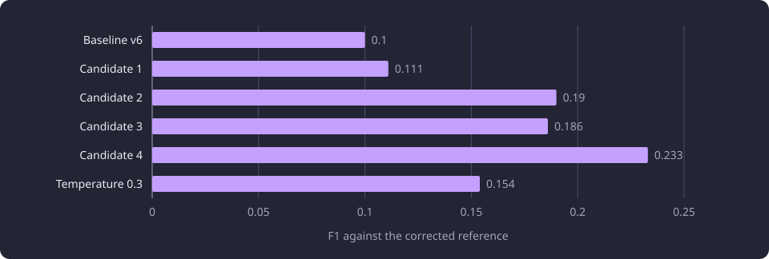
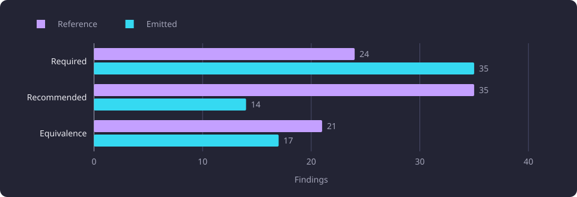
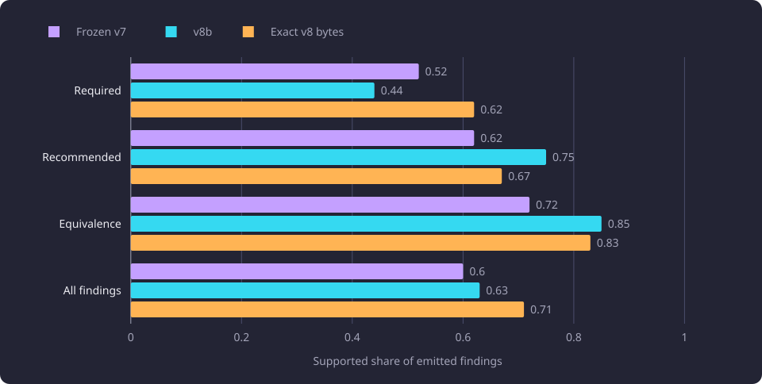

# Prompt and flag schema tuning

This report records which prompt contract and per-finding flag schema one local model followed, and what its flags marked.

**Evidence status:** Comparative. **Run dates:** 27 September 2026.

Its subject is the first prompt sequence and the blind support audit of the saved findings. The later prompt sweep, the re-tuning and the selection of prompt version 9 are reported on [prompt sweeps and version 9 selection](/docs/experiments/inference/prompt-sweeps-and-v9-selection.md).

## The question

A complete-target inference call has a fixed packet, a fixed target and a fixed schema. The prompt decides what the model treats as a direct prerequisite, how it groups options, when it proposes an equivalence group and how it reports doubt. Prompt tuning was therefore the part of the quality question that could move without changing the candidates or the model.

Two questions ran through this part of the work.

- Can a local model produce valid grouped results on long packets without truncating the input?
- Does prompt wording improve whole-result agreement with a separately corrected reference, and can a per-finding flag mark the findings that a filter should remove?

The second question matters because a wrong required claim is the costliest error in the ranking these measurements use. A right course in the right category ranks first, a right course in the wrong required-or-recommended category ranks second, and an omission ranks third. A course that is not a prerequisite at all is the error that matters. A filter that removed unsupported findings would be valuable only if its signal marked those findings rather than the model's general uncertainty.

The corrected reference is evaluation evidence, not the university's prerequisite record. It comes from one reference-model answer per target, corrected for the precision of the findings that answer emitted, and it cannot recover prerequisites that answer omitted. The [reference answers and judging](/docs/experiments/inference/reference-answers-and-judging.md) page states the corpus, the blind judge and the four-verdict rubric. Every F1 here is a disagreement diagnostic against that reference, and every support count comes from the same blind judge.

## Setup and fixed cohorts

### Model and request

The model was ByteShape Qwen3.8-27B IQ3_S, a 27B-class artifact at 3.23 bits per weight. Its 11.0 GB file holds 64 layers, a hybrid attention and state-space design, and an embedded multi-token-prediction head. It ran on an AMD Radeon RX 9070 XT (16 GB model) on ROCm 7.2.1, in a machine with 33.4 GB of usable RAM. The model runtime had a 4.295 GB memory limit and 8.590 GB of swap.

| Item | Value |
|---|---|
| Model | ByteShape Qwen3.8-27B IQ3_S, 3.23 bits per weight |
| Artifact | 11.0 GB |
| Architecture | 64 layers, hybrid attention with a state-space component, embedded MTP head |
| Card | AMD Radeon RX 9070 XT (16 GB model), ROCm 7.2.1 |
| System RAM | 33.4 GB usable |
| Model runtime limits | 4.295 GB of memory and 8.590 GB of swap |
| First local key | 118,784 tokens with MTP and a `q8_0` KV cache |
| Second local key | 147,456 tokens without MTP and a `q8_0` KV cache |
| Generation | Thinking off, temperature 0, seed 0, 8,192 output tokens |

The 118,784-token key was the one every tuning trial used. It fitted every tuning packet except the largest, which the cohort section describes.

The prompt is one system message and one user message per call. The user message carries the target descriptor and the 50 candidate descriptors in packet order. The system message fixes the output contract, the directness rule, the grouping rule, the category definitions, the equivalence rule and the code-copying rule. It never contains the target's official answer. No retrieval score, rank value or official prerequisite label entered a request. The corrected reference was read only by the scorer after a trial's outputs were saved.

### The 50 tuning targets and the 150 held-out targets

The cohort is 200 active represented target courses with a cross-encoder-only (CE-only) packet of 50 candidates each. It was fixed before any ByteShape output. The 50 tuning targets were selected without labels from the 200 by sorting on the rendered CE user-prompt character length and the target identity, then taking the integer-floor indices `(i*199)//49` for `i` from 0 to 49. The rule includes the smallest and largest packet. The tuning sizes span 37,065 to 534,313 characters. The other 150 targets formed the complement and were not used for tuning.

A 15-target format-check subset was drawn from the 50 with the same floor rule, `(i*49)//14`. Every format trial ran that subset. The 15 span 37,065 to 534,313 characters, the same extremes as the 50.

The 534,313-character packet is the only tuning target above both ByteShape context keys. Its 160,087 prompt tokens exceed the 118,784-token first key and the 147,456-token second key, so every 50-target trial reports one context skip. It was never truncated. A 50-target run with no transport drop therefore has 49 valid targets, and a format trial has 14 valid targets of 15.

The held-out check used the other 150 targets. Within those 150, a deterministic size-quantile subset of 50 served as the shared comparison cohort and the distinct validation set, and the other 100 were the fit set for a cutoff rule. The 50 and the 100 are disjoint. No tuning result counts toward the 150. The version 9 held-out run is reported on [held-out model quality](/docs/experiments/inference/held-out-model-quality.md), and the cutoff rule is reported on [confidence and flag calibration](/docs/experiments/inference/confidence-and-flag-calibration.md).

The diagram shows the cohorts and the runs this report measures. The 200 CE-only packets split into the 50 tuning targets and the 150 held-out targets. The 15-target format subset and candidate 4 on the 50 both come from the tuning 50, and the frozen v7 bytes were then measured on the same 50. The blind support audit read the saved findings of three runs, frozen v7, v8b and the exact v8 bytes on the format subset.


### Scoring, the reference and the judge

A [finding](/docs/reference/glossary.md#inference) is one option, with all of its courses taken together, or one equivalence group. A true positive requires the same member set and, in the primary score, the same category. A category-agnostic true positive requires only the same member set, so a right course in the wrong category counts. A near-match is a right member set with required and recommended swapped. Exact whole-result agreement requires every category and every member set to match.

The scores pool findings over the valid targets in the stated cohort. F1 is the harmonic mean of precision and recall against the corrected reference, computed micro over those findings. The reference for the 49 valid targets of the tuning cohort holds 80 findings, 24 required options, 35 recommended options and 21 equivalence groups. The reference has more findings than the model emits, so recall and F1 are low by construction. The supported share is the number of findings the judge marks supported divided by the findings the model emitted, and it is the primary measure here.

The blind judge is the one described in [Reference answers and judging](/docs/experiments/inference/reference-answers-and-judging.md). It sees a claim, the target and the named courses, and the producing model's evidence, but no model identity, confidence, [finding flag](/docs/reference/glossary.md#inference), routing metadata, packet identity or reference verdict. It returns one of four verdicts: `supported`, `partly`, `unsupported` or `unclear`.

The blind support audit judged 89 unique claims from three saved trials, carried by 153 finding occurrences. The claims were deduplicated by target, category and unordered member set, each unique claim was judged once, and the verdict was reused for every occurrence. The 89 are unique claims, not emitted occurrences, so they do not count the same unit as an emission count.

## Prompt versions and the flag schema

The versions this part of the work measured differ in the system message and, from version 7 on, in the result schema.

| Version | Prompt content | Schema | Role in this report |
|---|---|---|---|
| v6 | Complete-target prompt with nine curated examples, one grouping rule per category and five suppression outcomes | v1 | Baseline for the first sequence |
| v7 | Candidate 4 with the field `finding_flags`, flag guidance and a firmer instruction, frozen with a five-entry suppression cap and a multi-flag example | v2 | First checkpoint, frozen and measured on the 50 |
| v8 | The v7 system plus the measured flag-contract paragraphs, with the v7 example bytes | v2 | The version whose runs the audit judged |

The version 8 family supplied two judged runs, a completeness variant that asked for complete coverage and the exact version 8 bytes on the format subset. How those prompts were built and screened, and how version 9 was selected from them, are reported on [prompt sweeps and version 9 selection](/docs/experiments/inference/prompt-sweeps-and-v9-selection.md).

Schema version 2 makes `finding_flags` a required, possibly empty array on every option and every equivalence group. An option carries zero or more of `requiredness_uncertain`, `member_uncertain` and `directness_uncertain`. An equivalence group carries zero or more of `member_uncertain` and `group_scope_uncertain`. A finding may carry several distinct flags but never the same flag twice. Schema version 1 carried no such field and rejected it.

One saved candidate 4 result shows the nesting. This is the `required` requirement set for `RAK.RS.610`, printed from the model output and not taken from any official requirement record.

```json
{
  "requirement_id": "required_1",
  "options": [
    {
      "course_codes": ["RAK.RS.600"],
      "evidence": "RAK.RS.600 teaches the basics of CLT-structure design, timber member stability, and structural stiffening, which are the direct entry-level prerequisites for the advanced topics in multi-storey timber buildings and CLT structures covered in the target course.",
      "confidence": 0.95,
      "finding_flags": []
    },
    {
      "course_codes": ["53161"],
      "evidence": "53161 is titled 'Timber Structures' and is a course-wide equivalent to RAK.RS.600, providing the same foundational knowledge in timber design and stability required for the target course.",
      "confidence": 0.9,
      "finding_flags": ["member_uncertain"]
    },
    {
      "course_codes": ["RTEK-3410"],
      "evidence": "RTEK-3410 covers timber structure design principles, stability, and material properties, serving as an alternative foundational course for the timber design knowledge assumed by the target.",
      "confidence": 0.85,
      "finding_flags": ["directness_uncertain"]
    }
  ]
}
```

The `options` array is the OR level, and each option's `course_codes` array is the AND level. This saved set holds three alternatives of one code each. The complete result also holds a recommended set, one equivalence group and routing metadata. An accepted result holds zero or one requirement set in each of `required` and `recommended`, and the `equivalence` array holds groups.

No finding in the runs this report counts carries more than one flag. The multi-flag contract is covered by a curated example in the prompt and by the parser that reads schema version 2, not by model output. The [Inference pipeline](/docs/backend/inference/inference-pipeline.md) page states the product contract: prompt version 9 with schema version 2, and a required `finding_flags` array on every option and every equivalence group.

## The first prompt sequence

The first sequence moved from the v6 baseline through four candidate prompts to a frozen v7. All of the format trials used the same 15 targets and the same ByteShape key. Every trial except the temperature trial used deterministic settings at temperature 0 and seed 0. The invalid count was zero on every fitting target.

| Trial | Prompt and schema | Valid | Exact | Precision | Recall | F1 | Observation |
|---|---|---:|---:|---:|---:|---:|---|
| Baseline | v6, schema v1 | 14 | 4 | 0.133 | 0.080 | 0.100 | Mostly empty output |
| Candidate 1 | v6 wording plus flags and an emit-direct instruction, schema v2 | 14 | 4 | 0.182 | 0.080 | 0.111 | Every flag array empty |
| Candidate 2 | Adds equivalence target inclusion, an emit-recall instruction and a three-entry suppression cap | 14 | 3 | 0.235 | 0.160 | 0.190 | Equivalence groups include the target |
| Candidate 3 | Adds flag-bearing worked examples and flag-use guidance | 14 | 4 | 0.222 | 0.160 | 0.186 | Flags empty |
| Candidate 4 | Renames the field `finding_flags` and adds a firmer instruction | 14 | 4 | 0.278 | 0.200 | 0.233 | First emitted flags and the highest first-sequence F1 |
| Temperature 0.3 | v7 at temperature 0.3 and seed 1 | 14 | 3 | 0.214 | 0.120 | 0.154 | Lower emission and lower agreement |

The chart plots the F1 column. The baseline starts at 0.100, candidate 4 holds the highest value at 0.233, and the temperature trial falls to 0.154.



Candidate 3 added a worked example with flags and explicit flag-use guidance, and emitted no flag from either change. Candidate 4 emitted flags, only after the field name changed from `flags` to `finding_flags` and the instruction became firmer. The earlier guidance did not produce a flag, and the rename with the firmer instruction did.

The temperature trial moved away from the target. At temperature 0 and seed 0 the model is deterministic, so repeated prompts differ only through prompt bytes. The 15-target subset itself swings by about plus or minus 0.03. The frozen v7 measured 0.205 on the subset beside candidate 4 at 0.233 on identical settings. A difference of that size on 14 targets is not a prompt ranking.

### Candidate 4 on the full tuning set

Candidate 4 was the measured tuning candidate. On all 50 targets it attempted 50, returned 49 valid results and reported one context skip. Invalid complete-target output was zero. It matched 16 of 49 whole results exactly and reached precision 0.273, recall 0.225 and F1 0.247. The reference held 80 findings on the 49 fitting targets, and the model emitted 66.

| Category | Reference findings | Emitted | True positive | False positive | False negative | Precision | Recall |
|---|---:|---:|---:|---:|---:|---:|---:|
| Required | 24 | 35 | 9 | 26 | 15 | 0.26 | 0.38 |
| Recommended | 35 | 14 | 0 | 14 | 35 | 0.00 | 0.00 |
| Equivalence | 21 | 17 | 9 | 8 | 12 | 0.53 | 0.43 |

Candidate 4 over-produced required options and under-produced recommended options. The chart places the emitted count beside the reference count for each category. Required is 35 against 24, recommended is 14 against 35, and equivalence is 17 against 21.



Candidate 4 never emitted a recommended finding that coincided with the corrected reference's recommended set, so the recommended row carries no true positive. Several cases show the right course under the wrong category. `ACC.140` emitted `ACC.010` as required where the reference keeps it recommended, and `KIR.234` emitted only `KIR.140` where the reference requires `KIR.110` and `KIR.140`.

A post-output diagnostic separated membership from category. Of the 66 emitted findings, only 22 had a member set present anywhere in the reference, and 18 were exactly right. Relabelling every finding into its best category therefore caps F1 at 0.301. Most of the gap is a different member set, not a wrong required-or-recommended label. The reference's recommended set is mostly the reference model's required options that the judge demoted as relevant background, so a recommended true positive requires the model to emit the same course, not only to choose the recommended label.

### The frozen v7 bytes

The frozen v7 bytes made two contract changes to the candidate 4 prompt. It restored the suppression cap to five entries, because a three-entry cap contradicted a worked example with four suppressions. It also added a multi-flag example, because no example showed more than one flag on a finding. The instruction text otherwise matched candidate 4.

Because the exact bytes then differed from the measured candidate, the frozen v7 bytes were run again on the same 50. The re-run returned 49 valid results, the same one context skip and zero invalid output. It matched 14 of 49 whole results and reached precision 0.267, recall 0.200 and F1 0.229, with no recommended true positive.

The pair is a measurement lesson. A prompt's value belongs to the exact bytes that ran, and a change to the frozen bytes makes a new measurement rather than a copy of the old one. The re-run sits within tuning noise of candidate 4, so neither value is a separate estimate of a prompt's quality. Candidate 4 is the measured tuning candidate and frozen v7 is the exact-bytes checkpoint, and this report states both.

## Blind support by trial

The saved findings of frozen v7, v8b and the exact v8 bytes were judged blind in one audit. The 89 unique claims came from 86 in v7 or v8b plus three that the exact v8 bytes added. The occurrences were 60, 76 and 17. Every claim was judged once, and the verdict was reused for the same claim in every trial that carried it.

| Trial | Findings | Required supported share | Recommended supported share | Equivalence supported share | All supported share |
|---|---:|---|---|---|---|
| Frozen v7 | 60 | 15/29 (0.52) | 8/13 (0.62) | 13/18 (0.72) | 36/60 (0.60) |
| v8b | 76 | 16/36 (0.44) | 15/20 (0.75) | 17/20 (0.85) | 48/76 (0.63) |
| Exact v8 bytes, 14-target screen | 17 | 5/8 (0.62) | 2/3 (0.67) | 5/6 (0.83) | 12/17 (0.71) |

The chart plots the four supported shares for the three trials. Frozen v7 and v8b share the same 49 targets, and the exact v8 row rests on 14.



The verdict counts were 36 supported, 13 partly, nine unsupported and two unclear for v7, 48 supported, 13 partly, 13 unsupported and two unclear for v8b, and 12 supported, three partly, two unsupported and no unclear for the exact v8 bytes. The unique-claim totals were 53 supported, 19 partly, 14 unsupported and three unclear out of 89, a supported share of 0.60.

The exact v8 figure has a 14-target denominator and is not a 50-target result. It is also the smallest sample. The v7 and v8b figures share the same 49 targets and the same judge pass.

### Beside the reference model on the same targets

On those same 49 targets, the reference model's own CE-only answers were also judged. The matched comparison removes the different target mix that a comparison against all 200 reference answers would carry.

| Source, same 49 targets | Required supported share | Recommended supported share | Equivalence supported share | Findings |
|---|---|---|---|---|
| DeepSeek V4.1 Flash, v6 CE-only | 24/46 (0.52) | 14/21 (0.67) | 15/23 (0.65) | 90 |
| ByteShape frozen v7 | 15/29 (0.52) | 8/13 (0.62) | 13/18 (0.72) | 60 |
| ByteShape v8b | 16/36 (0.44) | 15/20 (0.75) | 17/20 (0.85) | 76 |

The local supported share is close to the reference model's on the same targets. It is better on equivalence, comparable on recommended and similar to worse on required. ByteShape emitted fewer claims than the reference model on those targets, yet produced more outright unsupported required claims, six for v7 and 10 for v8b against four for the reference. The reference model's equivalence row is the less reliable one because 45 of its 86 groups were judged against the target instead of only among group members. Each ByteShape equivalence group was judged against its own member set.

The supported share counts only emitted claims, while F1 also counts findings the model did not emit, so the gap between them is expected.

## Flags mark the category boundary

The flag behaviour of the saved runs is below. A flag occurrence is counted independently, so a finding with two flags would appear under both flags and once under the any-flag total. No run in this table carries a multi-flag finding.

| Run | Findings | Flagged | `requiredness_uncertain` | `directness_uncertain` | `member_uncertain` | `group_scope_uncertain` |
|---|---:|---:|---:|---:|---:|---:|
| Candidate 4 | 66 | 17 | 14 | 2 | 0 | 1 |
| Frozen v7 | 60 | 16 | 13 | 2 | 0 | 1 |
| v8b | 76 | 33 | 21 | 2 | 0 | 10 |
| Exact v8 bytes, 14-target screen | 17 | 8 | 3 | 0 | 0 | 5 |

Across the three judged trials the flags were 37 `requiredness_uncertain`, 16 `group_scope_uncertain` and four `directness_uncertain`, with no `member_uncertain`. `requiredness_uncertain` dominated and sat almost entirely on recommended options. Every recommended occurrence in those three trials was flagged `requiredness_uncertain`, 36 of 36.

| Group | Findings | Supported | Partly | Unsupported | Unclear |
|---|---:|---:|---:|---:|---:|
| Any flag | 57 | 40 (0.70) | 7 | 7 | 3 |
| No flag | 96 | 56 (0.58) | 22 | 17 | 1 |

The mild difference runs the wrong way for a precision signal. It is a category confound, not separation. Recommended is better supported than required, and every recommended finding is flagged. By contrast, the required options that carried `requiredness_uncertain` were not the unsupported required options. The five required options that carried it were two supported, one partly and two unclear, none unsupported, against 34 of 68 for the unflagged required options. Equivalence groups that carried `group_scope_uncertain` were supported in 13 of 16 cases against 22 of 28 unflagged. `directness_uncertain` appeared on four required options, two supported and two unclear, and never on an unsupported one. The flags mark the model's required-or-recommended boundary uncertainty, not weak teaching-text support.

Target routing metadata behaved the same way. Routing confidence was 0.9 on almost every target and routing flags were nearly absent. The table counts only the targets that emitted at least one finding.

| Trial | Targets with findings | Targets with any routing flag | Routing confidence values |
|---|---:|---|---|
| Frozen v7 | 32 | 0 | 0.9 on 31, 0.85 on 1 |
| v8b | 31 | 1 (`directness_ambiguity`) | 0.9 on 30, 0.8 on 1 |
| Exact v8 bytes, 14-target screen | 9 | 0 | 0.9 on 9 |

The one flagged target in v8b had one finding, judged supported. The v7 target at 0.85 had two findings, both judged partly. These are single-target observations, not a signal. Across all valid targets, routing flags were almost always `insufficient_course_information`, 11 for v7, 11 for v8b and two for the exact v8 bytes, plus the one `directness_ambiguity`. Most of those targets emitted no finding to judge.

Neither per-finding flags nor routing metadata separated support on the tuning set. No cutoff or demote rule was fitted from those results.

## Failed approaches

A worked example with flags plus explicit flag-use guidance would make the model emit flags. Candidate 3 carried both and emitted none, and its F1 of 0.186 was below the 0.190 of the candidate before it. The model began to use the field only when the field name changed to `finding_flags` and the instruction became firmer, in candidate 4. Guidance alone did not make the model use a field it had not been using.

A higher temperature would improve agreement. The version 7 prompt at temperature 0.3 and seed 1 emitted 14 findings and reached F1 0.154, against 0.233 at temperature 0 and seed 0. It moved away from the reference, and no higher temperature was tried.

Per-finding flags and routing metadata would mark the harmful findings and support a drop or demote rule. Flagged findings were supported more often than unflagged ones, 0.70 against 0.58, which is the wrong direction for a precision signal. Every recommended option carried the dominant flag, none of the five required options that carried it was unsupported, and routing confidence was 0.9 on almost every target. A filter built on either signal would remove supported claims and keep most harmful ones, so no cutoff or demote rule was fitted.

## What the numbers support

### Observed

Across the six first-sequence trials, 84 target results were valid and none returned invalid complete-target output, and every 50-target run had zero invalid output. The only non-valid outcome on a fitting packet was a transport drop, never a malformed result.

Prompt tuning moved ByteShape from the v6 baseline F1 of 0.100 to 0.233 on the format subset for candidate 4, and candidate 4 reached 0.247 on the 50 against 0.229 for the frozen v7 bytes. The supported share was 0.60 for v7, 0.63 for v8b and 0.71 for the exact v8 bytes on 14 targets. On the same 49 targets it was close to the reference model's. Every recommended finding in the three judged trials carried `requiredness_uncertain`, and flagged findings were supported more often than unflagged ones, 0.70 against 0.58.

### Interpreted

The prompt solved the format and grouping contract but did not solve membership. Candidate 4's 66 findings contained only 22 member sets present anywhere in the reference, and a perfect relabelling would cap F1 at 0.301. The remaining gap is a different view of which courses belong, not only a wrong required-or-recommended label.

The flags describe the model's own decision boundary. `requiredness_uncertain` marks recommended options and the required-or-recommended judgement, not weak teaching-text support. The near-constant routing confidence has the same character. A filter built on either signal would remove supported claims and keep most harmful ones.

## Limitations

The tuning cohort was used repeatedly across prompt versions, so the 50 is a poor estimate of an unseen prompt's quality. The 150 held-out targets are the better check, and the version 9 held-out run is reported on [held-out model quality](/docs/experiments/inference/held-out-model-quality.md).

The format subset has 15 targets, 14 valid, and the full tuning cohort has 50 targets, 49 valid. The exact v8 supported share rests on 17 findings from 14 targets and is not a 50-target result. The blind audit covered the saved findings of frozen v7, v8b and the exact v8 bytes, so the first-sequence trials, including candidate 4 and the temperature trial, carry only corrected-reference scores. The three judged trials were each judged in one pass, and the 89 unique claims were not independently resampled.

The [Inference experiments](/docs/experiments/inference/README.md#limitations) overview states the limits that every supported share in the category carries, and [reference answers and judging](/docs/experiments/inference/reference-answers-and-judging.md) states the rubric and the corrected reference.

## Baselines

A follow-up compares against these values. The model and settings are those of every measurement on this page.

| Item | Value |
|---|---|
| Model and key | ByteShape Qwen3.8-27B IQ3_S, 3.23 bits per weight, the 118,784-token key with MTP and `q8_0` KV |
| Generation | Thinking off, temperature 0, seed 0, 8,192 output tokens |
| Packet | CE-only top 50, fixed before any model output |
| v6 baseline F1, 15 targets | 0.100 |
| Candidate 4, 50 targets | 49 valid, 16 of 49 exact, precision 0.273, recall 0.225, F1 0.247 |
| Frozen v7 bytes, 50 targets | 49 valid, 14 of 49 exact, precision 0.267, recall 0.200, F1 0.229 |
| Reference on the 49 valid targets | 80 findings |
| Supported share, three judged trials | 0.60, 0.63 and 0.71 |
| Reference model, same 49 targets | 90 findings, required 24/46, recommended 14/21, equivalence 15/23 |
| Flag occurrences, three judged trials | 37 `requiredness_uncertain`, 16 `group_scope_uncertain`, 4 `directness_uncertain` |

## Open questions

1. Whether the field name or the firmer instruction produced the flag use. Candidate 4 changed both at once, so the two were not separated. Untested.
2. Whether the flag vocabulary can carry two independent doubts at a useful rate. No run this report counts holds more than one flag on a finding. Untested.
3. A second sample per target, which would separate prompt effects from sampling noise. Every saved result here is one sample per target. Untested.
4. A human re-read of the 89 judged claims, which would put a number on the judge's error and on the support rates. No such measurement exists. Untested.
