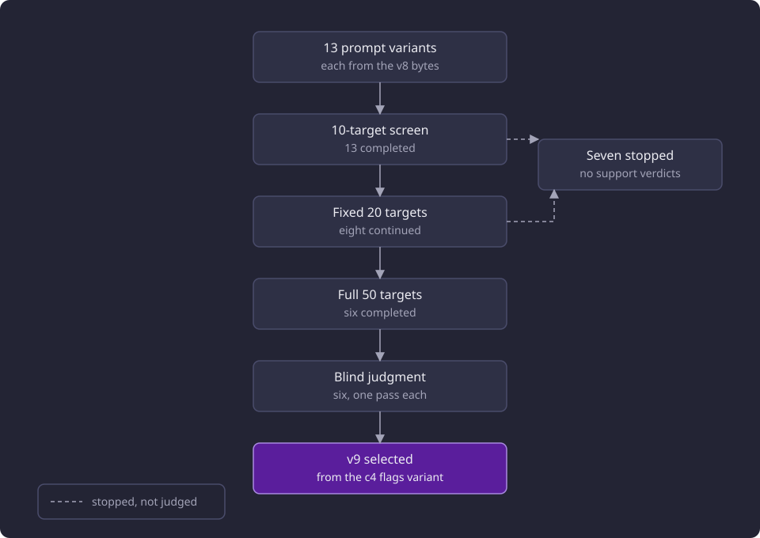
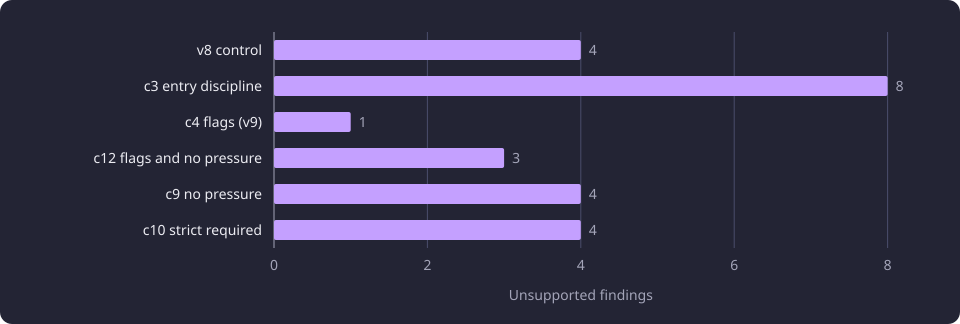

# Prompt sweeps and the v9 selection

This report records the prompt sweep that raised a local model's supported share, the re-tuning on the same 50 targets, and the selection of v9.

**Evidence status:** Comparative. **Run dates:** 27 and 28 September 2026.

The [Experiments section](/docs/experiments/README.md#inference) gives the catalogue, the evidence labels and the hardware. The [Inference experiments](/docs/experiments/inference/README.md) overview places this report in the category. [Prompt and flag schema tuning](/docs/experiments/inference/prompt-and-flag-schema-tuning.md) covers the prompt contract, the finding-flag vocabulary and the first sequence from the v6 baseline to a frozen checkpoint. This report covers the sweep that followed, the re-tuning on the same 50 targets, the blind judgment of six candidates and the v9 selection. The held-out validity and supported share of v9 belong to [held-out local model quality](/docs/experiments/inference/held-out-model-quality.md), and the fitted cutoff rule belongs to [confidence and flag calibration](/docs/experiments/inference/confidence-and-flag-calibration.md).

## The question

The prompt decides what the model treats as a direct prerequisite, how it groups options, when it proposes an equivalence group and how it reports doubt. The packet and the model were fixed for this line, so prompt wording was the part of the quality question that could move without changing the candidates or the artifact.

Two questions ran through the sweep. Could a completeness prompt or a stronger flag contract lift whole-result agreement above the measured candidate? And could broad prompt changes reduce outright unsupported findings, especially false required claims, while retaining useful coverage and improving category correctness?

The ranking places a right course in the right category first, a right course in the wrong required or recommended category second, and an omission third. A course that is not a prerequisite at all is the error that matters.

Two measures answer different questions. The primary measure is the supported share, the findings a candidate emitted that the blind judge marks supported divided by the findings it emitted. The secondary measure is F1 against the corrected reference, which is one DeepSeek V4.1 Flash answer per target corrected for the precision of the findings that answer emitted. The reference cannot recover a prerequisite that answer omitted, and it holds more findings than any local model emits, so its F1 is a disagreement diagnostic and is low by construction. [Reference answers and judging](/docs/experiments/inference/reference-answers-and-judging.md) states the corpus, the blind judge and the four-verdict rubric.

## Setup and comparison conditions

The [prompt and flag schema tuning](/docs/experiments/inference/prompt-and-flag-schema-tuning.md) report states the model, the request settings, the 50 tuning targets, the 15-target format subset, the corrected reference and the blind judge. Every variant here ran on ByteShape Qwen3.8-27B IQ3_S under those settings, and the [Inference experiments](/docs/experiments/inference/README.md#shared-method-and-cohorts) overview states the category method.

Three conditions belong to this sweep. Every re-tuning variant started from the exact v8 prompt bytes and inherited the v8 examples byte for byte, and the v8 control ran those exact bytes on the same 50 in the same comparison, so it is the comparison for the selection. Every full-50 run reported one context skip on the oversize packet, so 49 targets were valid. The v8 control returned 47 because two transport errors also lost `LAAL.615` and `AUT.250`. A format screen used a 15-target subset of the 50, drawn by size, of which 14 returned a valid result.

A finding is one option with all of its courses taken together, or one equivalence group, and the scores pool findings over the valid targets.

## The broader prompt sweep

### The completeness prompt

The sweep opened with a completeness prompt that asked for complete coverage. The v8b variant emitted 76 findings against the reference's 80, where the frozen v7 checkpoint emitted 60. It produced the first recommended true positive. The extra emission became more false positives than true positives.

| Run | Precision | Recall | F1 | Exact whole results | Required F1 | Recommended F1 | Equivalence F1 | Category-agnostic F1 |
|---|---|---:|---:|---:|---:|---:|---:|---:|
| Frozen v7 | 0.267 | 0.200 | 0.229 | 14 of 49 | 0.302 | 0.000 | 0.410 | 0.271 |
| v8b | 0.224 | 0.212 | 0.218 | 14 of 49 | 0.300 | 0.036 | 0.341 | 0.256 |

The category-agnostic score counts a right member set in the wrong category as a true positive. v8b did not improve agreement, and the completeness prompt was rejected as the next prompt.

### The format screen and the label-only shift

The v8 screen compared three prompts on the same 15 targets.

| Prompt | Valid | Exact | Precision | Recall | F1 |
|---|---:|---:|---:|---:|---:|
| v8a emit variant | 14 | 4 | 0.250 | 0.200 | 0.222 |
| v8d flag contract | 14 | 4 | 0.263 | 0.200 | 0.227 |
| Exact v8 bytes | 14 | 4 | 0.353 | 0.240 | 0.286 |

v8d kept the v7 system and added the measured flag-contract paragraphs. It screened at F1 0.227, with category-agnostic F1 0.318, seven of 19 findings flagged and four equivalence flags. It became prompt v8 for the research run with the v7 examples.

The exact v8 bytes differed from v8d only in two version labels, the title and the finding-flags section heading. Screened again on the same subset, they reached F1 0.286, the highest format-subset F1 in the line, with category-agnostic precision 0.471, recall 0.320 and F1 0.381, four exact results, and eight of 17 findings flagged including five equivalence groups.

The label-only shift is a warning, not a quality claim. Two version strings moved a deterministic 14-target result from 0.227 to 0.286 with no semantic prompt change. The range across the three format prompts is 0.222 to 0.286 on 14 valid targets. The exact v8 bytes were not run on the full 50 in that sweep. The re-tuning ran them as the v8 control, which returned 47 valid results and F1 0.244.

## Re-tuning on the same 50

The re-tuning used the same 50 targets and the same deterministic size order. A variant first ran a 10-target screen, then, if promising, a fixed 20-target set identical for every variant, and only a variant that completed the fixed 20 could run the full 50. Thirteen variants ran. Six completed the full 50 and were judged blind.

The funnel below shows the tiers and how many variants reached each. Seven stopped before the full 50, five at the 10-target screen and two at the fixed 20, and carry corrected-reference diagnostics but no support verdicts.

The seven tested an overlap rule for near-identical or older courses, a rule that the target's own material is not entry knowledge, an entry test, a deliver test, flags discipline, a separate older-or-overlapping-code rule, and a combination of four tested amendments. None of them was blind-judged.

| Candidate | Targeted amendment | Valid results |
|---|---|---:|
| v8 control | The exact v8 prompt bytes | 47 |
| c3 entry discipline | A strict required boundary, with omission preferred to a wrong required claim | 49 |
| c4 flags | Deliberate multi-flag use with worked doubt combinations | 49 |
| c12 flags and no pressure | Deliberate multi-flag use with emission pressure removal | 49 |
| c9 no pressure | Emission pressure removal | 49 |
| c10 strict required | The strict required rule | 49 |

## Blind judgment of the six candidates

Each candidate was judged once, in one pass. The six judgments covered 324 emitted claim occurrences in total. The comparison for the selection is the same-night v8 control, because the v8b support counts come from a separate judge pass over a different claim set.

| Candidate | Valid | Claims | Supported | Supported share | Unsupported | Unsupported required |
|---|---:|---:|---:|---:|---:|---|
| v8 control | 47 | 59 | 32 | 0.542 | 4 | 3 of 30 |
| c3 entry discipline | 49 | 64 | 35 | 0.547 | 8 | 8 of 33 |
| c4 flags | 49 | 58 | 35 | 0.603 | 1 | 1 of 29 |
| c12 flags and no pressure | 49 | 49 | 36 | 0.735 | 3 | 3 of 26 |
| c9 no pressure | 49 | 44 | 22 | 0.500 | 4 | 3 of 25 |
| c10 strict required | 49 | 50 | 33 | 0.660 | 4 | 3 of 26 |

c4 flags is the unique minimum on outright unsupported findings, one of 58, and on unsupported required findings, one of 29. The v8 control held four and three of 30. c3 moved the other way, with eight outright and eight of 33 required, so the entry-discipline direction did not reduce unsupported findings on this cohort. c12, c9 and c10 each held three unsupported required findings, and none beat c4 on either count.

The supported share alone favours c12, 0.735 over 49 claims, against c4's 0.603 over 58. It is a precision measure over emitted claims, so a candidate that emits fewer claims can show a higher share, and it does not rank the candidates by the costliest error. c9 emitted the fewest claims and held the lowest share, 0.500 over 44.

The chart plots the unsupported counts from the table above. c4 sits alone at the minimum.

### Per-category support

The per-category counts show where the support sits. Each row gives one candidate and one category.

| Candidate | Category | Findings | Supported | Partly | Unsupported | Unclear |
|---|---|---|---|---|---|---|
| v8 control | Required | 30 | 13 | 13 | 3 | 1 |
| v8 control | Recommended | 12 | 7 | 3 | 1 | 1 |
| v8 control | Equivalence | 17 | 12 | 5 | 0 | 0 |
| c3 entry discipline | Required | 33 | 14 | 9 | 8 | 2 |
| c3 entry discipline | Recommended | 13 | 9 | 3 | 0 | 1 |
| c3 entry discipline | Equivalence | 18 | 12 | 6 | 0 | 0 |
| c4 flags | Required | 29 | 17 | 10 | 1 | 1 |
| c4 flags | Recommended | 9 | 4 | 4 | 0 | 1 |
| c4 flags | Equivalence | 20 | 14 | 6 | 0 | 0 |
| c12 flags and no pressure | Required | 26 | 17 | 6 | 3 | 0 |
| c12 flags and no pressure | Recommended | 8 | 6 | 2 | 0 | 0 |
| c12 flags and no pressure | Equivalence | 15 | 13 | 2 | 0 | 0 |
| c9 no pressure | Required | 25 | 9 | 13 | 3 | 0 |
| c9 no pressure | Recommended | 6 | 1 | 4 | 1 | 0 |
| c9 no pressure | Equivalence | 13 | 12 | 1 | 0 | 0 |
| c10 strict required | Required | 26 | 13 | 10 | 3 | 0 |
| c10 strict required | Recommended | 9 | 8 | 0 | 1 | 0 |
| c10 strict required | Equivalence | 15 | 12 | 3 | 0 | 0 |

Equivalence was the strongest category. No candidate held an outright unsupported equivalence group, and each candidate supported between 12 and 14 of its 13 to 20 groups. Recommended carried at most one unsupported finding per candidate, and c10 supported eight of its nine.

Required was the weak category. It carried 21 of the 24 unsupported findings across the six candidates, and every candidate left at least one required option unsupported. c4's single unsupported finding was a required option. Its required set supported 17 of 29, its recommended set four of nine and its equivalence set 14 of 20.

## The F1 plateau

On the same 50 the corrected-reference score stayed flat while the support counts moved. The score counts a finding only when its member set and category match the corrected reference, pooled over the valid targets.

The nine variants that ran on the full 50 scored between 0.218 and 0.258. Two of them, the first sequence's measured candidate (candidate 4) and the frozen checkpoint that followed it (frozen v7), were measured before the sweep.

| Variant | Valid | Reference findings | F1 |
|---|---:|---:|---:|
| Candidate 4 | 49 | 80 | 0.247 |
| Frozen v7 | 49 | 80 | 0.229 |
| v8b | 49 | 80 | 0.218 |
| v8 control | 47 | 72 | 0.244 |
| c3 entry discipline | 49 | 80 | 0.236 |
| c4 flags (v9) | 49 | 80 | 0.246 |
| c9 no pressure | 49 | 80 | 0.258 |
| c10 strict required | 49 | 80 | 0.231 |
| c12 flags and no pressure | 49 | 80 | 0.248 |

Eight variants scored over 49 valid targets against the same 80-finding reference. The v8 control scored over its 47 valid targets, where the reference holds 72 findings, so its 0.244 is not directly comparable and the range mixes the two denominators.

c9 holds the highest F1, 0.258, with four unsupported findings. c4 holds 0.246 with one. The secondary score did not rank the candidates the way the judge did.

The chart plots the nine F1 values from the table.

## The selected v9 prompt

The c4 flags variant became prompt v9 with schema version 2. The frozen v9 prompt carries the c4 instructions that the blind judgment covered. Only heading labels differ, and the examples parse identically, so the blind verdicts apply to the applied prompt. [Prompt and flag schema tuning](/docs/experiments/inference/prompt-and-flag-schema-tuning.md) describes the flag vocabulary and the multi-flag contract that schema version 2 carries.

The selection is a small-sample directional result, not a proven quality gain. It rests on c4's 58 claims from one pass. c4 held one unsupported finding against four in the same-night control, and a supported share of 0.603 against 0.542.

The flags did not clearly isolate the errors. The single unsupported claim was unflagged, and the two unclear claims carried `requiredness_uncertain` and `member_uncertain`. The c4 cohort held no finding with two flags, although the selected instruction added multi-flag guidance.

v9 was then run on the 150 held-out targets. Its validity, supported share and the model comparison are reported on [held-out local model quality](/docs/experiments/inference/held-out-model-quality.md). The confidence and flag rule fitted on that held-out output, with its validation, is reported on [confidence and flag calibration](/docs/experiments/inference/confidence-and-flag-calibration.md).

## Failed hypotheses

- A completeness prompt would improve whole-result agreement. v8b emitted 76 findings against the reference's 80, added the first recommended true positive, and scored F1 0.218 against frozen v7's 0.229, with 14 of 49 exact whole results for both. The extra emission became more false positives than true positives.
- A strict required boundary would reduce false required claims. c3 entry discipline raised unsupported required findings to eight of 33 and outright unsupported findings to eight of 64, against three of 30 and four of 59 in the same-night control.
- A label-only prompt edit would leave a deterministic format score the same. Two version strings moved the 14-target result from 0.227 to 0.286.
- Deliberate multi-flag guidance would make the model carry two doubts on one finding. The judged c4 cohort's 58 claims carried at most one flag each.
- A confidence or flag cutoff could remove harmful findings before publication. The c4 flags did not mark its unsupported claim, and the rule fitted on held-out output failed its validation, as [confidence and flag calibration](/docs/experiments/inference/confidence-and-flag-calibration.md) reports.

## What the numbers support

### Observed

- The v8b completeness prompt scored 0.218 against frozen v7's 0.229 on 49 valid targets, with the same 14 exact whole results.
- The three v8 format prompts scored 0.222, 0.227 and 0.286 on 14 valid targets, and the label-only pair moved the score from 0.227 to 0.286.
- The six judged candidates returned 324 emitted claim occurrences, with one to eight outright unsupported findings each and one of 29 to eight of 33 unsupported required findings.
- Every full-50 run in the sweep returned zero invalid output, and the only non-valid outcome on a fitting packet was a transport drop.
- c4 flags held one unsupported finding of 58, the unique minimum, and the highest unsupported count was c3's eight of 64.
- The nine full-50 variants scored between 0.218 and 0.258 against the corrected reference.
- v9 carries the c4 instructions the blind judgment covered, with schema version 2, and only heading labels differ.

### Interpreted

The sweep moved format behaviour and support counts more than it moved the corrected-reference agreement score. The six candidates that reached the full 50 differ far more in their supported share than in their F1.

Required was the weak category. It carried 21 of the 24 unsupported findings, and no candidate reduced that count below one required option.

The selection rests on a single judge pass and small counts. c4's advantage is one unsupported finding against four in the same-night control, which is a directional result rather than a measured quality gap.

The c4 flags did not mark the one claim the judge rejected. Twenty-five of its 58 claims carried a flag and none carried two, so the single unsupported claim was among the 33 without a flag.

## Limitations

The [Inference experiments](/docs/experiments/inference/README.md#limitations) overview states the limits shared by every inference comparison, and [Reference answers and judging](/docs/experiments/inference/reference-answers-and-judging.md#limits-of-judged-support) states the limits of the reference and the judge.

The cohort was used repeatedly across prompt versions. That is the nature of tuning, but it makes the 50 a poor estimate of an unseen prompt's quality. A follow-up needs targets that were used neither for tuning nor for the cutoff fit.

Each judged candidate rests on 44 to 64 claims, judged once with no repeat judgment, so judge variation is not measured. c4's selection margin is three findings. The format subset has 15 targets, 14 valid.

Seven variants stopped before the full 50 and carry corrected-reference diagnostics but no support verdicts, so the blind judge does not test their directions.

The v8 control's 47 valid results and 72-finding reference make its F1 not directly comparable with the other eight variants.

## Baselines

| Element | Value |
|---|---|
| Model | ByteShape Qwen3.8-27B IQ3_S, 3.23 bits per weight, 11.0 GB artifact, 118,784-token key |
| Prompt and schema | v9 with schema version 2 |
| Cohort | The 50 tuning targets with a packet of 50 candidates, 49 valid |
| Supported share, c4 and v9 | 35 of 58, 0.603, with one unsupported finding |
| Corrected-reference F1, c4 and v9 | 0.246 over 49 valid targets against 80 findings |
| Same-night control | 32 of 59, 0.542, with four unsupported findings, and F1 0.244 over 47 valid targets against 72 findings |
| Format-subset range | 0.222 to 0.286 on 14 valid targets |

A follow-up that compares a prompt against these values needs the same packet, the same 49 valid targets and the same reference. Its supported share needs a fresh judge pass over its own claims.

## Untested follow-ups

1. A second sample per target and candidate would separate a prompt effect from sampling noise. Every saved result in this line is one sample per target.
2. A repeat blind judgment of the same claims would put a number on judge variation. Each candidate was judged once.
3. A judged comparison of the seven variants that stopped before the full 50 would test the directions that carry only corrected-reference diagnostics.
4. A prompt comparison on targets used neither for tuning nor for the cutoff fit would test whether the v9 advantage holds outside the 50.
5. A trial that produces two-flag findings would test whether the flag vocabulary can carry two independent doubts at a useful rate. The judged c4 cohort held none.
