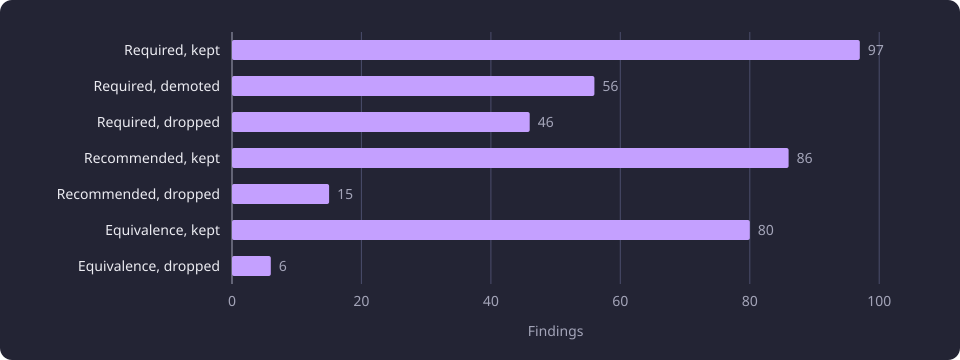

# Reference answers and judging

This page states the reference corpus, the blind support verdicts and the corrected reference that every inference comparison reads.

**Evidence status:** Corrected. **Run dates:** 26 September 2026.

## Why the category shares one reference

The inference experiments ask whether a candidate packet, a prompt version or a local model produces better inferred prerequisites. A difference between two variants can come from the model, the prompt, the candidate list or the sample. The category fixes the answer inputs and the judge so that a comparison measures the variant it names.

The reference answers are 300 saved complete target results from one external model on 200 fixed targets. A comparison reads the reference built from the saved answers instead of asking the model again. One unit of an answer is a [finding](/docs/backend/inference/inference.md#what-inference-produces), either one required option, one recommended option or one equivalence group. The judge is a separate language model that sees one finding and the teaching text it refers to and returns one of four support verdicts. It never sees which model produced the finding.

The corpus is evaluation evidence, not [the university's prerequisite record](/docs/reference/glossary.md#prerequisites-and-routes). The corrected reference derived from it is also evaluation evidence. The sections below state how both were produced, how the `partly` cases and one judge flaw were handled, and which limits every support number inherits.

## The reference model and its settings

The reference model is DeepSeek V4.1 Flash, requested from the DeepSeek chat-completions API. It is not one of the local models that the inference experiments measure. Every request enabled thinking at low reasoning effort and asked for a JSON object as the response. The request carried no temperature and no output token limit, so the provider defaults applied. The calls ran in the provider's off-peak window.

| Setting | Value |
|---|---|
| Model | DeepSeek V4.1 Flash |
| Endpoint | DeepSeek chat-completions API |
| Thinking | Enabled, `reasoning_effort=low` |
| Response format | `json_object` |
| Temperature | Not sent |
| Output token limit | Not sent |
| Prompt version | v6 |
| Candidates per packet | 50 |
| Answer validation | Strict complete-target result schema and supplied-code check |
| Retry | The identical request until the answer validated |
| Corpus spend | $3.77 |

## What the prompt asked for

The prompt is one system message and one user message per call. The user message carries the target descriptor and the ordered candidate descriptors of one packet. The system prompt fixes the output contract and the reasoning rules. Its version is v6.

- One complete result. The keys `required`, `recommended`, `equivalence` and `routing` are always present. An empty category is a complete answer, not a missing key.
- Grouping. Required and recommended are each an AND of requirement sets. Each set is an OR of options. Each option joins course codes with AND. A course may repeat across options of one category when the logic needs it, for example `(A AND B) OR (A AND C)`, but not across required and recommended.
- Copied codes. Every emitted course code must be copied from the candidate list. The target's own code may appear only in an equivalence group. The validator rejects an unknown or forbidden code.
- Directness. A candidate is a required prerequisite only when the target expects its knowledge immediately on entry. A chain does not justify a direct edge. A broad or transitive foundation is recorded as a suppressed candidate, not as an option.
- Categories. Required means the knowledge is expected before the course starts. Recommended means directly relevant background that is not an entry condition.
- Equivalence. A group asserts course-wide interchangeability. Similarity and target-local substitution do not qualify.
- Evidence and confidence. Every option and group carries a short evidence string and a confidence between 0 and 1. The prompt states that confidence is the model's certainty, not established truth.
- Routing. `routing` carries a confidence, zero or more of five flags and at most five suppressed candidates. The flags are `directness_ambiguity`, `alternative_path_ambiguity`, `breadth_ambiguity`, `substitute_overlap_ambiguity` and `insufficient_course_information`. The suppression outcomes are `too_basic_transitive`, `reverse_prerequisite`, `overlap`, `related` and `unrelated`.
- Hidden target labels. The model is told that the target's official prerequisite structure is withheld. No worked example shows the target's own answer.

The prompt also carries worked examples of a direct prerequisite, an AND option, an OR alternative, a suppression, a course-wide equivalence and an insufficient-information case. Each example is a curated reading of teaching text, not a university-authored prerequisite fact.

The corpus was produced under prompt version v6. Version v6 changed two rules from version v5: a course may appear in several OR options of one category, and five suppression outcomes are defined instead of one. The held-out answers motivated that wording, so the corpus is not an untouched prompt holdout.

## The cohort and the paired packets

The cohort is 200 active represented target courses, fixed before any answer was generated. It is disjoint from the fixed 100-target development set. A packet carries the candidates' identity fields and teaching text in packet order, with no retrieval score, rank value or official prerequisite label. Every target has a CE-only packet of 50 candidates. The first 100 targets in the fixed target order also have a 50-candidate RRF packet. Both packets for one target share the prompt, schema, settings and target and differ only in the ordered candidate descriptors.

The CE-only packet is the top 50 of a cross-encoder ranking over the saved 1,000-candidate multiview pool. The RRF packet is the top 50 by reciprocal rank fusion of the cross-encoder ranking and a ranking by Qwen3 0.6B at Q8_0, which scored 512 characters of candidate text. The corpus holds 300 validated answers across the 200 targets: the first 100 targets in the fixed target order carry a CE-only answer and an RRF answer, and the remaining 100 carry one CE-only answer each.

Each target and packet pair holds one validated answer, and no target has two validated answers under the same packet. The 100 pairs therefore compare two packets, not two samples of one packet, and they measure neither self-agreement nor the sampling variance of one packet.

In the corpus run, official prerequisite labels were read only after an answer existed, for spot checks, and never entered a packet, prompt or request. A separate retrieval measurement had already read the cohort's official labels, so the 200 are not an untouched holdout for ranking policy.

| Cohort | Answer slots | Validated answers | Invalid answers | Spend |
|---|---|---|---|---|
| First 100 targets | 200, CE-only and RRF | 200 | 12 | $2.38 |
| Remaining 100 targets | 100, CE-only | 100 | 2 | $1.39 |
| All 200 targets | 300 | 300 | 14 | $3.77 |

## The answers and cost

An answer was accepted only when it parsed against the strict complete-target result schema and every emitted course code appeared in the supplied packet. An invalid answer was re-sent with the identical request until it validated, so each slot holds its first valid answer. The corpus holds 300 validated answers and cost $3.77. The 200 CE-only answers emitted 386 findings across 151 targets.

## The blind judge

The judge is a language model that applies a fixed rubric to one finding at a time. It served the packet comparison, the reference corpus, the eight ambiguous required options and the local-model comparisons, and every one of those stages used Claude Opus 5.5 with the low variant. The judge is not the reference model and produced none of the corpus answers.

A verdict recorded for one target, category and member set was reused for the same claim instead of judging it again. The packet comparison and the reference corpus judged each distinct finding once. The judge returned one JSON array with one object per item in input order.

The rubric was held unchanged across the prompt versions and the local models, so their support numbers are comparable.

### What the judge saw

| Field | Content |
|---|---|
| `id` | A batch-local identifier |
| `claim` | One fixed phrase, either a required option with all listed courses taken together, a recommended option with all listed courses taken together, or a course-wide equivalence group |
| `target` | The target course code, name, learning outcomes and content |
| `courses` | The named courses with code, name, outcomes and content. For an equivalence group, the members other than the target |
| `target_is_member` | Whether the target belongs to the equivalence group |
| `model_evidence` | The producing model's own justification for the claim |

The rubric told the judge that the text may be Finnish or English and may be sparse, and that `model_evidence` may be wrong. The judge had to decide from the teaching text, not from the justification.

### What the judge did not see

The item carried no model identity, no confidence, no finding flag and no routing metadata. It did not show which packet or model produced the finding. The batch carried no official prerequisite or label, no earlier verdict and no corrected reference.

### Verdicts and the rubric

The judge returned one of four verdicts for each item.

- `supported`: the teaching text clearly supports the claim as stated.
- `partly`: part of the claim holds, for example one member of an AND option or most of an equivalence group, or the category is wrong.
- `unsupported`: the text does not support the claim or contradicts it.
- `unclear`: the text is too sparse to judge.

The rubric gives each category its own test.

- Required prerequisite. Supported only when the listed courses teach knowledge the target expects the student to hold immediately on entry. A broad or distant foundation, a sibling course taken alongside the target, a course that builds on the target, and related topic material are not required prerequisites.
- Recommended prerequisite. Supported when the listed courses are directly relevant background the target builds on, even if they are not an entry condition. Topic similarity alone is not enough.
- Equivalence group. Supported only when the members are interchangeable course-wide, so completing one could replace another everywhere. The same name with near-identical outcomes supports it. The same name with no text is unclear. Numbered series parts that are separate repeatable credits are not equivalent unless the text says they are interchangeable.

The rubric told the judge to be strict and consistent. Leaving out a true prerequisite is better than accepting a wrong one, so topic resemblance never earns `supported`. Every reason is 25 words or fewer.

The judge's verdicts over the 386 findings of the 200 CE-only answers are below. The supported share of a set is its number of `supported` findings divided by the number of findings it emitted. The weighted judged support score is the packet comparison's separate measure, with a weight of one for supported, 0.5 for partly and zero for unsupported. `partly` and `unclear` carry their own counts and are never folded into `supported`.

| Category | Findings | Supported | Partly | Unsupported | Unclear |
|---|---|---|---|---|---|
| Required options | 199 | 96 | 64 | 32 | 7 |
| Recommended options | 101 | 71 | 22 | 6 | 2 |
| Equivalence groups | 86 | 63 | 6 | 17 | 0 |
| All findings | 386 | 230 | 92 | 55 | 9 |

### Fine-disposition mode

The reference also needed a narrower reading for eight findings. These were required options whose recorded `partly` verdict carried no reason. A second mode returned one of four dispositions instead of the four verdicts.

- `correct as required`
- `correct only as recommended`
- `partial AND`
- `wrong`

The batch showed the teaching text, the claim and `model_evidence`, and withheld the old `partly` verdict, the producing model and the official labels. The mapping was `correct as required` to keep, `correct only as recommended` to demote, and `partial AND` or `wrong` to drop. The eight items produced one keep, six demotions and one drop.

## Correcting the reference

The 386 verdicts were not rewritten. The correction produced a separate 200-target reference by mapping every finding to a keep, demote or drop action. It made no call to the reference model, changed no prompt and read no official label.

The corrected reference is a 200-target evaluation corpus, not a set of edits to the answers. Every emitted finding has one recorded action, and the correction did not alter the 386 verdicts. No relationship was added to balance a category.

### Reused verdicts

Of the 386 findings, 98 were not judged again. The packet comparison had judged the 205 findings that appeared in only one of the two answers of a pair. Its 98 CE-only verdicts were reused here, keyed by the same target, category and member set in the same frozen packet. The split was 47 required options, 27 recommended options and 24 equivalence groups. Their reused CE-only totals were 57 supported, 31 unsupported, nine partly and one unclear. The other 288 findings were shuffled with seed 20260926 and judged in batches of 48.

The text shown to the judge was not identical for every reused item. Course order, literal HTML tags and truncation differed, while the packet did not change. The reuse is a limit of the text shown to the judge, not a second source or a second model answer.

### The correction rules

The rules were fixed before the mapping.

1. A `supported` finding stays.
2. An `unsupported` or `unclear` finding drops.
3. A `partly` required option that is relevant background without a clear entry requirement becomes recommended.
4. A `partly` finding whose reason identifies overlap, duplicated content, a more apt equivalence or an unsupported AND drops as a whole.
5. A `partly` recommended finding stays unless its reason says the relation is wrong or an overlap.
6. A target-not-member equivalence group stays exactly as emitted, whatever its verdict.
7. A target-member equivalence `partly` without full-group support drops.
8. A reasonless `partly` finding goes to fine mode when it is a required option, and drops by rule when it is a target-member equivalence group without full-group support.

A demoted option becomes its own single-option recommended set named `recommended_demoted_<n>`. It keeps its evidence and confidence exactly. No further OR grouping is invented, no recommended finding is promoted, and a requirement set left with no options drops.

### The partly class

All 92 `partly` findings received an action. The 83 that carried a recorded reason were read by hand. Eight reasonless required options went to the fine-disposition judge, which returned one `correct as required`, six `correct only as recommended` and one `partial AND`. The one reasonless target-member equivalence group dropped by rule.

In the required category, 50 reasoned `partly` options became recommended, and six reasoned ones dropped for overlap, duplicated content or an unsupported AND. The fine judge supplied the other six demotions and one drop.

For recommended `partly` findings the rule kept the recommendation unless the reason said the relation was wrong or an overlap. A reason that called the link weak, loose or tangential kept it. Seven of the 22 recommended `partly` findings dropped and 15 stayed. The 15 kept findings are a recorded interpretation, not a measured boundary, because a stricter reading of loose as wrong would have dropped them.

### The equivalence exception

45 of the 86 emitted equivalence groups do not contain their target. The item for such a group put the members in `courses` and the target in `target`, and set `target_is_member` to false. The judge compared the members with the target instead of only with one another, so its verdict did not test the group's claim. Those verdicts are unreliable.

The correction did not re-judge those groups. One fixed rule gives the exception precedence. Every target-not-member group stays exactly as emitted, whatever its verdict. Their recorded verdicts are 28 supported, 14 unsupported and three partly. The other 41 groups contained their target. The 35 supported groups stayed, and the three `partly` and three unsupported groups dropped.

The corrected reference therefore carries 45 equivalence groups whose group-wide support was never properly judged, and every comparison that reads the reference inherits that limit.

### The corrected reference

The corrected reference holds 97 required options in 70 sets, 142 recommended options in 126 sets and 80 equivalence groups. It retains 319 findings and drops 67. Of the 386 findings, 263 take a keep action, 56 a demotion and 67 a drop.

| Category | Emitted | Kept in category | Demoted to recommended | Dropped | Corrected |
|---|---|---|---|---|---|
| Required options | 199 | 97 | 56 | 46 | 97 |
| Recommended options | 101 | 86 | 0 | 15 | 142 |
| Equivalence groups | 86 | 80 | 0 | 6 | 80 |
| All findings | 386 | 263 | 56 | 67 | 319 |

The 56 demotions are the largest movement between categories. Every one moved a required option into recommended because its recorded reason described relevant background without a clear entry requirement, or because the fine judgment read it that way.

The chart plots the kept, demoted and dropped findings by category. Demotion to recommended applies to required options only, and 45 of the 80 kept equivalence groups are kept by exception.

## What the corrected reference can and cannot show

The corrected reference corrects emitted findings only. It fills no gap. The reference model may have omitted true prerequisites, and no rule could recover them. The 49 targets that emitted nothing have no finding in the reference, so no support rate counts them.

`Unsupported` counts a claim, and the taxonomy behind one verdict is wider than one error. A wrong category, an over-broad AND, an irrelevant course and a course that is an official prerequisite of another course all arrive as `unsupported`. A count of unsupported findings measures claims the text did not support. It leaves the count of omitted official prerequisites unmeasured.

A comparison against the corrected reference scores 45 groups whose group-wide support was never judged, and it scores them as the reference model wrote them.

The corrected reference was secondary evidence in the inference experiments. Its whole-result F1 compares a model's emitted options with a single-sample reference, and the reference holds more findings than any measured model emitted. The experiments used the blind supported share as the primary quality measure and F1 as a disagreement diagnostic.

## Where the method is used

The [packet comparison](/docs/experiments/inference/candidate-packet-selection.md), the [prompt and flag experiments](/docs/experiments/inference/prompt-and-flag-schema-tuning.md) and the local-model comparisons state their own variants, cohorts and numbers and link here for the corpus, the judge and the correction. The [Experiments section](/docs/experiments/README.md#inference) places this method page beside those reports. [Confidence and flag calibration](/docs/experiments/inference/confidence-and-flag-calibration.md) states what the confidence bins and the held-out rule fit found.

## Limits of judged support

The corpus and the judge support comparisons between variants. They do not establish that a prerequisite is true. The verdicts come from the four-verdict rubric stated above, and the category's shared limits, including the single sample per target, judging only emitted findings and the judge's truncated view, are stated on the [Inference experiments overview](/docs/experiments/inference/README.md#limitations).

The supported share and the judged support score are not interchangeable. The share counts `supported` verdicts over the findings a set emitted. The score weights supported one, partly 0.5 and unsupported zero over the findings that only one of two packets emitted. Neither is exhaustive ground truth.

The equivalence rubric is strict, and its verdicts were read as a lower bound rather than an exact measure. That strictness is a property of the measure rather than of the models (interpretation).

## Untested follow-up questions

Four questions remain untested.

1. A human re-read of a sample of the 386 findings would put a number on the judge's error. No such measurement exists.
2. A second DeepSeek answer per slot under the same packet would measure self-agreement and separate sampling noise from packet or prompt effects. No target holds two validated answers under the same packet, so that variance is unmeasured.
3. The supported share over emitted findings cannot reward a prerequisite that no model emitted. Measuring recall needs a reference independent of the generated claims, and none exists.
4. A re-judged equivalence set, with the 45 target-not-member groups compared only among their members, would show whether their verdicts and the corrected reference change. No such judgment exists.
