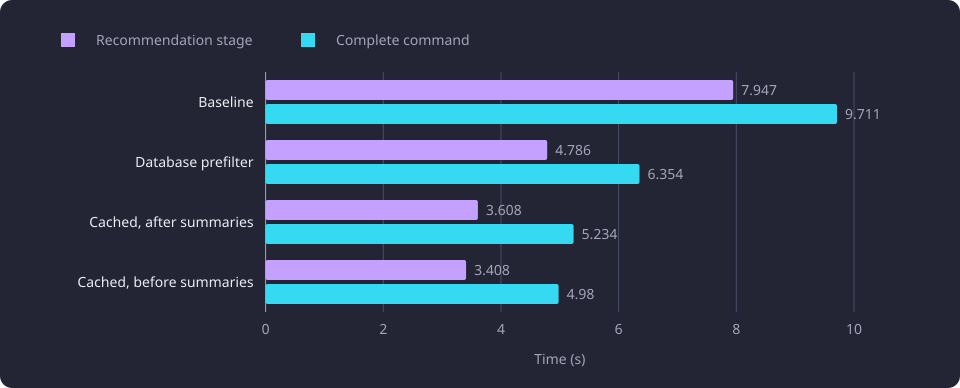

# Course-centroid candidate prefilter

A stored course centroid applied the recommendation relatedness floor before the candidate read, and the measured 50-course recommendation stage fell from 7.947 to 3.408 seconds.

**Evidence status:** Comparative. **Run date:** 27 October 2026.

## The question

The recommendation command read every ranked candidate's descriptive chunk vectors before the relatedness floor removed most of them. One hub-centred unit centroid per represented course can apply the same floor first, so the command reads summaries and full chunks only for the candidates that can pass it. The chunk-level coverage formula, the near-duplicate cut, the score and the order stay in the product scorer, and the candidate filter must not change the retained set, order or meters.

The product applies the floor from the course centroids of the [shared serving store](/docs/reference/glossary.md#serving-data), which the serving artifact build writes as one read-only float64 matrix that each process maps.

## Fixed basis and method

The measurements ran on a disposable copy of the selected dataset, never the live database. The copy held 11,086 courses, 58,962 chunk rows and 8,996 course centroids of 1,024 float64 components. The vectors are stored BGE-M3 embeddings with 1,024 components, so no embedding request ran. [Recommendation experiments](/docs/experiments/recommendations/README.md#hardware-the-reports-name) records the hardware the reports name.

The bases are the nested one, 10 and 50-course prefixes of the shared 21 October 2026 selection. [Recommendation experiments](/docs/experiments/recommendations/README.md#one-catalogue-and-the-fixed-selections) states how that selection was drawn and resolved, and [its policy settings](/docs/experiments/recommendations/README.md#the-request-and-policy-settings) state the configured values and request flags every run here used.

Each variant ran the product's own next-course read, basis read, nearest-chunk read, represented summaries, ranking and scorer. The baseline fetched chunks for the whole ranked pool. Each prefilter variant obtained the pool's centroids, computed the product's trimmed basis vector from the same basis chunks, and applied the relatedness floor. The variant that filtered before the summary read fetched summaries and chunks only for the survivors. The survivor list then went through the product's candidate scoring unchanged, so the coverage, near-duplicate and ordering steps stayed the product's.

Each basis ran one warmup round and three recorded rounds, alternating the variant order, with a cold next-course source cache and no descriptive chunk cache.

Each stored centroid is the scorer's own course point, the unit mean of the course's hub-centred, unit-length descriptive chunk vectors:

```python
rows = unit_rows(chunk_embeddings, chunk_fields, catalogue_hub, outcomes_hub)
centroid = unit_row(rows.mean(axis=0))
```

The pre-calculation wrote 8,996 rows in 111 batches in 47.34 s. A 100-course trial estimated 50.66 s for the work, 6.6 percent high. The binary store was converted from the float64 table in 6.54 s, a one-time cost that a direct binary write would avoid. Four variants ran on the same inputs:

| Variant | Centroid source | Summary order |
|---|---|---|
| Baseline | None | Every ranked candidate |
| Database prefilter | `double precision[]` rows read per request | Every ranked candidate, filter after |
| Cached, after summaries | 8,996-row `bytea` store loaded once into a NumPy matrix | Every ranked candidate, filter after |
| Cached, before summaries | Same in-memory matrix | Survivors only, filter before |

## Results

The 50-course stage and complete command, median of three recorded rounds:

| Variant | Recommendation stage | Complete command | Candidate chunk rows |
|---|---:|---:|---:|
| Baseline | 7.947 s | 9.711 s | 7,651 |
| Database prefilter | 4.786 s | 6.354 s | 1,468 |
| Cached, after summaries | 3.608 s | 5.234 s | 1,468 |
| Cached, before summaries | 3.408 s | 4.980 s | 1,468 |

The chart plots the recommendation stage and complete command time of the four variants at the 50-course basis.



The cached filter before the summary read is 57.1 percent faster than the baseline on the recommendation stage and 48.7 percent faster on the complete command. Against the database prefilter it is 28.8 percent faster on the stage and 21.6 percent faster on the command. The binary store and in-process cache account for 1.178 s of the stage saving, and applying the floor before the summary read for 0.200 s. That combination was selected and applied.

With either prefilter the candidate chunk read fell from 62.68 MB to 12.03 MB. The database variant read 15.34 MB of `double precision[]` centroids in 1.158 s per request, because each row carries a 1,024-element array, and the cached variants replaced that read with a 0.006 s in-memory lookup. Filtering before the summary read cut the candidate summary read from 0.232 s to 0.052 s. The remaining 50-course costs are the nearest-chunk read at 2.127 s, the candidate chunk read at 0.554 s and scoring at 0.492 s.

The 10-course recommendation stage fell from 1.469 s to 0.605 s. On the one-course basis the database variant was 0.162 s against the 0.143 s baseline, 13.3 percent slower, because its centroid read cost more than the 20 chunk rows it avoided. The cached variant removed that read and was near neutral at 0.139 s, 3.1 percent faster and within command noise.

The cache load is 0.92 s per process and the matrix is 73.7 MB. A process that loads it on its first recommendation request pays that cost once. The first 50-course command then takes about 5.90 s, which is faster than the 9.71 s baseline and the 6.35 s database prefilter. The first 10-course command takes about 1.80 s against a 1.78 s baseline, and the first one-course command about 1.31 s against a 0.39 s baseline.

The one-course result reads as a pool-size limit: the database read pays only when the pool is large enough to cover its centroid read, so the applied design loads the centroids into memory and filters before the summary read.

The recommendation route through the composed application, and the admission curves fitted from it, are measured in [Serving request cost and admission](/docs/experiments/runtime-storage-and-serving/serving-request-cost-and-admission.md).

## Exactness

Every recorded pair returned the same candidate pool and result digest: retained set, order, relatedness, score, overlap and derived flag. The instrumented baseline matched the real recommendation command on all three bases. No tolerance was applied.

The filter reuses the scorer's own centroid arithmetic and removes only candidates the scorer would have removed at the same floor. It used one NumPy dot per candidate, matching the scorer's `candidate_point @ profile` arithmetic rather than one matrix-vector product whose accumulation order could differ in the last bits.

20 binary centroids compared with the `double precision[]` rows they were written from were bit-identical, with a maximum absolute difference of 0.0.

## Boundaries

- The comparison uses one dataset, one selection and three bases. The candidate and result counts describe that snapshot.
- The values are command times measured in process, not web requests.
- The commands ran with no descriptive chunk cache. The live serving path reads candidate chunks from the shared float64 chunk store, so the measured command-time candidate read is not the serving path's warm read.
- The measured process held a 73.7 MB centroid matrix. The live centroid matrix is a read-only region of the shared serving store that every worker inherits.
- The exactness claim covers the float64 store.
- A centroid store keyed to another serving database, embedding configuration or academic year is a missing artifact rather than a stale read. [Serving artifact build and shared stores](/docs/experiments/runtime-storage-and-serving/serving-artifact-build-and-shared-stores.md) describes the build and the store's layout.

## Open questions

Each question below is untested.

- Whether a float32 centroid store keeps the same retained set near the relatedness floor.
- How much of the prefilter's saving the shared float64 chunk store removes on a warm serving path.
- Whether the prefilter pays on a basis larger than 50 courses, where the candidate pool grows with the basis.
- Whether the same retained set, order and meters hold on another dataset or subject area.
