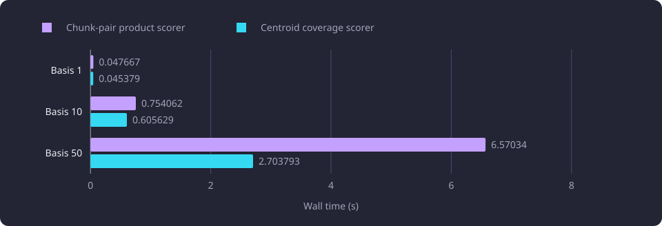
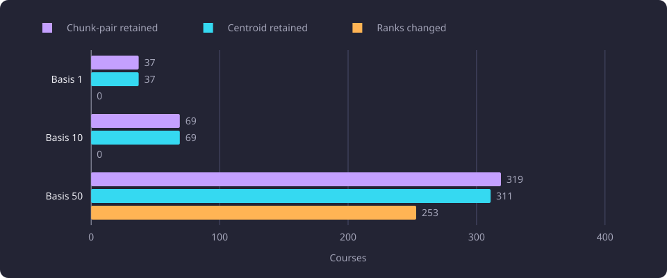
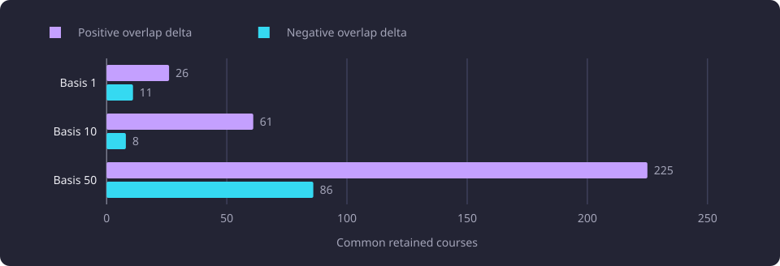

# Centroid coverage in recommendations

Course centroid coverage approximates the exact chunk-pair overlap that the recommendation scorer computes, and this report measures its runtime, memory and outcome changes.

**Evidence status:** Comparative. **Run date:** 21 October 2026.

## The question

[Recommendations](/docs/reference/glossary.md#discovery-and-the-structure-of-studies) rank candidate courses by the similarity of their teaching text to the completed [basis](/docs/reference/glossary.md#prerequisites-and-routes). Each result also carries an overlap meter, and a candidate whose text overlaps one basis course above a configured share is left out as a [near-duplicate](/docs/reference/glossary.md#discovery-and-the-structure-of-studies). The exact coverage step compares every descriptive [chunk](/docs/reference/glossary.md#capture-and-data-preparation) of a candidate with every descriptive chunk of the basis. That work grows with the product of the candidate chunk count and the basis chunk count.

The experiment asked how much scorer time and memory a coarser coverage step would save, and which recommendation outcomes would change. The alternative replaces chunk pairs with one centroid vector per course and changes nothing else in the scorer. A separate composition measurement asked whether the alternative would add value after formula-preserving vectorization and narrowed reads.

The exact chunk-pair scorer defines the reference outcome. The outcomes in this report are arithmetic: the retained set, order, exclusion reason, overlap meter, relatedness and score.

## The fixed pools

The three bases are the nested single-course, 10-course and 50-course prefixes of one fixed selection. The candidate pools are the product's retrieval and eligibility outputs for each basis, after its next-course exclusions, with 42, 435 and 1,874 ranked candidates. The [recommendation experiments overview](/docs/experiments/recommendations/README.md) states the shared cohort, the request and the configured policy for these measurements, and [its timing boundaries](/docs/experiments/recommendations/README.md#timing-boundaries) define the boundaries used here.

The chunk counts show why the coverage step grows:

| Basis | Basis chunk rows | Candidate chunk rows | Chunk pairs, upper bound |
|---|---:|---:|---:|
| 1 | 2 | 137 | 274 |
| 10 | 39 | 1,771 | 69,069 |
| 50 | 209 | 7,657 | 1,600,313 |

The pair count is an upper bound because candidates below the relatedness floor never reach the coverage products. The chunk rows are the descriptive content and learning-outcomes chunks available for each course, in either language. The vectors are stored BGE-M3 embeddings with 1,024 components, so no embedding model ran during the measurements.

## The coverage formulas

Both formulas begin from hub-centred unit vectors. Content chunks subtract the embedding hub, and learning-outcomes chunks subtract the outcomes hub. Candidate and basis chunks are pooled without a language filter, so a Finnish chunk can match an English chunk. The relatedness profile is shared and identical in both variants.

For a candidate course, let `u_i` be the hub-centred unit vector of candidate chunk `i` and `w_i` its character count. Let `v_j` be the hub-centred unit vector of basis chunk `j`, and let `g(j)` be the basis course of that chunk. The calibration maps a raw cosine ratio `r` to a percentage:

```text
overlap_percent(r) = 100 * clip((r - 0.20) / (0.90 - 0.20), 0, 1)
```

The exact chunk-pair formula computes:

```text
covered = sum over i of w_i * max(0, max over j of u_i . v_j)
whole_basis_overlap = overlap_percent(covered / sum over i of w_i)
strongest_course_overlap = max over basis courses g of
  overlap_percent((sum over i of w_i * max(0, max over j in g of u_i . v_j))
                  / sum over i of w_i)
```

A candidate is excluded as a near-duplicate when `strongest_course_overlap` reaches 90 percent. The whole-basis meter is the character-weighted mean of each candidate chunk's best match anywhere in the basis. The strongest-course meter repeats that calculation inside each single basis course. A broad basis therefore retains a candidate that shares content with many basis courses, and a candidate that duplicates one basis course is removed. The product applies its near-duplicate cut one basis course at a time, on its own overlap scale, as [Recommendation ranking](/docs/backend/search-and-discovery/recommendation-ranking.md) describes.

The centroid alternative compresses each course to one vector. For candidate centroid `c` and basis course centroid `b_g`:

```text
c = unit(mean of the candidate's hub-centred unit chunk vectors)
b_g = unit(mean of basis course g's hub-centred unit chunk vectors)
s_g = max(0, c . b_g)
whole_basis_overlap = overlap_percent(max over g of s_g)
strongest_course_overlap = max over g of overlap_percent(s_g)
```

Because the calibration is monotonic, the centroid variant's whole-basis overlap and its strongest-course overlap are the same value. Every basis course centroid is compared, and the maximum is taken. The candidate's chunks contribute equally through the centroid, and their character counts play no part in coverage.

Relatedness is identical in both variants. The basis course centroids are first compared with their own unit mean, and only those at or above the median cosine are kept. The unit mean of the kept centroids is the profile `p`, and relatedness is `100 * max(0, c . p)`. The trim kept one, five and 25 course centroids on the three bases. A single-course basis has no trim.

Only coverage is substituted. The relatedness floor, near-duplicate threshold, overlap penalty, name-and-code tie order and output type are the same. With `RECOMMENDATION_OVERLAP_PENALTY_WEIGHT=0.0`, score equals relatedness in both variants. The product's own policy for the relatedness floor, near-duplicate share and overlap penalty is stated in [Recommendations](/docs/backend/search-and-discovery/recommendations.md).

The diagram shows the two computations side by side on the same hub-centred unit chunk vectors.


## Scorer runtime

A matched measurement put the product scorer and the centroid scorer in each timed sample on identical captured inputs. The product and centroid calls used the same raw carriers, settings and output type, with preparation and result construction inside their timers.

| Basis | Chunk-pair median (s) | Centroid median (s) | Wall fall | CPU median fall |
|---|---:|---:|---|---|
| 1 | 0.047667 | 0.045379 | 4.80 percent, 0.002288 s | 4.79 percent, 0.002269 s |
| 10 | 0.754062 | 0.605629 | 19.68 percent, 0.148432 s | 19.74 percent, 0.148516 s |
| 50 | 6.570340 | 2.703793 | 58.85 percent, 3.866547 s | 58.93 percent, 3.863571 s |

The matched centroid scorer reproduced the saved centroid output on all three bases, with 37, 69 and 311 results. A timer that includes capture payload construction or output dumps on one leg and not on the other measures more than the coverage step. The series above places both calls inside one timer on identical inputs, so the wall fall is the coverage difference within that boundary.

The whole command that produced the fixed inputs took 1.391 s and 13.096 s on the single-course and 10-course bases. It includes the next-course read, approximate nearest-neighbour (ANN) retrieval, chunk reads, capture observers and payload hashing. The scorer fall is a minority of each command, and no uninstrumented alternative whole command was measured. The 50-course command spans separate timers, so it is not comparable to the 1.391 s and 13.096 s command timings.

The chart shows the matched wall medians.



The fixed call order in each sample was product then centroid. Cache warmth may favor the centroid call, so the centroid saving is bounded by that order. The measurement is scorer-only. It excludes capture loading, output serialization, diagnostics, hashing, ANN retrieval and HTTP serving.

## Which outcomes change

The retained sets and order were identical on the single-course and 10-course bases. Every overlap value changed, and every relatedness and score value was exactly equal. On the 50-course basis the centroid variant retained 311 courses against 319, removed eight and changed 253 of the 311 common ranks. No course was added.

| Basis | Ranked candidates | Retained, chunk-pair | Retained, centroid | Removed | Ranks changed | Relatedness-floor exclusions | Near duplicates, chunk-pair | Near duplicates, centroid |
|---|---:|---:|---:|---:|---:|---:|---:|---:|
| 1 | 42 | 37 | 37 | 0 | 0 | 5 | 0 | 0 |
| 10 | 435 | 69 | 69 | 0 | 0 | 366 | 0 | 0 |
| 50 | 1,874 | 319 | 311 | 8 | 253 | 1,532 | 23 | 31 |

The chart shows the retained counts and the changed ranks.



All eight removals fail the 90 percent near-duplicate test under centroid coverage. Their chunk-pair overlap was below the threshold and their centroid overlap was above it. The chunk-pair near-duplicate count was 23 and the centroid count was 31. Both variants excluded 1,532 candidates at the 33 percent relatedness floor. No candidate lacked chunks or a profile.

| Chunk-pair rank | Code | Relatedness | Chunk-pair overlap | Centroid overlap |
|---:|---|---:|---:|---:|
| 59 | `MEDANPSTOI` | 41.2926 | 89.2482 | 91.3468 |
| 119 | `ROBO.010` | 39.0913 | 75.1257 | 97.3042 |
| 126 | `MEDAHPAKÄY` | 38.8928 | 77.1136 | 94.0705 |
| 130 | `MEDAKHETOI` | 38.8224 | 88.0251 | 90.6867 |
| 136 | `MEDAAKUTOI` | 38.5215 | 89.8653 | 92.3582 |
| 168 | `SSR.GEN.110` | 37.1659 | 65.6158 | 94.5232 |
| 274 | `KAN.211` | 34.1985 | 73.1193 | 91.0360 |
| 283 | `MEDAINFERI` | 33.9831 | 78.1853 | 94.6116 |

For these eight courses the centroid overlap is also their centroid strongest-course overlap. The relatedness values are identical, so the removals come from coverage alone. The rank shifts of the common courses were one to eight places, with a median of six. The scores are identical, so the shifts follow from renumbering after the eight removals.

Every common retained course changed its overlap value on every basis. The direction was mixed:

| Basis | Common retained courses | Positive overlap deltas | Negative overlap deltas |
|---|---:|---:|---:|
| 1 | 37 | 26 | 11 |
| 10 | 69 | 61 | 8 |
| 50 | 311 | 225 | 86 |

The chart shows the two directions by basis.



On basis 50 the overlap delta had a mean of +5.2189, a median of +4.9668, a minimum of -23.7623 and a maximum of +29.7677 percentage points. The exact deltas are mixed in sign and size, so the centroid meter is neither a uniform inflation nor a uniform reduction of chunk-pair overlap. The hypothesis that centroid coverage would preserve the recommendation set failed on the 50-course basis.

The change is an approximation effect in the overlap meter and the near-duplicate rejection. It is not evidence that the removals are wrong, and it is not evidence that the recommendations improve.

## Memory

The scorer trace is the `tracemalloc` peak for the Python allocations of the scorer call. It is not the peak resident set of the coverage formula alone. Process peak RSS is process-wide and includes database reads, capture parsing, carrier conversion, interpreter pages and written payloads. It is not a controlled per-algorithm memory comparison.

| Basis | Chunk-pair trace (MB) | Centroid trace (MB) | Trace change | Capture process peak (MB) | Centroid process peak (MB) |
|---|---:|---:|---:|---:|---:|
| 1 | 0.601 | 0.634 | +5.57 percent | 142.78 | 110.88 |
| 10 | 2.485 | 2.519 | +1.34 percent | 498.16 | 356.53 |
| 50 | 10.329 | 10.319 | -0.10 percent | 1,033.28 | 1,175.13 |

The trace was 5.57 percent larger on the single-course basis, 1.34 percent larger on the 10-course basis and 0.10 percent smaller on the 50-course basis. The Python allocations range from 0.6 MB to 10.3 MB, so the trace says little about the memory of a serving process.

The capture process also performed the database reads, next-course compilation, ANN retrieval and fixed-input write. Its own payload snapshot before writing was 132.45 MB on the single-course basis and 364.09 MB on the 10-course basis. Writing the 5.4 MB and 64 MB fixed inputs raised the process peaks to the table values. The 50-course centroid process loaded a 289.41 MB fixed input and built candidate objects, and its process peak was higher than the capture peak of the same basis. The measurements did not isolate the cause. The centroid processes opened no database connection. The RSS values in the table do not isolate the memory of either coverage formula.

## Composition after vectorization

A separate measurement paired formula-preserving vectorized chunk coverage with descriptive-field-only reads on the same fixed bases, then swapped only the coverage step. Each leg resolved the dataset, created a fresh engine, read summaries and descriptive chunks, prepared its own arrays, scored and serialized. The centroid leg was 1.35 percent faster on the single-course basis, 0.68 percent faster on the 10-course basis and 0.84 percent slower on the 50-course basis.

| Basis | Chunk leg total (s) | Centroid leg total (s) | Centroid leg against chunk |
|---|---:|---:|---|
| 1 | 0.144528 | 0.142583 | 1.35 percent faster |
| 10 | 0.960810 | 0.954318 | 0.68 percent faster |
| 50 | 4.968174 | 5.010143 | 0.84 percent slower |

The leg totals differed by 0.0019 s, 0.0065 s and 0.0420 s of recorded wall median, inside run noise. The candidate chunk read dominated the composition at 4.047336 s of the 4.968174 s chunk leg on basis 50, and scoring was 0.551602 s of that leg. In the scorer-only matched measurement, the vectorized chunk scorer cost 0.5380 s on basis 50, against 2.7038 s for the centroid scorer and 6.5703 s for the product scorer. The centroid scorer did not improve on the vectorized scorer. Centroid coverage therefore adds no consistent fixed-pool composition saving after vectorization and narrowed reads, and the centroid candidate was dropped.

Both legs ran as float64 NumPy implementations with the same reads. Each leg reproduced its saved reference within the last binary digits, and the legs differed in the approximation's outcomes. Between the two legs, relatedness and score differ only in the last binary digits, while every overlap value changes.

| Basis | Comparison | Results | Same set | Same order | Ranks changed | Removed | Largest overlap delta | Tie pairs |
|---|---|---:|---|---:|---:|---:|---:|
| 1 | Centroid against saved centroid | 37 | yes | yes | 0 | 0 | 3.55e-14 | 0 |
| 1 | Centroid against chunk | 37 | yes | yes | 0 | 0 | 12.5083 | 0 |
| 10 | Centroid against saved centroid | 69 | yes | yes | 0 | 0 | 5.68e-14 | 0 |
| 10 | Centroid against chunk | 69 | yes | yes | 0 | 0 | 20.4220 | 0 |
| 50 | Centroid against saved centroid | 311 | yes | yes | 0 | 0 | 7.11e-14 | 27 |
| 50 | Centroid against chunk | 311 against 319 | no | no | 253 | 8 | 29.7677 | 27 |

The chunk leg reproduced the saved product output on every basis with the same set and order and no rank change, differing only in the last binary digits. No derived flag changed on any basis. The 27 adjacent exact tie pairs on basis 50 cover 41 courses, and they are identical in both legs and in both saved references. The median-trim membership is identical in both legs and both references, with one, five and 25 courses kept. The centroid leg's exclusion counts match the saved centroid diagnostics on every basis. Chunk-leg exclusion reasons for candidates excluded under both formulas were not recomputed, so a reason change at the same excluded outcome is not measured.

That result removes the runtime case for centroid coverage. The scorer-only saving is measured under matched boundaries, but it does not survive as a composition or whole-request saving once the formula-preserving vectorization removes most of the scoring time. The centroid variant changes outcomes on basis 50, and it has no quality validation.

The centroid change and the formula-preserving vectorization gain must not be combined into one equivalent speedup. Vectorization preserves the product formula and changes only last binary digits. Centroid coverage changes the formula, removes courses and changes ranks. They answer different questions and are not additive.

## What the results do not establish

- The matched saving is a scorer-only measurement. It excludes capture loading, carrier construction, output dumps, serialization, diagnostics, hashing, retrieval and HTTP serving.
- The composition leg is a fixed-pool leg, not an HTTP measurement. It excludes the next-course read, approximate retrieval, capture observers, hashing, the serving identity wrapper and response delivery.
- The fixed call order may favor the centroid call through cache warmth.
- Process RSS is process-wide and is not per-algorithm memory. The traced peak covers Python allocations for the scorer call only.
- With `RECOMMENDATION_OVERLAP_PENALTY_WEIGHT=0.0`, score equals relatedness. A configuration where the overlap meter penalizes score was not measured, so the score effect of the changed overlap is untested.
- The eight removals and 253 rank changes are measured on one 50-course pool. They are not a general rule for other bases.
- The [recommendation experiments overview](/docs/experiments/recommendations/README.md#limits-shared-by-the-line) states the limits shared by the line.

## Setup details

One heavy process ran at a time after a free-memory check. Each process had a 180 s wall limit and a 2.147 GB address-space cap.

The scorer used Python 3.14.3 and NumPy 2.4.6 with scipy-openblas 0.3.31 (build 188.0) in the matched measurement. The thread environment set `OPENBLAS_NUM_THREADS=1`, `OMP_NUM_THREADS=1`, `MKL_NUM_THREADS=1`, `BLIS_NUM_THREADS=1` and `VECLIB_MAXIMUM_THREADS=1` before product imports.

Every database session ran with `default_transaction_read_only=on` and a 30 s statement timeout. The capture processes opened two or three connections and rolled back their reads. The centroid processes opened no connection. No write was attempted.

## Open questions

Whether a different course centroid definition, such as one that weights chunks by character count, closes the eight removals and 253 rank changes is untested. The [recommendation experiments overview](/docs/experiments/recommendations/README.md#untested-questions) lists the questions the line shares, including a reader rating of the two lists and the effect of a nonzero overlap penalty.
