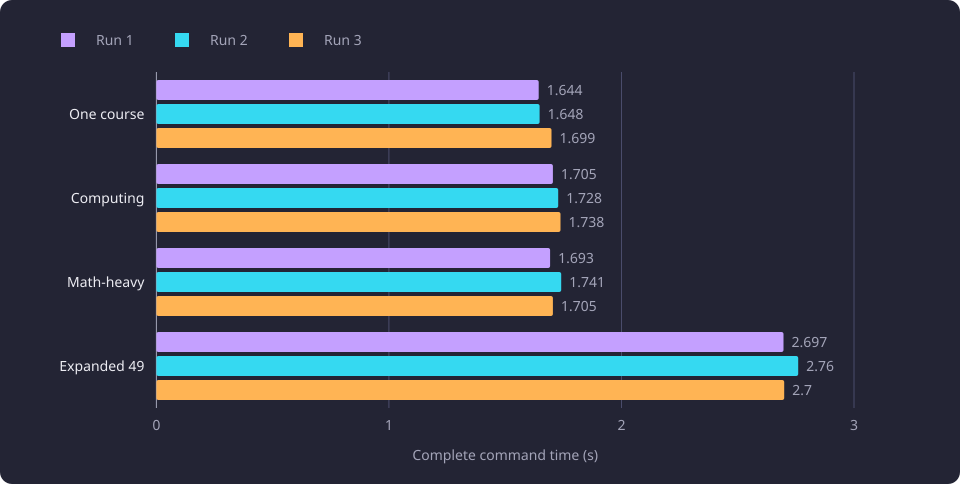
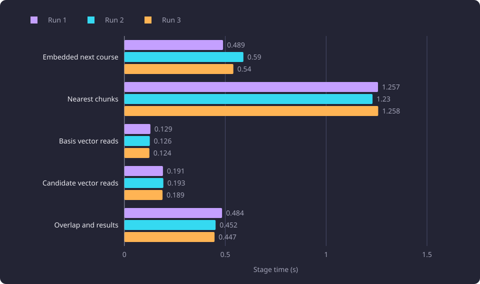

# Recommendation latency diagnosis and remediation

Four fixed baskets whose complete recommendation commands took 24.345 to 25.449 seconds were traced to two costs inside the request, and both were removed.

**Evidence status:** Comparative. **Run date:** 10 October 2026.

## The question

[Recommendations](/docs/backend/search-and-discovery/recommendations.md) list courses whose teaching text is similar to the whole [basis](/docs/reference/glossary.md#prerequisites-and-routes), after the complete [next-course](/docs/reference/glossary.md#discovery-and-the-structure-of-studies) report for the same inputs. The design target was about one second on the server for a basis of up to 50 courses. Four fixed baskets measured 24.345 to 25.449 seconds per complete command.

The experiment asked where that time went, whether the cost sat in the database, the approximate vector read or application computation, and whether changes inside the request could remove it without changing the result. A request-local change is one made inside one request, with no stored change, schema change or additional index.

Latency is the only subject here. The selection and tuning of the relatedness floor, the near-duplicate share and the overlap penalty belong to [Recommendation scoring calibration](/docs/experiments/recommendations/scoring-calibration.md). The effect of the basis centroid on the courses reached belongs to [Centroid coverage in recommendations](/docs/experiments/recommendations/centroid-coverage.md), and score-preserving vectorization belongs to [Recommendation vectorization and narrow reads](/docs/experiments/recommendations/vectorization-and-narrow-reads.md).

All times are complete command wall seconds unless a row states another boundary.

## Baskets and settings

The four baskets were fixed course sets. The next-course count and the similarity count come from the measured build.

| Basket | Basis | Basis size | Next courses | Similarity results |
|---|---|---:|---:|---:|
| One course | `COMP.CS.100` | 1 | 25 | 19 |
| Computing | `COMP.CS.100`, `COMP.CS.110`, `COMP.CS.140` | 3 | 46 | 13 |
| Math-heavy | `MATH.MA.110`, `MATH.MA.120`, `MATH.MA.210` | 3 | 23 | 3 |
| Expanded computing | Three computing seeds and the 46 computing next courses, deduplicated | 49 | 31 | 30 |

The one-course, computing and math-heavy baskets name requested course codes that resolve to canonical identities through the [course resolver](/docs/reference/glossary.md#search-and-comparison). The expanded basket takes the three computing identities in request order, then the 46 next-course results of the computing basket in report order, removes duplicates and keeps the first 50.

```python
basis = list(computing_seed_ids) + list(computing_next_course_ids)
basis = list(dict.fromkeys(basis))[:50]
```

Canonical deduplication left 49 courses, so the cap did not truncate the list. One computing seed is [inactive](/docs/reference/glossary.md#courses-and-the-catalogue), and an inactive course is a valid basis course.

| Setting in the measured build | Key | Value used by the runs |
|---|---|---:|
| Chunks per basis chunk | `RECOMMENDATION_CHUNK_TOP_K` | 40 |
| Candidate shortlist | `RECOMMENDATION_CANDIDATE_LIMIT` | 100 |
| Result cap | `RECOMMENDATION_MAX_RESULTS` | 30 |
| Relatedness floor | `RECOMMENDATION_MIN_RELATEDNESS` | 0.80 |
| Near-duplicate share | `RECOMMENDATION_NEAR_DUPLICATE_PERCENT` | 75 |
| Overlap penalty weight | `RECOMMENDATION_OVERLAP_PENALTY_WEIGHT` | 0.30 |
| Strong-match cosine floor | `COMPARISON_STRONG_MATCH_MIN_SCORE` | 0.79 |

The latency runs changed none of these values. The three keys `RECOMMENDATION_CANDIDATE_LIMIT`, `RECOMMENDATION_MAX_RESULTS` and `COMPARISON_STRONG_MATCH_MIN_SCORE` belong to the measured build, and the product reads none of them. The product's recommendation list is cut by the relatedness floor and the near-duplicate rule alone, so it has no configured length limit.

The expanded basket returned 30 similarity results, equal to the measured build's result cap. The count after overlap removal without the cap was not measured, and the shortlist cap of 100 held an unmeasured number of candidates.

## The command boundary

Every timed recommendation invocation was a separate complete command. It resolved the requested identities, read settings, ran the next-course command, read basis and candidate vectors, ran the nearest query, computed overlap and ranking, and serialized the report.

Every database transaction was read-only. No GPU, model provider, stored-vector write, schema change or configuration change took place. An external 30-second cap bounded every run and is not a product timeout.

## Initial complete timings

| Basket | Basis size | Separate next course (s) | Three complete recommendation runs (s) |
|---|---:|---:|---|
| One course | 1 | 24.425 | 24.345, 24.467, 24.465 |
| Computing | 3 | 24.512 | 25.270, 25.426, 25.331 |
| Math-heavy | 3 | 24.213 | 24.395, 24.457, 24.545 |
| Expanded computing | 49 | 1.015 | 25.449, 24.944, 24.822 |

The small baskets took 24.345 to 25.426 seconds, and their separate next-course calls took 24.213 to 24.512 seconds. The next-course stage therefore accounted for the small-basket cost.

The expanded basket's next-course call took 1.015 seconds, while its complete recommendation took 24.822 to 25.449 seconds, so the recommendation and vector work accounted for that cost. The separate next-course calls are different invocations, so these values are not stage sums.

The same one-course command through the [command-line script](/docs/backend/interfaces/command-line.md) took 25.85 seconds including process startup and JSON output.

## The small-basket cost

The one-course next-course command ran under Python's `cProfile` profiler and completed in 89.833 seconds. The profile recorded 63 SQL reads over 0.382 SQL seconds. The next-course outcome evaluation took 87.043 seconds. It resolved an occurrence 9,942 times, and those resolutions took 86.236 seconds and yielded about 11.45 million requirement occurrences from repeated whole-tree searches.

An occurrence is one position in a requirement tree. The calls came from next-course coverage for course slots and substitution slots. The database reads and the compiler were not the dominant cost.

A first-object identity lookup with the same root fallback returned a complete one-course next-course report in 1.925 seconds, with 63 SQL reads over 0.353 SQL seconds. That isolated the computational cause.

## The expanded-basket cost

The unprofiled expanded recommendation completed in 24.311 seconds.

| Stage | Seconds |
|---|---:|
| Next-course command | 0.907 |
| Basis summaries | 0.034 |
| Basis vectors (305, including name vectors the command discarded) | 0.137 |
| Nearest descriptive query (207 input chunks, 1,550 hits) | 1.239 |
| Hit summaries (601) | 0.086 |
| Candidate vectors (480) | 0.192 |
| Recommendation overlap and result service | 21.692 |

The stage values come from nested timers inside the command and are not an additive partition, so no two are added. The 56 SQL reads took 1.510 seconds, and the nearest query's SQL execution took 1.085 seconds. The overlap and result stage took 21.692 seconds and included the near-duplicate check, the overlap meters, scoring and ordering. It was application computation over the read vectors, not SQL execution.

The nearest query's plan read a `VALUES` list, applied a lateral `LIMIT`, joined by nested loops and used `Index Scan using ix_course_embedding_chunks_embedding_hnsw`, ordered by cosine distance to the input vector. HNSW is an approximate nearest-neighbour graph index. The index was present and was used by the nearest query. The 21.692-second overlap cost was application computation, so no planner forcing or additional index was needed for it. Basis and candidate reads each happened once, outside candidate loops.

Preparing the whole basis for every candidate produced a 2.718-second overlap stage. Preparing it once for all candidates produced a 0.417-second stage. The per-candidate preparation repeated the same chunk products, so it left the overlap stage above the target.

With the identity lookup and the once-prepared overlap combined, the expanded command took 2.945 seconds, including an extra earlier overlap call.

## Request-local changes

The remediation made two changes.

1. The first change resolves occurrences. One first-occurrence identity index is built inside the request and discarded with it. It replaces repeated whole-tree searches while preserving the first positional occurrence and the root fallback.
2. The second change prepares the overlap once. The descriptive basis is normalized once per request. Each candidate-basis chunk product is computed once and reused for the candidate-to-basis coverage and the per-basis-course near-duplicate check. The character weights and the configured floor and ceiling are the values the measured build used.

The approximate nearest-neighbour read and the HNSW index did not change. No stored vector, schema or configuration value changed.

## Report parity

The fixed baskets and the reports captured from them are the acceptance inputs for the change. Four next-course reports and four recommendation reports were captured before the changes, and all eight completed under the external cap.

After the changes, each separate next-course report equalled its saved pre-change report object, including order and coverage. Each recommendation report embedded the same next-course report. The third run of each basket kept the initial similarity result identities and order. Shared course report objects, derived flags and overlap availability matched. Relatedness, score and available overlap differed by no more than 1e-9, and the observed differences were zero.

The acceptance checks also confirmed that every similarity result was canonical-unique, active, disjoint from the basis and the next-course set, at or above the configured raw floor, below the inclusive near-duplicate cutoff when overlap was available, scored by the configured penalty formula and within the measured build's result cap. The four-basket comparison established whole-report parity within that tolerance on these inputs.

## Final measurements

### Complete command times

| Basket | Basis size | Separate next course (s) | Three complete recommendation runs (s) | Next courses | Similarity results |
|---|---:|---:|---|---:|---:|
| One course | 1 | 1.804 | 1.644, 1.648, 1.699 | 25 | 19 |
| Computing | 3 | 1.554 | 1.705, 1.728, 1.738 | 46 | 13 |
| Math-heavy | 3 | 1.598 | 1.693, 1.741, 1.705 | 23 | 3 |
| Expanded computing | 49 | 0.530 | 2.697, 2.760, 2.700 | 31 | 30 |

The three small baskets took 1.644 to 1.741 seconds, and the expanded basket took 2.697 to 2.760 seconds. The command-line script on the one-course basis took 3.241 seconds including process startup and JSON output.

The chart shows the three complete recommendation runs for each basket after the two request-local changes.



### Stage costs

| Basket | Embedded next course (s) | Nearest chunks (s) | Basis chunk vector reads (s) | Candidate vector reads (s) | Overlap and results (s) |
|---|---|---|---|---|---|
| One course | 1.496, 1.502, 1.559 | 0.029, 0.025, 0.024 | 0.010, 0.008, 0.008 | 0.048, 0.047, 0.047 | 0.015, 0.015, 0.015 |
| Computing | 1.585, 1.592, 1.558 | 0.041, 0.039, 0.040 | 0.014, 0.013, 0.014 | 0.031, 0.030, 0.030 | 0.013, 0.013, 0.013 |
| Math-heavy | 1.614, 1.578, 1.558 | 0.054, 0.048, 0.047 | 0.014, 0.013, 0.014 | 0.013, 0.013, 0.013 | 0.006, 0.006, 0.007 |
| Expanded computing | 0.489, 0.590, 0.540 | 1.257, 1.230, 1.258 | 0.129, 0.126, 0.124 | 0.191, 0.193, 0.189 | 0.484, 0.452, 0.447 |

Each cell lists the first, second and third run. On the expanded basket, the nearest query took 1.230 to 1.258 seconds and the overlap and result stage 0.447 to 0.484 seconds. The embedded next-course stage took 0.489 to 0.590 seconds. The basis and candidate vector reads were below 0.2 seconds each. The stage values come from nested timers and do not partition the complete command, so a stage saving is not added to another.

The final nearest query's bounded plan used the same HNSW index. No additional index or stored change was part of the remediation.

The chart shows the three stage measurements for the expanded basket.



## Remaining latency

On the measured build, the expanded basket's complete recommendation took about 2.7 seconds, mainly the 1.230 to 1.258-second nearest query and the 0.447 to 0.484-second overlap and result stage. The separate small-basket next-course calls took 1.554 to 1.804 seconds, and complete small-basket recommendations took 1.644 to 1.741 seconds.

The approximately one-second target was not met. The residual was left without a stored change or an additional index, and no further optimization loop ran. The product's recommendation scorer runs as native code, and [Native recommendation scoring](/docs/experiments/recommendations/native-recommendation-scoring.md) measures its cost.

## The rejected 48-course basis

The rejected stress construction sorted the three computing seed identities and removed the inactive seed, producing 48 courses. Recorded completion times were 23.492 to 23.763 seconds, with a further observation censored at the external cap. Sorting changed the request order, and removing the inactive seed dropped a valid basis course, so the construction differed from the intended acceptance input in both sequence and membership.

The 48-course values do not bound the 49-course basis. The dropped course is a valid basis course, and the censored observation gives only a lower bound for that different input. A stress basis has to follow the stated construction rule, with the seeds in request order and the inactive course kept. The 49-course measurements in the tables use that rule.

## Measurement boundaries

- Complete command values cover input resolution, settings, the next-course command, database and vector work, overlap and ranking, and JSON serialization.
- The command-line values include process startup and JSON output.
- A separate next-course value comes from a different call than the recommendation rows, so the two do not add.
- Stage values come from nested timers inside one command and do not partition it.
- The identity lookup and overlap preparation measurements ran outside the product and cover one command or one stage. The overlap prototype is one arithmetic check, not a whole-result equivalence proof. The four-basket report comparison supplies the parity result.

## Limitations

- The 89.833-second profile includes profiler overhead and is not comparable with wall-clock commands. No profiled breakdown exists for the expanded basket.
- The runs are three raw invocations with no separate warmup and no controlled cache warmth, so each value is one command and not a median, and the runs are not a warm and cold comparison.
- These are complete command times, not web request-path latency. No web server or [admission control](/docs/backend/interfaces/admission-control.md) was measured.
- The expanded basket's 30 results equal the measured build's result cap, so the count after overlap removal without the cap is unknown.
- The parity result covers the four baskets within the stated tolerance.
- No concurrent load was applied to these command runs.

The [recommendation experiments overview](/docs/experiments/recommendations/README.md#limits-shared-by-the-line) states the limits shared by the line.

## Setup details

| Item | Value |
|---|---|
| Accelerator | none, no GPU access |
| Remote stages | none ran |
| Embedding model | `BAAI/bge-m3`, 1,024 components |
| Vectors | stored representative content and learning-outcomes chunks |
| Database | PostgreSQL with pgvector and an HNSW index on the chunk embedding column |
| Access | read-only transactions |
| Baskets | four fixed baskets, three recommendation runs each |

Every request used `basis=completed`, `mode=at_least_one`, `display_language=en`, `include_inferred=false` and `active_only=true`. Only chunks of the measured embedding configuration took part. The commands read stored vectors and made no embedding request.

## Baselines

A follow-up compares against these values from the measured build. The complete command took 24.345 to 25.449 seconds across the four baskets before the changes, and 1.644 to 2.760 seconds after them. The separate next-course calls took 24.213 to 24.512 seconds on the small baskets and 1.015 seconds on the expanded basket before the changes, and 1.554 to 1.804 seconds and 0.530 seconds after them.

After the changes, the expanded basket's stages were 0.489 to 0.590 seconds for the embedded next course, 1.230 to 1.258 seconds for the nearest query, 0.124 to 0.129 seconds for the basis chunk vector reads, 0.189 to 0.193 seconds for the candidate vector reads and 0.447 to 0.484 seconds for overlap and results.

## Open questions

- Whether the nearest query and the overlap and result stage can be reduced further inside the request without changing the approximate index or the stored data. Untested.
- Whether the same request-local changes hold their latency and report parity on other bases, a larger catalogue or a server under concurrent load. Untested.
- Whether a web request path that adds admission control and response transfer meets the same times. Untested.
