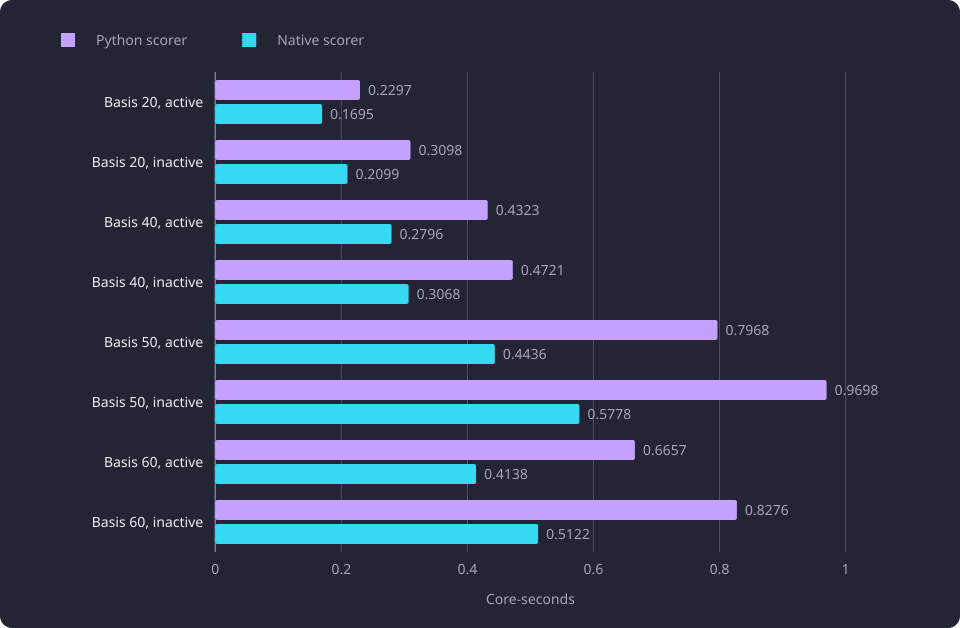
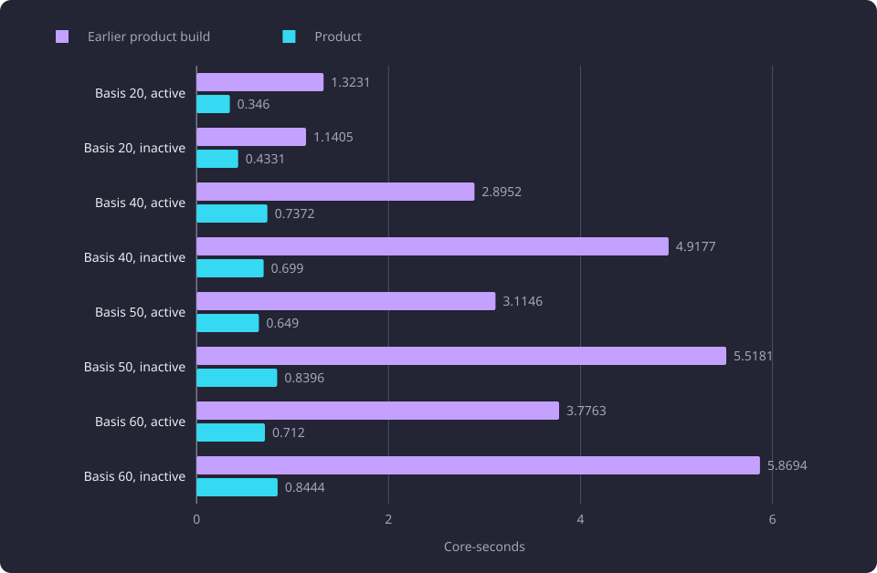

# Native recommendation scoring

Recommendation scoring and its overlap loop moved to native code with the same candidates, order, meters and derived-text flag, and every measured endpoint used fewer core-seconds.

**Evidence status:** Comparative. **Run dates:** 28 to 30 October 2026.

## The question

[Recommendations](/docs/backend/search-and-discovery/recommendations.md) rank courses whose teaching text is close to the [basis](/docs/reference/glossary.md#prerequisites-and-routes). For one recommendation request the web process, not the database, was the dominant CPU consumer. The scoring stage recomputed every candidate's centred and normalized chunk rows, its dot products against every basis chunk, its [overlap](/docs/reference/glossary.md#search-and-comparison) with the basis and its order.

The question was whether that arithmetic and the overlap loop could move to [native code](/docs/reference/glossary.md#serving-data) with the same candidates, order, meters and derived-text flag, and what the move saves at the endpoint. A second question asked where the remaining cost sits once the arithmetic is native.

## Setup

The measurements read one selected dataset of 11,086 courses, 58,962 teaching-text [chunks](/docs/reference/glossary.md#capture-and-data-preparation), 8,996 [course centroids](/docs/reference/glossary.md#discovery-and-the-structure-of-studies) and 4,709,120 stored neighbour rows. The paired scorer matrix ran on 28 October 2026 on a four-core aarch64 Neoverse N1 server with 24.1 GB of RAM. PostgreSQL 18.6 and pgvector 0.8.6 ran in a container. The product measurements ran on a four-core aarch64 server.

The paired scorer comparison used the first 20, the first 40, the first 50 and the first 60 course identities of one fixed selection as the basis, in an active-only and an including-inactive scope. Every scenario ran two warm-up calls before its recorded samples. A warm value is the median of five calls, and a report-cache-miss value is the median of five calls that clear the [next-course report cache](/docs/reference/glossary.md#administration) before the call. A miss sample clears only that cache, so the source-fact, chunk and centroid caches stay warm. The database container had a 2 GB limit, and every process used one BLAS thread. The database share of the endpoint stayed between 0.07 and 0.25 core-seconds.

The stage measurement used one synthetic request with the real basis-50 active shape: 398 candidates, 1,693 candidate chunks, 209 basis rows and 1,024 components.

The matched endpoint matrix of 30 October 2026 drove the product and the earlier product build with the same request bodies, database and embedding provider, over four workers under a 2.31 GB web cap. Each side's value is the mean of three samples, and each sample is a distinct report-cache miss verified by cache events, so a mean covers three different request bodies of the same shape. The parentheses give the minimum and maximum of the three. The matrix drew its bases from a 500-course workload pool, and its earlier column is the tree before this work, so that column is the regression test rather than a comparison with the 28 October shortlist. Every value is core-seconds summed over the web, database and embedding components. The endpoint measurement follows the serving method of the [Runtime, storage and serving experiments](/docs/experiments/runtime-storage-and-serving/README.md).

The diagram shows the path one recommendation request takes, with the native call marked.


No concurrent load, x86 host, second dataset or browser is part of the paired matrix. The matched matrix ran over four workers on one host and one dataset. In the paired matrix only the recommendation stage was replaced, and the rest of the endpoint was the same on both sides.

## The native scorer in the product

The product's recommendation scoring runs in native code. `native/scorer.cpp` exposes `course_recommendation_score`, and `src/course_explorer/recommendations/native_scorer.py` loads the library through `ctypes`, marshals one request to it and builds the recommendation objects from its results. The library format version is 2.

The caller passes the prepared basis rows, the trimmed basis vector, both hub vectors and every candidate's descriptive chunk rows. The candidate pool is built from the stored-neighbour read, filtered by the relatedness floor on the stored course centroids, and kept in first-seen order. The native call subtracts the field's hub from each candidate chunk, normalizes the row and forms the candidate point. It measures relatedness to the profile, computes the per-basis-course and whole-basis coverage, applies the near-duplicate cut and the score, and sorts the kept candidates by score, then relatedness, then the ordering key. It returns each kept candidate's index, relatedness, score, overlap, whether an overlap exists and the derived-text flag. The formula and the ordering key are described in [Recommendation ranking](/docs/backend/search-and-discovery/recommendation-ranking.md).

The dot product keeps the scalar reduction order in four lanes, so the vector form returns the same bits as the scalar form.

```text
double dot_product(const double *left, const double *right, int dim)
{
#if defined(__aarch64__)
    float64x2_t low = vdupq_n_f64(0.0);
    float64x2_t high = vdupq_n_f64(0.0);
    int d = 0;
    for (; d + 4 <= dim; d += 4) {
        low = vaddq_f64(low, vmulq_f64(vld1q_f64(left + d), vld1q_f64(right + d)));
        high = vaddq_f64(high, vmulq_f64(vld1q_f64(left + d + 2), vld1q_f64(right + d + 2)));
    }
    double lanes[2];
    vst1q_f64(lanes, low);
    double s0 = lanes[0], s1 = lanes[1];
    vst1q_f64(lanes, high);
    double s2 = lanes[0], s3 = lanes[1];
    for (; d < dim; ++d) s0 += left[d] * right[d];
    return (s0 + s1) + (s2 + s3);
#else
    double s0 = 0.0, s1 = 0.0, s2 = 0.0, s3 = 0.0;
    int d = 0;
    for (; d + 4 <= dim; d += 4) {
        s0 += left[d] * right[d];
        s1 += left[d + 1] * right[d + 1];
        s2 += left[d + 2] * right[d + 2];
        s3 += left[d + 3] * right[d + 3];
    }
    for (; d < dim; ++d) s0 += left[d] * right[d];
    return (s0 + s1) + (s2 + s3);
#endif
}
```

The marshalling collects each candidate's chunk span in one pass, then reads every candidate's descriptive rows in one call.

```python
offsets = [0]
index_rows: list[numpy.ndarray] = []
for record, _raw in candidates:
    span = chunk_rows.chunk_span(
        (record.summary.group_id, record.sisu_course_unit_id, record.source_hash)
    )
    start, count = span if span is not None else (0, 0)
    index_rows.append(numpy.arange(start, start + count, dtype=numpy.intp))
    offsets.append(offsets[-1] + count)
indices = (
    numpy.concatenate(index_rows)
    if index_rows and offsets[-1]
    else numpy.empty(0, dtype=numpy.intp)
)
embeddings, fields, characters, derived = chunk_rows.descriptive_rows(indices)
```

The candidate chunk rows come from the shared descriptive chunk store, which is described in [Serving artifact build and shared stores](/docs/experiments/runtime-storage-and-serving/serving-artifact-build-and-shared-stores.md). The shared centroid matrix and chunk store belong to that page, and the recommendation read's own path is described in [Recommendation ranking](/docs/backend/search-and-discovery/recommendation-ranking.md).

## The scorer stage on the real shape

The dot loops in the library that the experiment retained compiled to scalar double instructions. A disassembly of the built library showed no vector multiply or add in those loops. On the synthetic request with the real basis-50 active shape, that build measured 0.316 core-seconds of native time.

The explicit two-lane accumulator form measured 0.110 core-seconds on the same request, with byte-identical result buffers, which is consistent with the 0.116 core-seconds recorded for this stage. The retained scalar build measured 0.316 core-seconds on the same shape, so that build does not reproduce the recorded value, and the exact build behind the recorded value is not identified.

That is the measurement lesson of the stage: a native stage value is comparable only when the build that produced it is retained and identified. The same request shape measured 0.316 core-seconds on the retained scalar build and 0.110 on the two-lane build, and a recorded value without its build is not a baseline.

## Product versus native scorer

The paired matrix replaced the Python scorer with the native scorer and left the rest of the endpoint unchanged. All eight basis and scope scenarios returned the same candidate set and order, with zero added or removed identities, identical meters and an identical `uses_derived_text`. The maximum relatedness and score delta was `6.4e-14` and the maximum overlap delta was `1.1e-13`. No threshold flip occurred. These are last-bit float64 differences from summation order, not formula or policy differences.

All values are core-seconds.

| Basis | Scope | Python warm | Native warm | Python report miss | Native report miss |
|---:|---|---:|---:|---:|---:|
| 20 | active | 0.2297 | 0.1695 | 0.3288 | 0.2688 |
| 20 | inactive | 0.3098 | 0.2099 | 0.4341 | 0.3459 |
| 40 | active | 0.4323 | 0.2796 | 1.1862 | 1.0253 |
| 40 | inactive | 0.4721 | 0.3068 | 1.9536 | 1.7854 |
| 50 | active | 0.7968 | 0.4436 | 1.6359 | 1.2285 |
| 50 | inactive | 0.9698 | 0.5778 | 2.5104 | 2.0896 |
| 60 | active | 0.6657 | 0.4138 | 1.4700 | 1.2170 |
| 60 | inactive | 0.8276 | 0.5122 | 2.4700 | 2.1493 |

The chart shows the warm endpoint at each basis and scope for the two scorers.



The native scorer lowers the warm endpoint at every basis and scope. At basis 50 active the warm endpoint falls from 0.7968 to 0.4436 core-seconds, and at basis 20 active from 0.2297 to 0.1695. In the report-cache-miss mode the scorer's share is smaller, because compilation and next-course discovery dominate the request at bases 50 and 60.

At bases 50 and 60 the marshalling cost 0.045 to 0.094 core-seconds per request and the inner native call cost 0.09 to 0.14 core-seconds. A shared, process-independent chunk matrix would remove most of the marshalling cost. The per-worker duplication that such a matrix would avoid was not built or measured.

## Marshalling and the served recommendation

The marshalling loop that scanned every candidate's chunks for every candidate cost 0.017 to 0.034 core-seconds. Grouping the chunks by course once reduced that cost, and it lowered the whole `score_candidates` stage from 0.136 to 0.115 core-seconds. The same measurement pass read the basis and candidate summaries from the lookup projection, so those summary reads issued no query.

The recommendation web median with a cleared report cache fell on all four measured cases, and the database core-seconds fell with it because the summaries no longer issued reads. All values are core-seconds.

| Case | Web before | Web after | Database before | Database after |
|---|---:|---:|---:|---:|
| 50 active | 0.3836 | 0.2867 | 0.2160 | 0.1793 |
| 50 inactive | 0.4148 | 0.3356 | 0.2553 | 0.2108 |
| 60 active | 0.3267 | 0.2797 | 0.2228 | 0.1850 |
| 60 inactive | 0.3914 | 0.3346 | 0.2610 | 0.2265 |

All eight captured recommendation cases kept the same identities, order, meters and derived-text flag, with a maximum relatedness and score delta of `0.0`. The pass moved no value, because it changed how the rows reached the native call and where the summaries were read, and it did not change the arithmetic.

## The matched endpoint matrix

The matched matrix compares the product with the earlier product build over three distinct report-cache misses per row. The product column carries every change of this work, not the scorer alone. The earlier build lacked the native scorer, the shared centroid and chunk stores, the preloaded lookup projection, the stored neighbour read and the native next-course compiler.

All values are core-seconds. Each is the mean of three samples, with the minimum and maximum in parentheses, and each sample is a distinct report-cache miss, so a row averages three different request bodies of the same shape. The warm and report-cache-miss values in the paired table above are medians of five calls.

| Basis | Scope | Earlier product build | Product | Change |
|---:|---|---:|---:|---:|
| 20 | active | 1.3231 (0.1407 to 2.5881) | 0.3460 (0.1510 to 0.4799) | -73.9% |
| 20 | inactive | 1.1405 (0.2238 to 1.8883) | 0.4331 (0.2846 to 0.5176) | -62.0% |
| 40 | active | 2.8952 (2.5132 to 3.4395) | 0.7372 (0.6827 to 0.7866) | -74.5% |
| 40 | inactive | 4.9177 (4.0604 to 5.4851) | 0.6990 (0.5869 to 0.8483) | -85.8% |
| 50 | active | 3.1146 (2.6274 to 4.0117) | 0.6490 (0.5067 to 0.7294) | -79.2% |
| 50 | inactive | 5.5181 (4.1094 to 6.9287) | 0.8396 (0.6974 to 1.0384) | -84.8% |
| 60 | active | 3.7763 (2.8101 to 5.0889) | 0.7120 (0.6526 to 0.7864) | -81.1% |
| 60 | inactive | 5.8694 (4.0726 to 7.5702) | 0.8444 (0.7002 to 0.9827) | -85.6% |

The chart shows the two means at each basis and scope.



The basis-20 active row's earlier-build samples run from 0.1407 to 2.5881 core-seconds around a mean of 1.3231, and its product samples run from 0.1510 to 0.4799 around a mean of 0.3460.

The 38 recommendation cases from the same 500-course workload pool returned 32 cases identical in identities, order and values. The six differing cases are the two basis-3 active cases, the two basis-40 active cases and the two basis-200 inactive cases. The common courses keep their order, and the largest value difference among them is `1.28e-13`. That delta measures the common candidates only, so it is not a candidate-set comparison.

A separate eight-case endpoint comparison of the product with the earlier captures returned the same identities in the active cases and one, one and three identity differences in the inactive cases at bases 20, 50 and 60. The stored-neighbour read and its cutoff cohort diagnosis are described in [Nearest-neighbour retrieval for recommendations](/docs/experiments/recommendations/nearest-neighbour-retrieval.md). That diagnosis covers the three inactive cases at bases 20, 50 and 60. The six 38-case differences are recorded at the final-list level and have no stored-cohort diagnosis.

## Failed approaches

Two changes to the dot product were measured and reverted. The first used four FMA accumulators in the dot product. The second applied a four-by-sixteen tile over the chunk and basis rows. Neither changed the endpoint. On the same synthetic shape the tiled variant measured 0.714 seconds against 0.686 seconds for the plain loop.

The context is the loop's own rate. The dot loop runs at 6.8 GFLOP/s against an in-cache peak of 11.2 GFLOP/s. The loop leaves headroom to that peak. Neither change moved the endpoint, so the endpoint is not limited by the dot product's instruction mix at these shapes.

Both changes are reverted, and the scorer's results are byte-identical to the scalar build's.

## Interpretation

The scorer's arithmetic moved to native code without changing a candidate, an order or a meter. That is the result the paired matrix establishes, because both sides scored the same captured candidates and differed only by last-bit float64 summation order.

The saving is bounded by the stage. The native scorer covers the scorer stage, not candidate discovery and not the next-course compile, and at bases 50 and 60 the marshalling and the inner call are what remain on the native side. The report-cache-miss mode spends most of its cost in compilation and discovery, so a native scorer changes that mode least.

The endpoint matrix's saving covers more than the scorer. The product column carries the shared stores, the preloaded lookup projection and the stored neighbour read as well, so its saving is not the scorer's saving.

The dot product is not the limiter at the measured shapes. It reaches 6.8 of an 11.2 GFLOP/s in-cache peak, and neither of the two attempts to make it faster moved the endpoint. The remaining cost of the scorer stage is marshalling and the inner call, and the endpoint is limited by candidate discovery and the shared chunk read.

## Limitations

The limits shared by the recommendation line are stated in [Recommendation experiments](/docs/experiments/recommendations/README.md#limits-shared-by-the-line), which also states the 21 October 2026 fixed-pool setup. The limits below change how this report's numbers read.

- The paired matrix and the matched endpoint matrix measured different basis cohorts, so a saving from one does not carry to the other.
- The product column of the matched matrix prices every change of this work, so it is not a scorer-only saving.
- Parity is exact to `6.4e-14` for relatedness and score, `1.1e-13` for overlap and `1.28e-13` for the common courses of the 38-case endpoint comparison, and it is not bit-identical. A consumer that compares exact float64 bits would see differences.
- The basis-20 active row's samples run from 0.1407 to 2.5881 core-seconds on the earlier side, so that row's saving is the least precise.
- The stage measurement used one synthetic request shape on one aarch64 host. No x86 host and no second core model were measured.
- A shared process-independent chunk matrix that would remove the marshalling cost was not built, so its saving is unmeasured.

## Baselines

| Baseline | Value | Conditions |
|---|---:|---|
| Native stage, two-lane build | 0.110 core-s | Real basis-50 active shape, 398 candidates, 1,693 chunks, 209 basis rows |
| Native stage, scalar build | 0.316 core-s | Same shape |
| Scorer stage with one-pass marshalling | 0.115 core-s | Product build, from 0.136 |
| Warm endpoint, basis 50 active | 0.4436 core-s | Native scorer, median of five calls |
| Mean endpoint, basis 50 inactive | 0.8396 core-s | Product, three distinct report-cache misses |
| Maximum relatedness and score delta | 6.4e-14 | Paired scorer on the same candidates |
| Maximum overlap delta | 1.1e-13 | Paired scorer on the same candidates |

## Open questions

Each question below is untested.

- Whether a shared, process-independent chunk matrix removes the marshalling cost without duplicating the chunk data in every worker.
- Whether any dot-product change can raise the loop above 6.8 GFLOP/s toward the 11.2 GFLOP/s in-cache peak and move the endpoint.
- Whether candidate discovery, rather than scoring, is the next stage to move at bases 50 and 60.
- Whether the last-bit differences matter to any consumer that compares exact float64 values.
- Whether the saving holds on another CPU architecture or core model.
- Whether the basis-20 mean holds in a repeated run with a controlled background load.
- Whether a different summation order would change a near-duplicate decision at the 90 percent share. No threshold flip occurred in the measured cases.
