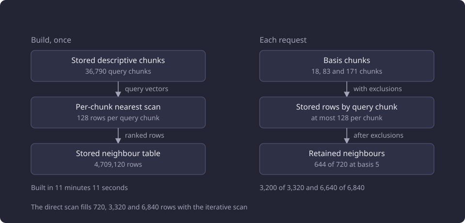
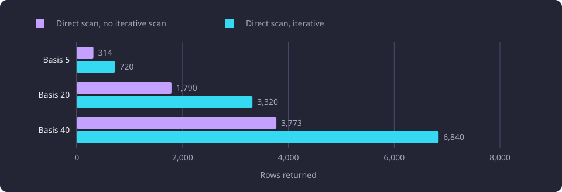

# Nearest-neighbour retrieval for recommendations

A recommendation read requests 40 nearest chunks per basis chunk, and the measurements cover the scan fill, a stored neighbour table and its cutoff tie-break.

**Evidence status:** Comparative. **Run dates:** 28 October 2026 for the read measurements and 29 to 30 October 2026 for the tie-break comparison.

## The question

[Recommendations](/docs/backend/search-and-discovery/recommendations.md) rank courses whose teaching text is close to the completed [basis](/docs/reference/glossary.md#prerequisites-and-routes). The first step reads the nearest teaching-text [chunks](/docs/reference/glossary.md#capture-and-data-preparation) of every basis chunk, and the candidates those neighbours reach form the pool that the relatedness and near-duplicate steps score. The read requests `RECOMMENDATION_CHUNK_TOP_K = 40` neighbours per basis chunk.

The read returned fewer than 40 neighbours for many basis chunks. The question was why, and whether an iterative scan could fill the configured limit. The second question was whether the per-chunk nearest rows could be stored once and read per request instead of scanned per request, and what that changes in the returned set. The stored read raised a third question: which row survives when an exact-score cohort crosses the per-chunk limit.

A basis chunk is one descriptive chunk of a basis course. A query chunk is one stored descriptive chunk used as the query of a nearest-neighbour scan. The direct read is one per-chunk nearest query run at request time. The stored read is one lookup of rows that a build wrote before the request.

## Setup

The measurements read one selected dataset of 11,086 courses, 58,962 chunks and 8,996 course centroids. The vectors are stored embeddings, so no embedding model ran. The bases are prefixes of one fixed representative order, at 5, 20 and 40 courses. They hold 18, 83 and 171 descriptive basis chunks, and the configured limit requests 720, 3,320 and 6,840 rows in total.

The stored table holds a neighbour only when it is a completed chunk with a stored vector, the embedding configuration hash of the build, a descriptive field and the same language as its query chunk. The read checks the target chunk's embedding configuration hash, the request's active-course condition and the excluded course identities against those stored rows before the per-chunk limit. The direct read applies all of those conditions inside the per-chunk statement, before its row limit.

HNSW is a graph index for approximate nearest-neighbour search. The scan collects a bounded candidate list before the status, field, language, active-course and exclusion conditions run. When those conditions remove candidates, the scan stops short of the row limit. The iterative scan continues the graph walk until the limit fills or the scan bound is reached. The two settings tested here are `hnsw.iterative_scan = relaxed_order` and `hnsw.max_scan_tuples = 20000`.

The stored table is built by the [serving artifact build](/docs/reference/glossary.md#serving-data) of the [administration command](/docs/reference/glossary.md#administration). It treats every completed descriptive chunk of the embedding configuration as a query chunk, runs one nearest scan per query chunk with the configured iterative scan and stores at most `SEARCH_NEIGHBOR_TABLE_ROWS_PER_CHUNK = 128` target rows for it, ordered by cosine distance alone. The table holds 4,709,120 rows for 36,790 query chunks. The build replaces the neighbour rows and the centroid rows in one transaction, and the read trusts that atomic build rather than re-verifying its coverage per request.

| Item | Value |
|---|---:|
| Query chunks in the stored table | 36,790 |
| Stored rows per query chunk | 128 |
| Stored rows in total | 4,709,120 |
| Build time | 11 minutes 11 seconds |

The diagram shows the build that writes the stored rows and the per-request read that consumes them.



The endpoint measurements drove the served recommendation route on the same selected dataset. The serving process answered read-only requests and kept one serving generation for the measurement run. Each label ran two warm-up calls and five measured calls, and the table reports the median of the five. The fill counts and the retained-set comparison come from direct reads of the same dataset, not from the endpoint calls.

The tie-break comparison ran on a restored copy of the same dataset. Its three cases are the basis 20, 50 and 60 inactive requests. For each case, the diagnosis read the stored rows at the cutoff for every basis chunk and compared the stored-read set with the final set of the direct-read captures, whose read used the exact per-chunk query. The copy held the same 11,086 courses, 58,962 chunks, 8,996 centroids and 4,709,120 stored neighbour rows.

A separate endpoint comparison ran 38 recommendation cases on a 500-course workload pool, at bases from 3 to 500, in active and inactive scope, with inferred prerequisites on some cases. It compared the direct read with the stored read at the final-list level. Its result counts differ from the endpoint measurements above.

The before values for the stored read are the values after the iterative scan. They are not the pre-scan baseline.

## Results

### Fill of the direct scan

Without the iterative scan, the direct read returned 314 of 720 rows at basis 5, 1,790 of 3,320 rows at basis 20 and 3,773 of 6,840 rows at basis 40. Every basis chunk was short at basis 5, 74 of 83 were short at basis 20 and 154 of 171 were short at basis 40. The minimum per short chunk was one to three rows, and the median short chunk held 22 rows.

With `hnsw.iterative_scan = relaxed_order` and `hnsw.max_scan_tuples = 20000`, every basis chunk filled its 40 rows. The read returned 720, 3,320 and 6,840 rows, with zero short chunks at every basis.

| Basis | Basis chunks | Requested rows | Direct rows | Short chunks | Iterative rows | Short chunks |
|---:|---:|---:|---:|---:|---:|---:|
| 5 | 18 | 720 | 314 | 18 | 720 | 0 |
| 20 | 83 | 3,320 | 1,790 | 74 | 3,320 | 0 |
| 40 | 171 | 6,840 | 3,773 | 154 | 6,840 | 0 |

The chart shows the rows the two direct reads returned at each basis.



### Latency before and after the stored read

The iterative scan filled every chunk and raised the recommendation cost. At basis 20 the served median rose from 820.7 ms to 1,480.2 ms, and the body grew from 28,449 bytes to 44,068 bytes. At basis 40 it rose from 1,945.6 ms to 3,144.1 ms, and the body grew from 55,189 bytes to 70,489 bytes.

The stored read reduced both. At basis 20 the median fell from 1,480.2 ms to 231.1 ms, and the body fell from 44,068 bytes to 42,328 bytes. At basis 40 the median fell from 3,144.1 ms to 415.7 ms, and the body stayed at 70,489 bytes. The final verification measured 214.6 ms at basis 20 and 397.5 ms at basis 40.

| Step | Basis 20 median (ms) | Basis 40 median (ms) | Basis 20 body (bytes) | Basis 40 body (bytes) |
|---|---:|---:|---:|---:|
| Direct read, no iterative scan | 820.7 | 1,945.6 | 28,449 | 55,189 |
| Direct read, iterative scan | 1,480.2 | 3,144.1 | 44,068 | 70,489 |
| Stored read | 231.1 | 415.7 | 42,328 | 70,489 |
| Stored read, final run | 214.6 | 397.5 | 42,328 | 70,489 |

The two direct-read steps and the stored-read step come from one fixed serving generation. The final row comes from a separate run under a new serving generation, so its body carries a different dataset identity and its values are not a direct repetition of the stored-read row.

### The retained-set difference

The stored read under-fills after the request exclusions. It returned 644 of 720 rows at basis 5, 3,200 of 3,320 rows at basis 20 and 6,640 of 6,840 rows at basis 40. The direct read is the reference for the comparison.

| Basis | Direct rows | Stored rows | Shared | Only direct | Only stored |
|---:|---:|---:|---:|---:|---:|
| 5 | 720 | 644 | 639 | 81 | 5 |
| 20 | 3,320 | 3,200 | 3,170 | 150 | 30 |
| 40 | 6,840 | 6,640 | 6,591 | 249 | 49 |

The rows are counted as a multiset, so two rows of the same target course with the same stored score remain two rows. The stored count equals the fill of the stored read at each basis.

The store holds 128 rows for each query chunk before the request's exclusions. A basis chunk whose nearest 128 rows include excluded courses loses those rows, and the read has no further stored row to put in their place. The stored read therefore returns fewer rows than the direct read at every measured basis.

### The tie-break at the cutoff

The stored read ranks the stored rows of each basis chunk by score and then by target chunk id, and keeps the rows at or before the configured limit. The direct read ordered the cutoff by score alone, so which row survived inside an exact-score cohort was undefined between executions. Two direct-read captures returned the same final sets, but that agreement does not define an order.

An exact-score cohort is a run of stored rows with the same score. A cutoff cohort is the cohort that holds the row at position 40. It can extend past the limit in both directions, so the tie-break, not the score, chooses the survivor.

```text
position = row_number() over (
    partition by query_chunk_id
    order by score desc, target_chunk_id
)
kept = position <= 40
```

The diagram shows one cutoff cohort that crosses the limit at position 40.


The cohort diagnosis read the whole cohort at the cutoff for every basis chunk of the three inactive bases whose sets changed. A tied cutoff cohort existed for 18 of 83 basis chunks at basis 20, 44 of 209 at basis 50 and 53 of 251 at basis 60. The next-course result groups agreed at three, 10 and 16 identities. With the basis course identities added, the diagnosis excluded 23, 60 and 76 groups. The basis chunk and stored row counts agreed at 83, 209 and 251 chunks and 3,320, 8,360 and 10,040 rows.

| Inactive basis | Next-course result groups | Excluded groups in total | Basis chunks | Stored rows | Tied cutoff cohorts |
|---:|---:|---:|---:|---:|---:|
| 20 | 3 | 23 | 83 | 3,320 | 18 |
| 50 | 10 | 60 | 209 | 8,360 | 44 |
| 60 | 16 | 76 | 251 | 10,040 | 53 |

The changed course, its stored row position and the cohort that witnesses the change are listed for each case.

| Inactive basis | Changed course | Set change | Stored row position | Witness cohort score | Witness cohort span |
|---:|---|---|---:|---:|---|
| 20 | `tut-cu-g-28836` | only stored | 40 | 0.727225590844348 | 39 to 42 |
| 20 | `tut-cu-g-42000` | only direct | 42 | 0.727225590844348 | 39 to 42 |
| 50 | `otm-2e702314-8ba6-4404-b733-9cfbd4a5dc63` | only stored | 35 | 0.6939527209969009 | 29 to 61 |
| 60 | `otm-2e702314-8ba6-4404-b733-9cfbd4a5dc63` | only stored | 34 | 0.6939527209969009 | 28 to 60 |
| 60 | `otm-f89324a1-ef7f-4f60-96bc-0de44392b5b3` | only stored | 40 | 0.6939527209969009 | 28 to 60 |
| 60 | `uta-ykoodi-53222` | only stored | 28 and 39 | 0.6939527209969009 and 0.7278403368186601 | 28 to 60 and 39 to 44 |

The basis 60 case holds two witness cohorts. At score 0.6939527209969009 the 28-to-60 cohort holds all three added courses, at positions 28, 34 and 40. At score 0.7278403368186601 the 39-to-44 cohort holds `uta-ykoodi-53222` at position 39. That course is also a member of a 27-to-54 cohort at score 0.7439757142081445, at position 41, which is after the limit and is not a witness.

The same basis also holds other tied cutoff cohorts. Across all tied cutoff cohorts, the positions span 27 to 47 at basis 20, 27 to 61 at basis 50 and 27 to 60 at basis 60. The table lists only the cohort that witnesses each changed course.

The full-cohort rule decides whether a changed course comes from the cutoff. A changed course counts as tied only when a tied cohort crosses the limit, so the cohort's lowest position is at or before 40 and its highest position is after 40, and the course's stored row sits on the side its set change requires. A course that only the stored set holds has a stored row at or before the limit, and a course that only the direct set holds has its stored row after the limit.

Every changed course in these three cases has such a row, listed in the second table. No change is attributed to the last score of the final list, because the witness is the stored row and its position.

### The endpoint parity comparison

The separate endpoint comparison ran 38 recommendation cases at bases from 3 to 500, in active and inactive scope, with inferred prerequisites on some cases. Thirty-two cases returned identical identities and order, with values within 1.28e-13. Six cases differ at the final-list level. Every case returned the same number of results, and every common course kept its position and its values within 1.28e-13.

A final-list score is not the stored-neighbour score at the cutoff. A result carries a relatedness percentage from 0 to 100, and a stored row carries one chunk-pair cosine. The two are different quantities on different scales, so a final score cannot place a changed course inside a cutoff cohort. The cohort evidence is the stored row and its position.

The six differing cases are listed below. The values are final relatedness scores, not stored chunk scores. No full stored-cohort record exists for these six cases, so their differences are not attributed to the cutoff cohort.

| Case | Courses that differ | Stored-read list final relatedness | Direct-read list final relatedness |
|---|---:|---|---|
| Basis 3, active | 2 | 49.34718945999834, 48.581499765618936 | 49.347189459998354, 49.1323646463647 |
| Basis 3, active, inferred | 2 | the same values | the same values |
| Basis 40, active | 3 | 43.81625617700781, 37.254108413773814, 41.41043399611988 | 43.816256177007816, 37.254108413773814, 44.59919327959584 |
| Basis 40, active, inferred | 3 | the same values | the same values |
| Basis 200, inactive | 1 | 35.7049806339844 | 36.19890475589251 |
| Basis 200, inactive, inferred | 1 | 35.7049806339844 | 35.7049806339844 |

In the basis 200 inactive inferred case the two lists hold different courses at the same final relatedness. The basis 3 and 40 active cases each change two or three courses. The differing values include a near-equal pair in each case, an exactly equal pair in the basis 40 case, and one value that differs between the lists. The comparison records these differences at the final-list level and does not prove that they come from the cutoff cohort. The causal evidence covers only the basis 20, 50 and 60 inactive cases above.

## Interpretation

The under-fill is a filter-after-scan effect. The index scan collects its candidate list before the active-course, language, field and exclusion conditions run, so a query chunk whose nearest candidates fail those conditions returns fewer rows. The iterative scan removes the under-fill by continuing the scan, and the measured cost of that change is a higher median and a larger body at both endpoint bases.

The stored read moves the per-chunk scan to build time. It answers a request with stored rows and removes the scan from the request path, which is why the endpoint medians fall below both direct-read steps. The gain is bought with a fixed bound: request exclusions can remove stored rows, and the read does not replace them.

The stored read is an approximation for request-specific exclusions, not an exact replacement for the direct read. The direct read is the reference, and the stored set shares 639, 3,170 and 6,591 rows with it at the three bases. The difference is recorded and is not a gate.

The stored read fixes the order inside an exact-score cohort at the cutoff. The basis 20, 50 and 60 inactive cases change by one, one and three identities, and each changed course has a stored row in a tied cohort that crosses the limit, on the side its set change requires. The separate 38-case endpoint comparison has 32 cases with identical identities and order, and six differing cases. Those six are recorded at the final-list level, and no stored-cohort record proves their cause. Every common course in the 38 cases keeps its position and its values within 1.28e-13. The tie-break changes no score, limit or threshold.

The stored read is the only product read for recommendations. The only nearest query in that path is the build query. The build is trusted as an atomic replacement of the neighbour and centroid rows.

## Limitations

- The stored read uses 128 rows per query chunk. The exclusion under-fill is a property of that bound, and a different bound would change both the fill and the table size.
- The fill and retained-set comparison covers three fixed bases and one exclusion set, the basis course identities. Other bases and other exclusion sets are unmeasured.
- The fill counts and the retained-set difference are read-only observations on one selected dataset. They do not measure recommendation relevance or quality.
- The stored-neighbour cohort diagnosis covers the basis 20, 50 and 60 inactive cases. The 38-case endpoint comparison is recorded at the final-list level. The basis 3 and 40 active cases and the basis 200 inactive cases, with their inferred twins, have no stored-cohort diagnosis, so their differences are not attributed to the cutoff.
- The endpoint medians are five calls per label. They are not a distribution or a concurrent-load measurement.
- The recorded evidence for these runs does not state the hardware specification.
- The build time of 11 minutes 11 seconds is one build of this dataset. It is not a general build cost, and a rebuild after a representative, chunk or embedding configuration change is unmeasured.

## Untested questions

Each question below is untested.

- Whether more than 128 stored rows per query chunk closes the exclusion gap, and what the table size and build time become.
- Whether a second direct scan only for chunks that under-fill after the exclusions recovers the direct rows at an acceptable cost.
- Whether the six differing cases in the 38-case endpoint comparison change the recommendations a reader would prefer. The differences are recorded at the final-list level, and no relevance or quality measurement compares the two sets.
- Whether a rebuild of the stored table returns the same rows at its own 128-row bound. The build orders each query chunk's candidate rows by distance alone, so an exact-distance cohort at the 128-row bound has no stored tie-break. The read's tie-break applies only to the rows the build stored.
