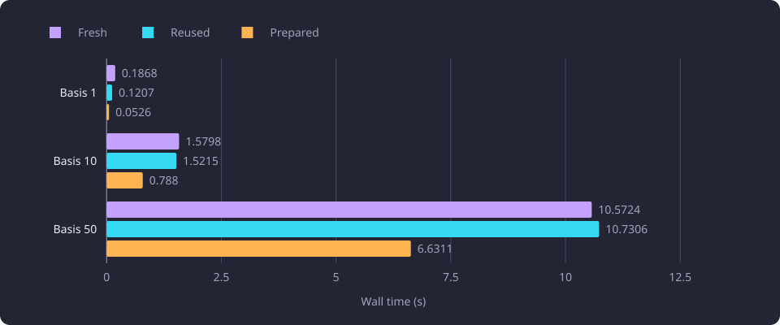
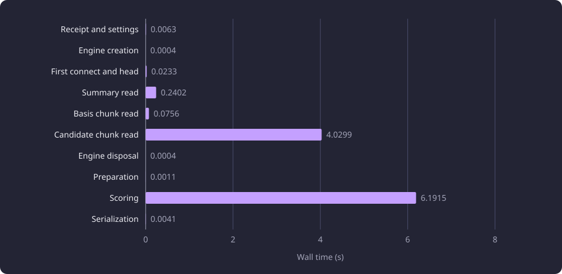

# Recommendation composition overheads

One fixed-pool recommendation composition spends most of its time in the candidate chunk read and the scorer, not in dataset resolution or serialization.

**Evidence status:** Comparative. **Run date:** 21 October 2026.

## The question

[Recommendations](/docs/backend/search-and-discovery/recommendations.md) rank courses whose teaching text is close to the completed [basis](/docs/reference/glossary.md#prerequisites-and-routes). The command resolves the dataset and its settings, reads represented-course summaries and descriptive [chunks](/docs/reference/glossary.md#capture-and-data-preparation), prepares the basis and candidate rows, scores every candidate and serializes a report. The composition path is described in [Recommendation ranking](/docs/backend/search-and-discovery/recommendation-ranking.md#recommendation-composition).

The line asked where one complete composition on a saved candidate pool spends its time, and whether holding one database engine across repetitions lowers that time. The composition is the work a recommendation request does between resolving its dataset and serializing its report, so the answer shows which segment a change could move and which segments are too small to matter at this pool size.

A fixed-pool composition is one complete recommendation composition on a saved candidate pool. It resolves settings, reads summaries and descriptive chunks, prepares the saved objects, scores, builds the report and serializes it. It excludes approximate nearest-neighbour retrieval, the next-course read and compiler, capture observers, hashing, the serving identity wrapper and response delivery. No HTTP request ran, so the values are not server latency.

The full-catalogue read projection and the served read path are separate measurements, reported in [Full-catalogue read projection](/docs/experiments/runtime-storage-and-serving/full-catalogue-read-projection.md) and [Served read path](/docs/experiments/runtime-storage-and-serving/served-read-path.md). Neither is part of the values here. [Centroid coverage in recommendations](/docs/experiments/recommendations/centroid-coverage.md) reports a composition leg with the float64 array scorer and the projected read under its own timers, so that leg is a different measurement from the values here.

## Fixed pools and measurement modes

The pools are the product's saved retrieval and eligibility output for three nested bases of 1, 10 and 50 courses, after its next-course exclusions. They come from the cohort that the recommendation experiments reading the configured policy share. The selection seed was 20261021. It fixed 200 stored active course identities that had a completed descriptive chunk compatible with the embedding configuration, resolved their representative versions once and took the first 50 compatible representatives in shortlist order. The 10-course and single-course bases are prefixes of that order.

[Recommendation experiments](/docs/experiments/recommendations/README.md#one-catalogue-and-the-fixed-selections) states the cohort, the candidate and chunk counts of the three pools and the catalogue they read. [The request and policy settings](/docs/experiments/recommendations/README.md#the-request-and-policy-settings) states the request flags and configured values this composition used.

The vectors are stored BGE-M3 embeddings with 1,024 components, and no embedding model ran. The fixed request used the shared cohort's request flags, with the selected set equal to the completed set equal to the basis.

Each cell ran one process in one of three modes.

| Mode | What the composition does |
|---|---|
| Fresh | Resolves the named receipt and settings, creates a database engine and session factory, checks the schema head on the first connection, reads summaries and descriptive chunks, prepares, scores, builds the report and serializes. |
| Reused | Holds one experiment-local engine across repetitions and uses fresh sessions for the reads. Engine creation and the first connection and head check are measured in setup, outside the composition samples. Final disposal is outside the samples but inside the process. |
| Prepared | Uses the saved in-memory summaries and chunks, the validated settings and the product scorer. It opens no database connection. Preparation, scoring, report construction and serialization are separate segments. |

Every connection ran with `default_transaction_read_only=on` and a 30 s `statement_timeout`, and every read rolled back. A fresh process opened four connections, a reused process one and a prepared process none. The captured dataset was resolved through its receipt rather than the selected-dataset pointer, so its resolution differs from the serving path's resolution. Each cell ran one warmup and three recorded repetitions, and the tables report the median. Every composition sample ran under one fatal 60 s timer that enclosed serialization. Database and CPU cache warmth was not controlled, and one process ran at a time on a 4-core aarch64 server under Python 3.14.3.

| Timer | Covers | Excludes |
|---|---|---|
| Composition sample | Resolution, engine creation, first connect and head check, summary read, basis chunk read, candidate chunk read, preparation, scoring, report construction and serialization | Approximate retrieval, next-course read and compiler, capture observers, hashing, serving identity wrapper, response delivery and HTTP |
| Prepared composition | Preparation of saved objects, scoring, report construction and serialization | Database I/O, engine creation, connection and head check |

The diagram shows the boundary of one composition sample and the work that lies outside it.

The composition total is measured directly. The ten stage segments cover one composition sample without overlap, so they are not independent external timings. The fresh sample captured the first connection and the schema head check inside its own timer. Each segment and the total are reported as a median of the three recorded samples, to four decimals, so a column need not add to its total exactly. At basis 50 fresh the ten segments sum to 10.5728 s against the 10.5724 s total. The difference is not attributed to one segment.

The product scores candidates through its [native scorer](/docs/experiments/recommendations/native-recommendation-scoring.md). The measured build evaluated the same formula in a scalar Python implementation, so the scoring segment below describes that implementation, not the native scorer's cost.

## Where the composition's time goes

Recorded wall medians for one complete composition:

| Basis | Fresh (s) | Reused (s) | Prepared (s) |
|---:|---:|---:|---:|
| 1 | 0.1868 | 0.1207 | 0.0526 |
| 10 | 1.5798 | 1.5215 | 0.7880 |
| 50 | 10.5724 | 10.7306 | 6.6311 |

The chart shows the three modes on the three bases.

| Basis | Reused against fresh | Prepared against fresh |
|---:|---:|---:|
| 1 | -35.37 percent | -71.83 percent |
| 10 | -3.69 percent | -50.12 percent |
| 50 | +1.50 percent | -37.28 percent |

Reused mode changed the measured composition by -35.37, -3.69 and +1.50 percent on bases 1, 10 and 50. Prepared mode changed it by -71.83, -50.12 and -37.28 percent.

The stage medians for the 50-course basis, in wall seconds:

| Segment | Fresh (s) | Reused (s) | Prepared (s) |
|---|---:|---:|---:|
| Named receipt and settings resolution | 0.0063 | 0.0063 | not run |
| Engine creation | 0.0004 | outside samples | not run |
| First connect and schema head | 0.0233 | outside samples | not run |
| Summary read | 0.2402 | 0.2328 | not run |
| Basis chunk read | 0.0756 | 0.0706 | not run |
| Candidate chunk read | 4.0299 | 3.9531 | not run |
| Engine disposal | 0.0004 | outside samples | not run |
| Preparation | 0.0011 | 0.0011 | 0.2133 |
| Scoring | 6.1915 | 6.4572 | 6.4137 |
| Serialization | 0.0041 | 0.0041 | 0.0040 |
| Measured total | 10.5724 | 10.7306 | 6.6311 |

The chart shows the basis 50 fresh stage costs.

At basis 50 the fresh composition took 10.5724 s. The candidate chunk read took 4.0299 s and the scorer 6.1915 s, so those two segments carry most of the total. The summary read took 0.2402 s and the basis chunk read 0.0756 s. Resolution took 0.0063 s, engine creation and disposal each 0.0004 s, the first connection and schema head check 0.0233 s and serialization 0.0041 s.

At basis 10 the fresh candidate chunk read and scorer took 0.7191 s and 0.7176 s of the 1.5798 s total. At basis 1 the summary read, the candidate read and the scorer were comparable, at 0.0488, 0.0499 and 0.0512 s of the 0.1868 s total. Across the three bases resolution measured 0.0063 to 0.0066 s, engine creation 0.0004 s, the first connection and head check 0.0231 to 0.0234 s, disposal 0.0003 to 0.0004 s and serialization 0.0005 to 0.0041 s.

Engine creation is lazy and opens no connection, so its 0.0004 s is not a connection cost. The first connection and schema head check is the larger connection cost.

Recorded CPU medians at basis 50 were 8.3232 s fresh, 8.5755 s reused and 6.5517 s prepared, below the wall medians in every mode.

## The engine-reuse attempt

The hypothesis was that holding one engine and session factory across repetitions would lower a composition, because a fresh process creates an engine, opens its first connection and checks the schema head inside every sample. Reused mode moved those steps into setup, outside the composition samples.

Reused mode changed the composition by -35.37 percent on the single-course basis, -3.69 percent on the 10-course basis and +1.50 percent on the 50-course basis. Engine creation measured 0.0004 s inside a fresh composition, so the single-course difference is not an engine-creation saving. The single-course reused cell recorded a summary read of 0.0146 s against 0.0488 s fresh, while the 50-course reused cell recorded a higher scoring time, 6.4572 s against 6.1915 s.

The recorded changes do not show a consistent engine-reuse saving. The direction differs across the three bases, so the comparison supports no engine-reuse or connection-pool recommendation at this boundary. That is an interpretation of the mode differences, not a decomposition of the engine's share.

Prepared mode is the other variant. It removes database I/O and reconstitutes the saved objects in memory. Its preparation segment took 0.0024, 0.0674 and 0.2133 s, and it changed the composition by -71.83, -50.12 and -37.28 percent. The reduction measures experiment-local reuse of saved objects, not a product cache, connection pool or invalidation policy.

## Interpretation

The composition is carried by two segments that grow with the candidate pool, the candidate chunk read and the scorer. On the 50-course pool the scorer is the larger of the two, and on the 10-course pool the two are nearly equal.

The fixed costs of a composition, settings resolution, engine creation, the first connection and head check, disposal and serialization, each lie below 0.024 s at basis 50. A change to one of them cannot move a composition on a pool of this size by much.

The prepared reduction reflects the database I/O that fresh and reused modes perform inside the composition, together with the object preparation that prepared mode does instead. It is not a product design, because no cache, pool or invalidation policy was created.

The engine-reuse result stands for its own boundary, one process at a time on three fixed pools. [Read memory and bounded reads](/docs/experiments/runtime-storage-and-serving/read-memory-and-bounded-reads.md) measures what these reads retain, and [Recommendation vectorization and narrow reads](/docs/experiments/recommendations/vectorization-and-narrow-reads.md) measures the scorer and the read on their own timers.

## What the results do not establish

[Recommendation experiments](/docs/experiments/recommendations/README.md) states the fixed-pool scope, the absent recommendation-quality measurement, the small-sample medians and the one-process-at-a-time runs that the line shares. The limits specific to this boundary are:

- The composition ends at report serialization. Approximate retrieval, the next-course read and compiler, capture observers, hashing, the serving identity wrapper, response delivery and the HTTP request lie outside every timing, so no server latency is claimed.
- The stage segments cover one composition sample without overlap and are not independent external timings. At basis 50 fresh the ten segments sum to 10.5728 s against the 10.5724 s total.
- Prepared mode reconstitutes saved objects in memory and creates no product cache, pool or invalidation policy.
- Only the scalar implementation of the scorer ran, so the native scorer's share of the composition is not measured here.

## Baselines

A follow-up on the same three pools compares against these wall medians from the tables above.

- Fresh composition: 0.1868 s at basis 1, 1.5798 s at basis 10 and 10.5724 s at basis 50.
- Reused composition: 0.1207, 1.5215 and 10.7306 s.
- Prepared composition: 0.0526, 0.7880 and 6.6311 s.
- Basis 50 fresh segments: candidate chunk read 4.0299 s, scorer 6.1915 s, summary read 0.2402 s, basis chunk read 0.0756 s, first connection and head check 0.0233 s, serialization 0.0041 s, resolution 0.0063 s, engine creation and disposal 0.0004 s each.
- The pool sizes in [Recommendation experiments](/docs/experiments/recommendations/README.md#one-catalogue-and-the-fixed-selections) and the shared policy settings, because a pool of another size changes every value.

## Untested questions

- Whether a product connection pool or engine reuse helps under concurrent requests or at other pool sizes. The line measured one process at a time on three fixed pools. Untested.
- Whole-request HTTP latency, including approximate retrieval, the next-course read, the serving identity wrapper and response delivery. Untested.
- Whether resolving the live selected-dataset pointer changes the composition cost, since every read here used a named receipt. Untested.
- How the native scorer's share compares with the 6.1915 s scalar scoring segment on the same pool. Untested.
- Whether the segment shares hold on a pool from another subject area or on a basis larger than 50 courses. Untested.
