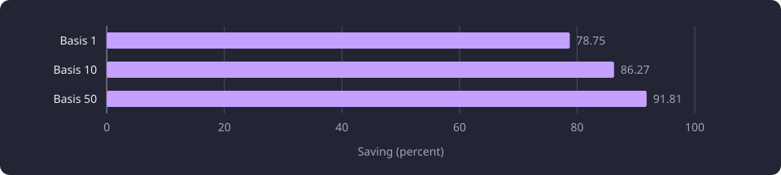
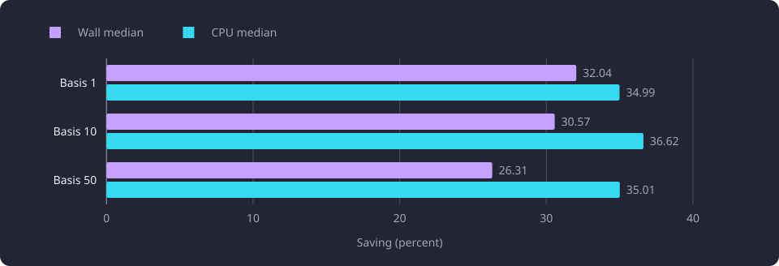

# Recommendation vectorization and narrow reads

A float64 array scorer and a projected content-and-outcomes read are measured against the scalar scorer and the full chunk read on three fixed recommendation pools.

**Evidence status:** Comparative. **Run date:** 21 October 2026.

## The question

The recommendation scorer turns chunk vectors into a relatedness meter and a coverage meter. Relatedness is the hub-centred cosine between the candidate's [course point](/docs/reference/glossary.md#discovery-and-the-structure-of-studies) and the trimmed basis vector, the unit mean of the basis course points kept at or above the median cosine, reported as a percentage. Coverage is the character-weighted share of the candidate's descriptive text that has a close match in the basis, with Finnish and English chunks pooled. A candidate whose strongest single-course overlap reaches the [near-duplicate](/docs/reference/glossary.md#discovery-and-the-structure-of-studies) share is left out. [Recommendation ranking](/docs/backend/search-and-discovery/recommendation-ranking.md) states the formulas.

Two formula-preserving changes were measured one at a time. The first replaced the scalar scorer with a float64 array scorer that evaluates the same formula. The second replaced the full chunk read and its Python filter with a projected read that selects only content and outcomes rows in SQL. A composition leg that ran both changes together, and the centroid comparison on the same legs, are reported in [Centroid coverage in recommendations](/docs/experiments/recommendations/centroid-coverage.md).

Formula preservation has a precise meaning here. The same inputs must return the same retained courses in the same order, with the same adjacent exact ties, the same median-trim membership, the same exclusion outcomes, the same derived flags and no missing chunk or profile. The numeric meters may differ in their last binary digits, because float64 array arithmetic and the scalar path accumulate in a different order. No tolerance was applied, no delta was rounded away and no bitwise equality is claimed.

## Fixed inputs

The three nested bases and their fixed candidate pools are the common 21 October setup, described in [Recommendation experiments](/docs/experiments/recommendations/README.md#one-catalogue-and-the-fixed-selections). All measurements reused those saved pools. No extraction, selection, approximate nearest-neighbour retrieval or pool variant ran.

The request used the policy in [The request and policy settings](/docs/experiments/recommendations/README.md#the-request-and-policy-settings). `RECOMMENDATION_OVERLAP_PENALTY_WEIGHT` was 0.0, so score equals relatedness.

The vectors are stored BGE-M3 embeddings with 1,024 components, so no embedding model ran. The captured catalogue holds teaching text in Finnish and English, and every basis course has a compatible descriptive chunk. No candidate in a pool lacks chunks or a profile.

## Method

The measurements ran on a four-core aarch64 server. [Hardware the reports name](/docs/experiments/recommendations/README.md#hardware-the-reports-name) records the hardware each report states. The run used Python 3.14.3, NumPy 2.4.6 and scipy-openblas 0.3.31 (build 188.0), in float64 and with one BLAS thread. The values in the tables are medians. [Sample structure and cache warmth](/docs/experiments/recommendations/README.md#sample-structure-and-cache-warmth) records the warm-up and sample counts and the cache state.

The scorer and read boundaries are the ones in [Timing boundaries](/docs/experiments/recommendations/README.md#timing-boundaries). For this experiment, the scorer timer also excludes carrier construction, diagnostics, hashing and disk work, and the read timer includes the product leg's Python field filtering and excludes approximate retrieval.

A composition leg starts from a saved candidate pool, resolves the named receipt and settings, creates a fresh engine and opens its first connection with the schema head check, reads summaries and descriptive chunks, prepares arrays, scores, builds and serializes a ranked report. The three timers cover different spans of the same path, as the diagram shows.

![One recommendation path runs from a saved candidate pool through dataset and settings resolution, a fresh engine and first connection, summary and chunk reads, array preparation and scoring, and report serialization to a ranked report. A read sample covers the summary and chunk reads and the product field filter, a scorer sample covers conversion through the sort, and a composition leg encloses resolution, the engine, the reads, preparation, scoring and serialization. The three timers are separate, so their savings do not add.](/docs/diagrams/recommendation-vectorization-stages.svg)

The three timers are separate, so their savings do not add.

## Scorer results

| Basis | Scalar scorer median (s) | Array scorer median (s) | Wall saving |
|---:|---:|---:|---|
| 1 | 0.047667 | 0.010129 | 78.75 percent, 0.037538 s |
| 10 | 0.754062 | 0.103500 | 86.27 percent, 0.650562 s |
| 50 | 6.570340 | 0.537979 | 91.81 percent, 6.032361 s |

The array scorer lowered the wall median by 78.75 percent on the one-course basis, 86.27 percent on the 10-course basis and 91.81 percent on the 50-course basis. The CPU medians fell by 78.70, 86.28 and 91.81 percent, which agrees with the wall saving within 0.1 percentage point. The savings include array preparation and allocation, so they are not a comparison of matrix multiplication alone.

## Numerical preservation

The array scorer returned the product retained set and the product order on all three bases. No rank changed, no course was added or removed, and no derived flag changed. The numeric meters differ in their last binary digits.

| Basis | Common results | Relatedness values changed | Score values changed | Overlap values changed | Exactly equal values | Largest relatedness delta | Largest score delta | Largest overlap delta |
|---:|---:|---:|---:|---:|---:|---:|---:|---:|
| 1 | 37 | 15 | 15 | 21 | 60 of 111 | 1.42e-14 | 1.42e-14 | 3.55e-14 |
| 10 | 69 | 45 | 45 | 38 | 79 of 207 | 2.13e-14 | 2.13e-14 | 3.55e-14 |
| 50 | 319 | 179 | 179 | 161 | 438 of 957 | 1.42e-14 | 1.42e-14 | 5.68e-14 |

On the 50-course basis the nonzero relatedness and score deltas lie from -1.42e-14 to 1.42e-14, and the overlap deltas from -4.26e-14 to 5.68e-14. No nonzero delta was treated as zero. The serialized chunk output differed from the saved product digest only in those last binary digits, so byte equality is not claimed.

Every candidate kept the same retained or excluded outcome. Five, 366 and 1,532 candidates fell below the relatedness floor, zero, zero and 23 were near duplicates, and none lacked a chunk or a profile. Median-trim membership was identical, with one, five and 25 profile courses kept in the same order.

The 50-course basis has 27 adjacent exact tie pairs covering 41 courses, and the array output has the same 27 pairs in the same order. The one-course and 10-course bases have no adjacent exact tie pairs.

## Narrow read results

| Basis | Full read wall median (s) | Projected read wall median (s) | Wall saving | Full read CPU median (s) | Projected read CPU median (s) | CPU saving |
|---:|---:|---:|---|---:|---:|---|
| 1 | 0.076136 | 0.051742 | 32.04 percent, 0.024394 s | 0.058361 | 0.037942 | 34.99 percent, 0.020420 s |
| 10 | 1.030745 | 0.715631 | 30.57 percent, 0.315114 s | 0.712520 | 0.451590 | 36.62 percent, 0.260930 s |
| 50 | 5.315186 | 3.916760 | 26.31 percent, 1.398427 s | 2.985184 | 1.940183 | 35.01 percent, 1.045002 s |

The projected read lowered the paired read wall median by 32.04 percent on the one-course basis, 30.57 percent on the 10-course basis and 26.31 percent on the 50-course basis. The CPU median fell by 34.99, 36.62 and 35.01 percent, so the CPU saving exceeds the wall saving on every pool.

The read returned the same ordered carrier tuples, including every embedding component, on every recorded sample for both requests. No carrier value, order, metadata field or group field differed.

| Basis | Basis descriptive carriers | Basis full rows | Candidate descriptive carriers | Candidate full rows |
|---:|---:|---:|---:|---:|
| 1 | 2 | 4 | 137 | 221 |
| 10 | 39 | 59 | 1,771 | 2,641 |
| 50 | 209 | 309 | 7,657 | 11,405 |

The full row counts include name rows, which the projected read does not request. Each read process opened one database connection with `default_transaction_read_only=on` and `statement_timeout=30s`, and no write was attempted.

## What was applied

The float64 array scorer and the descriptive-only projected read were selected and applied on the measured build. The array scorer carried the measured last-bit differences against the fixed pools, with a largest relatedness and score difference of 2.1316282072803006e-14 and a largest overlap difference of 5.684341886080802e-14.

The product scorer is native, and a recommendation request reads candidate chunk rows from the shared serving store without a database read. [Native recommendation scoring](/docs/experiments/recommendations/native-recommendation-scoring.md) measures that scorer, and [Recommendation ranking](/docs/backend/search-and-discovery/recommendation-ranking.md) states the reads and formulas a request uses.

## Limits

The recommendation line's shared limits, including no recommendation-quality measurement, no whole-request latency and no full-catalogue coverage, are stated in [Recommendation experiments](/docs/experiments/recommendations/README.md#limits-shared-by-the-line). Four limits apply to these measurements.

- The array scorer ran after the scalar scorer in every sample, so cache warmth may favor it.
- Exclusion reasons for candidates excluded under both variants were not recomputed per candidate, so a reason change at the same excluded outcome is not measured.
- The read timer includes the product leg's Python field filtering, so the saving is not a database-only saving.
- The preservation result is scoped to the fixed pools and does not establish a general behavior-preserving guarantee.

## Baselines

A follow-up on the same three pools compares against these wall medians from the tables above.

- Scalar scorer: 0.047667 s at the one-course basis, 0.754062 s at the 10-course basis and 6.570340 s at the 50-course basis.
- float64 array scorer: 0.010129, 0.103500 and 0.537979 s.
- Full chunk read: 0.076136, 1.030745 and 5.315186 s.
- Projected read: 0.051742, 0.715631 and 3.916760 s.
- The request flags, policy values and pool sizes in [Recommendation experiments](/docs/experiments/recommendations/README.md#one-catalogue-and-the-fixed-selections) and [The request and policy settings](/docs/experiments/recommendations/README.md#the-request-and-policy-settings), because a pool of another size changes every value.

## Open questions

- Whole-request latency. The fixed-pool savings have not been translated into an HTTP measurement that includes retrieval, the next-course read, the serving identity wrapper and response delivery. Untested.
- Read cost. The projected read took 3.916760 s on the 50-course basis. Whether another read shape, cache or transport lowers it is untested here.
- Human rating. No relevance judgment compared the retained sets, ranks or meters with a reader's view. Untested.
- Threshold distance. No measured delta changed an outcome on these pools. Whether a last-bit difference could flip a candidate at the relatedness floor or the near-duplicate share is untested.
