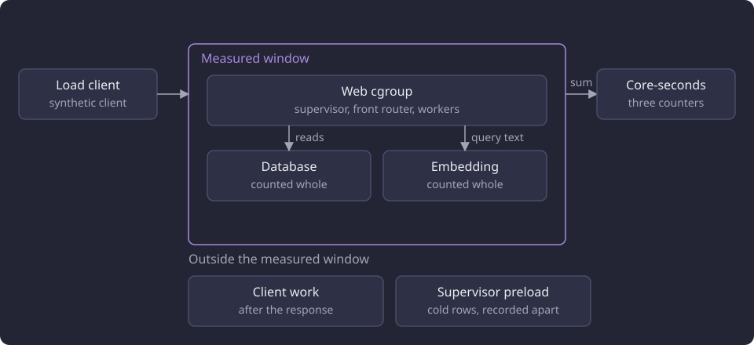

# Runtime, storage and serving experiments

Thirteen reports and one method page follow a stored row from a database read to a served response and to the capture that produced the catalogue.

## The question the line asked

The line begins with the shape of a read and the memory that shape retains. It continues through the work a served request repeats, the artifact set that removes part of that work, and the load a stack carries before its throughput stops growing. It closes at the source, with one capture of the public curriculum and the replay of its stored evidence.

Six questions ran through the category.

1. Can a full-catalogue read select fewer columns and a narrower identity scope without changing its output?
2. How much memory does each read shape retain, and what do float32 storage, a streamed read, a prepared cache and a response compression level cost?
3. What does a prebuilt artifact set and a set of shared stores save per request, and what do they cost in build time, disk and memory?
4. What does each request class cost in core-seconds, and where does the served path repeat work that no request can change?
5. How many simulated users does a stack serve before light throughput stops growing, and which limits keep the interactive path responsive while heavy work runs?
6. What does one capture of the public curriculum produce, and can its stored evidence be verified and normalized without the source?

Every capacity stack ran four worker processes, and its ladder varied the number of simulated users.

Each measurement states its own boundary: one read, one fixed pool, one process, one HTTP request, one load level, one whole-service profile. The line treats those boundaries as results, because a saving measured at one boundary does not carry to another.

The [catalogue the experiments read](/docs/experiments/README.md#the-catalogue-the-experiments-read) and the [experiments hardware](/docs/experiments/README.md#the-hardware) are stated on the section index.

## The shared measurement method

The serving accounts share one metric, one set of component boundaries and one way of recording memory. The read, memory and cache studies ran in process with no HTTP request, and they state their own method in their own pages.

### The cost metric

The metric is core-seconds summed over all CPU cores. One core-second is one second of CPU on one core. Wall time is context beside it.

A cost is the sum of three cumulative counters read around a request or a level: the web cgroup, the database container and the embedding container. The web cgroup holds the supervisor, the front router and every worker process, and every descendant is inside it before the first request. The database and the embedding provider are separate containers, and each is counted whole. The database and embedding shares are therefore upper bounds when other work reads the same container in the same window. A counter is read from its cgroup file, and a missing file raises instead of reading zero.

The measured window of one request is the three counters around it. The client decompresses the response body and validates its JSON after that window, so neither is charged to the request. The capacity levels drive the stack from a load client on a separate machine through one local forward to the stack's loopback port, so their wall times include that path.

### Memory caps and records

Memory is recorded as a current value and a peak for each component under an explicit cap. The cap is part of the result, because a peak recorded under one cap does not transfer to another.

The web cap is the limit set on that run's own cgroup, which holds the supervisor, the front router and every worker process. The database and the embedding provider are separate containers with their own limits beside it. A sum of the three components' independent peaks is an upper bound, not a simultaneous peak. A sum of their sampled current values describes those observations instead.

The caps of the capacity stack are on [Serving load method](/docs/experiments/runtime-storage-and-serving/serving-load-method.md). The read-memory line ran one process at a time under a 2.147 GB address-space limit. A run records its actual caps, its current and peak values, its fail, OOM and swap counts, and whether a peak was reset.

The measurement database is a disposable copy. The selected dataset and the database a site serves are never used for a measurement. The embedding provider is isolated on its own loopback port, so a measurement does not share another site's embedding service, and the request transport and the measured container counters point to the same provider.

### Warm and cold states

A warm measurement runs after a fixed warm-up against a stack that already holds its caches. A cold row runs each scenario in a fresh process with empty request and report caches. Before the one measured request the process checkpoints the database, drops the packed search relation's shared buffers, and advises the relation's files and the eight artifact files out of the page cache.

The supervisor preload opens the artifact set, builds the lookup projection and compresses the catalogue body. It is recorded apart from the request and costs 1.53 to 1.56 web core-seconds and 1.86 to 1.91 seconds of wall time per cold start. The cold state is the named relations and files, not a host-wide page-cache drop.

### Memory measures

Memory measures answer different questions and do not convert into one another. A value is read with the measure that produced it.

| Measure | What it counts | How the value is read |
|---|---|---|
| Array bytes | The NumPy buffer of one matrix | `array.nbytes` |
| Resident memory | The process's resident pages | `VmRSS` |
| Process peak | The resident high-water mark of one process | `VmHWM` |
| Python-traced memory | Python allocations | `tracemalloc` |
| Object-graph bytes | A `sys.getsizeof` walk, each shared object counted once | the walk itself |
| Cgroup charge | The kernel charge for one cgroup, including file cache and shmem | the cgroup's memory files |
| Address-space limit | A per-process cap, not a resident value | the limit set on the process |

## The order of the line

The order is conceptual, not the order in which the runs were taken. It follows one row from the read, to the memory it occupies, to the artifact set that serves it, to the request that carries it, and finally to the capture that produced the catalogue.

### Serving under load

[Serving load method](/docs/experiments/runtime-storage-and-serving/serving-load-method.md) states how the capacity levels and the per-operation cost matrix are built, driven and measured: one versioned workload, a disposable stack, one ladder and one request at a time. It is the method page for the four results below.

[Serving capacity](/docs/experiments/runtime-storage-and-serving/serving-capacity.md) ran the version 3 workload on four whole stacks under a light-only and a mixed profile, and states where each stopped and what limited it. The post-port stack reaches the highest light rate in both profiles, its light stop is CPU-bound, and its mixed ladder collapses at 750 users. Three levels failed at the web cap before a valid light result.

[Serving request cost and admission curves](/docs/experiments/runtime-storage-and-serving/serving-request-cost-and-admission.md) prices 101 matched endpoint rows before and after the CPU port and fits the four curves the router charges. Every matched row is cheaper on the product tree except the study read that names an explicit version, and the inactive recommendation class failed its acceptance rule by one basis, so its smallest-residual curve was applied.

[Front router state and placement](/docs/experiments/runtime-storage-and-serving/serving-front-router-state.md) asked whether admission state belongs in a shared store or in the router process, and how the router places heavy reads. The measured store's kernel charge outlived the keys it held, and the state lives in the router process.

[Web memory and allocator retention](/docs/experiments/runtime-storage-and-serving/web-memory-and-allocator-retention.md) explains the web charge the capacity ladder reached. The growth is free heap pages in glibc arenas plus copy-on-write pages of the preload, and `WEB_MALLOC_ARENA_MAX = 2` was selected and applied from the measured options.

### Serving artifacts and memory

[Serving artifact build and shared stores](/docs/experiments/runtime-storage-and-serving/serving-artifact-build-and-shared-stores.md) measures one prebuilt artifact set: the build time and disk of the catalogue body, the study fragments, the centroid store, the chunk store, the packed search relation and the neighbour rows, and what the supervisor preload and the shared stores save per request. The shared stores cut the mixed-load total, and the final product run completed all 80 requests at each of the three web caps, the tightest one included. An unshared stack at the same cap summed above 4 GB, and the unchanged product path at that cap lost two workers to the OOM killer.

[Served read path](/docs/experiments/runtime-storage-and-serving/served-read-path.md) removed six per-request costs on the 28 October build without changing a response body. The retained catalogue body carried most of the saving, and every other removal saved at most 79.8 ms on its endpoint. The CPU port replaced that build's per-worker retention with the preloaded artifact set above.

### Reads and storage experiments

[Endpoint load profiling and bottleneck attribution](/docs/experiments/runtime-storage-and-serving/endpoint-load-profiling.md) is the whole-service profile that opened the question, run on a two-worker build without a front router, admission or compression. It priced one read end to end, split the CPU of three heavy profiles, and ranked candidate savings, each of which another report in the section measured. Its savings are estimates, not measurements of a changed implementation.

[Full-catalogue read projection](/docs/experiments/runtime-storage-and-serving/full-catalogue-read-projection.md) narrowed the full-catalogue reads to the columns and identities their callers use. The three command outputs were byte-identical, and every measured command and read became faster.

[Read memory and bounded reads](/docs/experiments/runtime-storage-and-serving/read-memory-and-bounded-reads.md) compared a materialized, a descriptive and a streamed read of one recommendation pool, then ran the matched bounded read that is the category's paired memory result. The same results came back at a much lower process peak, about two seconds slower per recorded sample, and the bounded read was not adopted.

[Array storage and float precision](/docs/experiments/runtime-storage-and-serving/array-storage-and-float-precision.md) measured float32 and float64 storage on the same pools and kept storage precision apart from arithmetic precision. Float32 halves every buffer, and the sampled variants kept the set, order, ties and flags, but float32 is not a lossless default.

[Descriptive chunk caching](/docs/experiments/runtime-storage-and-serving/descriptive-chunk-caching.md) asked whether a bounded cache of descriptive chunk reads shortens a repeated heavy recommendation call. The 497-entry bound at 137,794 bytes per entry saved time at the 50-course basis, while the 200-course saving stayed within its spread. It was selected and applied as a budget trade-off, then replaced when the serving path moved to the shared float64 chunk store that every worker maps read-only.

[Response compression levels](/docs/experiments/runtime-storage-and-serving/response-compression.md) compared gzip levels 1, 6 and 9 on a saved report and a report-shaped payload. Level 6 was selected for responses of at least 500 bytes, and level 9 was measured and not selected.

### Capture

[Curriculum capture and replay](/docs/experiments/runtime-storage-and-serving/curriculum-capture-and-replay.md) closes the line at the source with an externally timed capture of the 2026-2027 curriculum period and a response set shared by two full-catalogue captures. One verified manifest was normalized twice. The external timer, manifest timestamp spans and normalization replays have different boundaries and are not compared on speed or scale.

## Headline results

The table gives each report's question and its headline outcome. Each row links the report that owns its numbers, its baselines and its untested questions.

| Report | Question | Headline outcome | Run dates |
|---|---|---|---|
| [Serving capacity](/docs/experiments/runtime-storage-and-serving/serving-capacity.md) | How many simulated users does each stack serve before light throughput stops growing? | The post-port stack has the highest light-only stop throughput and the highest mixed throughput before its collapse at 750 users | 30 October 2026 |
| [Serving request cost and admission curves](/docs/experiments/runtime-storage-and-serving/serving-request-cost-and-admission.md) | What does each endpoint cost at equal output, and where does a read become heavy? | Every matched row is cheaper except the explicit-version study read, and the applied cutoffs are bases 92, 59, 317 and 121 | 30 October 2026 |
| [Front router state and placement](/docs/experiments/runtime-storage-and-serving/serving-front-router-state.md) | Does admission state belong in a shared store, and how are heavy reads placed? | The store's kernel charge outlived its keys, so the state lives in the router process, which places a heavy read on a worker that carries none | 21 and 22 October 2026 |
| [Web memory and allocator retention](/docs/experiments/runtime-storage-and-serving/web-memory-and-allocator-retention.md) | What retains the web charge, and does capping malloc arenas help? | The growth is free arena pages and private copies of the preload, and the arena cap was applied with no throughput cost resolvable at concurrency 8 | 30 and 31 October 2026 |
| [Serving artifact build and shared stores](/docs/experiments/runtime-storage-and-serving/serving-artifact-build-and-shared-stores.md) | What does one prebuilt artifact set cost, and what does it save per request? | The shared stores cut the mixed total by 14.6 percent, and the final product run completed all 80 requests at web caps of 2.307, 1.992 and 1.573 GB | 28 to 30 October 2026 |
| [Served read path](/docs/experiments/runtime-storage-and-serving/served-read-path.md) | Which repeated per-request costs can be removed without changing a body? | Six removals kept every body identical, and the retained catalogue body carried most of the saving | 28 October 2026 |
| [Endpoint load profiling and bottleneck attribution](/docs/experiments/runtime-storage-and-serving/endpoint-load-profiling.md) | What does one read cost end to end, and where does CPU go? | The profile priced each read end to end and ranked the candidate savings that the other reports measured | 19 and 22 October 2026 |
| [Full-catalogue read projection](/docs/experiments/runtime-storage-and-serving/full-catalogue-read-projection.md) | Can the full-catalogue reads select fewer columns and identities without changing output? | The three command outputs were byte-identical, and every measured command and read became faster | Not recorded, no later than 7 October 2026 |
| [Read memory and bounded reads](/docs/experiments/runtime-storage-and-serving/read-memory-and-bounded-reads.md) | What does each read shape retain, and does the smallest return the same result? | The bounded read returned 319 of 319 results at a lower process peak, about two seconds slower per sample, and was not adopted | 21 October 2026 |
| [Array storage and float precision](/docs/experiments/runtime-storage-and-serving/array-storage-and-float-precision.md) | What does float32 storage save, and is it lossless? | Float32 halves every buffer, and the sampled variants kept the set, order, ties and flags, with no lossless claim | 21 and 28 October 2026 |
| [Descriptive chunk caching](/docs/experiments/runtime-storage-and-serving/descriptive-chunk-caching.md) | Does a bounded chunk cache shorten a repeated heavy call? | The 497-entry bound saved 1.170300 s at the warm median beyond the 0.112218 s spread at the 50-course basis and none beyond spread at 200, and it was applied and then replaced by the shared store | 21 and 22 October 2026 |
| [Response compression levels](/docs/experiments/runtime-storage-and-serving/response-compression.md) | Which gzip level pays for its compression time? | Level 6 was applied for responses of at least 500 bytes, and level 9 was measured and not selected | 21 October 2026, and 28 October 2026 for the served catalogue |
| [Curriculum capture and replay](/docs/experiments/runtime-storage-and-serving/curriculum-capture-and-replay.md) | What does one capture produce, and can its evidence be replayed? | One external timer, two full-catalogue captures sharing a response set, and two normalization replays of one manifest | 10 and 11 September 2026 |

## Where the line ended

The read projection and the artifact set were selected and applied. The descriptive chunk cache was applied and then replaced by the artifact set's shared chunk store. The projected represented-course summary read and the aggregate coverage read are the product's full-catalogue reads. The artifact build writes the catalogue body, one study-fragment entry per root and the shared float64 stores. A fragment entry holds a projected payload or an unavailable or version-selection marker. The supervisor compresses the catalogue body once at level 6 before it forks the workers.

The served path has one engine per dataset identity, one resolved receipt per pointer state, a raw next-course alias and one subtraction primitive, and the CPU port replaced the per-worker retention with the preloaded artifact set. Four worker processes and admission control are the applied serving shape, and the applied curves, heavy bases and charges are on [Serving request cost and admission curves](/docs/experiments/runtime-storage-and-serving/serving-request-cost-and-admission.md). `WEB_MALLOC_ARENA_MAX = 2` is applied, and responses of at least 500 bytes are compressed at gzip level 6.

The bounded read, float32 storage, the two prepared caches, the Redis store and the source-free replay were measured and not adopted. The capture line ends with a recorded scale and a replay method, and live-source ingestion with a resumable capture is the supported operation.

## The boundaries of the shared method

- The serving method measures HTTP service under a synthetic client. It does not measure browser rendering, interaction, a user study or a general capacity rating, and its user counts are virtual users.
- No single build, dataset revision, payload set, memory cap or warm state holds across the category, so values from different reports do not add.
- Many values are single observations. A read timing is one recorded pass after one warmup, a heavy load level can complete few basis-50 calls, and a percentile over one call is that call.
- The read, memory and cache studies ran in process with no HTTP request. Their totals exclude retrieval, the next-course read and response delivery.
- The capacity ladders ran without `WEB_MALLOC_ARENA_MAX`, so the capacity of the capped stack is untested.
- The fixed pools are captured outputs on one pinned dataset for three nested bases, not a full-catalogue sample, and no measurement rates retrieval, semantic or recommendation quality.
- The full-catalogue projection carries no memory measurement and no stage decomposition, so attributing its reduction to the narrower read is an interpretation.
- The capture timing is one run, and the record states neither the machine nor the source condition.

## Untested questions

Each question below is untested.

- Whether a capacity ladder run with `WEB_MALLOC_ARENA_MAX = 2` raises the post-port stop level or prevents the mixed collapse.
- Whether the post-port light-only ladder continues above 750 users.
- Whether the capped stack stays inside the 4.295 GB web cap at 750 users in both profiles, and what its simultaneous process peak is.
- Whether the bounded read returns exact parity on another pool, basis size or display language.
- Whether the float32 deltas stay below the measured margins on other pools, languages or query inputs.
- Whether the measured cache's warm-tail saving holds under the configured worker count, the front router and admission control.
- Whether the shared stack fits a web cap below 1.573 GB.
- Whether a graph larger than 1,363 drawing elements reaches the 1.0-second graph cutoff.
- Whether charging measured elapsed seconds instead of curve core-seconds changes which reads are refused.
- Whether a second timed capture on the same machine and source reproduces 125.49 seconds.
