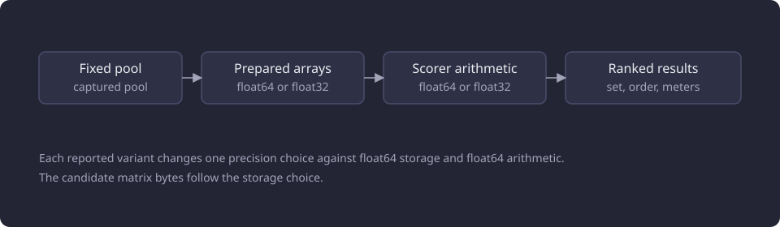
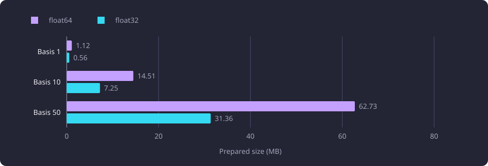

# Array storage and float precision

This report measures the bytes that float32 and float64 array storage hold and whether the cheaper storage returns the same recommendation results.

**Evidence status:** Comparative. **Run dates:** 21 and 28 October 2026.

## The question

A recommendation read turns stored teaching-text [chunks](/docs/reference/glossary.md#capture-and-data-preparation) into arrays: a prepared basis and one matrix of candidate chunk vectors. The product reads each stored vector as a list of Python floats, which are float64. A client-side array can hold the same values at float32 and halve its buffer.

The question is how many bytes each storage type costs and whether the cheaper one returns the same recommendation result. The answer has two parts. Halving the bytes is a property of the buffer. Returning the same result is a property of the whole scoring path, where storage precision and arithmetic precision are separate choices. This report measures both and keeps them apart.

## Method and fixed pools

The array measurements ran on 21 October 2026 on three nested bases of one, 10 and 50 courses, taken as prefixes of one fixed representative order. The catalogue holds 11,086 represented courses, of which 4,543 are active, and 9,901 eligible module versions. The vectors are stored BGE-M3 embeddings with 1,024 components, so no embedding model ran.

| Basis | Ranked candidates | Descriptive candidate rows | Descriptive basis rows |
|---:|---:|---:|---:|
| 1 | 42 | 137 | 2 |
| 10 | 435 | 1,771 | 39 |
| 50 | 1,874 | 7,657 | 209 |

The fixed request used `basis="completed"`, `mode="all"`, `display_language="en"`, `include_inferred=false` and `active_only=true`, with the selected set equal to the completed set equal to each basis. The dataset was pinned through its named receipt, the required schema head was checked, and the selected-dataset pointer was not resolved.

| Setting | Value |
|---|---|
| `RECOMMENDATION_CHUNK_TOP_K` | 40 |
| `RECOMMENDATION_MIN_RELATEDNESS` | 0.33 |
| `RECOMMENDATION_NEAR_DUPLICATE_PERCENT` | 90 |
| `RECOMMENDATION_OVERLAP_PENALTY_WEIGHT` | 0.0 |
| `COMPARISON_OVERLAP_FLOOR` | 0.20 |
| `COMPARISON_OVERLAP_CEILING` | 0.90 |

The arrays were loaded from a derived file, never from the multi-hundred-megabyte capture JSON. Array bytes are the NumPy buffer from `array.nbytes`. Resident growth is from `VmRSS`. The array case loaded the configured hub vectors for preparation shape and timing without an identity comparison, and its byte figures do not depend on hub values.

The array measurements ran one process at a time under a 2,147,483,648-byte address-space limit, with 10.2 to 10.6 GB of available memory against a required 3.2 GB headroom, on Python 3.14.3 and NumPy 2.4.6 with one BLAS thread (`OPENBLAS_NUM_THREADS=1`, `OMP_NUM_THREADS=1`, `MKL_NUM_THREADS=1`, `BLIS_NUM_THREADS=1` and `VECLIB_MAXIMUM_THREADS=1`).

Each variant set one storage dtype for the client-side arrays and one math dtype for the scorer. The reported variants are float64 storage with float64 arithmetic, float32 storage with float64 arithmetic, and float64 storage with float32 arithmetic.

The diagram shows the two precision choices on one scoring path.



```python
variants = {
    "float64_storage_float64_math": (np.float64, np.float64),
    "float32_storage_float64_math": (np.float32, np.float64),
    "float64_storage_float32_math": (np.float64, np.float32),
}

stored = np.asarray(pool.vectors[rows], dtype=storage_dtype)
centred = np.array(stored, dtype=math_dtype, copy=True)
```

The scorer read the stored rows at the storage dtype, then copied them at the math dtype before centring. The float32 variants held the client-side embedding arrays at float32. The stored pgvector representation and the database bytes were outside the case, so the byte saving is a client-memory result, not a database-storage result.

## Prepared array bytes

The prepared basis holds the hub-centred unit rows of the descriptive basis chunks, the [course centroids](/docs/reference/glossary.md#discovery-and-the-structure-of-studies) and the trimmed basis vector. The candidate matrix holds one row per descriptive candidate chunk. The candidate matrix figures isolate the storage dtype, because the same rows were cast to float64 and float32. The prepared basis figures are the two builds, one at float64 and one at float32.

| Basis | Prepared basis float64 | Prepared basis float32 | Candidate matrix float64 | Candidate matrix float32 | Float32 saving |
|---:|---:|---:|---:|---:|---:|
| 1 | 32,768 bytes | 16,384 bytes | 1,122,304 bytes (1.12 MB) | 561,152 bytes (0.56 MB) | 50 percent |
| 10 | 409,600 bytes | 204,800 bytes | 14,508,032 bytes (14.51 MB) | 7,254,016 bytes (7.25 MB) | 50 percent |
| 50 | 2,129,920 bytes | 1,064,960 bytes | 62,726,144 bytes (62.73 MB) | 31,363,072 bytes (31.36 MB) | 50 percent |

Float32 halves every buffer exactly, because each element takes four bytes instead of eight. The saving is 50 percent at every basis and for both arrays.

At the 50-course basis, loading the derived arrays added 63.9 MB resident. The float64 prepared basis added 3.5 MB, the float32 prepared basis added 1.6 MB, and the float32 candidate matrix added 31.5 MB. Releasing all arrays after a collection dropped resident memory by 94.0 MB and ended 6.5 MB above the pre-fixture baseline.

The resident figures follow the buffer only loosely. The float32 candidate matrix's 31.5 MB growth is close to its 31.36 MB buffer, while the prepared basis figures carry allocator state and do not scale exactly with the buffer. Array bytes and resident memory are different measures, and only the buffer halves.

The prepared candidate matrix size at each basis is plotted below.



## Parity of the variants

Each variant scored the same captured pool with the product formula and was compared with the product float64 scorer. The comparison checked the retained set, the order, the exact tie pairs, rank and membership changes, and the largest relatedness and overlap deltas.

| Basis | Variant | Same set and order | Rank changes | Membership changes | Tie pairs | Max relatedness delta | Max overlap delta |
|---:|---|---|---:|---:|---:|---:|---:|
| 1 | float64 storage, float64 math | yes | 0 | 0 | 0 of 0 | 1.4e-14 | 3.6e-14 |
| 1 | float32 storage, float64 math | yes | 0 | 0 | 0 of 0 | 2.2e-07 | 3.8e-07 |
| 1 | float64 storage, float32 math | yes | 0 | 0 | 0 of 0 | 5.7e-06 | 3.3e-05 |
| 10 | float64 storage, float64 math | yes | 0 | 0 | 0 of 0 | 2.1e-14 | 3.6e-14 |
| 10 | float32 storage, float64 math | yes | 0 | 0 | 0 of 0 | 1.4e-07 | 3.8e-07 |
| 10 | float64 storage, float32 math | yes | 0 | 0 | 0 of 0 | 8.5e-06 | 2.8e-05 |
| 50 | float64 storage, float64 math | yes | 0 | 0 | 27 of 27 | 1.4e-14 | 5.7e-14 |
| 50 | float32 storage, float64 math | yes | 0 | 0 | 27 of 27 | 2.2e-07 | 2.6e-07 |
| 50 | float64 storage, float32 math | yes | 0 | 0 | 27 of 27 | 7.3e-06 | 3.2e-05 |

All nine comparisons returned the same retained set and order, with zero rank changes and zero membership changes. The 50-course basis kept all 27 exact tie pairs in every variant. The float64 leg reproduced the product result and differed only in the last binary digits, so a last-bit difference is not specific to float32. The float64 array scorer and its own preservation result are described in [Recommendation vectorization and narrow reads](/docs/experiments/recommendations/vectorization-and-narrow-reads.md).

Float32 storage alone moved relatedness by at most 2.2e-7 and overlap by at most 3.8e-7. Float32 arithmetic moved relatedness by 5.7e-6 to 8.5e-6 and overlap by 2.8e-5 to 3.3e-5. Float32 storage moved the meters less than float32 arithmetic. The byte table's saving comes from the float32 arrays, and the float32 arithmetic variant was measured for parity, not for bytes.

At the 50-course basis the smallest absolute relatedness margin was 0.0307 percentage points and the smallest [near-duplicate](/docs/reference/glossary.md#discovery-and-the-structure-of-studies) margin was 0.135 percentage points. The float32 arithmetic overlap deltas lie from 2.8e-5 to 3.3e-5 percentage points. The observed deltas stayed below both margins, and no sampled candidate crossed a threshold, changed membership, changed order or changed a derived flag.

That is a sampled classification on the fixed pools, not a guarantee for every input. No bitwise equality is claimed. Float32 storage and arithmetic are behavior-altering evidence only, not a lossless default.

## The shared chunk store's float64 build

On 28 October 2026 a separate experiment built a shared descriptive chunk store for the serving workers from the selected dataset of 11,086 courses and 58,962 chunks. Its first version stored float32 binary payloads and produced a maximum embedding difference of 1.46e-8 from the float64 values the product ORM parses from the stored vector text. The report calls the relatedness, score and overlap values of one result its recommendation meters. Every recommendation meter changed in the last bits. The float32 store exists as a diagnostic and is not used.

The store was rebuilt from the text values in float64, and the recommendation result returned to the parity of that stack. The rebuild, the store's size and its served parity are described in [Serving artifact build and shared stores](/docs/experiments/runtime-storage-and-serving/serving-artifact-build-and-shared-stores.md).

The confirming run used an aarch64 Neoverse N1 server with four logical cores and 24.1 GB of RAM, PostgreSQL 18.6 and pgvector 0.8.6.

The interpretation is that the shared store's float64 build confirms the array finding where it matters for the product. Float32 storage is not lossless: it can move a meter in the last bits, and a meter feeds a threshold. The array experiment's sampled deltas stayed below the measured margins, but the margins are properties of the fixed pools, not of the format.

## Failed approaches

### Float32 storage as a lossless default

The hypothesis was that float32 storage could replace float64 without changing a result. It halved the bytes on every basis, but it did not reproduce the product bit for bit: the float32-storage variants moved relatedness by up to 2.2e-7 and overlap by up to 3.8e-7, and the float32 shared store changed every recommendation meter in the last bits. A last-bit change can flip a candidate at a threshold, so the hypothesis failed as a lossless claim. It is a sampled result on the fixed pools, not a measured failure on every input.

### Float32 arithmetic

Float32 arithmetic was measured as a second variant. It kept float64 storage for the candidate rows, so it did not reduce the candidate matrix. It moved the meters by up to 8.5e-6 relatedness and 3.3e-5 overlap, one to two orders of magnitude more than float32 storage, so it was not a candidate.

## Interpretation

The observation is that float32 halves the array bytes at every basis and that the sampled variants kept the set, order, ties and flags. The interpretation is that storage precision and arithmetic precision are separate costs: the candidate matrix bytes follow the storage choice, and storage alone moved the meters less than arithmetic alone.

The shared-store result is the observation that a float32 store changed meters in the last bits. That confirms that float32 is not a lossless default, and it makes the array margins a property of the fixed pools rather than of the format.

## Limitations

- The pools are fixed captured outputs on one pinned dataset. The report makes no full-catalogue, retrieval or semantic-quality claim.
- Array bytes are buffer bytes from `array.nbytes`. Resident growth is process-wide and includes allocator state, and the two measures do not convert.
- The float32 variants held the client-side arrays at float32. The stored pgvector representation and the database bytes were outside the case.
- The parity result is a sampled classification on three fixed pools. No bitwise equality is claimed and no guarantee applies to other inputs.
- The array case loaded the hub vectors for preparation shape and timing without an identity comparison. The byte figures do not depend on hub values.
- The shared-store result ran on a separate protocol, and its 1.46e-8 embedding difference is not comparable to the array deltas.

The limits shared by the whole category, including in-process measurement and values that do not add across reports, are on [Runtime, storage and serving experiments](/docs/experiments/runtime-storage-and-serving/README.md#the-boundaries-of-the-shared-method).

## Baselines

| Baseline | Value | Conditions |
|---|---|---|
| Prepared candidate matrix, float64 | 62,726,144 bytes | Basis 50, 7,657 descriptive rows |
| Prepared candidate matrix, float32 | 31,363,072 bytes | Same rows |
| Prepared basis, float64 | 2,129,920 bytes | Basis 50, 209 descriptive basis rows |
| Prepared basis, float32 | 1,064,960 bytes | Same rows |
| float64 leg, largest relatedness delta | 1.4e-14 to 2.1e-14 | Three bases |
| float64 leg, largest overlap delta | 3.6e-14 to 5.7e-14 | Three bases |
| Product reference | float64 scorer | Fixed pools of 42, 435 and 1,874 candidates |

## Open questions

- Whether the float32 deltas stay below the 0.0307 and 0.135 percentage-point margins on other pools, languages or query inputs. Untested.
- Whether a float32 store's 1.46e-8 embedding difference stays below every threshold on another dataset. Untested.
- Whether the byte saving of a float32 shared chunk store changes the serving memory cap enough to justify its numeric risk. The float64 store's size and the cap were measured, and a float32 store's effect on both was not. Untested.
