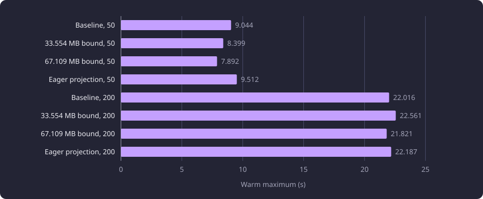
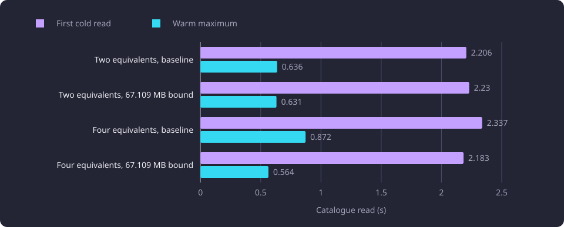

# Descriptive chunk caching

A bounded cache of descriptive chunk reads was measured on repeated heavy recommendation calls at two basis sizes.

**Evidence status:** Comparative. **Run dates:** 21 and 22 October 2026.

## The question

A heavy recommendation call read the descriptive chunks of the basis courses and of its candidate courses, scored them and returned a report. A repeated call over the same basis read many of the same chunks again. The experiment asked whether a bounded per-process cache of those read results measurably shortened the warm tail of that call, alone or beside an eagerly built lookup projection or a compact projection. It also asked whether one interactive catalogue read stayed fast while two heavy calls ran, at a per-process share that fitted a 1.074 GB aggregate at four process equivalents.

A descriptive chunk is a stored [chunk](/docs/reference/glossary.md#capture-and-data-preparation) of a course version's content or learning-outcomes text. The cache was a bounded store of the read carriers those two descriptive reads returned. An entry was keyed by the read triple `(group_id, sisu_course_unit_id, representative_source_hash)` and held the ordered carriers for that triple. A carrier held the group identity, the text field and language, the chunk index, the retained text origin, the stored character count and the vector. The chunk text itself was not part of a carrier.

A heavy recommendation call here is one complete recommendation command over a fixed [basis](/docs/reference/glossary.md#prerequisites-and-routes), reading the basis and candidate chunks and scoring them. An interactive catalogue read is one catalogue report read. A process equivalent is one process's memory and CPU footprint, not a configured worker process and not an HTTP request.

The policy was one least-recently-used order with one lock serializing access, and the 67.109 MB bound set it to 497 entries. The entry structure and the eviction step were the whole policy.

```python
import threading
from collections import OrderedDict
from typing import Any

max_entries = 497
entries: OrderedDict[tuple[str, str, str], tuple[Any, ...]] = OrderedDict()
lock = threading.Lock()

def store(triple: tuple[str, str, str], carriers: tuple[Any, ...]) -> None:
    with lock:
        entries[triple] = carriers
        entries.move_to_end(triple)
        while len(entries) > max_entries:
            entries.popitem(last=False)
```

The cache saved 1.170300 s at the warm median on the product command's 50-course prefix, beyond the 0.112218 s spread of that comparison. At the 200-course basis no saving stood beyond the spread. The 497-entry bound at 137,794 bytes per entry was selected as a budget trade-off on that evidence.

## Bases and variants

Three basis sets were used, and they are not interchangeable.

| Set | Construction | Result count |
|---|---|---:|
| 50-course basis | A separate saved 50-course input, with 1,874 candidate triples in the serial cases | 319 |
| 200-course basis | 200 shortlist group identities from the saved selection input, with 2,925 candidate triples | 629 |
| 50-course prefix | The first 50 group identities of the 200-course basis | 432 |

The 200-course basis was built from the 200 `shortlist_group_ids` of the saved selection input in recorded order. Every shortlist group whose triple occurred in the fixed 1,874-triple candidate set was kept, then the remaining groups were filled from that candidate set in recorded order. That kept 56 shortlist groups and filled 144, for 200 distinct groups. The builder read each chosen triple's represented summary and asserted equality, and 200 of 200 matched.

The 50-course basis was a separate saved input with a different construction. The 50-course prefix was the reproduction's set, used only by the product-path reproduction. Its construction and its 432 results do not extend the serial 50-course case or its 319 results.

| Variant | What changed | Cases |
|---|---|---|
| Baseline | No descriptive chunk cache. The lookup projection built on first use. The source-fact cache held 8,000 entries. | 50 and 200, serial |
| 33.554 MB bound | A descriptive chunk cache at 248 entries | 50 and 200, serial |
| 67.109 MB bound | A descriptive chunk cache at 497 entries | 50 and 200, serial, and 2 and 4 process equivalents |
| Eager projection | The lookup projection built at process start | 50 and 200, serial |
| Compact projection | A compact lookup projection | One catalogue-read case |

Every serial case ran one process with one cold call and three warm calls. The concurrency cases are described below.

## Warm state and the comparison threshold

Each serial case ran four calls in one fresh process: one cold call and three warm calls. The calls were one sequence, not independent trials. The first call filled the caches, and the three warm calls showed the state it left.

The chunk cases ran a descriptive probe before the timed calls, and the probe warmed shared database buffers. The cold calls were therefore not a cache-only comparison. The 50-course cold calls were 9.599 s and 9.579 s against the baseline 10.125 s. The 200-course cold calls were 23.230 s and 23.098 s against 28.251 s. The baseline 200 cold call ran first and paid a cold HNSW and page-cache cost that the other cold calls did not pay. Only the warm tails and the concurrency interactive tails informed the qualification.

The comparison threshold was the larger of the two cases' own warm spreads. A saving or loss below that threshold was not read as an effect.

| Case | Basis | Warm minimum (s) | Warm median (s) | Warm maximum (s) | Spread (s) |
|---|---:|---:|---:|---:|---:|
| Baseline | 50 | 9.019 | 9.030 | 9.044 | 0.025 |
| 33.554 MB bound | 50 | 8.261 | 8.333 | 8.399 | 0.138 |
| 67.109 MB bound | 50 | 7.728 | 7.755 | 7.892 | 0.163 |
| Eager projection | 50 | 9.024 | 9.101 | 9.512 | 0.487 |
| Baseline | 200 | 21.794 | 21.847 | 22.016 | 0.222 |
| 33.554 MB bound | 200 | 22.327 | 22.347 | 22.561 | 0.234 |
| 67.109 MB bound | 200 | 21.421 | 21.633 | 21.821 | 0.399 |
| Eager projection | 200 | 21.841 | 21.872 | 22.187 | 0.346 |

## Warm heavy-call results

| Bound | Basis | Maximum saving (s) | Median saving (s) | Own spread (s) | Result |
|---|---:|---:|---:|---:|---|
| 33.554 MB | 50 | 0.645 | 0.697 | 0.138 | Saving beyond the spread |
| 67.109 MB | 50 | 1.152 | 1.276 | 0.163 | Saving beyond the spread |
| 33.554 MB | 200 | -0.545 | -0.500 | 0.234 | Loss beyond the spread |
| 67.109 MB | 200 | 0.195 | 0.214 | 0.399 | Saving within the spread |

A positive value is a saving against the matching baseline.

The 67.109 MB bound was the only bound that saved beyond the spread at the 50-course basis without losing beyond the spread at the 200-course basis. The 33.554 MB bound saved at the 50-course basis and lost at the 200-course basis, so no smaller qualifying bound existed. The saving was confined to the 50-course basis.

The warm maxima of the four serial variants are plotted below.



## What the cache retained

The working set was the set of triples one call read. The 50-course set was 50 basis triples plus 1,874 live candidate triples, 1,924 entries. The 200-course set was 200 basis triples plus 2,925 live candidate triples, 3,125 entries. The 67.109 MB bound held 497 of the 3,125 entries, 15.9 percent. The 33.554 MB bound held 248, 7.9 percent. The cold call filled the basis and candidate entries, so both bounds evicted the basis and the oldest candidates.

Warm hits showed the same working-set limit. The basis hit count was zero at both bounds and both bases.

| Bound | Basis | Candidate hits | Candidate misses |
|---|---:|---:|---:|
| 33.554 MB | 50 | 198 | 1,676 |
| 33.554 MB | 200 | 48 | 2,877 |
| 67.109 MB | 50 | 447 | 1,427 |
| 67.109 MB | 200 | 297 | 2,628 |

The retained bytes at each bound follow.

| Case | Accounted chunk term (bytes) | Measured chunk bytes | Entries |
|---|---:|---:|---:|
| 33.554 MB, 50 | 33,554,432 | 33,318,668 | 248 |
| 33.554 MB, 200 | 33,554,432 | 35,131,425 | 248 |
| 67.109 MB, 50 | 67,108,864 | 67,246,566 | 497 |
| 67.109 MB, 200 | 67,108,864 | 68,483,256 | 497 |
| 50-course prefix, 497 entries | 68,483,618 | 68,937,692 | 497 |

The 33.554 MB and 67.109 MB accounted terms were the nominal bounds, 33,554,432 and 67,108,864 bytes. The entry count was derived from the average entry size the descriptive probe measured, 134,839.596 bytes at the 50-course basis and 134,759.103 bytes at the 200-course basis, and the largest entry was 759,423 bytes. The retained set included entries larger than the average, so the count bound did not cap bytes exactly.

The 33.554 MB case at the 200-course basis measured 1,576,993 bytes above its term. The 67.109 MB case at the 200-course basis measured 1,374,392 bytes above its term. The 67.109 MB case at the 50-course basis measured 67,246,566 bytes against the 67,108,864-byte term. The four-equivalent cache process measured 69,739,866 bytes, 2,631,002 bytes above the term.

The retained figures were object-graph sizes, so they are not resident memory. Each facility counts shared objects once within the facility, and the facilities are summed.

The measured and accounted chunk bytes are plotted below.


## Concurrency

Four concurrency cases ran, two at two process equivalents and two at four. At two equivalents, two serving processes ran. The first ran one cold heavy recommendation call beside a repeated interactive catalogue reader thread, and the second ran one cold heavy recommendation call. At four equivalents, the same two active processes ran plus two holder processes. The holders built a full cache set and then idled. They ran no work while the two heavy calls and the reader ran, so the interactive read was measured under a four-process memory footprint. Within each group, the baseline case and the cache case shared the layout.

The diagram shows the processes in each measured group and the work each ran.


The four-equivalent case was not four heavy recommendation calls. The interactive reader was a thread in the first heavy process, so that process's CPU seconds include the reader. The cases counted process equivalents, not configured worker processes. No front router, admission decision or HTTP response was part of the measurement. The server had four usable cores, so the four-equivalent case filled every core and had no spare core.

| Case | Heavy a (s) | Heavy b (s) | Samples | First catalogue (s) | Warm minimum (s) | Warm median (s) | Warm maximum (s) |
|---|---:|---:|---:|---:|---:|---:|---:|
| Baseline, 2 equivalents | 31.498 | 24.643 | 32 | 2.206 | 0.180 | 0.257 | 0.636 |
| Baseline, 4 equivalents | 30.274 | 23.025 | 31 | 2.337 | 0.176 | 0.250 | 0.872 |
| 67.109 MB bound, 2 equivalents | 30.997 | 23.611 | 35 | 2.230 | 0.177 | 0.272 | 0.631 |
| 67.109 MB bound, 4 equivalents | 30.847 | 23.416 | 35 | 2.183 | 0.175 | 0.270 | 0.564 |

The heavy calls were cold in every concurrency process, so they issued no cache hits. Their walls, 23.025 to 31.498 s, include contention and are not cache-benefit evidence.

The interactive maximum with the cache was 0.631 s at two equivalents against 0.636 s, and 0.564 s at four against 0.872 s. The warm median was 0.272 s against 0.257 s at two, and 0.270 s against 0.250 s at four, so the maximum was the statistic that did not worsen. The first catalogue read was 2.230 s against 2.206 s at two and 2.183 s against 2.337 s at four, and it included the lazy projection build. The run's qualification rule used the interactive maximum. The four-equivalent baseline maximum of 0.872 s carries scheduler contention because the case had no spare core.

The interactive reads are plotted below.



The largest retained process graph in the four-equivalent cache case was 108,903,771 bytes. Four such graphs held 435,615,084 bytes, which is 638,126,740 bytes inside the aggregate.

## Eager projection

The eager projection built the lookup projection at process start. The build took 1.830 s at the 50-course basis and 1.685 s at the 200-course basis, with six statements and 27,999,707 bytes. The lazy first catalogue read paid the build. The eager read used the projection built at process start.

| Basis | Lazy cold first read (s) | Lazy warm second read (s) | Eager first read (s) |
|---|---:|---:|---:|
| 50 | 2.538 | 0.227 | 0.169 |
| 200 | 2.111 | 0.175 | 0.159 |

The eager first read was 0.159 to 0.169 s against 2.111 to 2.538 s for the lazy cold first read. The build moved to process start at the same total build cost and the same 27,999,707 bytes.

The heavy call did not shorten. At the 50-course basis the eager cold call was 9.901 s against the baseline 10.125 s, a 0.224 s difference. The baseline warm spread was 0.025 s and the eager warm spread was 0.487 s. The recommendation path never read the lookup projection, so the cold difference was not a projection effect, and the warm tails were 9.101 s and 9.030 s at the 50-course basis and 21.872 s and 21.847 s at the 200-course basis.

The 200-course cold difference, 22.705 s against 28.251 s, was the baseline's first-process cold HNSW and page-cache cost. The eager cold neighbour search was 8.156 s against the baseline cold 12.458 s, and the three eager warm neighbour reads were 7.818, 7.820 and 7.821 s. The facility was skipped because no heavy call shortened.

## Compact projection

The compact projection retained only the fields the catalogue report and the lexical matcher consume. It dropped the summary and version wrapper objects, the module-version identifier that the strict catalogue path does not read, the period identifiers and the module fields the lookup projection does not carry.

| Projection | Total bytes | String bytes | Structure bytes | Scalar bytes |
|---|---:|---:|---:|---:|
| Product lookup projection | 27,999,707 | 11,186,191 | 16,813,096 | 420 |
| Compact projection | 17,863,687 | 9,924,907 | 7,938,360 | 420 |
| Saving | 10,136,020 | | | |

The compact projection retained 63.8 percent of the product projection bytes, 36.2 percent fewer, a saving of 10,136,020 bytes. All 16 fixed lexical cells matched for exact, substring and fuzzy results, with no mismatch. The catalogue report digest was identical.

The product lazy cold read was 1.888 s and the warm read 0.241 s. The compact row read was 1.648 s, its build 0.168 s and its report 0.036 s, so the compact cold path was 1.852 s against 1.888 s and the compact warm report 0.036 s against 0.241 s.

The matcher comparisons ran the same product matchers over both structures and returned identical results. Their wall time was not isolated. The rule required the matcher cells not to slow, and that condition is unproven. The facility was skipped with the measured saving recorded.

## The product-path reproduction

The reproduction called the product recommendation command with the implemented cache, one invocation per mode in its own process. The baseline mode had no descriptive chunk cache. The cache mode had one 497-entry cache. Both modes had one 8,000-entry source-fact cache. The request was `basis="completed"`, `mode="all"`, `display_language="en"`, `include_inferred=False` and `active_only=True`. The basis was the first 50 group identities of the 200-course basis. The separate 50-course basis of the serial comparison was a different input. The report returned 432 courses.

Each mode ran four calls in one process: one cold call and three warm calls. The calls were one sequence, not independent trials. The cold calls were not benefit evidence.

| Mode | Warm minimum (s) | Warm median (s) | Warm maximum (s) | Spread (s) |
|---|---:|---:|---:|---:|
| Baseline | 9.082554 | 9.188899 | 9.194772 | 0.112218 |
| Cache | 7.937882 | 8.018599 | 8.026672 | 0.088790 |

| Measure | Baseline (s) | Cache (s) | Saving (s) | Beyond the 0.112218 s spread |
|---|---:|---:|---:|---|
| Warm maximum | 9.194772 | 8.026672 | 1.168100 | Yes |
| Warm median | 9.188899 | 8.018599 | 1.170300 | Yes |

The three warm calls fell from the 9.082554 to 9.194772 s range to the 7.937882 to 8.026672 s range. The maximum saving was 1.168100 s and the median saving 1.170300 s, against the larger warm spread of 0.112218 s. All four report digests were identical within each mode and between the two modes. The cache returned the same report.

The retention in the same run was 68,937,692 chunk bytes over 497 entries and 9,491,065 source-fact bytes over 1,263 entries. The walked source plus chunk total was 78,428,757 bytes. With the accounted projection share the walked total was 111,983,189 bytes.

The cache's retained bytes at the 497-entry bound were measured against a 68,483,618-byte term, 497 entries at 137,794 bytes per entry. The run measured 68,937,692 bytes, 454,074 bytes or 0.663 percent above the term. The measured cache was 68.938 MB against the 68.484 MB accounted term.

The cause was the entry mix. The 68,483,618-byte term was 497 entries at 137,794 bytes, and that value rounds the average over the 497 retained entries of the 200-course serial case, 137,793.27 bytes per entry. The reproduction's 50-course prefix read a heavier mix. Its 497 most recently read triples averaged 138,707.63 bytes, 0.66 percent heavier.

The decisive budget held. Four processes held 634,160,496 bytes, which is 634.160496 MB, inside the aggregate, with 439,581,328 bytes, which is 439.581328 MB, of headroom. The measured source facts were far below the 56,048,000-byte accounted share, so that term held the accounting conservative. The 137,794-byte per-entry value and the 497-entry count stand as the selected budget values.

## The four-process accounting

The per-process share had three terms: the lookup projection bytes, the source-fact entry count times its per-entry bytes, and the descriptive chunk entry count times its per-entry bytes. The configured terms were the lookup projection at 33,554,432 bytes, the source facts at 8,000 entries by 7,006 bytes, 56,048,000 bytes, and the descriptive chunk term. The aggregate was 1.074 GB. The decision arithmetic used the configured shares, because those were the configured bound. The measured column was the observed fill at that basis.

| Case | Accounted per process (bytes) | Accounted, four (bytes) | Measured per process (bytes) | Measured, four (bytes) | Measured headroom, four (bytes) |
|---|---:|---:|---:|---:|---:|
| Baseline, 200 | 89,602,432 | 358,409,728 | 11,164,198 | 44,656,792 | 1,029,085,032 |
| 33.554 MB, 200 | 123,156,864 | 492,627,456 | 46,295,623 | 185,182,492 | 888,559,332 |
| 67.109 MB, 50 | 156,711,296 | 626,845,184 | 76,144,231 | 304,576,924 | 769,164,900 |
| 67.109 MB, 200 | 156,711,296 | 626,845,184 | 79,647,454 | 318,589,816 | 755,152,008 |
| Compact | 73,911,687 | 295,646,748 | 73,911,687 | 295,646,748 | 778,095,076 |
| Reproduction, 497 entries | 158,086,050 | 632,344,200 | 158,540,124 | 634,160,496 | 439,581,328 |

Every accounted four-process total fitted. The largest was the 67.109 MB bound at 626,845,184 bytes, and its measured four-process total at the 200-course basis left 755,152,008 bytes of headroom.

The compact row combined its measured projection with the configured source-fact share, because the compact case built no source-fact cache. Its source-fact part was the configured share, not a measurement. The baseline row used the configured projection share, and its measured projection was 0 bytes. The measured source-fact figure was 8,897,665 bytes at the 50-course basis and 11,164,198 bytes at the 200-course basis, below the 56,048,000-byte share.

## Where the line ended

| Facility | Measured result | Disposition |
|---|---|---|
| 33.554 MB bound | 50-course saving of 0.645 s maximum and 0.697 s median beyond the 0.138 s spread. 200-course loss of 0.545 s maximum and 0.500 s median beyond the 0.234 s spread. | Not selected |
| 67.109 MB bound | 50-course saving of 1.152 s maximum and 1.276 s median beyond the 0.163 s spread. 200-course saving of 0.195 s maximum and 0.214 s median within the 0.399 s spread. | Selected at 497 entries and applied to the product. The shared chunk store replaced it |
| Eager projection | The 1.685 to 1.830 s build moved to process start. No heavy call shortened. | Not selected |
| Compact projection | 10,136,020 bytes and 36.2 percent fewer. The 16 lexical cells and the catalogue report were identical. The matcher wall time was not isolated. | Not selected, with the measured saving recorded |

The 497-entry cache at 137,794 bytes per entry was selected and applied to the product after these measurements. The saving at the 50-course basis and the absence of a spread-qualified saving at the 200-course basis both stand. The chosen bound was a budget trade-off, not a finding that the 200-course tail improved. The per-process cache was removed when the serving path moved to the shared float64 chunk store.

## Descriptive chunk reads in the product

Descriptive chunk reads in the product answer from the read-only shared float64 chunk store of the serving artifact build. The chunk store is one mapped file per build, and an entry holds the ordered carriers of one representative triple with each carrier's identity, field, language, chunk index, origin, character count and vector. Every worker maps the same files read-only, so the page cache holds one copy, and a descriptive read opens no database session. The all-field read that comparison uses reads the database projection, and the store's dataset key and academic year are validated at open, where a key of another database or year raises `ValueError` naming the build command. The per-process cache measured in this report is not part of the serving path, and the shared store serves the same descriptive reads. [Serving artifact build and shared stores](/docs/experiments/runtime-storage-and-serving/serving-artifact-build-and-shared-stores.md) describes the build that writes the store and the reads that consume it.

## Limitations

- One cache policy per fresh process, one pinned dataset and one sequence of four calls per case. The calls were not independent trials, and the values are not a distribution or a confidence interval.
- The chunk cases ran a descriptive probe before the timed calls, which warmed shared database buffers. The cold comparison was not a cache-only comparison, and only the warm tails and the concurrency interactive tails informed the decision.
- Case order affects the 200-course cold calls. The baseline 200 cold call ran first and paid a cold HNSW and page-cache cost that the other cold calls did not pay.
- The retained figures were object-graph sizes, so they are not resident memory.
- The concurrency reader ran as a thread in the first heavy process, and that process's CPU seconds include the reader. The server had four usable cores, so the four-equivalent case had no spare core and its interactive tail carries scheduler contention.
- The product-path reproduction used the first 50 group identities of the 200-course basis and returned 432 results. Those values do not extend the serial 50-course case or its 319 results.
- The retained mix depends on the requested basis, so a different basis moves the measured cache bytes around the accounted term.

## Untested questions

- Whether the compact projection's matcher cells slow under a direct timer. The run compared their results only, so the no-slowdown condition is untested.
- Whether a bound between 248 and 497 entries saves beyond the spread at both bases. Only the two nominal bounds were measured. Untested.
- Whether the warm-tail saving holds under the configured HTTP worker count, the front router and admission control. The concurrency cases measured process equivalents, not HTTP requests. Untested.
- Whether a second requested basis moves the measured cache above or below the accounted term in the same direction as the 50-course prefix. One heavier mix is recorded, and a second basis is untested.
