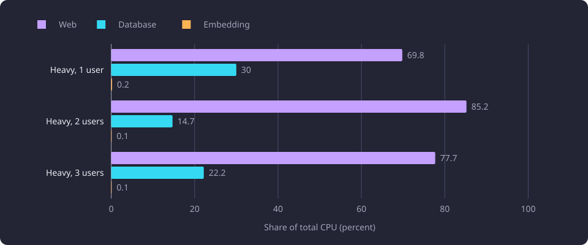

# Endpoint load profiling and bottleneck attribution

This report records whole-service endpoint profiles from October 2026, their per-stage costs and the CPU attribution that located the bottlenecks.

**Evidence status:** Exploratory. **Run dates:** 19 October 2026 and 22 October 2026.

The [Experiments section](/docs/experiments/README.md) states the catalogue and the evidence labels. The [glossary](/docs/reference/glossary.md) defines the request path, the front router, the worker process and admission control. The [folder overview](/docs/experiments/runtime-storage-and-serving/README.md#the-shared-measurement-method) states the cost metric, the component boundaries and the memory measures that the serving measurements share. This report states the method each of its own profiles used: the 19 October profile timed HTTP requests and read process CPU per request, and the 22 October attribution summed whole-run process and container counters. The serving shape of the profiled build differs from the shape a site serves, and the difference bounds what every number here can support.

## The question

The profile asked what one read costs end to end. Earlier work measured parts of the system in isolation, such as a recommendation scorer, a database read or a vector search. Those measurements did not say which reads dominate a served site, how much of a read's cost is Python work, how much is database CPU and how much is embedding CPU, how large the responses are, or what changes when a basis grows or a graph includes every course.

Four questions shaped the whole-service profile:

1. Which endpoint dominates the wall time of an ordinary session, and what does its CPU split look like across processes?
2. How do the cost and the response size move between a small basis and a large one?
3. What does the server do when several expensive reads arrive together, and what happens to its memory?
4. Which costs would a change have to reduce first, and what saving would each candidate plausibly give?

A separate graph and route profile asked a narrower question. Within one prerequisite graph read and one minimum-route read, how much time goes to compilation, drawing projection and preparation, satisfaction states and serialization, and how much to the HTTP request as a whole?

## The serving shape the profiles measured

The whole-service profile ran on 19 October 2026 against a site served by two uvicorn worker processes with synchronous request handlers. The profile excluded prerequisites from its request set, so its 59 requests cover the other dataset reads, the shell and the assets.

The graph and route profile ran on the same day. Its route calculation ran on the server, its server sent no compression middleware, and it split the work of the same command functions in process. Its gzip column is `gzip -9` of the response body rather than a transfer size.

A served site runs differently. One [front router](/docs/backend/interfaces/front-router.md) listens on the configured loopback port, [admission control](/docs/backend/interfaces/admission-control.md) classifies and limits each API read when `ADMISSION_ENABLED` is true, `WEB_WORKERS` worker processes serve the dataset behind the router, responses of at least 500 bytes pass through gzip, and the browser calculates the route from the graph report as [Prerequisite graph](/docs/backend/prerequisites/prerequisite-graph.md) describes. A dataset read runs one command in a worker process and returns one JSON report. The attribution below ran with four worker processes.

The diagram contrasts the two shapes for one read.

Those differences matter. The profiled build had no front router, no admission control, no response compression and no browser solver. Its absolute wall times, CPU times and response sizes describe that build. They are not a measurement of a read on a site that runs the present serving shape, and they do not become one by comparison across the two shapes. A browser solver performs the route work on the client, so the server route seconds in the graph profile include work that a served site does not run on the server.

## The whole-service profile

### The request set and repetitions

The profile made 59 HTTP requests against the site it measured. The set covered the four [search methods](/docs/backend/search-and-discovery/search.md#the-four-search-methods) (exact code, substring, fuzzy and semantic), a comparison pair, next-courses at a basis of three and 50, recommendations at a basis of three and 50, one study structure, one module lookup, 50 course summaries, and the shell and asset reads. Every request shape except the concurrency check ran one at a time.

Each shape ran warm with three repetitions. The wall column gives the range over those repetitions. Python CPU is the process CPU of the request, and the response column gives the response size.

The database and embedding columns need care. The database CPU is a per-query sample for semantic search, recommendations at a basis of 50 and module lookup. It is inferred for the three lexical search methods, comparison, next-courses, study structure and course summaries, and the table marks those cells as inferred. The embedding CPU is sampled for semantic search and recommendations at a basis of 50 and inferred for the other search methods, and the table marks those cells as inferred as well. No per-query database sample exists for the lexical searches, so their database cost cannot be separated from other work in the same window.

### The measured costs

| Area | Request | Wall (s) | Python CPU (s) | Database CPU (s) | Embedding CPU (s) | Response (MB) |
|---|---|---|---|---|---|---|
| Search, exact code | `COMP.SGN.320` | 1.82 to 1.98 | 0.87 | about 1.1 (inferred) | about 0.13 (inferred) | 0.045 |
| Search, substring | `COMP.SGN` | 1.75 to 1.98 | 0.86 | about 1.1 (inferred) | about 0.13 (inferred) | 0.038 |
| Search, fuzzy | `Advnced Image Processng` | 1.76 to 1.87 | 0.90 | about 1.1 (inferred) | about 0.13 (inferred) | 0.204 |
| Search, semantic | `how do neural networks learn from data` | 1.83 to 1.94 | 0.93 | 1.15 | 0.13 | 0.039 |
| Comparison, one pair | One course pair | 0.19 to 0.23 | 0.11 | about 0.05 (inferred) | 0 | 0.000820 |
| Next courses, basis 3 | Same request shape | 0.36 to 0.41 | 0.15 | about 0.15 (inferred) | 0 | 0.000264 |
| Next courses, basis 50 | Same request shape | 1.61 to 1.68 | 1.08 | about 0.4 (inferred) | 0 | 0.0072 |
| Recommendations, basis 3 | Same request shape | 0.92 to 0.95 (3.27 cold) | 0.55 | about 0.25 (inferred) | 0 | 0.011 |
| Recommendations, basis 50 | Same request shape | 8.22 to 8.49 (15.87 cold) | 5.41 | 2.96 | 0.016 | 0.049 |
| Study structure | One structure read | 0.28 to 0.31 | 0.10 | about 0.15 (inferred) | 0 | 0.124 |
| Module lookup | `Computing` | 0.87 to 0.94 | 0.76 | 0.15 | 0 | 0.0069 |
| Course summaries, 50 | 50 identities | 0.037 | 0.02 | about 0.01 (inferred) | 0 | 0.016 |
| Shell and bundle | `GET /`, `GET /assets/*.js` | 0.002 and 0.012 | Not measured | Not measured | Not measured | 0.000455 and 1.4 |

The four search methods cost about the same wall time, between 1.75 and 1.98 seconds. Python work is 0.86 to 0.93 seconds, and the lexical database estimate of about 1.1 seconds is close to the sampled 1.15 seconds of the semantic search. The fuzzy query returns 0.204 MB, and the other three return 0.038 to 0.045 MB.

Comparison takes 0.19 to 0.23 seconds. A study structure costs 0.28 to 0.31 seconds and returns 0.124 MB, while 50 course summaries cost 0.037 seconds. The shell and the JavaScript bundle are negligible against the dataset reads.

Next-courses grows with the basis. A basis of 50 takes 1.61 to 1.68 seconds against 0.36 to 0.41 seconds for a basis of three. Python work rises from 0.15 to 1.08 seconds, the inferred database cost from about 0.15 to about 0.4 seconds, and the response from 0.000264 to 0.0072 MB.

Recommendations grow more sharply. A basis of three takes 0.92 to 0.95 seconds warm and 3.27 seconds cold. A basis of 50 takes 8.22 to 8.49 seconds warm and 15.87 seconds cold. Python work rises from 0.55 to 5.41 seconds, the database cost from an inferred 0.25 seconds to a sampled 2.96 seconds, and the response from 0.011 to 0.049 MB. The warm basis-50 recommendation is the largest cost in the profile, and its 5.41 seconds of Python work is most of its 8.22 to 8.49 second wall time.

A module lookup costs 0.87 to 0.94 seconds and returns 0.0069 MB. Its 0.76 seconds of Python work sits against 0.15 seconds of database CPU, so the request is dominated by application work rather than by database CPU.

### Sequential and concurrent recommendation reads

The basis-50 recommendation also served as the concurrency check. One read alone takes 8.22 to 8.49 seconds warm, and the comparison used 8.3 seconds for that value. Three simultaneous reads took 9.69, 14.70 and 14.90 seconds.

| Concurrent basis-50 recommendation read | Wall (s) |
|---|---:|
| One read alone | 8.3 |
| First of three at once | 9.69 |
| Second of three at once | 14.70 |
| Third of three at once | 14.90 |

The single read and the three simultaneous reads are plotted below.

The throughput gain is about 1.7 times, not three times. Two synchronous worker processes and work bounded by CPU and the Python interpreter lock explain the gain, which is an interpretation of the measured walls. The first concurrent read takes 9.69 seconds, and the other two complete after it.

The worker resident set started at about 85 to 89 MB and reached 328 MB and 504 MB during the check, and it was not returned to the operating system. That is a process-wide resident-set observation across the whole check. It is not a per-request measurement, and it does not show how much memory one request allocates or releases.

### Estimated optimization candidates

The profile ranked nine ideas by expected saving. Every saving in this list is the profile's estimate, not a measurement of a changed implementation, and the profile changed nothing.

1. Semantic search scanned 58,962 chunk vectors because subtracting the embedding hub before the similarity test defeated the HNSW index. Storing hub-centred vectors and querying them directly was estimated to move a search from 1.9 seconds to about 0.8 seconds.
2. Exact, substring and fuzzy search ran full-catalogue Python scans over about 11,000 courses. Moving them to SQL or a cached immutable projection was estimated to save 0.7 to 0.9 seconds of Python work per search.
3. Recommendation similarity ran in nested Python loops over 1,024-dimensional chunk vectors, at 5.41 seconds of Python work and with memory growth. Precomputing per-course centroids and ranking in the database or NumPy was estimated to move the read from 8.3 seconds to between one and two seconds.
4. The candidate chunk fetch was unbounded, and the large basis spent 2.96 seconds of database CPU. Indexing or denormalising the read, fetching fewer fields and prefiltering before fetching embeddings was estimated to save two to three seconds.
5. Module lookup rebuilt 15,553 module versions and spent 0.76 seconds of Python work. Caching the represented-course and module projections per dataset version was the candidate.
6. Next-course prerequisites were compiled per request. Precomputing the direct prerequisite compilation per dataset was estimated to give three to four times on a basis of 50.
7. Each request built its own database engine and pool. One engine and pool per process was estimated to save tens of milliseconds and reduce connection churn.
8. Large JSON reports were sent uncompressed. Trimming or compressing them was the candidate, with fuzzy search at 0.204 MB and study structure at 0.124 MB.
9. The worker model was to be revisited after the first three candidates, because more processes were expected to help only once vector work left Python.

The list points at the recommendation path, the lexical full-catalogue scans and the semantic vector scan as the largest plausible levers. That is an interpretation of the measured costs.

The work that followed implemented and measured most of the list on its own builds. Seven reports carry the results.

- The stored centred vectors and the packed exact semantic read, on [Packed exact semantic search](/docs/experiments/search-and-translation/packed-exact-semantic-search.md).
- The normalized lexical projection and the native fuzzy scorer, on [Lexical lookup projection and native fuzzy matching](/docs/experiments/search-and-translation/lexical-lookup-projection-and-native-fuzzy.md).
- Recommendation scoring in native code, on [Native recommendation scoring](/docs/experiments/recommendations/native-recommendation-scoring.md).
- The native prerequisite compiler, its fact loader and the drawing projection, on [Native prerequisite compilation and identity](/docs/experiments/graph-and-route-algorithms/native-prerequisite-compilation.md).
- The serving artifact build and the shared stores it prepares, on [Serving artifact build and shared stores](/docs/experiments/runtime-storage-and-serving/serving-artifact-build-and-shared-stores.md).
- The cost of one request and the admission curves that price it, on [Serving request cost and admission](/docs/experiments/runtime-storage-and-serving/serving-request-cost-and-admission.md).
- The compression level of a response body, on [Response compression levels](/docs/experiments/runtime-storage-and-serving/response-compression.md).

Each report states its own measured outcome. None of the estimates above is a realized gain.

## The graph and route profile

### Cohort and method

The graph profile measured one prerequisite graph read and one minimum-route read for each of 10 courses with active only on and off, which gives 20 valid course-setting rows. It ran one repetition. The course state was empty, and Recommended and Inferred were on.

Graph and route ran over the HTTP routes. The same command functions ran in process to split the graph work into compilation, drawing projection and preparation, satisfaction states and serialization. Those stage times are in-process measurements, and the HTTP graph time and route CPU time are separate measurements. The stages do not add up to the HTTP wall time.

The server sent no compression, and the gzip column is `gzip -9` of the body. The drawing limit was 500 elements, and the client timeout was 240 seconds.

### The abandoned target

YKT.SOA.303 has no valid row. Its HTTP graph and route requests ran past the client's 240-second timeout, and the server workers kept computing both for about 30 minutes at 1.7 to 1.8 GB of resident memory each, until the web service was restarted. A closed client connection does not cancel a synchronous handler running in a thread pool, so the work continued after the client had given up.

In process, that target's graph compiled in 18.5 seconds with active only on and 41.1 seconds with it off. Its projection had not finished after 56 seconds and 33 seconds respectively. The target therefore contributes no latency value and no payload value. The recorded compile time is a floor for an incomplete calculation, not a measurement of a completed read.

### HTTP graph and route results

| Course | Setting | Graph (s) | Raw (MB) | gzip (MB) | Route (s) | Route CPU (s) | Route state |
|---|---|---:|---:|---:|---:|---:|---|
| MATH.MA.725 | All courses | 28.40 | 92.98 | 3.55 | 30.34 | 28.9 | Approximate |
| MATH.MA.725 | Active only | 12.47 | 65.76 | 1.66 | 17.84 | 16.4 | Approximate |
| MATH.MA.880 | All courses | 13.10 | 28.02 | 1.70 | 15.47 | 14.4 | Approximation failed |
| MATH.MA.880 | Active only | 3.89 | 6.76 | 0.47 | 8.24 | 7.3 | Approximate |
| COMP.CS.110 | All courses | 0.25 | 0.024 | 0.002 | 0.24 | 0.1 | Exact |
| COMP.CS.110 | Active only | 0.31 | 0.004 | 0.001 | 0.28 | 0.2 | Exact |

The largest graph read is MATH.MA.725 all courses at 28.40 seconds and a 92.98 MB body, compressed to 3.55 MB. The largest route read is the same course-setting at 30.34 seconds and 28.9 seconds of route CPU. MATH.MA.880 all courses is next at 13.10 seconds for the graph and 15.47 seconds for the route. The smallest target, COMP.CS.110, takes 0.25 to 0.31 seconds for the graph and 0.24 to 0.28 seconds for the route.

The six larger targets take 1.25 to 28.40 seconds for the graph and 1.30 to 30.34 seconds for the route. The four smallest take 0.23 to 0.83 seconds for the graph and 0.23 to 0.79 seconds for the route. All-courses scope raises the graph time on all six larger targets. The route time rises on five of them and falls from 5.92 to 5.65 seconds on PSY.324. On the four smallest the scope changes the graph time by at most 0.10 seconds and the route time by at most 0.33 seconds, in either direction.

The route outcomes differ by target. The four small targets return exact routes. MATH.MA.880 returns an approximate route with active only and an approximation failure with all courses. MATH.MA.725 and PSY.324 return approximate routes in both scopes. The three KAT targets return unresolved routes in both scopes.

### Server stages of a graph read

| Course | Setting | Compile (ms) | Project and prepare (ms) | Satisfaction (ms) | Serialize (ms) |
|---|---|---:|---:|---:|---:|
| MATH.MA.725 | All courses | 7609 | 15578 | 3414 | 875 |
| MATH.MA.725 | Active only | 6188 | 5103 | 771 | 518 |
| MATH.MA.880 | All courses | 4395 | 5664 | 1996 | 339 |
| MATH.MA.880 | Active only | 2915 | 502 | 239 | 81 |

The four stage times of the four largest graph reads are plotted below.

Drawing projection and preparation is the largest stage on the two large all-courses reads: 15,578 milliseconds for MATH.MA.725 and 5,664 milliseconds for MATH.MA.880. Compilation is the largest stage on the other rows in the table, and it is below 620 milliseconds on the four smallest targets. Satisfaction states reach 3,414 milliseconds on MATH.MA.725 all courses, and serialization is below one second on every target.

The four stage costs are not additive to the HTTP graph time. Compilation, projection, satisfaction and serialization ran in process on the same functions, while the graph seconds came from the HTTP request. The 15,578 millisecond projection on MATH.MA.725 all courses is 15.578 seconds, more than half of that target's 28.40 second graph read, but the two figures are not parts of one sum.

The profile ranked its costs in this order. Payload volume comes first, at 6.8 to 93 MB uncompressed with a calculated 14 to 40 times gzip reduction and no compression middleware. Drawing projection and sharing comes second, from 0.5 seconds on MATH.MA.880 active only to 15.6 seconds on MATH.MA.725 all courses, and it is the largest server stage on the two large all-courses reads. Tree build comes third at 2.9 to 7.6 seconds on the large cases, satisfaction fourth at up to 3.4 seconds and 3.4 MB, and the route solver fifth at 4.4 to 6.5 seconds with preparation comparable to or larger than solving.

### Payload size and the drawing limit

The graph bodies range from 0.004 MB to 92.98 MB. The largest bodies are 6.76 to 92.98 MB on the two mathematics targets, and they compress with `gzip -9` to 0.47 to 3.55 MB. Ratios calculated from the table run from about 14 times for the 6.76 MB body to about 40 times for the 65.76 MB body.

The MATH.MA.880 all-courses body of 28.02 MB divides into two large parts. The calculation tree is 12.73 MB, including requirements 5.76 MB, node occurrences 4.96 MB, issues 1.66 MB, module occurrences 0.14 MB and courses 0.12 MB. The listed parts sum to 12.64 MB, leaving 0.09 MB unattributed. The drawing is 15.30 MB. Edges are 6.31 MB, including relationship members of 4.73 MB (of which occurrence and condition evidence is 2.23 MB) and endpoints of 1.02 MB. Node states are 3.43 MB, course nodes 2.98 MB, connector nodes 2.15 MB, mark groups 0.32 MB and module nodes 0.11 MB.

The drawing is refused by the 500-element [drawing limit](/docs/backend/prerequisites/prerequisite-graph.md#the-drawing-limit) on most large targets. The element counts are 1,805 for MATH.MA.880 active only, 14,217 for MATH.MA.880 all courses and 9,105 for MATH.MA.725 all courses. In the profiled build a refused drawing was fully built, serialized and sent, so it costs build time and bytes even though the browser is told not to draw it. The product's projection computes the counts first and produces a display graph only when the allowance permits it, so a refused report carries the solver structure and the counts with `display` set to null.

## CPU attribution of recorded loads

The 22 October 2026 attribution answered a different question from the request profile. It measured where CPU went across whole runs rather than inside one request. It ran a disposable copy of the site with four worker processes on a 4-core aarch64 server with 24.1 GB of RAM, and it read the database and embedding container CPU counters once a second. Requests passed through a relay process. Three heavy runs issued basis-50 recommendations at one, two and three concurrent virtual users.

| Run | Web (s) | Database (s) | Embedding (s) | Relay (s) | Total (s) | Web, database, embedding, relay share |
|---|---:|---:|---:|---:|---:|---|
| Heavy, 1 user | 132.63 | 57.01 | 0.41 | 0.03 | 190.08 | 69.8/30.0/0.2/0.02 percent |
| Heavy, 2 users | 296.18 | 51.13 | 0.41 | 0.03 | 347.75 | 85.2/14.7/0.1/0.01 percent |
| Heavy, 3 users | 267.12 | 76.45 | 0.39 | 0.04 | 344.00 | 77.7/22.2/0.1/0.01 percent |

The CPU shares of the three heavy runs are plotted below.

The heavy profile is web-dominant. Web carries 69.8 to 85.2 percent of total CPU, the database 14.7 to 30.0 percent, and embedding 0.1 to 0.2 percent. The relay is below 0.15 percent in every run.

The per-class split comes from the in-process pass and is separate from the run totals.

| Operation and variant | Database share | Embedding share |
|---|---|---:|
| Recommendation, basis 50, active only | 27.6 percent | Below 0.5 percent |
| Recommendation, basis 200, all courses | 31.8 percent | Below 0.5 percent |
| Search, exact, short query, inactive included | 52.7 percent | Below 0.5 percent |
| Search, semantic, long query, inactive included | 42.2 percent | 10.2 percent |
| Study structure | 60.3 percent | Below 0.5 percent |
| Course summaries, basis 200 | 50.0 percent | Below 0.5 percent |
| Largest graph read | 15.4 percent | Below 0.5 percent |

The database is the largest non-web component for study structure at 60.3 percent, course summaries at 50.0 percent, short exact search with inactive courses at 52.7 percent and long semantic search at 42.2 percent. Long semantic search is the only class with a material embedding share at 10.2 percent. The largest graph read carries the smallest database share in this list at 15.4 percent, so its cost is mostly web work rather than a database wait.

The attribution measures a four-worker build with a relay, not the two-worker build of the 19 October profile. It does not revise any per-request value above.

## Limitations

The database and embedding cells marked inferred carry no per-query precision, and the lexical searches have no database sample at all. The wall figures are ranges over three warm repetitions with no percentile, so the profile has no tail statistic.

The whole-service profile used one client, one server and one dataset, and it ran requests one at a time except for the single three-way check. The concurrency result describes three requests against two worker processes, not a sustained load. The cold recommendation values are single observations, and they vary with page cache state.

The graph profile ran one repetition, and its stage split and its HTTP times are separate measurements that cannot be added. The 240-second timeout is a client bound, and the abandoned target shows that closing the client does not cancel the server work. The gzip figures compress the body with `gzip -9` and are not transfer sizes.

The concurrency check measured the resident set of the worker processes, not per-request allocation. It records growth and no return to the operating system, and it does not establish a per-request leak or a reuse pattern.

The database and embedding counters cover whole containers, so they can include reads outside the measured copy in the same window. The web and relay figures belong to the disposable copy of the site. The attribution therefore bounds the database and embedding share rather than isolating the measured copy's work.

## Setup details

The catalogue is a captured snapshot of the Tampere University curriculum for the academic years 2006-2007 to 2026-2027 with a three-year activity window set by `ACTIVE_ACADEMIC_YEAR_WINDOW`. The snapshot holds 11,086 courses, of which 4,543 are active, 9,901 eligible module versions and 58,962 teaching-text chunks, each with a BGE-M3 vector.

The whole-service profile ran on a 4-core 2 GHz aarch64 server. The site had two uvicorn worker processes and synchronous handlers. The request shapes ran warm with three repetitions, and the cold recommendation values are marked in the table.

The graph profile used 10 courses: MATH.MA.880, MATH.MA.725, PSY.324, KAT.MARK.399, KAT.MARK.310, KAT.MARK.304, KIE.SUY.420, COMP.CS.500, COMP.CS.110 and COMP.CS.200. Each ran with active only on and off, Recommended and Inferred on, an empty course state, a 500-element drawing limit and a 240-second client timeout.

The attribution ran on a 4-core aarch64 server with 24.1 GB of RAM, with `WEB_WORKERS = 4`. A separate client generated the load with k6 v2.3.0. The heavy runs issued one basis-50 recommendation per user iteration with no think time and one summaries probe every 2 seconds.

## Untested questions

Each question below is untested.

1. Whether moving the route calculation to the browser changes the server stage split, and how much of the 4.4 to 6.5 second solver cost becomes client time. The graph profile measured the server calculation only.
2. Whether the concurrency throughput ratio and the resident-set growth hold beyond three simultaneous recommendation reads or with a mixed request set. Only three reads against two workers were measured.
3. How long YKT.SOA.303 would have taken to complete a graph read and a route read, and how much resident memory the two workers would have reached. The run stopped at the client timeout.
4. Whether a repeated graph profile reproduces the 20 rows and the stage split. One repetition was taken.
