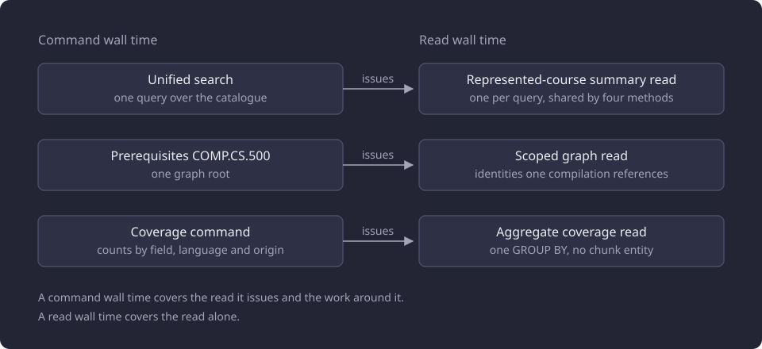

# Full-catalogue read projection

This report measures whether narrowing the full-catalogue reads to the columns and identities their callers use changed any result or the time a command or read takes.

**Evidence status:** Comparative. **Run date:** not recorded. The measurements were taken no later than 7 October 2026.

## The question

[Unified search](/docs/reference/glossary.md#search-and-comparison), the prerequisite command and the coverage command each read the catalogue. The [command line](/docs/backend/interfaces/command-line.md) page describes those commands. A full read loaded whole course rows, including every version, teaching text, curriculum period, prerequisite row and substitution row, although the caller used only a summary, an identity or a count.

A [projected read](/docs/reference/glossary.md#courses-and-the-catalogue) selects only the columns its caller consumes, and returns the same value for those columns as the full read. The line asked two questions. Could the product's full-catalogue reads select fewer columns and a narrower identity scope without changing their results? What would the narrower reads do to command wall time?

A full-catalogue read is one that returns rows for every represented course rather than for the identities one request names.

## The catalogue and the timing boundaries

The measured catalogue held 11,086 represented courses, of which 4,543 were active, and 58,962 teaching-text chunks. Each chunk carries a stored BGE-M3 vector of 1,024 components. The runs recorded no machine specification, and the [experiments section](/docs/experiments/README.md#the-catalogue-the-experiments-read) describes the shared catalogue.

Five measurements were recorded. Three are command wall times: unified search, the prerequisites command for `COMP.CS.500`, and the coverage command. Two are read wall times: the represented-course summary read that replaced a full course read, and the full-scope coverage read. A command time covers the read it issues and the work around it, so the command rows and the read rows measure different spans.

The diagram shows the three commands and the read each one issues.



These are full-catalogue times on the measured build. A separate line measured where one fixed-pool recommendation composition spends its time, and a later line measured the served read path. Those lines used other input sets and timing boundaries, and their values do not combine with these. [Recommendation composition overheads](/docs/experiments/recommendations/recommendation-composition-overheads.md) and [Served read path](/docs/experiments/runtime-storage-and-serving/served-read-path.md) report them.

## The projected reads

### The represented-course summary read

The read returns one row per represented course: the shared official summary columns plus the selected representative's identity. It returns no full course version, teaching text, curriculum period, prerequisite row or substitution row. Unrepresented courses are absent, and a selected representative with no persisted version raises the same `representative course versions are missing` error as the full read.

The read selects these columns.

```python
columns = [
    Course.group_id,
    Course.is_active,
    CourseVersion.sisu_course_unit_id,
    SourceSnapshot.source_hash,
    CourseVersion.name_fi,
    CourseVersion.name_en,
    CourseVersion.code,
    CourseVersion.credits_min,
    CourseVersion.credits_max,
    CourseVersion.official_url,
]
```

The summary is built by the same shared builder as the full read, so the field mapping has one source of truth. [Curriculum reads](/docs/backend/catalogue/curriculum-reads.md#the-shared-course-summary) describes the summary and the reads that consume it.

### One summary read per search

On the measured build, unified search performed one represented-summary read per query and passed the result to each lexical and semantic method. A method called on its own without that shared result read for itself.

### The aggregate coverage read

The coverage read is one aggregate `GROUP BY` over the field, language, origin and status of the chunk rows. It materializes no chunk entity, stored text or vector.

```python
statement = (
    select(
        CourseEmbeddingChunk.field,
        CourseEmbeddingChunk.language,
        CourseEmbeddingChunk.text_origin,
        CourseEmbeddingChunk.status,
        func.count(),
    )
    .join(CourseVersion, CourseVersion.id == CourseEmbeddingChunk.course_version_id)
    .join(Course, Course.id == CourseVersion.course_id)
    .group_by(
        CourseEmbeddingChunk.field,
        CourseEmbeddingChunk.language,
        CourseEmbeddingChunk.text_origin,
        CourseEmbeddingChunk.status,
    )
)
```

The read emits all 12 field, language and origin cells in enum order, including cells whose counts are zero, and sets the total chunk count to the sum of the buckets. The aggregate status counts equal the per-cell sums. The full-scope coverage read is this query with no course scope.

### The scoped graph read

On the measured build, the graph read seeded the target and retained course identities in one eager read, then read every other referenced course or module lazily through a per-compilation cache. It shared its loaders with the full reads, so identity filtering was the only behavioral difference. An identity absent from the database resolved to missing, and the hard-fail cases had the same outcomes.

## Results

The recorded command and read wall times:

| Measurement | Boundary | Before (s) | After (s) |
|---|---|---:|---:|
| Unified search | Command | 15.5 to 19.0 | 2.6 to 2.9 |
| Prerequisites `COMP.CS.500` | Command | about 14.5 | 2.35 to 2.44 |
| Coverage command | Command | 18.6 | 6.14 |
| Represented-course summary read | Read | 4.15 | 1.04 |
| Full-scope coverage read | Read | 13.5 | 0.28 |

Unified search fell from 15.5 to 19.0 s to 2.6 to 2.9 s. The prerequisites command for `COMP.CS.500` fell from about 14.5 s to 2.35 to 2.44 s, and the coverage command from 18.6 s to 6.14 s. The represented-course summary read fell from 4.15 s to 1.04 s, and the full-scope coverage read from 13.5 s to 0.28 s.

The chart draws every measurement at its recorded bounds, and a measurement with one recorded value has equal bounds.


The coverage command includes work beyond the coverage read, so its 6.14 s and the read's 0.28 s measure different spans. The represented-course summary read is one part of a search command that takes 2.6 to 2.9 s, and it replaced a full course read that took 4.15 s. The before column is the baseline a follow-up compares against.

## Parity

The `search`, `prerequisites` and coverage commands produced JSON outputs byte-identical by SHA-256 to their outputs before the projection on the full catalogue. Targeted tests, a network-free suite and a disposable-database integration gate also checked the change.

## Interpretation

Observed: every measured read and command became faster, and the three command outputs were byte-identical. Interpreted: the narrower read is consistent with the command reduction, because a command does not load rows it does not consume. The commands were not decomposed, so the share of each reduction that the narrower read accounts for is not measured.

## What the product reads

The projected represented-course summary read and the aggregate coverage read are the product's reads. Lookup reads, which resolve an identity or an official code and supply the summaries that search, next courses and recommendations use, answer from the lookup projection the supervisor builds before it forks its workers. A worker that was not forked from a preloaded supervisor raises an error instead of building its own. [Lexical lookup projection and native fuzzy matching](/docs/experiments/search-and-translation/lexical-lookup-projection-and-native-fuzzy.md#one-projection-inherited-by-four-workers) records that path.

The prerequisite graph compiles through the native compiler, which evaluates through the retained [native fact handle](/docs/reference/glossary.md#serving-data).

## Limitations

- The command times are not decomposed, so attributing a command reduction to the narrower read is an interpretation.
- The projection measurement carries no memory measurement and is not HTTP latency.
- The values come from one catalogue snapshot on one machine.

## Open questions

Each question below is untested.

- Whether the command reduction holds on a larger or smaller catalogue, or on another machine.
- How much of each command's reduction the narrower read accounts for, since no command was decomposed.
- The memory the projected reads retain.
- The whole-request HTTP latency of unified search, which no run measured.
- Whether approximate nearest-neighbour indexing or path-solver dominance pruning changes the command times. Neither ran in this line.
