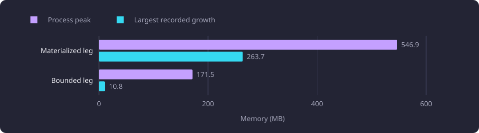

# Read memory and bounded reads

Three read shapes for one recommendation pool are compared by the client memory they retain and by whether the smallest returns the same result.

**Evidence status:** Comparative. **Run date:** 21 October 2026.

## The question

The recommendation read returns stored teaching-text chunks for a basis and a candidate pool. Each [chunk](/docs/reference/glossary.md#capture-and-data-preparation) carries its embedding vector and metadata. The read can materialize a Python carrier for every row, project only the descriptive fields in SQL, or stream rows into one matrix.

The question is how much client memory each shape retains, and whether the smallest shape returns the same result. [Recommendation ranking](/docs/backend/search-and-discovery/recommendation-ranking.md#recommendation-composition) describes the composition the read belongs to. The read-time saving of the projected read against the full read is measured in [Recommendation vectorization and narrow reads](/docs/experiments/recommendations/vectorization-and-narrow-reads.md).

A second group asks what a bounded cache of prepared data retains. One cache held prepared candidate matrices and one held one course's facts. Neither was the [497-entry descriptive chunk cache](/docs/experiments/runtime-storage-and-serving/descriptive-chunk-caching.md), which was measured separately.

The measurements use fixed cohorts and one pinned dataset. They make no HTTP, full-catalogue, retrieval-quality or semantic-quality claim.

## Fixed pools and conditions

The three bases are prefixes of one fixed representative order, and the candidate pools held 42, 435 and 1,874 ranked candidates. The fixed request used `basis="completed"`, `mode="all"`, `display_language="en"`, `include_inferred=false` and `active_only=true`. The selected set equals the completed set equals the basis.

| Setting | Value |
|---|---:|
| `RECOMMENDATION_CHUNK_TOP_K` | 40 |
| `RECOMMENDATION_MIN_RELATEDNESS` | 0.33 |
| `RECOMMENDATION_NEAR_DUPLICATE_PERCENT` | 90 |
| `RECOMMENDATION_OVERLAP_PENALTY_WEIGHT` | 0.0 |
| `COMPARISON_OVERLAP_FLOOR` | 0.20 |
| `COMPARISON_OVERLAP_CEILING` | 0.90 |

The search settings, embedding configuration, embedding hub and outcomes hub were pinned by digest. The dataset was pinned through its dataset receipt, and the required schema head was checked. Each measurement process ran alone after a free-memory check, under a 2.147 GB address-space limit. The category's shared measurement method and memory caps are in [Runtime, storage and serving experiments](/docs/experiments/runtime-storage-and-serving/README.md#the-shared-measurement-method).

The catalogue holds 11,086 represented courses, of which 4,543 are active, and 9,901 eligible module versions. The vectors are stored BGE-M3 embeddings with 1,024 components, so no embedding model ran during the measurements. The [catalogue the experiments read](/docs/experiments/README.md#the-catalogue-the-experiments-read) is stated on the section index. The run records no CPU model, and it records 24.1 GB of total memory.

| Basis | Basis full rows | Basis descriptive rows | Candidate full rows | Candidate descriptive rows | Retained results |
|---:|---:|---:|---:|---:|---:|
| 1 | 4 | 2 | 221 | 137 | 37 |
| 10 | 59 | 39 | 2,641 | 1,771 | 69 |
| 50 | 309 | 209 | 11,405 | 7,657 | 319 |

A full row is a stored chunk of any field, including the name field. A descriptive row is a content or learning-outcomes chunk. The product's recommendation command selects the content and learning-outcomes rows only, and the descriptive read matches that shape.

## Measurement units

Five memory measures are used, and they are not interchangeable. The category defines them in [Runtime, storage and serving experiments](/docs/experiments/runtime-storage-and-serving/README.md#memory-measures).

| Measure | What it counts | What it leaves out |
|---|---|---|
| Array bytes | The NumPy buffer of a matrix, from `array.nbytes` | Object metadata, allocator rounding, interpreter pages |
| Resident memory | The process's resident pages, from `VmRSS` | Pages that were never touched or were swapped out |
| Process peak | The resident-memory high-water mark, from `VmHWM` | Nonresident pages and per-stage attribution. The peak is process-wide and retains the warmup. |
| Python-traced memory | Python allocations, from `tracemalloc` | Extension buffers and allocator arenas |
| Object-graph bytes | A `sys.getsizeof` walk over Python objects, each shared object once | Per-instance bytes of a dict-backed structure that the walk does not reach |

A carrier is one Python object that holds a stored chunk's values and its vector. A streamed read partitions the rows in SQL and fills one matrix, and at most one partition of carriers is alive. The matched comparison calls its streamed leg the bounded leg.

The stages of one read sequence nest inside one process and are not additive. Process memory includes the interpreter, libraries and allocator arenas. A resident delta is not array bytes, and a cache bound that counts array or object-graph bytes is not a resident-set size.

## Full, descriptive and streamed reads

The full read selected every chunk field and returned one carrier per row. The descriptive read selected content and outcomes rows only and also returned carriers. The streamed read filled one float32 matrix and held one partition at a time. [Array storage and float precision](/docs/experiments/runtime-storage-and-serving/array-storage-and-float-precision.md) measures the storage widths.

Recorded wall seconds, one warmup and one recorded pass per sequence. The read sequences are read-only and do not include the consumer.

| Basis | Full basis | Full candidate | Descriptive basis | Descriptive candidate | Streamed candidate, 128 rows | Streamed candidate, 512 rows |
|---:|---:|---:|---:|---:|---:|---:|
| 1 | 0.016 | 0.361 | 0.011 | 0.248 | 0.171 | 0.180 |
| 10 | 0.104 | 4.695 | 0.087 | 3.467 | 2.035 | 2.032 |
| 50 | 0.513 | 21.677 | 0.372 | 16.581 | 9.977 | 10.117 |

The streamed basis reads took 0.009, 0.046 and 0.225 s at 128 rows, and 0.009, 0.045 and 0.223 s at 512 rows. Every timing is one recorded pass.

Resident growth for the 50-course basis. Each growth is measured from the resident size at the start of its sequence, and the resident size moves between sequences, so the growth and resident-after columns do not add down the table.

| Sequence | Resident growth (MB) | Resident after (MB) | Process peak (MB) |
|---|---:|---:|---:|
| Full basis read, 309 chunks | +3.7 | 143.6 | 157.7 |
| Full candidate read, 11,405 chunks | +233.9 | 374.4 | 753.2 |
| Descriptive basis read | 0.0 | 352.7 | 753.2 |
| Descriptive candidate read | +18.7 | 371.5 | 753.2 |
| Streamed candidate, 128 rows | 0.0 | 356.0 | 753.2 |
| Streamed candidate, 512 rows | +15.5 | 370.4 | 753.2 |

The growth on the candidate read for the three shapes is plotted below.

At the 50-course basis the full candidate read added 233.9 MB and set a 753.2 MB process peak. The descriptive candidate read added 18.7 MB. The streamed read held a 31,363,072-byte float32 matrix, 31.36 MB for 7,657 rows by 1,024 components, and added 15.5 MB at 512 rows. The 128-row partition added 0.0 MB. The two streamed deltas differ while the matrix is the same size, so the difference reflects allocator state, not matrix size.

The full candidate read holds every chunk as a carrier, so the 233.9 MB is carrier retention, not array bytes. The streamed read holds the matrix and one bounded partition. Resident memory did not return to the post-import baseline because Python allocator arenas remain resident, and this line makes no claim that freed carriers return memory to the operating system.

The streamed candidate read used two SQL statements of at most 1,000 triples each. At the 50-course basis it used 90 partitions at 128 rows and 23 at 512 rows, with a largest partition of 128 or 512 rows. Its chunk digest equals the saved descriptive digest, and the recorded streamed row counts equal the full-read counts. The full-row equality is recorded but not a code-enforced assertion, so a skipped non-descriptive row would not fail the comparison.

## The matched bounded read

The matched comparison ran two legs in separate processes. Both used the same 50-course basis metadata, the same 50 basis triples, the same 1,874 candidate triples, the same 1,874 course summaries and the same float64 consumer. The rows were 309 basis rows and 11,405 candidate rows, of which 7,657 were descriptive. No float32 path ran, so every numeric comparison used float64.

The materialized leg read descriptive rows only, as the product descriptive read does, and matched both descriptive digests. The bounded leg streamed every stored row in partitions of at most 256 rows and matched the candidate all-row digest, the candidate descriptive digest and the basis descriptive digest. Its basis all-row digest covered 309 rows and equalled the unfiltered basis read. Both legs produced the same ordered result digest and the same descriptive carrier digests.

| Parity against the product reference | Result |
|---|---|
| Result count | 319 of 319 |
| Exact payload matches | 319 of 319 |
| Membership changes | 0 |
| Order changes | 0 |
| Relatedness, score and overlap changes | 0, 0, 0 |
| Maximum absolute numeric delta | 0.0 |
| Course payload changes | 0 |
| Derived flag changes | 0 |
| Exact tie pairs preserved | 27 of 27 |
| Added or removed results | 0 |

Both legs scored 1,874 groups with chunks, 1,532 below the relatedness floor, 23 near-duplicates and 319 results.

| Leg | Warmup wall (s) | Recorded wall (s) | Fresh baseline RSS (MB) | Warmup growth (MB) | Recorded growth (MB) | Peak RSS (MB) |
|---|---:|---|---:|---:|---|---:|
| Materialized | 19.816 | 11.003, 11.069, 11.035 | 113.7 | 432.7 | 263.7, 252.1, 246.8 | 546.9 |
| Bounded | 23.699 | 13.000, 12.952, 13.259 | 113.9 | 53.5 | 9.8, 10.8, 5.0 | 171.5 |

The two legs share the consumer and differ in how the rows reach it. The diagram shows the shared input, the rows each leg holds and the result both returned.

The process peak and the largest recorded sample growth of the two legs are plotted below.

The bounded leg lowered the process peak by 375.4 MB and each recorded sample growth by 241 to 254 MB. It was about 2 s slower per recorded sample, 17 to 20 percent, 10.0 s over the four sample runs and 9.3 s over the whole process.

A process peak belongs to the sequence that produced it. The 753.2 MB peak in the growth table came from the full candidate read of 11,405 rows in its own sequence, which started from a 139.8 MB post-representative baseline. The matched materialized leg read 7,657 descriptive rows from a 113.7 MB fresh baseline and peaked at 546.9 MB. Subtracting 171.5 from 753.2 would charge a difference in read shape, row count and process state to the bounded read, so the paired result is 546.9 to 171.5 MB.

The materialized carrier arithmetic is 255.0 MB from 7,657 descriptive rows at 33,309 bytes per measured carrier, consistent with the recorded growth. The bounded leg holds one candidate group's carriers and one row partition. The warmup sets the process high-water mark, which masks the per-sample peak excess, so the warmup growth and the per-sample resident deltas are the evidence.

## Prepared caches

Two measurements retained prepared data in a bounded cache. Neither was the 497-entry per-process descriptive chunk cache, whose retained budget and warm-tail saving are described in [Descriptive chunk caching](/docs/experiments/runtime-storage-and-serving/descriptive-chunk-caching.md). That cache was selected and applied, then replaced by the shared float64 chunk store.

### Prepared matrices

Two prepared candidate matrices from the fixed 50-course basis vectors, 31,363,072 and 31,358,976 bytes, or 31.36 MB each, were requested through a bounded cache with a 2 s expiry and six calls per policy. The policies ran sequentially in one process, so allocator state carries between them.

| Bound | Calls | Hits | Misses | Expiries | Evictions | Retained before clear | Resident before and after clear (MB) |
|---|---:|---:|---:|---:|---:|---|---|
| None | 6 | 0 | 6 | 0 | 0 | 0 bytes | 196.5 to 196.5 |
| 33.6 MB | 6 | 1 | 5 | 1 | 3 | 31,358,976 bytes | 228.0 to 165.5 |
| 134.2 MB | 6 | 2 | 4 | 2 | 0 | 62,722,048 bytes | 259.4 to 196.9 |

A 33.6 MB bound holds one of the two matrices, so a second key evicts the first. A 134.2 MB bound holds both, and expiry removes each after the 2 s window. After clearing the 134.2 MB cache, resident memory fell by 62,488,576 bytes, 62.49 MB, which matches the two held matrices within allocator granularity. The 33.6 MB release is larger than its retained bytes because it follows the no-cache policy in the same process.

### Course facts

Each entry was one course's immutable summary, normalized name and code, title tokens and every stored chunk carrier, with the dataset, the embedding configuration, the embedding hub and the exact source identity. No basis vector, eligibility, candidate pool or final compiled tree was cached.

Each policy ran one cold six-call sequence in a fresh process. The four requested courses were the candidates with the most stored chunk rows, ordered by row count and then group identity.

| Key | Chunk rows | Entry graph bytes | MB |
|---|---:|---:|---:|
| A | 25 | 828,510 | 0.83 |
| B | 20 | 663,776 | 0.66 |
| C | 18 | 597,782 | 0.60 |
| D | 16 | 531,942 | 0.53 |

| Bound | Misses | Hits | Expiries | Evictions | Retained graph before clear | Peak RSS (MB) | Post-clear RSS (MB) |
|---|---:|---:|---:|---:|---|---:|---:|
| None | 6 | 0 | 0 | 0 | 0 bytes | 148.3 | 148.3 |
| 33.6 MB | 5 | 1 | 1 | 0 | 2,622,010 bytes | 159.6 | 159.6 |
| 134.2 MB | 5 | 1 | 1 | 0 | 2,622,010 bytes | 159.9 | 159.9 |

The four entries total 2,622,010 bytes, 2.62 MB, far below the 33.6 MB bound. The 33.6 MB and 134.2 MB bounds are not exercised at the measured per-course payload size and no eviction occurs. Whole-entry arithmetic at the largest measured entry gives 40 entries at 33.6 MB and 161 entries at 134.2 MB. The bounds count object-graph bytes, not resident memory.

A cold miss issued one SQL statement, and a hit issued none. The first A call took 0.203 to 0.214 s, each other cold miss 0.136 to 0.162 s, the hit 0.000 s and the expired A call 0.198 to 0.199 s.

Expiry works on access. Key A expired after the 2 s window and was re-read on the sixth call. The deadlines of B, C and D also passed before that call, and those entries stay retained until their key is requested or the cache clears.

Post-clear resident memory was 15.9 to 16.2 MB above the fresh baseline, while the Python-traced figure returned to about 0.11 MB above it. The no-cache process ended 5.0 MB above its baseline. Entry sizing walks allocate a transient identity set, so a call's resident growth and time include that accounting work.

Neither prepared cache became a product facility. The matrix bounds count array bytes and the course-fact bounds count object-graph bytes, so neither is a resident-set size. The course-fact bounds never bind at the measured payload, so no eviction cost is measured, and Python-allocation retention and a cache-specific process peak were not recorded. A cache budget has to come from the intended entry count, and these measurements give no product budget.

## Direct-prerequisite raw-input reuse

The reuse question asks whether the raw course and module inputs of one prerequisite compilation can be retained across compilations. One comparison used a fixed single-course basis with five candidate ids and five compilations. It read 63 SQL statements and retained 122 canonical courses, five modules, five inferred reads and 106 equivalence reads. The serialized JSON character count of the retained courses and modules was 424,688, which excludes the inferred and equivalence cache entries and is not a UTF-8 byte measure.

That basis made no candidate eligible, so the product's official second pass, which compiles the discovered targets, had zero targets. The shared-context and fresh-context passes both executed zero statements and returned empty lists. Both result lists are empty, so the digests match and the comparison answers nothing about reuse. The raw-input retention and the read count were measured, and the reuse saving was unmeasured on that basis.

A comparison with five nonempty candidate targets and five compilations answered the question. The projection read used five statements.

| Pass | SQL statements | Wall range over recorded samples (s) | Compilations | Output digest |
|---|---|---:|---:|---|
| Shared-context cold | 63 | 0.4568 to 0.5743 | 5 | Identical |
| Shared-context reused | 0 | 0.0582 to 0.0816 | 5 | Identical |
| Fresh-context cold | 63 | 0.4167 to 0.4692 | 5 | Identical |

The three full compilation digests are identical. The reused pass saved all 63 statements, and the fresh pass issued the same 63. The reuse saved about 0.40 to 0.49 s per pass on this basis.

| Retained raw context | Count |
|---|---:|
| Courses | 122 |
| Modules | 5 |
| Inferred reads | 5 |
| Equivalence reads | 106 |
| Retained missing courses | 0 |
| Retained missing modules | 0 |
| Total Python object graph | 889,691 bytes |

The fresh-context graph was 889,636 bytes. The 55-byte difference is not attributed further, and the fact counts are identical. The process peak was 148.9 MB, and the first sample added 13.0 MB over the post-setup baseline.

The cached values are raw course and module inputs and retained absence. Policy enters the compilation context: `include_inferred`, `active_only`, the retained ids and the caller's selected and completed sets. A dataset-keyed cache of final compilations would be a caller-state or eligibility cache, so final compiled trees are not a safe dataset-only cached fact. Only policy-independent raw source projections are reusable.

## What the evidence supports

The observation is that the full carrier read is the dominant client memory cost in this line. At the 50-course basis it added 233.9 MB and set a 753.2 MB process peak in its own sequence. The descriptive read added 18.7 MB, and the streamed read held a 31.36 MB matrix and one partition.

The observation is that the matched bounded read reproduces the product result on the fixed pool. It returned 319 of 319 results with no membership, order, value or flag change and all 27 exact tie pairs, at a 171.5 MB peak against 546.9 MB. The measured cost was about 2 s per recorded sample, or 17 to 20 percent slower.

The interpretation is that the lower peak comes from holding one partition and one candidate group's carriers instead of every carrier. That is a reading of the two leg values, not a stage attribution, because the legs ran in separate processes.

The observation is that the four measured course facts are 0.53 to 0.83 MB each, and that the 33.6 and 134.2 MB bounds were not exercised.

The observation is that reused raw context removed all 63 compile statements and reproduced the compilation digest with 0.89 MB of retained facts on one basis. The interpretation is that the retained policy-independent inputs let the compilation repeat without a read.

## Where the line ended

The matched comparison drew no product memory budget, cache budget or float32 promotion. The matrix and course-fact caches stayed experimental. The matched run made no product, schema, model or configuration change.

The 21 October values describe the measured build. Its descriptive read was a SQL projection that returned one carrier per row, and both matched legs scored with the same float64 consumer.

The product answers the same read from the shared float64 chunk store, and its recommendation scorer marshals those rows in native code. [Serving artifact build and shared stores](/docs/experiments/runtime-storage-and-serving/serving-artifact-build-and-shared-stores.md) describes that store. The measured streaming leg therefore describes the measured build, not the product read. The 497-entry per-process descriptive chunk cache was selected and applied, then replaced by the shared float64 chunk store. Its retained budget is described in [Descriptive chunk caching](/docs/experiments/runtime-storage-and-serving/descriptive-chunk-caching.md). The served read path measured on 28 October 2026 is a separate account, in [Served read path](/docs/experiments/runtime-storage-and-serving/served-read-path.md).

## Limitations

The category's shared boundaries, including the fixed captured pools and the in-process measurement, are in [Runtime, storage and serving experiments](/docs/experiments/runtime-storage-and-serving/README.md#the-boundaries-of-the-shared-method).

- The full-row equality of the streamed read is recorded but not a code-enforced assertion. A skipped non-descriptive row would not fail it.
- The two read legs ran in separate processes. Their match rests on identical ordered output and carrier digests and exact product-reference parity.
- Warmup sets the process high-water mark, so the per-sample peak excess is masked. The warmup growth and the per-sample resident deltas are the evidence.
- The cache bounds count array bytes or object-graph bytes, not resident memory, and they are not product budgets. Neither bound is exercised at the measured per-course payload, and no eviction cost is measured.
- Cache expiry works on access. Expired entries stay retained until requested or cleared, and entry sizing adds a transient identity set to each call.
- The direct-prerequisite reuse comparison uses one fixed basis course and one candidate projection, with a warm database cache. It covers five targets and one basis.

## Baselines

A follow-up on the same pools and the same 50-course basis compares against these values.

| Baseline | Value |
|---|---|
| Materialized leg peak and recorded growth | 546.9 MB and 246.8 to 263.7 MB |
| Bounded leg peak and recorded growth | 171.5 MB and 5.0 to 10.8 MB |
| Materialized and bounded recorded wall | 11.003 to 11.069 s and 12.952 to 13.259 s |
| Full candidate read in its own sequence | 233.9 MB growth and a 753.2 MB peak |
| Descriptive candidate read | 18.7 MB growth |
| Streamed matrix at the 50-course basis | 31,363,072 bytes, 31.36 MB |
| Prepared matrix and course fact | 31.36 MB and 0.53 to 0.83 MB |
| Reuse on one basis | 63 statements removed and 889,691 bytes of retained facts |
| Request flags and settings | The table in [Fixed pools and conditions](#fixed-pools-and-conditions), because another basis or pool changes every value |

## Untested questions

Each question below is untested.

- Whether the bounded read returns exact parity on another pool, another basis size or a display language other than English.
- What a per-request streaming read retains when its rows come from the shared float64 store rather than a database projection.
- Whether a product memory bound holds the bounded read under concurrent requests in one worker process.
- Whether a cache budget based on an intended entry count evicts under load, and what that eviction costs.
