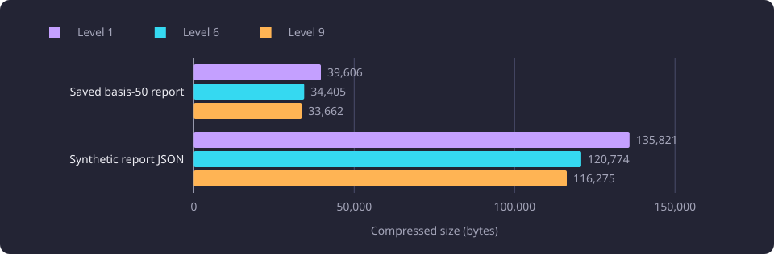
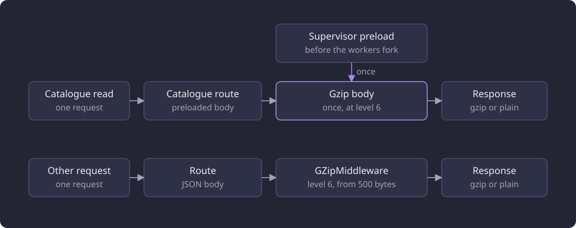

# Response compression levels

This report compares gzip levels 1, 6 and 9 on a saved report and a report-shaped payload by size, time and decoded bytes.

**Evidence status:** Comparative. **Run dates:** 21 October 2026, and 28 October 2026 for the served catalogue result.

## The question

The application returns JSON reports over HTTP. A gzip level sets how much work the encoder spends finding repetition in a body. A higher level produces a smaller body and costs more time on every response it compresses, so the choice trades bytes on the wire against CPU in the worker process.

The line asked which level gives a size saving that justifies its compression time, and whether every level returns the same bytes after decoding. The second question decides whether a level can change without changing a response.

A third question followed from the served path. The catalogue body holds the same bytes on every request, so compressing it per request repeats identical work. That path is measured separately on [Serving artifact build and shared stores](/docs/experiments/runtime-storage-and-serving/serving-artifact-build-and-shared-stores.md).

## Payloads and samples

Two payloads were compressed. The first is a saved basis-50 recommendation report of 152,191 bytes, serialized from the fixed 50-course basis of one captured catalogue of 11,086 represented courses. The second is an explicitly synthetic body of 1,274,526 bytes shaped like a report. The synthetic body adds a second size and repetition pattern, and it is not a captured product response.

Each payload was compressed at levels 1, 6 and 9 in one process. The recorded value is the wall median of three samples after one warmup. Every level decoded to the same SHA-256 bytes as its plain payload, on both payloads.

The measurement covered compression of already-serialized bytes only. It excluded report serialization, HTTP transfer and the event-loop middleware path, so it supports no HTTP or transfer claim. One heavy process ran at a time under Python 3.14.3, with one fatal 60-second sample timer and a 2,147,483,648-byte address-space limit.

## Compressed size and time

| Payload | Plain bytes | Level | Compressed bytes | Compression time (s) |
|---|---:|---:|---:|---:|
| Saved basis-50 report | 152,191 | 1 | 39,606 | 0.00148 |
| Saved basis-50 report | 152,191 | 6 | 34,405 | 0.00304 |
| Saved basis-50 report | 152,191 | 9 | 33,662 | 0.00438 |
| Synthetic report-shaped JSON | 1,274,526 | 1 | 135,821 | 0.00703 |
| Synthetic report-shaped JSON | 1,274,526 | 6 | 120,774 | 0.01510 |
| Synthetic report-shaped JSON | 1,274,526 | 9 | 116,275 | 0.03248 |

The compressed size at each level is plotted below.



The relative change at each step is below. The compression time is a ratio of the wall medians in the table.

| Comparison | Saved basis-50 report | Synthetic report-shaped JSON |
|---|---|---|
| Level 6 against level 1, compressed size | 13.0 percent smaller | 11.1 percent smaller |
| Level 6 against level 1, compression time | about 2.1 times | about 2.1 times |
| Level 9 against level 6, compressed size | 2.2 percent smaller | 3.7 percent smaller |
| Level 9 against level 6, compression time | 1.4 times | 2.2 times |

Level 1 was the cheapest level in compression time. Level 6 reduced the saved report by 13.0 percent and the synthetic payload by 11.1 percent against level 1, at about 2.1 times the compression time on both. Level 9 reduced a further 2.2 percent and 3.7 percent against level 6, at 1.4 and 2.2 times the compression time of level 6.

The interpretation is that level 6 is the size and CPU compromise on both payloads. The step from level 1 to level 6 carries the larger share of the size reduction on both, and the step from level 6 to level 9 adds a few percent more at a larger time multiple.

## The applied level

The application registers gzip compression on the feature application at level 6, with a minimum response size of 500 bytes. A response body of at least that size is compressed for a client that accepts gzip. A smaller response, or one that already carries a `Content-Encoding`, is sent without further compression.

```python
application.add_middleware(GZipMiddleware, minimum_size=500, compresslevel=6)
```

[Web routes](/docs/backend/interfaces/web-routes.md) describes the application surface that registers the middleware.

The catalogue body takes a second path. The supervisor appends the serving dataset identity to the catalogue artifact and compresses that body once at level 6 before it forks the worker processes. A client whose `Accept-Encoding` admits gzip receives the compressed body with `Content-Encoding: gzip`, and every other client receives the plain body. [Serving state](/docs/backend/interfaces/serving-state.md#the-catalogue-artifact) describes the two answers and the retained bodies.

The two response paths are drawn below. The catalogue route answers from the body the supervisor compressed once, and every other response passes through the middleware.



The preloaded catalogue body therefore uses the level this comparison selected, and it pays the compression time once per supervisor start rather than once per request.

## The served catalogue body

On 28 October 2026 the served path measured per-request compression against a body compressed once. Per-request compression repeated the same zlib work on the same bytes for every request, and the supervisor-compressed body is the form the product serves. [Serving artifact build and shared stores](/docs/experiments/runtime-storage-and-serving/serving-artifact-build-and-shared-stores.md) owns those numbers.

That measurement ran on one serving build and one catalogue. The compression samples above cover two payloads and no served request, so the two results answer different questions and their values do not add.

## Failed approaches and dropped designs

Level 9 was measured and not selected. It reduced compressed size by a further 2.2 percent on the saved report and 3.7 percent on the synthetic payload against level 6, at 1.4 and 2.2 times the compression time of level 6. On the synthetic payload, level 9 is 116,275 bytes in 0.03248 s against 120,774 bytes in 0.01510 s at level 6. The level 9 step therefore adds the largest time multiple in the comparison for a 2.2 and 3.7 percent size reduction.

Per-request compression of the catalogue body was measured and dropped in favour of the preloaded body. Its output matched the plain body, and its cost was the full compression time on every request for a body that does not change between requests. Compressing the body once before the workers fork removes that repeated work, and the served measurement that compared the two paths is on the linked page.

## Limitations

The boundaries of the shared method for this category are stated in [Runtime, storage and serving experiments](/docs/experiments/runtime-storage-and-serving/README.md#the-boundaries-of-the-shared-method). The conditions specific to this comparison follow.

- The comparison rests on two payloads in one process, with three samples per level and no recorded spread. The ratios are ratios of wall medians.
- The synthetic payload is synthetic. Its ratio describes a body with a report-like shape and repetition, not a product response.
- Compression of already-serialized bytes is not a request measurement. Report serialization, transfer, content negotiation and client decoding are outside the samples, and the compression time is not a request latency.
- One saved basis-50 report supplies the product-shaped sample. A graph report, a next-course report or a catalogue body has its own repetition and may compress differently.
- The catalogue result comes from a separate served measurement on one build. It compares two paths on the same body, not the levels on that body.

## Baselines

A follow-up compares against the applied settings and the level 6 values.

| Baseline | Value |
|---|---|
| Reference level | gzip level 1 |
| Applied level for responses | gzip level 6 |
| Smallest compressed response | 500 bytes |
| Saved basis-50 report at level 6 | 34,405 bytes, 0.00304 s |
| Synthetic report-shaped JSON at level 6 | 120,774 bytes, 0.01510 s |
| Catalogue body | compressed once at level 6 before the worker processes fork |

## Untested questions

Each question below is untested.

- Whether level 6 stays the compromise on other bodies, such as a graph report, a next-course report or a catalogue body, at their own size and repetition.
- What the middleware costs per request on the event loop, and what a client observes after transfer and decoding.
- Whether brotli on the same payloads beats gzip level 6 at an acceptable compression time.
- Whether a level chosen per route serves bytes and CPU better than one level for every response.
