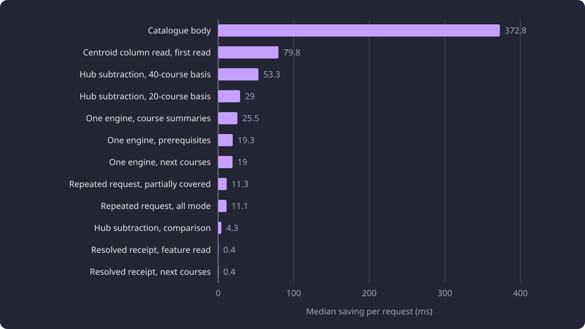

# Served read path

Six per-request costs on the served path of 28 October 2026 were removed without changing a response body, and each saved between 0.4 and 372.8 milliseconds.

**Evidence status:** Comparative. **Run date:** 28 October 2026.

## The question

The web server answers each read by resolving the served dataset, opening a database engine, reading stored rows, computing a report and serializing it. On the measured build, part of that work repeated on every request although its result could not change between requests.

The selected dataset receipt was parsed again, a database engine was created and disposed, the catalogue report was built and serialized, a repeated next-course request was resolved from its identities, the centroid matrix was loaded as one entity per row, and the [embedding hub](/docs/reference/glossary.md#capture-and-data-preparation) was subtracted row by row in Python.

The question was which of those costs could be removed without changing a response, and what each removal saved. A change counted only when the served body of its endpoint matched the baseline body.

Two further served changes of the same runs are reported elsewhere. The semantic method stopped repeating its represented-summary read, which [Exact and approximate semantic retrieval](/docs/experiments/search-and-translation/semantic-retrieval.md#the-served-search-request) reports, and the stored neighbour table replaced the per-request nearest-chunk scan, which [Nearest-neighbour retrieval for recommendations](/docs/experiments/recommendations/nearest-neighbour-retrieval.md#latency-before-and-after-the-stored-read) reports.

## Method and setup

The measured build served one dataset of 11,086 canonical courses, 58,962 teaching-text [chunks](/docs/reference/glossary.md#capture-and-data-preparation) and 8,996 [course centroids](/docs/reference/glossary.md#discovery-and-the-structure-of-studies).

One supervisor and four [worker processes](/docs/reference/glossary.md#administration) ran behind the front router on a loopback listener. The requests were read-only, and the process kept one [serving dataset identity](/docs/reference/glossary.md#configuration) for the whole run.

Each label ran two warm-up calls and five measured calls, and the tables report the median of the five. The requests were the feature read, the catalogue response, course summaries, prerequisites, the two next-course requests in All mode and in Partially covered mode, recommendations on a 20-course and a 40-course basis, and one comparison.

The before value of each result is the preceding run of the same measurement series, not the first baseline matrix. Each change was checked against the baseline body. A change was kept when the body digest was identical, and the centroid read was kept on equal body bytes.

A final verification run repeated the whole matrix under a new serving generation. Every response carries the serving dataset identity, so those bodies differ from the baseline by that value alone.

The values are medians of five calls per label in one generation. No concurrent load ran, and no request was decomposed into stages.

## What each removal saved

The saved column is the difference between the two medians on the same row.

| Cost removed | Endpoint | Before (ms) | After (ms) | Saved (ms) | Body check |
|---|---|---:|---:|---:|---|
| One engine per dataset identity | Course summaries | 69.3 | 43.8 | 25.5 | identical digest |
| One engine per dataset identity | Next courses, All mode | 37.5 | 18.5 | 19.0 | identical digest |
| One engine per dataset identity | Prerequisites | 149.5 | 130.2 | 19.3 | identical digest |
| One resolved receipt per pointer state | Feature read | 6.3 | 5.9 | 0.4 | identical digest |
| One resolved receipt per pointer state | Next courses, All mode | 7.5 | 7.1 | 0.4 | identical digest |
| Retained catalogue body | Catalogue response | 512.1 | 139.3 | 372.8 | identical digest |
| Repeated next-course request | Next courses, All mode | 18.6 | 7.5 | 11.1 | identical digest |
| Repeated next-course request | Next courses, Partially covered mode | 19.2 | 7.9 | 11.3 | identical digest |
| Centroid column read | First recommendation, 20-course basis | 2,476.8 | 2,397.0 | 79.8 | body bytes equal |
| Served hub subtraction | Recommendation, 20-course basis | 854.3 | 825.3 | 29.0 | identical digest |
| Served hub subtraction | Recommendation, 40-course basis | 2,018.5 | 1,965.2 | 53.3 | identical digest |
| Served hub subtraction | Comparison | 35.2 | 30.9 | 4.3 | identical digest |

The retained catalogue body carried most of the removable cost. Every other removal saved 79.8 ms or less on its endpoint, and the two receipt labels saved 0.4 ms each. The chart orders the same savings from largest to smallest.



## How each removal worked

### One engine per dataset identity

Every dataset route read through the one serving engine held for the serving dataset identity, so a request no longer created and disposed an engine and its connection pool. A new identity built an engine for the new dataset, and the previous engine stayed open while a request could still hold it. No endpoint in the matrix regressed.

The earlier fixed-pool comparison held one experiment-local engine across repetitions and changed a complete composition by -35.37, -3.69 and +1.50 percent, with engine creation at 0.0004 s inside a composition. That comparison measured reuse within one process on fixed pools. The served change keeps the engine and its pool across requests, so the two results have different boundaries and do not contradict each other.

### One resolved receipt per pointer state

The selected dataset receipt was parsed once and reused while the selected pointer and the receipt kept the same modification times and sizes. The memo key is the state root, the pointer modification time and size, and the receipt modification time and size.

```python
key = (
    str(state_root),
    pointer_stat.st_mtime_ns,
    pointer_stat.st_size,
    receipt_stat.st_mtime_ns,
    receipt_stat.st_size,
)
```

A rewrite of either file changes the key, and the next request re-reads the receipt. The pointer is still read to name the receipt path. The fall is consistent with reusing the resolved receipt. The request was not decomposed, so the measurement does not separate the receipt read from the remaining request work.

### The retained catalogue body

The first catalogue read built the report and serialized it once, and every later read returned the retained body. The body belonged to one serving dataset identity, so a new identity built and serialized the report again. The body is 5,878,209 bytes (5.88 MB), under the measured build's bound of 8,388,608 bytes (8.39 MB), and a body above that bound raised one error.

The retained body skips the report build and the serialization on every read after the first. The catalogue fall is consistent with that removed work.

### The repeated next-course request

A repeated next-course request was answered from the raw request body before the selected identity and its receipt were resolved. The raw key carries the selected and completed tuples plus the basis, the mode, the display language, the inference flag and the activity flag.

A raw alias returned the canonical report when its canonical entry existed, so the repeated read avoided the resolve. An alias was removed with its canonical entry. The fall is consistent with removing the identity resolve, and the request was not decomposed, so it does not separate the resolve from the remaining forwarding and report work.

### The centroid column read

The centroid loader selected the columns it consumes, ordered by group identity, instead of loading whole centroid entities. The load therefore built no entity for the 8,996 rows, and the completeness count and the key checks stayed the same.

The named endpoint was the first recommendation on a 20-course basis after a worker restart, one call before and one call after the change. The warm median of the same endpoint moved from 851.6 to 848.3 ms, inside the run spread of that label. The change is a startup saving, and the matrix values and the arithmetic are unchanged.

### The served hub subtraction

The embedding hub subtraction, which centres every vector on its field's hub, became one function for one row or for many rows. Both the single-vector subtraction and the unit-row conversion call it, and the comparison meters run on float64 NumPy arrays. The arithmetic and the clamping are unchanged.

```python
def subtract_hub(vector, hub):
    return tuple(subtract_hub_rows((vector,), (TeachingTextField.NAME,), hub, hub)[0].tolist())
```

The recommendation and comparison bodies of the measured requests kept identical digests. That parity compares the served body, while a scorer-only comparison measures a fixed-pool scorer output. The saving is smaller than a scorer-only saving because the endpoint median covers the whole request and the arithmetic is one stage of it.

## Where the removals sit on the path

The diagram shows the six removals on the measured build, each beside the structure the request reused instead of rebuilding. The receipt memo and the engine sit at the front of every request, and the catalogue body, the report alias, the centroid columns and the subtraction primitive replace work a request would otherwise repeat.


## Interpretation

The observation is that every removal lowered the median of the endpoints that ran the removed work, and that no served body changed. The observation is also that the size of the fall follows the work removed. A report build and serialization saved 372.8 ms on the catalogue response, while a memoized parse saved 0.4 ms on the feature read.

The interpretation is that the falls are consistent with the removed work, because each change removed exactly that work and left the body identical. The measurement does not decompose a request, so no stage-by-stage attribution is claimed. Each of the six changes was selected and applied on its own measurement.

## What the CPU port replaced

The CPU port replaced the per-worker retention of the measured build with one preloaded serving artifact set. No worker keeps its own copy of the catalogue body, the centroid matrix or the descriptive chunks.

The serving artifact build writes the catalogue body, and the supervisor appends the serving dataset identity and compresses it once before it forks the workers, so no request builds, reads or compresses it. The centroid matrix and the descriptive chunk store are read-only mapped files that every worker shares, and the next-course report cache is one shared region that the supervisor creates before it forks the workers. [Serving artifact build and shared stores](/docs/experiments/runtime-storage-and-serving/serving-artifact-build-and-shared-stores.md) describes the build and the stores.

The engine per dataset identity, the receipt memo, the raw next-course alias and the one subtraction primitive are part of the served path.

## Limitations

- Five measured calls per label in one generation give medians, not distributions. No concurrent load ran.
- Requests were not decomposed, so each fall rests on the change and on the identical body, not on a stage timer.
- The before value of each row is the preceding run of its series, so each saving carries that run's variation. A difference of a few tenths of a millisecond is not distinguishable from it.
- The centroid column read is one call before and one call after a restart, and its warm row lies inside the run spread.
- These runs record no hardware specification, so their milliseconds do not transfer to another machine.
- One dataset and one selection ran. A pointer switch or a receipt rewrite under load was not measured.

## Baselines

A follow-up compares against the before medians in the results table, with the same request bodies, one serving generation, two warm-up calls and five measured calls per label, and a body digest compared with the same baseline.

The final verification run measured these medians under a new serving generation.

| Label | Final median (ms) |
|---|---:|
| Feature read | 5.9 |
| Catalogue response | 138.5 |
| Course summaries | 41.9 |
| Prerequisites | 129.0 |
| Next courses, All mode | 7.4 |
| Next courses, Partially covered mode | 7.3 |
| Comparison | 30.2 |

The next-course final values carry all three next-course changes of this page. The two recommendation labels are left out because a further served change replaced their nearest-chunk read, which [Nearest-neighbour retrieval for recommendations](/docs/experiments/recommendations/nearest-neighbour-retrieval.md#latency-before-and-after-the-stored-read) reports, so their final medians do not belong to this comparison.

## Open questions

Each question below is untested.

- Whether the same removals hold their medians under concurrent requests, where the report cache and the engine pools are exercised at once.
- Whether a per-request decomposition attributes each fall to the removed work in the proportion the medians suggest.
- Whether the receipt memo holds its saving when the selected pointer is switched while requests run.
- Whether the engine per identity and the receipt memo save the same amounts on another dataset identity.
