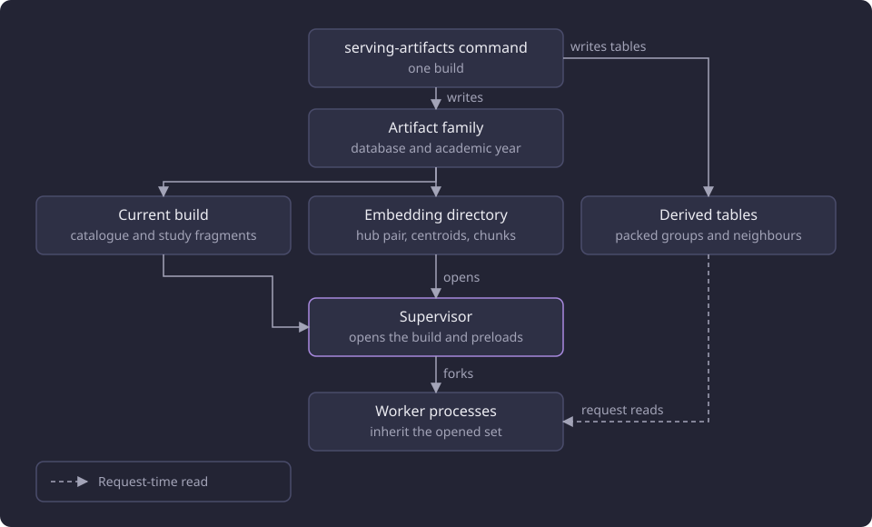
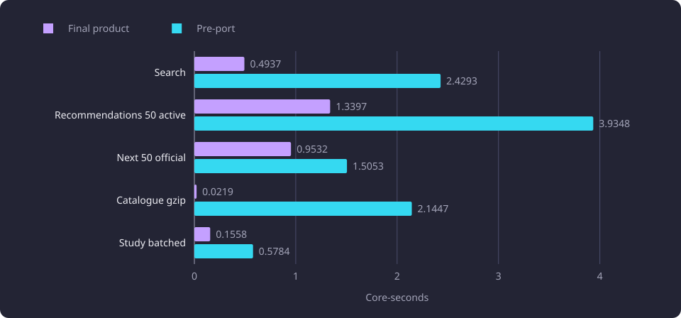

# Serving artifact build and shared stores

This report measures what one prebuilt serving artifact set and shared serving stores cost in build time, disk, CPU and memory, and what they save per request.

**Evidence status:** Comparative. **Run dates:** 28 to 30 October 2026.

## The question

The serving path can read its catalogue, study structures, course centroids and descriptive chunks from the database on every request, or from files one [serving artifact build](/docs/reference/glossary.md#serving-data) prepares ahead of time. The files can be held by each [worker process](/docs/reference/glossary.md#administration), or mapped once and shared by every worker the supervisor forks.

The question is what the second arrangement costs and saves. The costs are the build time and the disk it writes, the supervisor preload at each start, and the memory the mapped files occupy. The savings are the per-request CPU of the catalogue, the study structure and the shared stores, the worker memory under a concurrent mixed load, and the first request after a cold start.

The report measures the arrangement as a whole and each part beside its pre-port or unshared counterpart. It does not measure retrieval or recommendation quality, and it makes no capacity claim beyond the 80-request protocol it ran.

## Setup and measurement

The measurements used one disposable copy of the selected dataset: 11,086 courses, 58,962 embedding chunks of which 18,183 are learning-outcomes chunks, 8,996 course centroids, 4,709,120 stored neighbour rows, 11,086 packed search groups and 461 blocks. The embedding configuration is the stored BGE-M3 configuration with 1,024 components. The machine is a four-core aarch64 server. PostgreSQL 18.6 with pgvector 0.8.6 ran in its own container, and the live read-only embedding provider ran in another.

CPU is core-seconds summed over the web, database and embedding cgroups. Wall time is reported beside it and is not the primary metric. The mixed protocol ran one supervisor, one router and four forked worker processes, one warm-up pass, then two rounds of ten request cases over four client threads, for 80 requests per web cap. The cases are search, recommendations at bases 50 and 60 in both activity scopes, three next-course requests, a study-structure batch and the catalogue. The web cap is the only cap that varies between the runs. The database and embedding peaks are container lifetime values that were never reset. The category's shared measurement boundaries are in [Runtime, storage and serving experiments](/docs/experiments/runtime-storage-and-serving/README.md).

A separate sequential matrix drove one request at a time through the application in one process, with warm caches except where a row says miss. The catalogue and study rows come from that matrix, and the mixed rows come from the four-worker protocol.

Cold rows ran each scenario in a fresh process with empty request and report caches under the category's cold protocol ([warm and cold states](/docs/experiments/runtime-storage-and-serving/README.md#warm-and-cold-states)). The supervisor preload is recorded apart from the request.

> [!NOTE]
> A second product run of the same 80-request protocol used the final admission settings. Its values are reported as the final product rows and are not a like-for-like rerun of the shared and unshared rows.

## One build and one artifact family

`scripts/admin.py serving-artifacts` runs the one builder. A build writes the catalogue body and one [study fragment](/docs/reference/glossary.md#serving-data) or marker for every study-structure root, and, on a site that serves the embedding features, the hub pair and the [shared serving store](/docs/reference/glossary.md#serving-data) files. With the embedding features on, the same transaction replaces the dataset's centroid rows, its neighbour rows and its packed search groups, blocks and meta row. The family's `current` link switches last, so a worker opens one complete build. [Serving artifact build](/docs/backend/text-and-vectors/serving-artifact-build.md) describes the files and the transaction.

The build measured for this report wrote one fragment entry for each of 11,141 study-structure roots: 9,901 projectable payloads, 1,240 unavailable markers and none that needed an explicit version selection. The fragment file is 145,812,544 bytes (145.81 MB) and took 25.18 seconds of wall time and 21.72 core-seconds. The catalogue response body is 5,878,209 bytes (5.88 MB) and holds 20,987 entries: 11,086 courses and 9,901 modules.

The centroid store is 8,996 rows of 1,024 float64 components, 73,695,232 bytes (73.70 MB), built in 1.185 seconds of wall time and 1.260 core-seconds. The descriptive chunk store holds 36,790 rows in 303,662,866 bytes (303.66 MB), built in 15.803 seconds of wall time and 11.409 core-seconds. The packed search relation holds 11,086 groups and 461 blocks. The blocks carry the dataset's 58,962 chunk vectors at 128 per block except the last partial block, and the packed relation is 251,904,000 bytes (251.90 MB), of which 250,904,576 bytes (250.90 MB) are its toast relation. The build wrote 4,709,120 neighbour rows. No separate build time was recorded for the packed tables or the neighbour rows.

| Output | Records | Size | Build wall s | Build core-s |
|---|---|---:|---:|---:|
| Study fragments | 11,141 roots, 9,901 projectable | 145.81 MB | 25.18 | 21.72 |
| Catalogue body (response) | 20,987 entries | 5.88 MB | not recorded | not recorded |
| Centroid store | 8,996 rows by 1,024 float64 | 73.70 MB | 1.185 | 1.260 |
| Chunk store | 36,790 rows | 303.66 MB | 15.803 | 11.409 |
| Packed search groups and blocks | 11,086 groups, 461 blocks holding 58,962 chunk vectors | 251.90 MB | not recorded | not recorded |
| Neighbour rows | 4,709,120 | not recorded | not recorded | not recorded |

Every study-structure root has one entry in the build's fragment file: 9,901 projected payloads, 1,240 unavailable markers and no version-selection marker. The 20-root request used in the study measurements maps a separate 182,908-byte (0.18 MB) file built for those roots. The chunk store holds the descriptive content and learning-outcomes chunks, 36,790 of the 58,962 chunks.

On a site that serves the embedding features, the build writes two things: files in the artifact family and rows in the dataset's derived tables. The supervisor opens the family's current build and, on a site that serves the embedding features, its embedding directory before it forks the workers, and the workers read the derived tables at request time. The diagram shows that split.

## The catalogue response

The catalogue is the largest response body the serving stack retains: a 5.88 MB JSON body held in plain and gzip form, against report entries of at most 37,888 bytes. The pre-port product compressed it in middleware on every request. The measured alternatives were a precompressed file served with `Content-Encoding: gzip` and the plain body served to identity clients.

| Variant | Encoding | Core-s | Wall s |
|---|---|---:|---:|
| Product middleware gzip | gzip | 0.11386 | 0.11385 |
| Product middleware pass-through | identity | 0.00256 | 0.00249 |
| Precompressed file | gzip | 0.00091 | 0.00086 |
| Precompressed file | identity | 0.00079 | 0.00072 |

Precompressed gzip removes 99.2 percent of the catalogue core-seconds. One compression of the body costs 0.1117 core-seconds, so the file is amortized after one gzip request. The gzip body is 1.01 MB and is one product compression at level 6, not a second encoder.

In the sequential matrix, the final product returns the retained gzip body and costs 0.0033 core-seconds against 0.1144 for the pre-port middleware gzip, 34.7 times fewer. The identity path costs 0.0029 against 0.0031, parity rather than a gain. A two-route prototype that returned the same bytes without settings resolution, dataset identity or route work cost 0.00091 core-seconds, and a matched control through the full application cost about 2.0 to 2.4 ms more than that prototype. Both the identity body and the gzip body decompress to the same 5,878,209 bytes and strip to the same SHA-256.

The product serves the same gzip body without a gzip file in the build. The supervisor appends the serving identity to the plain body and compresses it once at level 6 before it forks the workers. Each worker inherits both forms, and the route returns one of them, so no request reads or compresses the catalogue.

## Study structure reads

The study-structure endpoint projects a batch of requested roots. The product read issued one statement set per request and projected each root from the rows it read. The batched variant prefetched the reachable modules and course summaries once. The fragment variant stored the projected roots in one file and assembled the batch in caller order.

Five samples each, with three cold samples. The response digest was identical across all variants.

| Variant | Core-s | Database core-s | Wall s | SQL statements | Retained body |
|---|---:|---:|---:|---:|---|
| Product read | 0.8045 | 0.4835 | 0.762 | 241 | per-request projection |
| Batched reads | 0.1617 | 0.0804 | 0.153 | 19 | per-request projection |
| Disk fragments, warm | 0.0158 | 0.0000 | 0.0147 | 0 | 0.18 MB file |
| Disk fragments, cold | 0.0159 | 0.0000 | 0.0148 | 0 | 0.18 MB file |

Batched reads save 80 percent of the endpoint core-seconds, and fragments save 98 percent. In the sequential matrix, the final product's batched route costs 0.1248 core-seconds against 0.5623 for the pre-port read, 4.51 times fewer, and issues 29 SQL statements. The fragment route costs 0.0128 core-seconds, issues no SQL statement and returns the same parsed report. A request with explicit module version selections bypasses the fragment file and uses the batched path.

The fragment file is read with `mmap`, so four workers map one file and the page cache holds one copy. The fragment path added about 0.5 MB to the process resident set between the batched and fragment samples. The file is keyed by dataset identity and academic year, so a changed year or dataset does not read a stale file.

## Shared centroid and chunk stores

The shared stores are read-only files in an artifact family's embedding configuration directory, keyed by the artifact family key: the serving database name and the academic year. Every worker maps the same files read-only, so the page cache holds one copy. The centroid matrix is 8,996 by 1,024 float64, 73,695,232 bytes (73.70 MB). The chunk store holds 36,790 descriptive rows in 303,662,866 bytes (303.66 MB) and stores the float64 values parsed from the stored vector text, which is what the product ORM reads.

The mixed protocol measured the same 80 requests with per-worker stores, with the shared stores and against the unchanged product path.

| Run | Requests | Total core-s | Web core-s | Core-s per request | Wall s | Web current GB | Sum current GB | Sum peak GB | Status |
|---|---:|---:|---:|---:|---:|---:|---:|---:|---|
| Unshared stores, 2.307 GB cap | 80 | 44.98 | 30.29 | 0.562 | 15.56 | 2.059 | 4.031 | 4.598 | 80 × 200 |
| Shared stores, 2.307 GB cap | 80 | 38.39 | 25.73 | 0.480 | 13.04 | 1.431 | 3.504 | 3.970 | 80 × 200 |
| Unchanged product path, 2.307 GB cap | 80 | 101.76 | 75.12 | 1.272 | 36.54 | 2.172 | 4.135 | 4.846 | 77 × 200, 3 × 500 |

Sharing the stores reduces total core-seconds by 14.6 percent, web current memory by 0.63 GB and the summed current memory by 0.53 GB, in a run where every next-course request is a report miss. The shared stack fits a 1.573 GB web cap, and the final product run completed all 80 requests there. The unchanged path lost two workers to the OOM killer, recorded three kills and returned three HTTP 500 responses.

The chart compares the total and web core-seconds of the 80-request mixed load under unshared stores, shared stores and the unchanged product path.

Worker resident sets in the shared run were 401.5, 399.6, 402.3 and 237.3 MB for the four workers and 129.0 MB for the router, with 166 to 167 MB of each busy worker's resident set being shared file-backed pages. In the unshared run the busy workers were 566.8 to 593.8 MB and the router and less busy worker 115.5 to 124.8 MB. The per-worker lookup projection is present in both runs and left the busy workers near 400 MB after the other stores were shared. Its fork sharing is measured in [Lexical lookup projection and native fuzzy matching](/docs/experiments/search-and-translation/lexical-lookup-projection-and-native-fuzzy.md#one-projection-inherited-by-four-workers).

Float64 is the selected representation for both stores. A float32 chunk store cut the file to 152,971,026 bytes (152.97 MB), about half the float64 store, but changed the meters, and the reason is in the failed approaches section.

## Supervisor preload and shared caches

The supervisor resolves one settings bundle and opens the current build, with the configured embedding directory on a site that serves the embedding features. It appends the identity to the catalogue body and compresses it once, builds the lookup projection and creates the next-course report region. On a site that serves the embedding features it also creates the query embedding region. It then forks the workers. Every worker inherits the opened set, both catalogue forms and the shared regions. A worker replacement inherits the same values.

| Region | Configured bytes | Entry | Capacity |
|---|---:|---|---|
| Next-course reports | 100,663,296 (100.66 MB) | 20,480 to 37,888 bytes including the alias | about 3,500 distinct requests, about six minutes at ten distinct requests per second |
| Query embeddings | 50,331,648 (50.33 MB) | 12,288 bytes after page rounding | about 4,096 distinct texts, about seven minutes at ten distinct queries per second |

One report entry holds the serialized report with its canonical and raw keys. A hit deserializes it in 0.0002 to 0.0005 core-seconds, and the whole next-course hit answers in 4.0 to 4.9 ms of web CPU against 50 to 115 ms for a miss. The query embedding entry holds the exact query text, the configuration identity and one 1,024-component float64 vector. A hit costs 0.0001 core-seconds, and the first miss of a repeated search text cost 0.018 embedding core-seconds while its later hits cost none. The run charged the two regions against a retained-cache budget whose terms and arithmetic are in [Descriptive chunk caching](/docs/experiments/runtime-storage-and-serving/descriptive-chunk-caching.md#the-four-process-accounting). The supervisor builds the lookup projection once and every worker inherits it, and no configuration key sizes that object. Its measured share is in [Lexical lookup projection and native fuzzy matching](/docs/experiments/search-and-translation/lexical-lookup-projection-and-native-fuzzy.md#one-projection-inherited-by-four-workers).

The final 80-request runs recorded 16 hits and eight misses at the 2.307 GB cap and 17 hits and seven misses at the 1.992 and 1.573 GB caps, over 24 next-course requests per run. All four worker pids recorded events, so the region is shared across every fork. The supervisor preload costs 1.53 to 1.56 web core-seconds and 1.86 to 1.91 seconds of wall time per cold start, recorded outside every request.

## The memory envelope under the mixed load

The final product run completed all 80 requests at each of the three web caps with no fail count, no OOM kill and no swap.

| Web cap | Web current / peak GB | Database current / peak GB | Embedding current / peak GB | Sum current / peak GB | Requests | Fail / OOM / swap | Total core-s |
|---:|---:|---:|---:|---:|---|---:|---:|
| 2.307 GB | 0.908 / 0.909 | 0.669 / 0.755 | 0.553 / 0.779 | 2.131 / 2.442 | 80, all 200 | 0 / 0 / 0 | 15.465 |
| 1.992 GB | 0.890 / 0.891 | 0.486 / 0.574 | 0.553 / 0.779 | 1.930 / 2.243 | 80, all 200 | 0 / 0 / 0 | 15.363 |
| 1.573 GB | 0.907 / 0.907 | 0.486 / 0.576 | 0.553 / 0.779 | 1.946 / 2.262 | 80, all 200 | 0 / 0 / 0 | 15.329 |

The chart compares the current memory of the three components at the three web caps.

The summed current value is 1.930 to 2.131 GB and the summed peak is 2.243 to 2.442 GB, below the 3.5 GB current target and the 4 GB peak ceiling. The peak sum adds each component's own peak, so it bounds the stack rather than measuring one simultaneous moment. The web peak is reset at the cap start, and the database and embedding peaks are container lifetime values. The web current is 0.890 to 0.908 GB at every cap, the database current is 0.669 GB at the 2.307 GB cap and 0.486 GB at the two tighter caps, and the embedding current is 0.553 GB. Per-request total CPU is 0.1916 to 0.1933 core-seconds.

The web cap is 2.307, 1.992 or 1.573 GB in these runs. The database container's limit is 2.147 GB and the embedding service's limit is 1.573 GB. The final product's sum is below the shared-store run's 3.504 GB at the same 2.307 GB cap. The two runs are separate stacks, and the difference is not attributed here.

## Cold starts

Each cold row is a fresh process with empty request and report caches, and its protocol evicts the packed search relation's files and the eight artifact files before the one request. The supervisor preload is recorded apart from the request.

| Scenario | Final core-s | Final web / database | Pre-port core-s | Preload web core-s | Preload wall s |
|---|---:|---|---:|---:|---:|
| Search | 0.4937 | 0.1716 / 0.2711 | 2.4293 | 1.5310 | 1.864 |
| Recommendations 50 active | 1.3397 | 0.5861 / 0.7536 | 3.9348 | 1.5252 | 1.859 |
| Next 50 official | 0.9532 | 0.2724 / 0.6808 | 1.5053 | 1.5567 | 1.893 |
| Catalogue gzip | 0.0219 | 0.0218 / 0.0000 | 2.1447 | 1.5380 | 1.877 |
| Study batched | 0.1558 | 0.0696 / 0.0862 | 0.5784 | 1.5648 | 1.905 |
| Study fragments | 0.0313 | 0.0313 / 0.0000 | no row | 1.5294 | 1.880 |

The chart compares the first-request core-seconds of the final product and the pre-port stack.

Every final row with a pre-port row is lower: search 0.4937 against 2.4293, recommendations at basis 50 active 1.3397 against 3.9348, next courses 0.9532 against 1.5053, the catalogue 0.0219 against 2.1447 and the batched study read 0.1558 against 0.5784. The fragment study read has no pre-port row and costs 0.0313.

The preload covers the artifact open, the lookup projection and the catalogue compression. The first request then pays the per-worker work the preload does not cover, including the native fact load on next-course and recommendation requests. The final next-course and recommendation rows include that native fact load, and the search and catalogue rows do not.

## Failed approaches

### The float32 chunk store

A chunk store built from float32 binary payloads was tried as the smaller representation. It was 152,971,026 bytes (152.97 MB), about half the float64 store, and recommendation reads were compared against the product read.

The maximum embedding difference was `1.46e-8`, and every recommendation meter changed in its last bits. The product ORM parses the stored vector text into float64, so a float32 store does not hold the values the product reads. The store was rebuilt from the text values at 303,662,866 bytes (303.66 MB), and recommendation parity returned to `9.24e-14`. The float32 file is kept as a diagnostic and is not used.

### The per-chunk tuple conversion

Converting each stored chunk to a Python float tuple on every request was tried in place of the mapped views. It was 4.6 core-seconds slower over the 80-request mixed load.

The conversion repeated for every chunk a request read, while the store can expose read-only NumPy views over the mmap. The conversion was removed and the views are used.

### The unshared stack above 4 GB

The same stack with each worker holding its own centroid and chunk stores was measured at the 2.307 GB web cap. It summed to 4.031 GB current and 4.598 GB peak, and every component stayed below its own cap. The unchanged product path at the same cap summed to 4.135 GB current and 4.846 GB peak, lost two workers to the OOM killer and returned three HTTP 500 responses.

The caps bound each component and not their sum, so a total memory ceiling needs the stores to be shared. The shared stack fits a 1.573 GB web cap.

## Interpretation

Observed. The catalogue route falls from 0.1144 to 0.0033 core-seconds, the study fragment route costs 0.0128 against 0.5623 for the pre-port batched read, and the shared stores cut the mixed total by 14.6 percent.

Interpreted. The saving comes from doing once what the request path repeated: one compression per serving generation, one fragment entry per study-structure root per build, and one mapped view of each store per worker over one copy in the page cache. The shared stores are what let the mixed load fit a 1.573 GB web cap, because the unshared stack summed above 4 GB at the same load.

Observed. The final product run costs 15.329 to 15.465 core-seconds for 80 requests, 0.1916 to 0.1933 per request, at 1.930 to 2.131 GB summed current memory. Every request answered 200 at all three caps, with no fail count, no OOM kill and no swap.

Not established. Whether the saving holds at a larger catalogue, a different request mix or a smaller web cap is untested.

## Limits

- The measurements used one dataset of 11,086 courses on one four-core aarch64 machine. They make no x86 claim.
- The memory sum is a sum of three cgroups, not the output of one enforcing cgroup. The database and embedding peaks are container lifetime values that were never reset.
- The cold rows evict the named relations and files, so a cold row is not a host-wide cold start.
- The build's total command wall time was not recorded. The reported build costs are the recorded stages, and the packed tables and neighbour rows have no separate time.
- The final product mixed run and the shared and unshared mixed runs are separate stacks. Their absolute values are not a paired comparison.
- The 80-request protocol is synthetic. It is not a capacity rating or a user latency measurement.

## Baselines

| Quantity | Baseline value | Condition |
|---|---|---|
| Study fragment build | 145.81 MB, 25.18 s wall, 21.72 core-s | 11,141 roots, 9,901 projectable |
| Centroid store build | 73.70 MB, 1.185 s wall, 1.260 core-s | 8,996 rows of 1,024 float64 |
| Chunk store build | 303.66 MB, 15.803 s wall, 11.409 core-s | 36,790 descriptive rows |
| Packed search tables | 251.90 MB | 11,086 groups, 461 blocks of 58,962 chunk vectors |
| Catalogue route | 0.0033 core-s gzip, 0.0029 core-s identity | final product |
| Study route | 0.1248 core-s batched, 0.0128 core-s fragment | final product, 20 roots |
| Mixed load, shared stores | 38.39 core-s, 0.480 per request, web current 1.431 GB | 80 requests, 2.307 GB cap |
| Mixed load, unshared stores | 44.98 core-s, 0.562 per request, web current 2.059 GB | 80 requests, 2.307 GB cap |
| Mixed load, final product | 15.329 core-s, 0.1916 per request, sum 1.946 / 2.262 GB | 80 requests, 1.573 GB cap |
| Cold first request | 0.4937 search, 1.3397 recommendation, 0.9532 next, 0.0219 catalogue, 0.1558 study batched, 0.0313 study fragment | fresh process, empty caches |
| Supervisor preload | 1.53 to 1.56 web core-s, 1.86 to 1.91 s wall | per cold start |

## Open questions

Each question below is untested.

- Whether the build's total command time fits an operator window on a larger catalogue.
- Whether a float32 centroid store keeps the same retained recommendation set near the relatedness floor.
- Whether the shared stack fits a web cap below 1.573 GB.
- Whether the report region's 3,500-request capacity holds at a higher distinct-request rate.
- Whether the fragment file's build cost scales linearly with the projectable root count.
