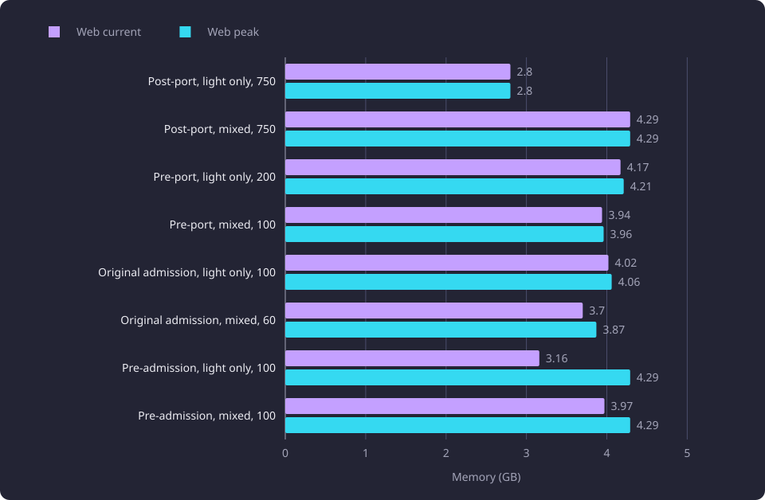

# Serving capacity

Four serving stacks each ran a ladder of simulated users under a light-only and a mixed profile, and this page states where each stopped and what limited it.

**Evidence status:** Comparative. **Run date:** 30 October 2026.

## The question

The native CPU port moved the fuzzy-name score, the recommendation scorer and the prerequisite compiler and drawing projection from Python into native libraries. The admission refit changed the request limits. The port lowered the cost of one request, and the refit changed which requests count as heavy. A lower request cost does not say how many concurrent users a stack serves before its light throughput stops growing. This page asks how many simulated users each of four stacks serves before light throughput stops scaling under workload version 3, and what limits each stack at that point.

The two profiles answer different questions. The light-only profile measures the read path without heavy work. The mixed profile adds the heavy class, so it measures what heavy requests cost the light requests and what they add to memory.

## The four stacks

| Stack | What ran |
|---|---|
| Pre-admission | The build before admission control, so the front router admits every request. |
| Original admission | The build with admission control at its first configuration. |
| Pre-port | The build before the native CPU port, with its own admission configuration. |
| Post-port | The finished build after the native port, with the applied admission configuration. |

Each build ran through its own launcher and its own configuration. The comparison is between whole stacks. The port, the admission configuration and the serving code between the builds differ, and no difference on this page is attributed to one change. The three admitted stacks do not share one admission configuration, and [Serving request cost and admission curves](/docs/experiments/runtime-storage-and-serving/serving-request-cost-and-admission.md) prices the request classes and states the applied values.

## Method and setup

[Serving load method](/docs/experiments/runtime-storage-and-serving/serving-load-method.md) states the workload, the two user classes, the level timing, the measured stack, the stop rule and the caps. The conditions needed to read the tables are below.

The light-only profile makes every user light. The mixed profile makes every tenth user heavy, so a level of 10 users or more holds 90 percent light users and at least one heavy user.

A combination ends at the first level whose light successful requests per second rises less than 10 percent over the previous level, or falls. The stop or last level in the table is the last level with a valid light result, and the stop reason is that rule's value there or that the next level failed. A 429 response is a refusal and a request with no response is a client transport failure, and neither counts as a success. Busy cores are the whole-host busy CPU over the sampler window on the four-core server.

The web cgroup cap and the database cap were both 4.295 GB. The post-port levels ran before the product applied the malloc arena cap. `WEB_MALLOC_ARENA_MAX=2` was applied on 31 October 2026, after these runs. The three earlier builds do not define that setting, and each ran as its own launcher would start it. Every level on this page therefore describes a stack without the cap. [Web memory and allocator retention](/docs/experiments/runtime-storage-and-serving/web-memory-and-allocator-retention.md) measures the growth and the cap.

## Results

The table gives the levels each combination ran, the level where it ended and its light rate there. The stop or last level is the last level with a valid light result. The stop reason is the rule's value there, or that the next level failed.

| Combination | Profile | Levels run | Stop or last level | Stop reason | Light/s | Light p95 (ms) | Light refusals | Heavy successes | Heavy refusals |
|---|---|---|---:|---|---:|---:|---:|---:|---:|
| Post-port | Light only | 10, 20, 40, 60, 80, 100, 150, 200, 250, 300, 400, 500, 750 | 750 | rise 3.6% | 40.041 | 9,681.1483 | 423 (3.77%) | none | none |
| Post-port | Mixed | 10, 20, 40, 60, 80, 100, 150, 200, 250, 300, 400, 500, 750 | 750 | fall 91.2% | 2.919 | 69,629.7822 | 9 (0.12%) | 70 | 4 (0.57%) |
| Pre-port | Light only | 10, 20, 40, 60, 80, 100, 150, 200 | 200 | next level failed | 12.967 | 5,458.0625 | 0 | none | none |
| Pre-port | Mixed | 10, 20, 40, 60, 80, 100 | 100 | next level failed | 6.785 | 2,115.2136 | 0 | 193 | 0 |
| Original admission | Light only | 10, 20, 40, 60, 80, 100 | 100 | rise 3.9% | 5.485 | 11,391.9646 | 0 | none | none |
| Original admission | Mixed | 10, 20, 40, 60 | 60 | next level failed | 3.744 | 4,087.6472 | 0 | 94 | 0 |
| Pre-admission | Light only | 10, 20, 40, 60, 80, 100 | 100 | rise 0.4% | 5.404 | 14,094.0108 | 0 | none | none |
| Pre-admission | Mixed | 10, 20, 40, 60, 80, 100 | 100 | rise 7.4% | 4.541 | 15,707.3366 | 0 | 90 | 0 |

The chart plots the light rate at the stop level, or at the last valid level where the next level failed. For post-port mixed that is the 750-user level, where the rate fell to 2.919, and not the 500-user level, where it was 33.093.

Four combinations ended on the stop rule's rise. The post-port light-only level rose 3.6 percent, the original admission light-only level 3.9 percent, the pre-admission light-only level 0.4 percent and the pre-admission mixed level 7.4 percent. The post-port mixed level fell 91.2 percent. The other three combinations ended because the next level failed before a valid light result.

## Scaling by stack

### Post-port

The light-only ladder ran all 13 levels to 750 users. The rate rose from 0.789 at 10 users to 38.641 at 500, then to 40.041 at 750, a rise of 3.6 percent, which ends the combination. The 750 level recorded 423 light refusals (3.77 percent), all on the prerequisite route, and a successful p95 of 9,681.1483 ms. Busy cores were 3.42 of four and the web cgroup held 2.80 GB, so the level is CPU-bound.

The mixed ladder also ran to 750 users. The rate rose from 0.707 at 10 users to 33.093 at 500, then fell to 2.919 at 750, a fall of 91.2 percent. The 750 level recorded 6,768 light transport failures (89.5 percent) and 627 heavy ones (89.4 percent) with a client maximum of 180 seconds, against 788 light and 70 heavy successes. The web cgroup held 4.29 GB at the 4.295 GB cap, and no OOM kill was recorded. Heavy successes rose from 21 at 10 users to 990 at 500, then fell to 70 at 750.

At 500 users the mixed profile served 33.093 light requests a second with the web cgroup at 4.29 GB, and the light-only profile served 38.641 with the web cgroup at 2.48 GB. At that user count the mixed profile served fewer light requests and held more web memory.

### Pre-port

The light-only ladder ran eight levels to 200 users and ended because the 250 level failed at the web cap. At 200 the rate was 12.967, a rise of 17.6 percent over 150, so the ladder ended while throughput was rising. The level recorded no refusals, a p95 of 5,458.0625 ms, 3.29 busy cores and web memory of 4.17 GB current and 4.21 GB peak, below the 4.295 GB cap.

The mixed ladder ran six levels to 100 users and ended because the 150 level failed. At 100 the rate was 6.785, a rise of 23.4 percent over 80, with no refusals, a p95 of 2,115.2136 ms, 193 heavy successes, 2.42 busy cores and web memory of 3.94 GB current and 3.96 GB peak.

### Original admission

The light-only ladder ran six levels to 100 users and ended at a rise of 3.9 percent. At 100 the rate was 5.485, with no refusals, a p95 of 11,391.9646 ms, 3.46 busy cores and web memory of 4.02 GB current and 4.06 GB peak against the 4.295 GB cap. The level recorded no OOM kill.

The mixed ladder ran four levels to 60 users and ended because the 80 level failed. At 60 the rate was 3.744, a rise of 39.4 percent over 40, with no refusals, a p95 of 4,087.6472 ms, 94 heavy successes, 2.95 busy cores and web memory of 3.70 GB current and 3.87 GB peak.

### Pre-admission

The light-only ladder ran six levels to 100 users and ended at a rise of 0.4 percent. At 100 the rate was 5.404, with no refusals, 18 client transport failures (1.2 percent), a p95 of 14,094.0108 ms, 3.44 busy cores and web memory of 3.16 GB current and 4.29 GB peak. The level recorded two web OOM kills.

The mixed ladder ran six levels to 100 users and ended at a rise of 7.4 percent. At 100 the rate was 4.541, with no refusals, six light and two heavy client transport failures, 90 heavy successes, a p95 of 15,707.3366 ms, 3.43 busy cores and web memory of 3.97 GB current and 4.29 GB peak. The level recorded three web OOM kills, and the 80 level recorded two.

The current web figure is lower than the peak at these levels. The container killed workers during them, and the rate was measured across those replacements.

## Memory and the limit

The table gives the busy cores and the memory at the stop or last level, and the limit that reading supports.

The summed component columns add the web cgroup, the database and the embedding provider. The current column adds the three current values at the level. The peak column adds each component's own peak over its lifetime. Those peaks need not occur at the same moment, so the summed peak is an upper bound and not a simultaneous peak of the three components.

| Combination | Profile | Busy cores | Web current (GB) | Web peak (GB) | Summed component current (GB) | Summed component peak (upper bound, GB) | Limit | Cap event |
|---|---|---:|---:|---:|---:|---:|---|---|
| Post-port | Light only | 3.42 | 2.80 | 2.80 | 5.50 | 5.95 | CPU-bound | none |
| Post-port | Mixed | 3.97 | 4.29 | 4.29 | 6.85 | 7.44 | Memory-bound | cap from 500, 750 collapse |
| Pre-port | Light only | 3.29 | 4.17 | 4.21 | 7.73 | 8.16 | Memory-bound | 250 failed at the cap |
| Pre-port | Mixed | 2.42 | 3.94 | 3.96 | 7.52 | 7.91 | Memory-bound | 150 failed at the cap |
| Original admission | Light only | 3.46 | 4.02 | 4.06 | 6.63 | 8.01 | CPU-bound | none |
| Original admission | Mixed | 2.95 | 3.70 | 3.87 | 6.30 | 7.82 | Memory-bound | 80 failed at the cap |
| Pre-admission | Light only | 3.44 | 3.16 | 4.29 | 6.36 | 8.25 | Both | 2 OOM kills |
| Pre-admission | Mixed | 3.43 | 3.97 | 4.29 | 6.57 | 8.25 | Both | 3 OOM kills |

A combination is CPU-bound when the server's four cores are the binding resource and the web cgroup is below its cap. It is memory-bound when the level reaches the 4.295 GB cap or the next level fails at it. It is both when the level records OOM kills while the cores are also busy. The limit column follows that reading.

Post-port light-only and original admission light-only are CPU-bound. The post-port level held 3.42 busy cores and 2.80 GB of web memory, and the original admission level held 3.46 busy cores and 4.06 GB of web peak with no OOM kill. Post-port mixed and both pre-port profiles are memory-bound. The post-port mixed level reached the cap from 500 users and collapsed at 750, and the pre-port next levels failed at the cap at 250 and at 150. Pre-admission is both. Its light-only and mixed levels held 3.44 and 3.43 busy cores and recorded two and three web OOM kills, with web peaks at the cap.

The web memory chart shows the current and peak web cgroup memory at the stop level.

The summed component memory chart adds the database and embedding components to the web cgroup.

## Failed levels

Three levels failed before a valid light result, and one stop level collapsed inside its measured window. They stay in the record as failures.

- Original admission mixed 80 users. The web cgroup reached its 4.295 GB cap, recorded at a 4.29 GB peak, the container recorded one OOM kill, one worker exited with -9 and was replaced, and two requests answered 500. The level produced no light throughput result.
- Pre-port light-only 250 users. The web cgroup reached its 4.295 GB cap, recorded at a 4.29 GB peak, the container recorded one OOM kill, one worker exited and was replaced, and 13 requests answered 500. The startup burst recorded 99 client transport failures in the settle window.
- Pre-port mixed 150 users. The web cgroup reached its 4.295 GB cap, recorded at a 4.29 GB peak, the container recorded one OOM kill, one worker exited and was replaced, and eight requests answered 500 with eight client transport failures.
- Post-port mixed 750 users. The level completed and its measured window collapsed. It recorded 6,768 light transport failures (89.5 percent) and 627 heavy ones (89.4 percent) with a client maximum of 180 seconds, against 788 light and 70 heavy successes. The web cgroup held 4.29 GB at the 4.295 GB cap, and no OOM kill was recorded. The stop is a memory-cap timeout collapse, not admission saturation.

The pre-admission levels are not failed levels, and the container killed workers inside them. Light-only 100 recorded two OOM kills, mixed 80 recorded two and mixed 100 recorded three, each at a 4.29 GB web peak.

## Interpretation

The post-port stack raises the light rate. Its light-only combination and the original admission light-only combination are CPU-bound. It serves 40.041 light requests a second at 750 users with 3.42 of four cores busy and the web cgroup at 2.80 GB. The pre-port light-only stack serves 12.967 at 200 users, original admission serves 5.485 at 100 users and pre-admission serves 5.404 at 100 users. On the table values, the post-port rate is 3.1 times the pre-port rate and 7.3 to 7.4 times the two older rates.

In the mixed profile the post-port stack serves 33.093 at 500 users against 6.785 for pre-port, 4.541 for pre-admission and 3.744 for original admission. The 750 level then collapses. On the table values, the post-port mixed rate is 4.9 times the pre-port rate and 7.3 to 8.8 times the older rates.

The cap sets where three ladders end, through the level after their last valid one. Both pre-port ladders and the original admission mixed ladder stopped on a level below the cap, at web peaks of 4.21 GB at 200 users, 3.96 GB at 100 and 3.87 GB at 60. The next level in each case, 250, 150 and 80 users, reached the 4.295 GB cap and failed. Those stops are therefore a function of the cap, and whether a larger cap would let the next level complete is untested.

Both pre-admission ladders reached the cap inside their last valid levels and recorded OOM kills, two at light-only 100 and three at mixed 100. The post-port light-only and original admission light-only ladders ended on the rise rule at 2.80 GB and 4.06 GB of web peak, below the cap, so the cap explains neither stop.

Which part of the post-port gain is the port and which is the admission configuration is not measured. The stacks differ in both.

## Limitations

- The comparison is between whole stacks. The port, the admission configuration and the serving code between the builds differ, so a difference is not attributable to one change.
- The users are virtual users with a 5 to 20 second pause, not people. The rates are completed requests and the latencies are client wall times, and neither is a user-perceived measure.
- One server, one workload version and one 500-course pool. The values describe that pool, not the full catalogue.
- The client runs on a separate machine and reaches the stack through one forwarded connection to the stack's loopback port, so a client wall time includes that path.
- A p95 is a sample statistic and not a capacity bound. The post-port light-only 750 level holds 10,811 successful samples and the original admission mixed 60 level holds 1,011.
- The 4.295 GB web and database caps bound the measurement stack. They are not product settings.
- The capacity levels ran without the malloc arena cap, which was applied on 31 October. The memory at the stop and the cap-bound failures are the memory of a stack without it.
- The post-port mixed 750 busy-core figure of 3.97 is measured in a level that recorded 6,768 light transport failures. The last level that completed without transport failures, 500 users, recorded 3.16.

## Baselines

A follow-up compares against these settings and values. The workload is version 3 with seed 20261030, the server had four cores, each stack ran four worker processes, the web and database caps were 4.295 GB each, and each level was 300 seconds with a 30 second settle and a 270 second measured window.

The baseline rows are post-port light-only at 40.041 requests a second and 750 users, post-port mixed at 33.093 and 500 users, pre-port light-only at 12.967 and 200 users, pre-port mixed at 6.785 and 100 users, original admission light-only at 5.485 and 100 users, original admission mixed at 3.744 and 60 users, pre-admission light-only at 5.404 and 100 users, and pre-admission mixed at 4.541 and 100 users. The light p95 values and the memory at each stop are in the two tables.

## Open questions

Each question below is untested.

- Whether `WEB_MALLOC_ARENA_MAX=2` raises the post-port stop level or prevents the mixed collapse. No capacity ladder has run with the cap.
- Whether the post-port light-only ladder continues above 750 users. The rise rule ended it there, and the workload's larger levels of 1,000, 1,500, 2,000 and 3,000 users did not run.
- Whether the three earlier stacks continue to scale under a web cap above 4.295 GB. The pre-admission ladders recorded OOM kills at the cap, the pre-port ladders and the original admission mixed ladder failed their next level at the cap, and the original admission light-only ladder ended on the rise rule at 4.06 GB.
- How much of the post-port gain is the port and how much is the admission configuration. The stacks differ in both.
- Whether a mixed level between 500 and 750 users completes for the post-port stack. 500 is the last level that completed without transport failures.
- Whether the pre-admission rates would differ on a stack that did not lose workers mid-level. The OOM kills are inside the measured levels.
