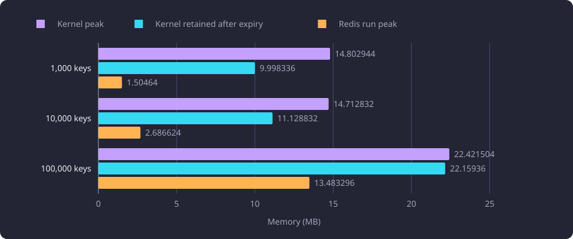
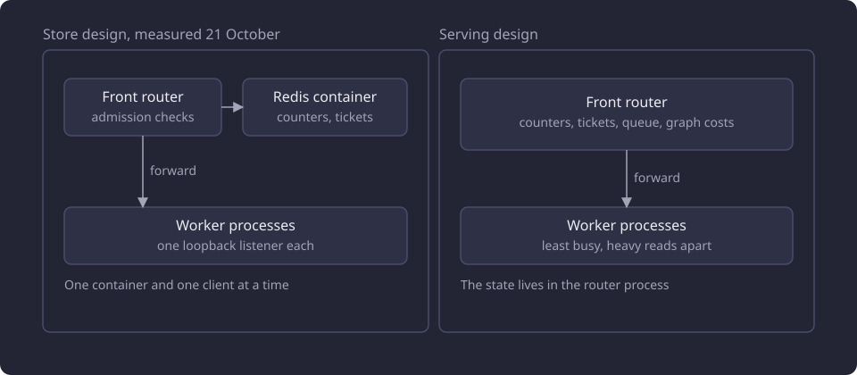

# Front router state and placement

This report asks whether admission state belongs in a shared store or in the front router's own process memory, and how the router places heavy requests.

**Evidence status:** Comparative. **Run dates:** 21 and 22 October 2026.

## The question

Admission control keeps a small amount of transient state for each browser: a light token bucket, a heavy budget, a concurrency count, heavy tickets and a waiting queue. The [front router](/docs/reference/glossary.md#administration) reads that state when it admits a read and again when a response body ends. A design that keeps the state in a separate store adds a service to the serving tree, and the store's memory becomes part of the site's footprint. A design that keeps it in the router process loses the state when the router is replaced.

The second question is placement. Four worker processes serve dataset reads behind one router, and a heavy read holds its worker process until its response body ends. A rule that let two heavy reads share a worker process would leave the interactive reads to the other worker processes.

The measured cost of each request class and the applied cost curves are on [Serving request cost and admission](/docs/experiments/runtime-storage-and-serving/serving-request-cost-and-admission.md). What four worker processes carry under load is on [Serving capacity](/docs/experiments/runtime-storage-and-serving/serving-capacity.md).

## The Redis footprint study

On 21 October 2026 a disposable Redis 7.4.2 container ran with one Unix socket, no TCP port, no persistence and no network. The client stored only opaque state for a store-backed admission design that was measured and then dropped. Half the keys were counters stored as strings set by `INCR`, and half were tickets stored as hashes with `created_ms` and a unit cost of one. Keys were generated deterministically with BLAKE2b from the case index. No identity, course, job, request body, profile, cookie or IP value entered a key or a value.

The container limit was 134.218 MB, `maxmemory` was 67.109 MB with `noeviction`, and the client ran in an isolated scratch environment under a 0.537 GB address-space cap. The client used redis-py 8.1.0 on Python 3.14.3, and its highest process high-water mark was 34.0 to 34.3 MB. That figure is measurement client memory, not product worker process or browser memory. The runs used a 5.15 Linux kernel with the cgroup v1 memory controller, and the supervisor read the limit and usage from the container's cgroup files.

Each case populated one database, set one absolute `PEXPIREAT` deadline at the server time plus 2,000 ms on every key, checked a 256-key sample for a missing TTL, and waited for `DBSIZE` to reach zero within 10 s. It then took three snapshots about 0.5 s apart. One population and one expiry were recorded per case, with no warmup. The three post-expiry snapshots are repeated reads of one retained state, not three independent population trials.

| Quantity (MB) | 1,000 keys | 10,000 keys | 100,000 keys |
|---|---:|---:|---:|
| Redis `used_memory`, baseline | 1.190768 | 1.190736 | 1.190704 |
| Redis `used_memory`, run peak | 1.504640 | 2.686624 | 13.483296 |
| Redis `used_memory`, retained after zero keys | 1.388432 | 1.378160 | 1.373520 |
| Redis `used_memory_rss`, run peak | 16.330752 | 17.313792 | 28.348416 |
| Allocator resident after zero keys | 16.187392 | 17.563648 | 27.525120 |
| Allocator active after zero keys | 14.417920 | 13.697024 | 18.350080 |
| Allocator allocated after zero keys | 5.525864 | 3.940608 | 3.674928 |
| Kernel cgroup charge, baseline | 9.367552 | 9.363456 | 9.371648 |
| Kernel cgroup charge, peak | 14.802944 | 14.712832 | 22.421504 |
| Kernel cgroup charge, retained after zero keys | 9.998336 | 11.128832 | 22.159360 |
| Redis `dataset.bytes` at population | 0.282992 | 0.606992 | 3.846992 |

The kernel charge stays far above the Redis logical charge at every size, and the kernel charge outlives the keys. At 100,000 keys the kernel charge peaked at 22.421504 MB and retained 22.159360 MB after `DBSIZE` was zero, within 0.262144 MB of its peak, while Redis logical `used_memory` had returned to 1.373520 MB. The observation window was about 1.5 s after the database emptied, so this is a short-window retention result, not a claim about decay over minutes. The largest run peak `used_memory` was 13.483296 MB, below the 67.109 MB `maxmemory`, and the largest kernel peak was 16.7 percent of the 134.218 MB container limit.

The allocator shows the retention from a third direction. Resident allocator pages stayed high at every size, with the active and allocated figures below the resident one.

The chart sets the kernel peak, the kernel charge retained after expiry and the Redis logical run peak beside each other at the three sizes.

The measures answer different questions and do not substitute for one another.

| Measure | Scope |
|---|---|
| `used_memory` | Redis logical allocator accounting. The run peak includes transient server allocation during the snapshot and arming work that followed population, measured 0.155544, 0.465088 and 3.584440 MB above the post-populate peak. It is not live key bytes. |
| `used_memory_rss` | Redis self-reported resident or allocator-backed value, close to the allocator resident figure but not identical. It was 28.348416 MB against a 22.421504 MB kernel charge at 100,000 keys, so it is not a budget for system RAM. |
| Kernel cgroup charge | The kernel's charge for the owned container, including the process image, allocator pages and page-cache effects. Its floor of about 9.36 MB is not dataset bytes. |
| `dataset.bytes` | Redis dataset accounting. At 1,000 keys the per-key sample implies 0.032 MB of counters and 0.052 MB of tickets while `dataset.bytes` reports 0.282992 MB. At 100,000 keys the sample implies 3.2 MB and 5.2 MB while `dataset.bytes` reports 3.846992 MB. The scopes are not reconciled. |
| `clients.normal` | Redis server-side allocation for the connected client, 0.023168 to 0.037760 MB. It is not the client process. |

The expiry completed at every size. All three cases reached `DBSIZE` zero inside the 10 s bound with no missing deadline.

| Keys | Arm time (s) | Post-arm time to empty (s) |
|---:|---:|---:|
| 1,000 | 0.014 | 2.321 |
| 10,000 | 0.160 | 1.970 |
| 100,000 | 1.451 | 1.031 |

The 100,000-key case recorded 1.451 s to arm every key and 1.031 s from the end of arming to the first `DBSIZE` of zero. The two intervals are sequential and sum to 2.482 s. The 1.031 s interval starts when arming ends, not at the deadline, and it includes the 256-key TTL sample and the poll for zero keys. The measurement does not state the offset between the start of arming and the server time that fixed the deadline, so it does not place the 1.031 s interval inside the remaining part of the 2,000 ms window. A claim that the two intervals both fit inside one 2,000 ms window is not supported.

### What the study did not settle

The study proposed per-container allowances near the small-state and 100,000-key peaks and marked them unvalidated. A smaller enforced container cap was unmeasured. Pending request bodies, a job payload, product worker process memory, a second instance and concurrent clients were also unmeasured. The study set no budget for the serving design, TTL, proxy rule, abuse limit, capacity or implementation.

The security and configuration choices stayed open. They included the anonymous cookie's lifetime, scope, renewal and rotation, the lifetime, truncation and salt of short-lived IP-derived keys, the trusted proxy hops and headers, transient key prefixes, TTLs, cleanup and rotation, capacity and cost policy, store access and operation, and any memory bound. None became a product value.

## Why the store was not adopted

The store's cost sits in the kernel charge. An empty container carried 9.363456 to 9.371648 MB at baseline, before it held a single key, and the charge that remained after a burst was set by the burst rather than by the live key count. Those are properties of a container, and a process-memory design adds no container to the serving tree.

The study ended without a product budget. Its allowances were arithmetic on three sizes with one population each, and pending bodies, a job payload, product worker memory, a second instance and concurrent clients were unmeasured. No total system cost existed to set against a memory bound, and the security and configuration choices above had no values.

A job queue was rejected on two grounds. RQ stores job payloads and results in Redis, which the measured boundary excluded, and the feature routes are synchronous commands that return a final report, whereas RQ adds asynchronous enqueueing, job identifiers, result retrieval and a separate queue worker lifecycle. No RQ, product limiter, worker process, queue or admission code was implemented in the study.

The serving design keeps the state in the front router process. The router holds the admission counters, activity timestamps, tickets, queue entries and dataset-scoped graph costs in its process memory, with no persistence and no second store, and the serving tree runs no Redis container, socket or service.

The diagram shows the two placements. The store design keeps the counters and tickets in a container beside the router, and the serving design keeps them inside the router process.

## The front router and placement

One supervisor owns the configured listener and one ephemeral loopback listener for each of four worker processes. It starts one front router on the configured listener and one plain worker process on each worker listener, as [the web supervisor page](/docs/backend/interfaces/web-supervisor.md#the-fork-the-readiness-barrier-and-replacement) describes.

An admitted heavy read runs on the least busy worker process that carries no heavy read, with the lowest index on a tie. A light or free read runs on the least busy worker process, which may carry a heavy read. One heavy slot fewer than `WEB_WORKERS` keeps a worker process free. A read holds its worker process until its response body ends. The router opens one connection per forwarded read and reuses none. A failed connection to a worker process ends the request with status 500, and the read is not retried or moved.

With admission off, every request goes to the least busy worker process with no cookie, classification, ticket, graph record or refusal, and the router appends one request record. The supervisor keeps every listening socket open. When the router or a worker process exits, a replacement starts on the same descriptor and the same serving generation, and a replacement router starts with empty admission state and an empty graph cost cache.

### The acceptance

The acceptance ran four worker processes and one router on loopback ports, with the tracked admission values and admission enabled as a process override. It exercises the classes, the cookie, the queue and the request record.

| Step | Observation |
|---|---|
| Feature read | `POST /api/features` answered 200. `Set-Cookie` held `tce_anon` as 32 lowercase hexadecimal characters with `Max-Age=2592000`, `Path=/`, `HttpOnly`, `Secure` and `SameSite=Lax`. The request appended exactly one request record. |
| Heavy placement | Three basis-50 inactive recommendations ran on three worker processes. A basis-3 inactive recommendation answered 200 while all three heavy slots were held. A basis-5 inactive recommendation stayed pending and raised the waiting count from 0 to 1. All five requests answered 200 and appended five recommendation records. |
| Saturation refusal | With the headroom and saturation lines overridden to 0.01 and 0.02 in the process only, the saturated state showed one running heavy request and 16 waiting. A seventeenth heavy request answered 429 in 0.0017 s with `{"detail": "Too much traffic"}` and `Retry-After: 5`. Releasing the slot let the first waiting ticket answer 200, and the second stayed pending. |
| Meter | The router's utilisation series tracked a separate `/proc/stat` window over 10 aligned samples with a maximum difference of 0.0378 and a mean of 0.019. Every sample selected the saturated regime. |
| Admission off | With admission off, a search answered 200 with no cookie and appended exactly one search record. |

The heavy budget refusal was also exercised in the saturated instance. A second basis-50 inactive recommendation from the same cookie answered 429 with the same body and `Retry-After: 5`.

A disposable instance started through the product launcher ran one supervisor, one router and four worker processes. `GET /` and `POST /api/features` answered 200, and the instance stopped with the port free and no surviving process.

## Limits

- The Redis study used one Redis version, one client version, one kernel and one server, with one container and one client at a time. It measured three sizes, one population each, and a short post-expiry window. It measured no concurrency, HTTP load, pending body, product client, second instance or total system memory.
- The study measured a store. The footprint of the admission state inside a long-running router process is not part of this account.
- The acceptance exercises admission, the queue and the request record at one request at a time, apart from the three heavy slots it held. It measures no sustained load, no distribution of heavy reads across four worker processes and no latency curve.

## Baselines

A follow-up that measures a store for this state compares against four quantities: the baseline kernel charge, the kernel peak, the kernel charge retained after expiry and the Redis logical peak. An empty Redis 7.4.2 container cost 9.363456 to 9.371648 MB of kernel charge at baseline. At 100,000 opaque keys the kernel charge peaked at 22.421504 MB and retained 22.159360 MB about 1.5 s after the keys expired. Redis logical `used_memory` peaked at 13.483296 MB. The serving design has no container baseline, because a replacement router starts with an empty admission state in its own process.

## Open questions

- What memory does the admission state occupy in a long-running router process at the identity counts a site reaches? The study measured a store, and the acceptance did not read the router's own footprint (untested).
- How much would a queue and pending request bodies add to the store's kernel charge? The study stored counters and tickets only (untested).
- Which distribution of heavy reads across four worker processes the placement rule produces under sustained load on the measured request shapes (untested).
- What a router replacement costs a site during a heavy burst, when every cookie starts with a full budget and the queue is empty (untested).
