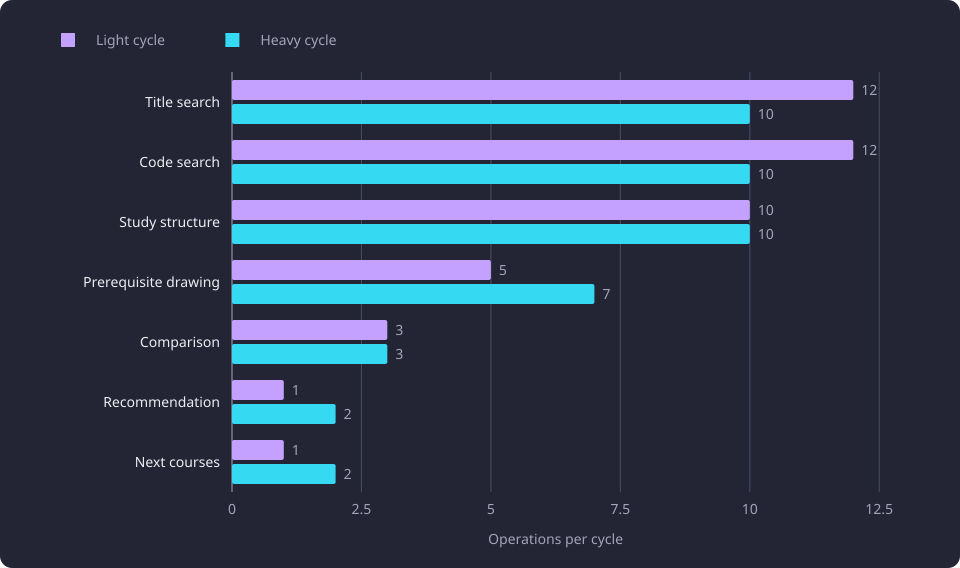

# Serving load method

This page states how the serving capacity levels and the per-operation cost matrix were built, driven and measured.

**Evidence status:** Comparative. **Run date:** 30 October 2026.

Both measurements read one versioned workload and one machine configuration. The capacity levels drive the workload through a load client against a disposable stack, and the cost matrix sends the workload's request bodies one at a time against a fresh supervisor. The cost metric, the component boundaries and the memory record that the serving pages share are stated on [Runtime, storage and serving experiments](/docs/experiments/runtime-storage-and-serving/README.md).

The capacity results are in [Serving capacity](/docs/experiments/runtime-storage-and-serving/serving-capacity.md). The endpoint costs and the admission fit are in [Serving request cost and admission curves](/docs/experiments/runtime-storage-and-serving/serving-request-cost-and-admission.md). The maintained tooling, its configuration keys and its commands are described in [Serving load measurement](/docs/testing/load-measurement.md).

## What the method covers

The workload is one versioned definition of the course pool, the two user classes, their fixed operation cycles, the pause after each response and the user ladder. A change to any of those starts a different baseline, and every result records the workload version it used.

Two measurements read it. The capacity levels drive the workload from a load client against a disposable stack and report throughput, latency, refusals, component core-seconds and memory per level. The per-operation cost matrix sends one request at a time against a fresh supervisor and reports the core-seconds of each request shape.

The method does not cover browser rendering, interaction or a user study. It measures HTTP service under a synthetic client, and a client wall time is not a user-perceived time. The user counts are virtual users, not people, and the workload does not replay traffic observed in use.

## The load workload

The workload is version 3, with seed 20261030 and English as its display language. It holds the pool, the two user classes, the two cycles, the capacity section and the matrix section. The seed fixes the pool and every simulated user's random stream, so the same seed and dataset produce the same pool and the same request sequence on every stack.

### The course pool

The pool holds the 500 lowest ranks of SHA-256 of `<seed>:<group_id>` among all courses whose version with the greatest created time carries a code and an English or Finnish title. The ranks are sorted by group identity. Every pool course resolves to a code and at least one title.

A search query is a pool course's full English title, its Finnish title when no English title exists, or its code. A graph target and a comparison course are drawn from the pool or from the user's basis. The pool fixes which courses the workload uses as queries, targets and bases. It does not limit which courses the server reads.

### Light and heavy users

| Setting | Light user | Heavy user |
|---|---|---|
| Starting basis | 10 to 20 pool courses | 50 to 100 pool courses |
| Inference on requests | off | on for every prerequisite, recommendation and next-course request |
| Activity scope of a scope-aware request | active only | active only with probability 0.8, including inactive courses with probability 0.2 |
| Study roots per study request | 1 | 20 |

A scope-aware request is a prerequisite, recommendation, next-course or search request. The light class therefore sends official prerequisites and active-only reads, and the heavy class sends inferred prerequisites and one read in five that includes inactive courses.

Both classes draw the add chance and the remove chance independently before every request, each 0.1. The starting range is not a bound on the evolving basis, so a user's basis grows or shrinks past it. A graph target or a comparison course comes from the current basis with probability 0.5 and from the pool otherwise.

After each response each user waits a pause drawn uniformly from 5 to 20 seconds from its own seeded stream.

### One simulated user

One user number seeds one random stream from the workload seed. The stream draws the size of the starting basis from the class range and a partial shuffle of the 500 pool indices, then every later choice of that user.

Each user starts at `(user number × 7) mod cycle length` and advances one operation per iteration. One virtual user holds one simulated user's state, so no arrival-rate executor hands iterations to arbitrary users. Users one to n of a level hold the same seeds and request sequences as users one to n of the previous level.

An iteration draws the add chance, the remove chance, the operation's own choices and finally the pause. The pause is the last draw, so it adds one value to the stream without shifting any request draw.

```text
const userNumber = exec.vu.idInTest;
const className = classForUser(profileName, userNumber);
if (
  currentUser === null
  || currentUser.number !== userNumber
  || currentUser.profileName !== profileName
) {
  const rng = mulberry32(hash32(workload.seed, userNumber));
  const cycle = workload.cycles[className];
  currentUser = {
    number: userNumber,
    profileName,
    className,
    rng,
    basis: initialBasis(rng, className),
    cursor: (userNumber * 7) % cycle.length,
  };
}
const rng = currentUser.rng;
if (rng() < workload.users.add_probability) {
  addCourse(currentUser, rng);
}
if (rng() < workload.users.remove_probability) {
  removeCourse(currentUser, rng);
}
const cycle = workload.cycles[currentUser.className];
const operation = cycle[currentUser.cursor % cycle.length];
currentUser.cursor += 1;
send(currentUser, requestFor(operation, currentUser, rng));
// The pause is the iteration's last draw, so it adds one value to the stream without shifting
// any request draw.
sleep(pauseMin + rng() * (pauseMax - pauseMin));
```

The snippet states the order of one iteration. The add and remove draws come first, the operation's own choices follow inside the request, and the pause is drawn last.

### The operation cycles

Each class has one fixed interleaved order of operations, and both cycles hold 44 operations.

| Operation | Light cycle | Heavy cycle |
|---|---:|---:|
| Title search | 12 | 10 |
| Code search | 12 | 10 |
| Study structure | 10 | 10 |
| Prerequisite drawing | 5 | 7 |
| Comparison | 3 | 3 |
| Recommendation | 1 | 2 |
| Next courses | 1 | 2 |
| Total | 44 | 44 |

The heavy cycle holds two fewer title searches, two fewer code searches, two more prerequisite drawings, one more recommendation and one more next-course request than the light cycle. Every heavy prerequisite, recommendation and next-course request enables inference, so no light request carries inferred prerequisites.

The chart plots the operation counts of the two cycles.



The order is fixed rather than drawn. A non-search operation follows a search except at a few adjacent pairs, so no run of three non-search operations occurs in either cycle.

## The measured stack

The stack is the product's supervisor, its front router and four [worker processes](/docs/reference/glossary.md#administration). The measurement database and the embedding provider are containers beside them. Every host in the configuration is a loopback address, so a measurement never binds a public interface.

The load client is a separate machine. It reaches the stack through one forwarded connection to the stack's loopback port, and every command sends to that port. The client is k6 v2.3.0, and one virtual user holds one simulated user at a constant user count.

The client opens one connection per request. The pause between requests exceeds the server's keep-alive timeout, and a reused idle connection fails with EOF, so a kept-alive connection would measure a transport failure rather than a served request.

The database is disposable. The embedding provider is isolated on its own loopback port, so a measurement does not share another site's embedding service.

A capacity combination holds one stack for the whole profile, and a fresh stack and one fixed warm-up precede each profile. The cost matrix starts a fresh supervisor and a fresh cgroup pair for its run, so no worker's retained cache or admission state carries into a measurement.

The supervisor starts the front router as a child process and forks the four worker processes. The supervisor and every descendant sit in one cgroup pair that the launcher creates for the run. The database and the embedding provider have their own container cgroups.

The counter sampler writes the three cumulative CPU counters every 0.25 seconds. Every 5 seconds it also writes the web cgroup's memory counters and each web process's resident size, which separates anonymous growth from file cache and attributes it to a process. Each of the three component counters is read from its own cgroup over a request or a level.

The diagram shows the two sides of one measurement and the counters read from each component.


The server is a four-core aarch64 machine, and the [experiments hardware](/docs/experiments/README.md#the-hardware) section states its RAM. The caps below are the limits the measured stack ran under, converted to GB here.

| Bound | Limit | In GB | Component |
|---|---|---|---|
| Web memory cap | 4,294,967,296 bytes | 4.295 GB | the run's web cgroup |
| Database memory and memory plus swap | 4,294,967,296 bytes | 4.295 GB | the measurement database |
| Database shared buffers | 1 GB | 1 GB | the measurement database |
| Embedding memory | 1,572,864,000 bytes | 1.573 GB | the embedding provider |

The web cap bounds the cgroup that holds the supervisor, the front router and the four worker processes. The database limits bound the database container, and the embedding limit bounds the embedding provider container.

The capacity levels ran on builds without `WEB_MALLOC_ARENA_MAX`, so a level's memory describes a stack without the arena cap.

## The capacity levels

One ladder serves both profiles and every stack: 10, 20, 40, 60, 80, 100, 150, 200, 250, 300, 400, 500, 750, 1000, 1500, 2000 and 3000 total users. Each level is one client invocation at a constant user count.

A level runs for 300 seconds from its first request, and the client waits up to 30 seconds for an in-flight request. The first 30 seconds is the settle window and the remaining 270 seconds is the measured window. A request that completes during the drain after the level is outside every window.

The `light_only` profile makes every user light. The `mixed` profile makes every user whose number is a multiple of 10 heavy, so a level of 10 or more users holds 90 percent light users and at least one heavy user.

### The stop rule

The stop rule ends a combination after the first level whose light successful requests per second in the measured window rise less than 10 percent over the previous level, or fall. Heavy refusals and heavy latency never stop a combination.

The ladder is not a cap. A larger coarse level joins the ladder when light throughput continues to rise at the largest level, and a combination that reached the largest level without a stop has no measured ceiling.

### Successful requests, refusals and transport failures

The client expects status 200 and status 429. A 429 is an admission refusal, and a request that receives no server response records status 0 and counts as a client transport failure. The three outcomes are reported apart, and successful latency never mixes with refused latency. One threshold fails a run on any other status.

A rate counts successful requests only. The refusal count, its rate and its latency are reported beside it. The connection burst at the start of a high level can be refused by the forward, and those failures fall in the settle window.

## The per-operation cost matrix

The matrix starts a fresh supervisor and sends one request at a time against that stack, so the core-seconds of a call are not shared with another request. It sends the workload's warm-up bodies first, then each case.

The matrix covers search in four query and scope combinations, recommendations and next courses at bases from 3 to 499 in both activity scopes, five graph targets, one comparison pair, three study-structure bodies, the catalogue plain and compressed, and the feature read. Every prerequisite, recommendation and next-course case is sent in an official form and an inference-enabled form at the same target, basis and activity scope. The graph bodies use 30 historical course codes as their selection.

A cached case takes a number of genuine misses on distinct request bodies of the same shape, then a number of samples on the first body.

| Run | Warm-up | Per-case warm-up | Distinct misses per point | Samples per point |
|---|---|---|---|---|
| Matched matrix | the warm-up bodies, one sample each | none | 3 | 3 |
| Matrix behind the applied admission fit | the warm-up bodies, one sample each | none | 10 | 3 |

Every cached case takes the miss count of its run. In the matrix behind the applied admission fit every class of the admission curve takes 10 distinct misses, and in the matched matrix every class takes three. A miss is a different body of the same shape and not the same query sent again: a recommendation or next-course miss takes a distinct pool offset of the same basis size, and a search miss takes a distinct pool course. Both runs read the same case set and pool, so a point keeps the route, scope and basis size or target that its case defines, and each run draws its own distinct bodies around them.

A body whose cache key the run already requested is skipped, and the run-level key set starts with the warm-up bodies, because those populate the same caches. A full-pool basis is one canonical request, so the largest measured basis is 499.

Every miss sample is a genuine miss, verified from a cache event log that a measurement wrapper writes from inside the measured web cgroup. A cached case that produces no event fails the run.

A search case without a cache sends one distinct pool query per sample, and every other case without a cache sends the configured number of warm samples. Any status other than 200 stops the run with the case label, the status and the start of the response body.

A matrix cost is the shared cost metric read around one call.

The matrix also records each graph target's drawing element count and solver piece count beside its cost, and the largest graph target's elapsed cost.

### What the fit reads

The fit reads the result's fit inputs. Each input is one measured case that carries an admission class, an explicit inference flag and a basis size, with the mean, median and range of its total core-seconds, its sample count, its median elapsed time and its result count.

Inference is not an admission dimension. An inference-enabled recommendation, next-course or graph case therefore carries the same class as the official request at that route and scope. The fit uses the inference-enabled rows of a recommendation or next-course class, because the capacity workload enables inference on its heavy requests.

Each curve point is the mean over the distinct misses of one request shape, and it reports its minimum, maximum and sample count. A point over several distinct bodies therefore reports a range.

## How the load numbers are read

A rate is successful requests per second in the measured window. It is not the offered rate, because a client that waits on a response or a connection completes fewer requests than it attempts.

The settle window is excluded from a steady level because it holds the client start and the burst of new connections.

A percentile carries the count it rests on. A level that completes few heavy calls does not support a heavy tail, and a p50 over one call is that call.

The per-class core-seconds in a level result are an apportionment of the component counters over overlapping requests, and [Serving load measurement](/docs/testing/load-measurement.md#the-summarizer-result) states that method. A per-class share describes a run's share of the measured CPU, not one request's cost.

A matrix cost is a serial cost. A load level sends overlapping requests, so its measured CPU is not the sum of the matrix costs.

A rate from one profile is not a rate for another profile, and a rate from one stack is not a rate for another stack. The rates and costs describe the measured four-core aarch64 stack, and they are not a capacity rating for another machine.
