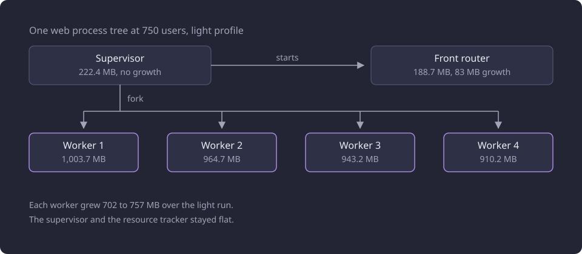
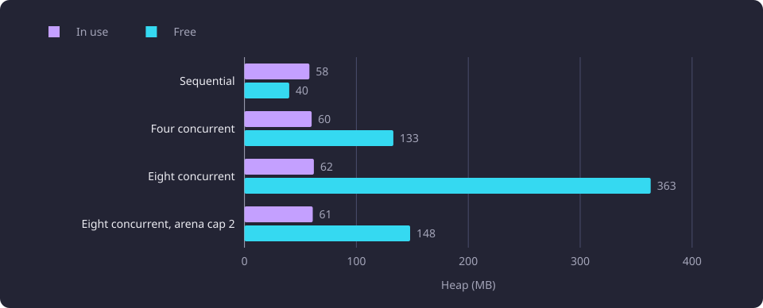

# Web memory and allocator retention

This report explains why the web server's memory rose with load and whether capping glibc malloc arenas changed its memory or throughput.

**Evidence status:** Observational. **Run dates:** 30 and 31 October 2026.

## The question

The capacity runs measured one [supervisor](/docs/reference/glossary.md#administration), one front router and four [worker processes](/docs/reference/glossary.md#administration) inside one cgroup limit of 4.295 GB. In those runs of 30 October 2026 the web charge rose from 0.68 GB at 10 users to 2.80 GB at 750 users in the light profile, and the mixed profile reached the 4.295 GB limit at 500 users and stayed there at 750. [Serving capacity](/docs/experiments/runtime-storage-and-serving/serving-capacity.md) states that ladder, its throughput and the stop of each profile.

A memory ceiling that a stack reaches by serving more requests decides how many users a site can hold. A per-request leak or an unbounded cache would make the ceiling fall as new request shapes arrive. The question is what retains the memory, whether any state accumulates without a bound, and whether the glibc setting `MALLOC_ARENA_MAX` lowers the retained memory at an acceptable throughput cost.

## What was measured

The evidence has three parts, and one of them is comparative. The build measured is the ported serving build, whose prerequisite compilation runs as native code on the CPU.

- The capacity runs of 30 October 2026 recorded the web cgroup charge and the resident set of every process every 5 seconds. Thirteen levels ran from 10 to 750 users, in a light profile that sends light operations only and a mixed profile that adds heavy operations. Each user waits a pause drawn uniformly from 5 to 20 seconds after each response.
- A diagnosis on 31 October 2026 ran one disposable stack of the same build with four workers and the same limit. Sequential replay sent workload-shaped bodies one at a time, first distinct and then repeated. Every sequential request landed on worker 1, because the router picks the least busy worker and one request was in flight. Direct loopback requests to that worker then exercised four and eight concurrent requests. Signal handlers recorded Python traced allocations, the glibc heap summary, the per-arena listing and what a trim returned, and a separate probe opened the native fact handle on the whole 11,086-course dataset. No product code changed.
- A matched A/B test on 31 October 2026 compared the setting in alternation. Configuration A leaves `MALLOC_ARENA_MAX` unset, and B sets it to 2 in the launcher environment. Each of the four runs used a fresh stack, the same 20-request warm-up and a 2 s settle, then the same seeded sequence for 180 s at concurrency 8 through the router, with 64 rotating anonymous cookies and a new connection per request. The sequence held nine light cycles to one heavy cycle, the order was A, B, A, B, and all four runs carried the same request sequence.

The A/B test is the one comparative leg. It compares two configurations of one setting on matched runs. The diagnosis observes one stack, and the capacity runs observe one stack per profile.

The measures are not interchangeable. The cgroup charge, the anonymous resident total `rss`, the file cache and shmem, the resident set of one process, the glibc heap and Python traced allocations answer different questions. The charge includes the cgroup's file cache and shmem, so it sits above the anonymous resident total. The glibc heap comes from the allocator's own summary inside one worker and is smaller than that worker's resident set. This report names the measure with each value.

Two things were not measured. The capacity runs of 30 October 2026 ran without the arena cap, and no capacity ladder ran with it. The concurrency-4 leg of the A/B test has one run and no matched counterpart, so no concurrency-4 comparison is reported.

## The growth in the capacity runs

The web charge at each level, with the light profile's anonymous resident total, the growth inside the level, the growth per request and the requests the window attempted. The mixed profile column is the same charge measure.

| Users | Light attempts | Light web charge (GB) | Light anonymous `rss` (MB) | Light level growth (MB) | Light growth per request (kB) | Mixed web charge (GB) |
|---:|---:|---:|---:|---:|---:|---:|
| 10 | 242 | 0.68 | 675 | 154 | 636 | 0.68 |
| 20 | 477 | 0.75 | 732 | 58 | 121 | 0.78 |
| 40 | 962 | 0.88 | 864 | 132 | 137 | 1.01 |
| 60 | 1,444 | 0.99 | 968 | 104 | 72 | 1.20 |
| 80 | 1,924 | 1.11 | 1,087 | 119 | 62 | 1.42 |
| 100 | 2,402 | 1.25 | 1,224 | 138 | 57 | 1.61 |
| 150 | 3,591 | 1.47 | 1,441 | 217 | 60 | 1.95 |
| 200 | 4,797 | 1.64 | 1,603 | 162 | 34 | 2.17 |
| 250 | 6,024 | 1.78 | 1,751 | 149 | 25 | 2.56 |
| 300 | 7,207 | 2.01 | 1,973 | 222 | 31 | 2.89 |
| 400 | 9,610 | 2.21 | 2,167 | 193 | 20 | 3.39 |
| 500 | 11,819 | 2.48 | 2,428 | 262 | 22 | 4.29 |
| 750 | 12,899 | 2.80 | 2,740 | 311 | 24 | 4.29 |

Every light level raised the charge, and the light profile ended at 2.80 GB. At the 750-user light level the charge was 2.799 GB, of which 2.740 GB was anonymous `rss`, 41 MB file cache and 20 MB shmem. Across the light levels the cache charge stayed between 2 and 41 MB and shmem between 2 and 21 MB, and the mixed levels reached 90 MB of cache and 21 MB of shmem. The byte-bounded shared caches are therefore not the growth.

The charge of both profiles at each level is plotted on a log user axis below.


Most levels plateaued inside the level, and the idle gap between levels added nothing. The highest levels did not level off. The 750-user light level rose from 2.476 GB to 2.799 GB and was still rising at its end, and the mixed profile sat at the limit at 500 and 750 users.

The growth sits in the workers. Over the light run the supervisor and the multiprocessing resource tracker stayed flat, the front router grew 83 MB, and each of the four workers grew between 702 and 757 MB of resident memory.

| Process | Resident at the 10-user level (MB) | Resident at the 750-user level (MB) |
|---|---:|---:|
| Supervisor | 222.4 | 222.4 |
| Multiprocessing resource tracker | 85.7 | 85.7 |
| Front router | 106.1 | 188.7 |
| Worker 1 | 253.0 | 1,003.7 |
| Worker 2 | 207.6 | 964.7 |
| Worker 3 | 207.6 | 943.2 |
| Worker 4 | 207.6 | 910.2 |

The measured process tree at 750 users shows where those values sit.



### Growth tracks requests, not users

From 100 users onward the light levels added 20 to 60 kB per request, and the mixed levels added 45 to 90 kB at the higher levels. The 10 to 80 user levels added 62 to 636 kB per request, because one-time initialization dominates there. The 750-user level served 12,899 attempts and grew 311 MB, 24 kB per request, and the 300-user level served 7,207 attempts and grew 222 MB, 31 kB per request. Both sit in the same band.

A growth rate per added user is not stable in this design. A level's growth is paid by every user still sending requests, not only by the users the level adds, so dividing a level's growth by the new user count mixes the two. The per-request rate is the stable quantity, and the level's total request volume, not the new user count, drives its growth.

## Where the retained memory sits

The diagnosis measured the same processes on one stack. The growth was anonymous resident memory, and almost all of it was free heap pages inside the four workers plus the preload pages each worker had copied private.

### One arena per worker thread

The worker routes are synchronous handlers, so the server runs them in a thread pool. Each thread that allocates takes its own glibc malloc arena, and each arena keeps the high-water mark of the free pages it has held. An arena is one heap region that glibc reserves for one thread and reuses, and a page it once held stays in the arena after the allocation is freed.

Direct requests to one worker showed the count. At rest the worker held two heaps, the main heap plus one arena. Four concurrent requests raised that to five heaps and eight concurrent requests to nine.

| Concurrency | Heaps | Heap system (MB) | In use (MB) | Free (MB) | Trim returned (MB) | Resident before and after the trim (MB) |
|---:|---:|---:|---:|---:|---:|---|
| Sequential | 2 | 101 | 58 | 40 | 8 to 10 | not recorded |
| Four concurrent | 5 | 193 | 60 | 133 | 33 | not recorded |
| Eight concurrent | 9 | 425 | 62 | 363 | 84 | 891 to 806 |
| Eight concurrent, arena cap 2 | 2 | 209 | 61 | 148 | 118 | 640 to 522 |

The in-use and free parts of the heap at the four settings are plotted below.



At eight concurrent requests 85 percent of the arena pages were free, against about 40 percent at rest and 69 percent at four concurrent requests. The free pages cannot all be returned, because most of them are not at the top of an arena. A trim returned 84 MB of the 363 MB free.

Repeated identical requests added no heap. The recommendation batch raised the worker's heap from 48.2 MB to 101.2 MB, and the heap stayed at 101.2 MB through 100 repeated identical requests and 500 further searches. Distinct and larger requests ratchet the high-water up, and a repeated shape does not.

| Batch on the disposable stack | Web cgroup growth | Worker anonymous growth | Trim returned | Reading |
|---|---:|---:|---:|---|
| 500 distinct `search_code` | +13.5 MB | +0.3 MB | 10.0 MB | About 20 kB per request of retained free heap, with no live data |
| 500 distinct `prerequisites`, 60-course basis, inferred | +3.0 MB | about 0 MB | 0.6 MB | About 6 kB per request, and the native facts are small |
| 500 distinct `next_courses`, 60-course basis, inferred | +27.5 MB current, +1.3 MB anonymous | +1.3 MB | 10.9 MB | Most of the growth is file cache, and about 2.6 kB per request is anonymous |
| 200 distinct `recommendations`, 60-course basis | +67.5 MB | +51.6 MB | about 30 MB | The heap high-water ratchets up |
| 100 repeated identical `recommendations` | about +5.7 MB | about 0 | 5.5 MB | The high-water was already reached, so only free pages churn |
| 100 distinct `recommendations`, 100-course basis | +30 MB | +9.3 MB | about 11 MB | A larger basis raises the high-water only slightly |

The heap high-water is bounded by the largest request working set and the number of arenas, not by the number of users or courses. Once the same concurrency and request shapes repeat, the heap stops growing. The stack never restarts between levels, so each level starts from the previous level's high-water and its growth is added to it.

### Copy-on-write of the preload

Each worker starts as a fork of the supervisor, and the supervisor opens the preload before the fork: the lookup projection, the catalogue and the opened set of serving artifacts. A forked page is shared until a process writes to it, and the write copies that page private.

At startup worker 1 held 197 MB of anonymous resident memory, of which 144 MB was `Shared_Dirty`, the inherited preload, and 49 MB was private. After about 500 requests `Shared_Dirty` had fallen to 68 MB, so 76 MB of the inherited pages had been copied private. That cost is paid at most once per worker and is bounded by the 144 MB preload.

### The native facts and the shared caches

The [native fact handle](/docs/reference/glossary.md#serving-data) keeps one bundle per open handle, holding course, module, inferred prerequisite and equivalence group facts. It adds distinct targets and bases and never evicts. The probe measured the closure of the whole dataset rather than the workload pool. It started at 44.0 MB of anonymous memory, reached 70.9 MB of anonymous memory and 88.6 MB of resident memory after all 11,086 courses with inferred facts, and fell to 45.6 MB when the handle closed. The bundle is about 25 to 27 MB per worker for the whole dataset and about 11 MB for the 500-course workload pool. It is dataset-bounded.

The shared caches are byte-bounded regions that the supervisor creates before the fork, and they were observed at 16 to 21 MB of shmem. Study fragments and embedding stores are read-only file mappings. `tracemalloc` recorded 2.67 MB of live Python allocations and a peak of 33.6 MB around 50 distinct recommendations, so the remaining about 50 MB of that batch was outside Python's allocators, in native and NumPy buffers freed into the process heap.

### The four-worker estimate

Per worker the bound is the arena set times its per-arena high-water, plus the copy-on-write of the preload and the fact bundle. At the measured eight-thread pattern the heap term is 425 MB.

| Term | Four workers (GB) |
|---|---:|
| Heap, 425 MB per worker | 1.70 |
| Copy-on-write of the preload, 76 MB per worker | 0.30 |
| Native facts, 27 MB per worker | 0.11 |
| Private baseline | 0.2 |
| Supervisor and front router | 0.45 |
| Total | 2.76 |

The estimate is 2.76 GB with the measured 76 MB of copy-on-write per worker, and about 3.0 GB with the 144 MB preload ceiling instead. The recorded 2.80 GB at 750 users sits inside that range. The estimate is arithmetic over per-worker terms, not a simultaneous measurement. A heavy mixed request with a 100-course basis and a large drawing has a larger per-arena high-water, which is how the mixed profile reached the limit.

With the arena cap the heap term falls to about 209 MB per worker, and the same arithmetic gives about 1.9 to 2.2 GB. That value is inferred, and no capacity run tested it.

## The arena cap and throughput

The setting caps the number of glibc malloc arenas per process at 2. At eight concurrent requests to one worker it cut the heap from 425 MB to 209 MB and let a trim return 118 MB instead of 84 MB. The resident set after the trim fell from 891 MB to 806 MB without the cap and from 640 MB to 522 MB with it.

The matched test ran at concurrency 8 across four workers, which is about two requests in flight per worker.

| Run | `MALLOC_ARENA_MAX` | Successful requests per second | p50 (ms) | p95 (ms) | p99 (ms) | Web (ms per request) | Database (ms per request) | End web charge (GB) | 429 refusals |
|---|---|---:|---:|---:|---:|---:|---:|---:|---:|
| A, first run | unset | 30.304 | 220.6 | 775.0 | 1,007.8 | 31.33 | 58.74 | 1.247 | 392 |
| B, first run | 2 | 30.169 | 223.5 | 767.0 | 1,031.3 | 31.54 | 58.72 | 1.170 | 72 |
| A, second run | unset | 24.627 | 242.8 | 980.2 | 1,263.5 | 33.73 | 62.52 | 1.239 | 0 |
| B, second run | 2 | 24.460 | 236.8 | 1,007.9 | 1,312.7 | 33.38 | 61.54 | 1.246 | 0 |

The successful throughput of the four runs is plotted in the order they ran.


| Comparison | Difference (requests per second) | Difference (percent) |
|---|---:|---:|
| Pair 1, B minus A | -0.135 | -0.45 |
| Pair 2, B minus A | -0.167 | -0.68 |
| A repeat, first run minus second | 5.677 | 18.7 |
| B repeat, first run minus second | 5.709 | 18.9 |

B was 0.135 and 0.167 requests per second slower, 0.45 and 0.68 percent. The two A runs differed by 5.677 requests per second, 18.7 percent of the faster run, and the two B runs by 5.709, 18.9 percent. The paired differences are 28 to 42 times smaller than the repeat spread, so the setting's throughput cost is not resolvable at this concurrency and no cost was measured. Web plus database core-seconds per successful request differ by +0.21 and -1.37 percent, and the latency percentiles differ by -2.5 to +3.9 percent with no consistent direction.

At this load the cap brought no memory benefit. Eight concurrent requests across four workers left only about two in flight per worker, so each worker used three heaps without the setting and two with it. The end-of-run web charge fell by 77 MB in the first pair and rose by 7 MB in the second, and the summed worker heaps were 471.1 and 465.4 MB without the setting and 472.4 and 447.8 MB with it. The 425 to 209 MB saving needs eight concurrent requests per worker, which this test did not create.

Pair 1 recorded 392 admission refusals without the setting and 72 with it, spread across the light operations and some prerequisite requests, and pair 2 recorded none. The setting does not touch admission, and successful throughput and CPU still matched, so the difference is unexplained admission noise rather than a throughput effect.

Concurrency 4 has no matched pair. One run without the setting completed and no run with it was measured, so no concurrency-4 comparison is reported.

## Options that were not selected

| Option | What it would do | Reason it was not selected |
|---|---|---|
| A periodic `malloc_trim(0)` in each worker | Returns free pages at arena tops, 8 to 10 MB per call in the sequential replay | It needs a maintenance hook and brief pauses, and it recovers only part of the free pages while many arenas exist. It does not lower the high-water. |
| Fewer workers, for example two | Halves the per-worker baseline, copy-on-write and heap terms | It halves the request parallelism of the four-worker build and would likely lose throughput at the heavy tail. Two workers were not measured in these runs. |
| Sharing the native facts across workers | Saves at most 25 to 27 MB per worker | It needs a new cross-process fact owner and lifecycle for a small saving. |
| Byte-bounding the per-worker caches | Would cap cached data | No unbounded per-worker cache exists, and the shared caches are already byte-bounded and small, so it does not address the growth. |
| Raising the cgroup limit | Delays the cap | It hides the symptom and leaves the retained memory in place. |
| `MALLOC_TRIM_THRESHOLD_` and `MALLOC_MMAP_THRESHOLD_` tuning | Returns free memory sooner | It costs more mmap and munmap calls and CPU, and it was not measured. |

The arena cap and a trim are the direct match to the measured cause: cap the arenas, then trim what remains. With two arenas most free memory is recoverable by a trim, while with many arenas only part is. A trim hook is a product change and would need a capacity run that shows the residual after the cap.

## The applied setting

The product sets `WEB_MALLOC_ARENA_MAX = 2` in `config/web.toml`. It is a validated web setting that accepts a positive integer.

```toml
# glibc malloc arenas per web process, as a positive integer. The launcher passes it to the
# supervisor, and the router and every forked worker inherit it. Fewer arenas cap the free heap
# each worker retains under concurrency.
WEB_MALLOC_ARENA_MAX = 2
```

The launcher rebuilds the supervisor environment from `HOME`, `PATH`, `LANG` and the validated settings, so a value set only in the service unit would not reach the router or the workers. The launcher passes the setting itself, because glibc reads it at process start and the router and the forked workers inherit the supervisor environment.

```python
# glibc reads MALLOC_ARENA_MAX at process start, and the router and forked workers inherit this
# supervisor environment, so the setting enters here rather than in the unit file.
environment["MALLOC_ARENA_MAX"] = str(web_settings.web_malloc_arena_max)
```

The value was selected from the measured options and applied. The capacity runs of 30 October 2026 ran without it, so the capacity of the capped stack is untested.

## Interpretation

| Claim | Status |
|---|---|
| The four workers hold nearly all of the growth, and the supervisor and the resource tracker stay flat | Observed |
| The retained memory is free heap pages in glibc arenas plus private copies of the preload | Observed on one worker |
| A per-request leak or an unbounded per-worker cache holds the growth | Failed hypothesis |
| The four-worker bound is the arena set times its high-water plus copy-on-write and facts | Inferred, arithmetic |
| The arena cap lowers the four-worker bound to about 1.9 to 2.2 GB | Inferred, untested at capacity |
| The arena cap costs no measurable throughput at concurrency 8 | Observed, two matched pairs |

The growth is allocator retention and copy-on-write, not a per-request leak. No live object references the free pages, the Python total stays at 2.67 MB, the native handle is dataset-bounded, and repeated identical requests add no heap. What accumulates is the high-water of the arena set and the private copies of the preload, and the stack never restarts between levels.

The hypothesis that failed is that a per-worker cache without a byte bound holds the growth, either the native fact handle or a Python result cache. The native handle is bounded by the dataset, no unbounded Python cache exists, and the shared caches are byte-bounded and small.

## Limitations

- The A/B test measured concurrency 8 across four workers, about two requests in flight per worker. It does not exercise the per-worker thread count that produced the 425 MB heap, so its no-cost result applies to that load.
- The diagnosis ran on a copy of the build outside the serving unit, with one request at a time or direct requests to one worker. Its rates are not whole-service rates.
- The 2.76 to 3.0 GB estimate is arithmetic over per-worker terms, not a simultaneous measurement of the four workers.
- `tracemalloc` sees Python allocations only, so a native allocation that grew would not appear in it.
- No capacity run tested the capped stack, so the capacity effect of the setting is untested.
- The runs used one 4-core host and one dataset, and the user counts are virtual users, not people.

## Baselines

| Baseline | Value |
|---|---|
| Web charge, light profile at 750 users | 2.80 GB |
| Web charge, mixed profile at 500 and 750 users | 4.29 GB, the cgroup limit |
| Per-worker resident growth over the light run | 702 to 757 MB |
| Worker heap at eight concurrent requests | 425 MB, with 363 MB free and 84 MB trimmed |
| Worker heap at eight concurrent requests with the arena cap | 209 MB, with 148 MB free and 118 MB trimmed |
| Successful throughput at concurrency 8, unset | 30.304 and 24.627 requests per second |
| Successful throughput at concurrency 8, arena cap 2 | 30.169 and 24.460 requests per second |
| Repeat spread of one configuration | 18.7 and 18.9 percent |

## Open questions

Each question below is untested.

- Whether the capped stack stays inside the 4.295 GB limit at 750 users in both profiles, and what throughput it reaches there.
- Whether a repeated steady level at the same user count adds almost nothing, measured with per-worker `smaps_rollup` and `malloc_info`. This is the confirmation the high-water asymptote lacks.
- Whether a periodic trim recovers the residual under the cap, and whether its pauses matter at capacity.
- Whether two workers lose throughput, which the fewer-workers option assumes.
- Whether a workload that keeps eight requests in flight per worker shows the cap's memory benefit through the router at capacity.
