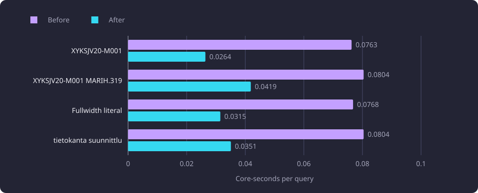

# Lexical lookup projection and native fuzzy matching

This report asks whether one normalized lexical projection and a native fuzzy-name scorer can replace per-query normalization and Python matching without changing any result.

**Evidence status:** Comparative. **Run dates:** 21, 28 and 29 October 2026.

The [Experiments section](/docs/experiments/README.md) gives the catalogue and the hardware this line used.

## The question

Every lexical search needs the same normalized text. An [exact code match](/docs/reference/glossary.md#search-and-comparison) compares normalized query tokens with normalized official codes. A [substring match](/docs/reference/glossary.md#search-and-comparison) looks for the normalized query inside a code or displayed name. A [fuzzy match](/docs/reference/glossary.md#search-and-comparison) scores a displayed name against the query and adds a token-coverage term.

Normalizing the code and both official names on every query, and splitting every title into tokens on every query, repeats work over a catalogue that changes only when its serving dataset changes. A projection could do that work once, if it returns the same courses, scores and order as a matcher that normalizes per call.

The fuzzy stage had a second candidate. On 29 October 2026 the whole-title score was RapidFuzz's `WRatio`, which is compiled C already. The per-title tokenization and the per-title coverage loop were Python. A native port could remove that Python work, if every score is identical.

The [search page](/docs/backend/search-and-discovery/search.md#the-four-search-methods) describes the four methods the product serves. The [normalization and ordering](/docs/backend/search-and-discovery/search-queries.md#normalization-and-ordering) page defines the normalized rows, the token tables and the score formula. The SQL lexical forms over the same rows are a separate line, recorded in [Lexical matching equivalence and collation](/docs/experiments/search-and-translation/lexical-matching-and-collation.md).

## What was measured

Four queries were fixed before any comparison. One exercises a code, one two codes in a single query, one a compatibility form and one a misspelling.

| Case | Query | Source |
|---|---|---|
| case-1 | `XYKSJV20-M001` | First active canonical course code |
| case-2 | `XYKSJV20-M001 MARIH.319` | First two distinct active canonical course codes |
| case-3 | `ＯＨＪＥＬＭＯＩＮＴＩ` | Fixed fullwidth literal |
| case-4 | `tietokanta suunnittlu` | Fixed misspelled literal |

Each query ran under Finnish and English and under the all-courses and active-only scopes, so one matcher has 16 cells. Every cell compares the full ordered identity list and the source fields behind each row, and the fuzzy cells also compare every score and tie. The reference received the same activity-scoped summaries as the projection. A lookup service that is handed a list returns that list as it is and applies the activity scope only when it performs its own read, so the comparison supplied the summaries for the cell's scope.

The 21 October leg measured the projection against a reference that normalized per call. It timed the three lexical methods in the four English active-inclusive cells, with one warmup and three recorded samples per cell. The timings cover the three methods only, with no database read and no HTTP request. That leg used Python 3.14.3.

The 29 October leg measured the native fuzzy stage. Its figures are medians of the stated samples, in core-seconds of process CPU accumulated per stage, on one code revision against a disposable database. The search request medians are whole-request web medians measured with a cleared query-embedding cache, so the cache did not hide the embedding cost in either case.

| Setting | Value |
|---|---|
| `FUZZY_SEARCH_MIN_SCORE` | 80 |
| `FUZZY_TOKEN_MATCH_WEIGHT` | 0.95 |
| Worker processes in the serving measurement | 4 |
| BLAS threads | 1 |

The 21 October object-graph proof recorded 10.28 to 10.39 GB available at start and a 2.15 GB address-space limit.

## The normalized projection

### What it holds

The serving projection holds one row per represented course. A row carries the canonical group identity, the activity flag, the normalized code and one normalized displayed name for each language. A requested official name is used first, and the other official name is the fallback when the requested one is absent. The projection holds one entry per canonical module identity, each with the versions a catalogue read selects from, and it stores module names and codes without normalizing them.

The measured prototype also held one row per eligible module version, with the module type and its normalized name and code, and it kept the title tokens beside each row.

The normalization is the product rule.

```text
normalized_text(value) = NFKC(value).casefold().strip()
```

NFKC turns compatibility forms into their composed equivalents, casefolding makes the comparison case-insensitive and outer trimming removes surrounding whitespace. Punctuation inside the string and runs of spaces are not rewritten.

Building and deserializing the prototype took 0.058 s for the courses and 0.059 s for the modules.

### Retention and build cost

The projection's bytes are a Python object-graph size from `sys.getsizeof`, with each shared object counted once. They are not a resident-set size.

| Measure | Bytes | MB |
|---|---:|---:|
| Course projection | 12,440,135 | 12.4 |
| Module projection | 10,101,721 | 10.1 |
| Combined, shared strings once | 22,541,016 | 22.5 |
| Title token structures and their strings | 11,511,607 | 11.5 |
| Course projection strings | 9,341,295 | 9.3 |
| Module projection strings | 7,376,897 | 7.4 |

The title token structures are 51.1 percent of the combined graph. They sit inside the course projection, so the rows do not add. The fuzzy call measured on 21 October derived title tokens inside the product scorer, so those bytes were retained projection payload without a measured tokenization saving.

A sum of four fields per entry with `sys.getsizeof` gave 5,092,095 bytes, or 5.09 MB. That sum is not a retention measure, because it excluded the three normalized strings the projection adds and the container and dataclass overhead, so it understated the retained projection.

The build ran with the source rows and the catalogue report resident.

| Measure relative to the post-setup baseline | Bytes | MB |
|---|---:|---:|
| Resident growth after the build | 224,198,656 | 224.2 |
| Python-traced growth after the build | 93,182,154 | 93.2 |
| Resident-minus-traced residual | 131,016,502 | 131.0 |
| Peak resident growth | 236,904,448 | 236.9 |

The traced growth includes the source rows, and the residual carries allocator arenas and extension allocations. Releasing the projections and the sources lowered resident memory by 4,120,576 bytes, so the measured resident growth is not the projection's retained size. The recorded process peak was 374.9 MB at the post-cell snapshot, and the whole-process maximum resident size was 424.1 MB after the object-graph accounting.

### Match parity

All 16 cells are identical for each of the three matchers. The canonical payload and order of the prototype's course projection match the catalogue owner, and those of its module projection also match.

| Matcher | Identical cells | Source-field mismatches |
|---|---|---|
| Exact code | 16 of 16 | 0 |
| Substring | 16 of 16 | 0 |
| Fuzzy name | 16 of 16 | 0 |

Module matching equality was not measured, because no module matching function was exposed to the comparison.

### Query time

The projection reuses its stored normalized strings, so a query does not normalize the catalogue again.

| Query | Reference wall (s) | Projection wall (s) | Saving |
|---|---:|---:|---:|
| First active course code | 0.3926 | 0.3510 | 10.6 percent |
| Two distinct active course codes | 0.4090 | 0.3707 | 9.4 percent |
| Fullwidth literal | 0.3961 | 0.3565 | 10.0 percent |
| Misspelled literal | 0.3989 | 0.3561 | 10.7 percent |

The projection saved 9.4 to 10.7 percent of wall time in those four cells. The difference is consistent with a reference that is recomputed on each call and a projection that reuses stored normalized strings. That is an interpretation of the timing, not a separate measurement.

The timing covers the three lexical methods as they ran on 21 October, with whole-title scoring and per-title token coverage in Python. It does not carry to the fuzzy stage after the 29 October native port.

## One projection inherited by four workers

On 28 October each serving worker held its own copy of the projection. It measured 137,199,616 bytes per worker, 137.2 MB, for 11,086 courses, 11,086 represented records and 11,141 module identities. The 11,141 figure counts canonical module identities, each with its versions. The catalogue's 9,901 eligible module versions were the prototype's row count. One build cost 1.86 core-s.

Four independent builds cost 8.1 core-s and held 601 MB of summed proportional set size. A prototype that built the projection once and forked four read-only children held 163 MB of summed proportional set size for the same four workers, a reduction of 438 MB.

The supervisor builds one projection before it forks its workers, and every worker inherits the pages. The serving routes read the supervisor's projection, and a worker that was not forked from a preloaded supervisor raises an error instead of building its own. The run counted the projection once as a 167,772,160-byte (167.8 MB) share of a retained-cache budget that no configuration key sets. The configuration sets the two retained regions `WEB_NEXT_COURSE_REPORT_CACHE_BYTES` and `WEB_QUERY_EMBEDDING_CACHE_BYTES` and leaves the supervisor-built projection unsized.

The diagram shows the one projection build, the four workers that inherit it and the fuzzy score path that runs in a worker.


The two measured sizes do not describe the same object. The 22.5 MB figure counts the prototype's normalized matching rows and title tokens, and the 137.2 MB figure counts the serving projection with its represented records and module identities. They are not compared, and no conversion between them is measured. The 137.2 MB figure is recorded without the per-language token tables that the projection builds, so the projection's total size with them is unmeasured.

With the projection preloaded, the reads that resolved an input or a summary answered from it.

| Stage | Before (core-s) | After (core-s) |
|---|---:|---:|
| Drawing input lookup, five targets | 0.0349 to 0.0422 | 0.0001 |
| Next-course input lookup | 0.0058 to 0.0072 | 0.0001 |
| Recommendation basis and candidate summary reads | 0.033 to 0.042 | 0.0000 |

The resolver that answers an identity or a code has one implementation. It answers from the projection when one is supplied and performs the scoped reads otherwise, which is the command-line path. The comparison resolved 3,168 sampled canonical identities and current codes through both paths and found zero differences in every representative tuple. One code is held by two canonical courses, and both paths raised the same ambiguity error.

## Native fuzzy-name matching

### Where the fuzzy stage spent its time

Before the native port, the score call cost 67 to 72 ms for the four queries. The title tokenization and the per-title coverage loop were 55 to 60 ms of that call. The other lexical stages did not carry the request. Exact code matching cost 0.8 to 0.9 ms and substring matching 2.9 to 3.3 ms. Pairing and merge, report construction and serialization, and the semantic repository call each measured at or below 7.4 ms.

### The native token coverage

The projection builds one token table per display language. A table holds each title's token positions, the distinct vocabulary and the code points of every vocabulary token. A query therefore tokenizes no title, and a query token is compared with the vocabulary rather than with every title's token list. The native library takes the table arrays and the score array as contiguous arrays without copying the table.

The similarity is the normalized Indel ratio over Unicode code points. It is the value RapidFuzz reports for `fuzz.ratio`.

```text
ratio(a, b) = 100 * (1 - edit_distance(a, b) / (length(a) + length(b)))
coverage    = weight * sum(best ratio of each query token) / query token count
score       = max(whole-title score, coverage)
```

A candidate whose coverage does not exceed its whole-title score takes the whole-title score. A query with no token, and a cutoff above the weight times 100, leave only whole-title similarity able to qualify a course.

The product calls the two stages in sequence. Whole-name Jaro-Winkler similarity fills one score array for the request's name list, and the native call raises the entries that token coverage can lift. Each entry holds a 0 to 100 score. The method takes every score at or above the configured cutoff of 80, maps each kept entry back to its row and sorts active courses first, then by descending score, then by the name and code keys.

Exact code and substring matching compare the projection's rows in Python. The fuzzy method reads the projection's per-language name list and token table.

The 29 October run filled the same array with a whole-title `WRatio` call:

```python
scores = numpy.zeros(len(names), dtype=numpy.float64)
for _, score, index in process.extract(
    query,
    names,
    scorer=fuzz.WRatio,
    processor=None,
    score_cutoff=threshold,
    limit=None,
):
    scores[index] = score
query_tokens = title_tokens(query)
if query_tokens and threshold <= 100 * token_weight:
    native_lookup.apply_token_coverage(
        scores,
        positions,
        table,
        query_tokens,
        threshold=threshold,
        token_weight=token_weight,
    )
```

### Cost and parity

| Query | Before, fuzzy stage (core-s) | After, fuzzy stage (core-s) | After, score call (core-s) |
|---|---:|---:|---:|
| `XYKSJV20-M001` | 0.0763 | 0.0264 | 0.0189 |
| `XYKSJV20-M001 MARIH.319` | 0.0804 | 0.0419 | 0.0251 |
| Fullwidth literal | 0.0768 | 0.0315 | 0.0231 |
| `tietokanta suunnittlu` | 0.0804 | 0.0351 | 0.0266 |

The fuzzy stage fell to 0.0264 to 0.0419 core-s. The score call alone fell to 0.0189 to 0.0266 core-s.

The chart plots the fuzzy-name stage cost for the four fixed queries before and after the token coverage moved to the native lookup library.



The score parity made 64 score-array comparisons, eight queries across two display languages, two activity scopes and two token-table paths, and found zero byte differences from the Python formula. The eight queries are the four fixed search queries, `ohjelmointi`, `tietokanta`, `opintojakso suunnittelu` and the empty string. One path scores from the prebuilt projection and the other builds an ad-hoc token table over the same rows. The name lists are filtered by the cell's activity scope and display language, so the arrays are not all the same length. The native ratio reproduces `fuzz.ratio` exactly, and the coverage rule is the same rule. The four search queries also return the same fuzzy scores, order, tiers and semantic results.

### Search request medians

| Query | Before (s) | After (s) |
|---|---:|---:|
| `XYKSJV20-M001` | 0.1027 | 0.0542 |
| `XYKSJV20-M001 MARIH.319` | 0.1068 | 0.0709 |
| Fullwidth literal | 0.1257 | 0.0812 |
| `tietokanta suunnittlu` | 0.1137 | 0.0688 |

The chart plots the whole-request search web median for the four fixed queries before and after the native fuzzy stage, with the query-embedding cache cleared.


Each median is a whole request, so it includes the query embedding request, the three lexical methods, the semantic read, the merge and serialization. The native fuzzy stage is one part of the difference.

The 29 October run recorded the remaining whole-title `WRatio` work over the searched titles at 14 to 31 ms of the score stage.

## The dropped native WRatio port

A native port of whole-title `WRatio` was tried after the token coverage moved. It produced no measured gain. The token coverage port removed a Python loop over every title, and the `WRatio` port had no equivalent Python loop to remove. RapidFuzz's `WRatio` already runs as compiled C, and a batch iterator over the same library, `extract_iter`, measured no gain either.

The port was dropped, and the whole-title score is the RapidFuzz call. No gain figure was recorded, so the attempt gives no cost baseline. The measured consequence is the 14 to 31 ms share that the native token coverage does not remove.

## What the results establish

Observed: the measured prototype returns the same ordered identities in all 16 cells of each matcher and the same fuzzy scores and ties in the fuzzy cells. It records no source-field mismatch, and its course and module canonical payloads and order match the catalogue owner. It holds 22.5 MB of measured object graph and saves 9.4 to 10.7 percent of wall time in the four timed cells.

Observed: the serving projection measured 137.2 MB per worker and 1.86 core-s per build. Four independent builds held 601 MB of summed proportional set size against 163 MB for a fork-shared prototype, and the supervisor preloads the projection once.

Observed: the native token coverage lowers the fuzzy stage to 0.0264 to 0.0419 core-s, leaves all 64 score arrays equal to the Python formula, and lowers every measured search request median. The whole-title `WRatio` share, 14 to 31 ms, is the part the token coverage left.

Interpreted: the projection's timing saving comes from reusing stored normalized strings, because the reference normalized the catalogue again on each call. The native port preserves scores because it computes the same normalized Indel ratio and the same coverage formula, and it removes the per-title Python loop.

Not established: that every Unicode input, every catalogue revision and every query mix preserves parity. The eight parity queries are a purposive sample. The search request medians are whole-request values and do not decompose the remaining cost. No concurrent or browser measurement was taken.

## Limitations

- The 21 October timings cover the three lexical methods only, with no database read or HTTP request. They describe the projection with the Python fuzzy stage and do not carry to the native stage.
- The projection sizes are Python object-graph estimates from `sys.getsizeof`, not resident sets. The 22.5 MB and 137.2 MB figures measure different objects and are not a before and after of one structure.
- The 137.2 MB per-worker figure is recorded without the per-language token tables, so the projection's total size with them is unmeasured.
- Module matching equality is unmeasured.
- The 29 October figures come from one code revision and one disposable database. The database and CPU cache warmth is uncontrolled.
- The search request medians include the query embedding request, the semantic read and serialization, so they do not isolate the fuzzy stage.

## Baselines

| Baseline | Value |
|---|---|
| Projection object graph, prototype | 22.5 MB, course 12.4 MB and module 10.1 MB |
| Projection build, prototype | 0.058 s courses, 0.059 s modules |
| Projection size per worker | 137.2 MB |
| Projection build, serving | 1.86 core-s |
| Four independent builds | 601 MB summed proportional set size, 8.1 core-s |
| Four fork-shared workers | 163 MB summed proportional set size |
| Projection share at measurement | 167,772,160 bytes, 167.8 MB |
| Projection match parity | 16 of 16 cells for each of the three matchers |
| Lookup parity | 3,168 identities, 0 differences |
| Fuzzy score parity | 64 score arrays, 0 byte differences |
| Fuzzy stage after the port | 0.0264 to 0.0419 core-s |
| Search web median after the port | 0.0542 to 0.0812 s |
| Fuzzy cutoff and token weight | 80 and 0.95 |

## Open questions

Each question below is untested.

- The projection's total object graph after the per-language token tables were added, and how it compares with the 167.8 MB the run measured.
- Whether a representation change can make the projection shareable as mapped memory rather than inherited copy-on-write pages, and what it would cost per query.
- Whether a native whole-title `WRatio` gains once the score array is consumed by native code end to end, rather than materialized for a Python caller.
- Whether the score parity holds on a wider sample of Unicode names, codes and query strings.
- Whether the fuzzy-stage saving holds under concurrent load and with a warm query-embedding cache.
- Whether token coverage can run without materializing the full score array for titles below the cutoff.
