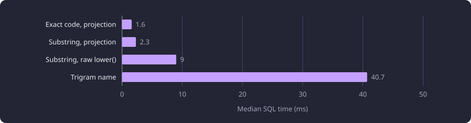

# Lexical matching equivalence and collation

This report tests whether SQL can reproduce the application's course-code and name matching, and why result order depends on collation.

**Evidence status:** Corrected. **Run date:** 21 October 2026.

The [Experiments section](/docs/experiments/README.md) gives the catalogue and the hardware this line used.

## The question

The application matches course codes and names without a model. An [exact code match](/docs/reference/glossary.md#search-and-comparison) compares normalized query tokens with normalized official codes. A substring match looks for the normalized query inside a code or displayed name. A fuzzy match scores a displayed name against the query. A SQL version could move that work into PostgreSQL, but it is acceptable only if it returns the same courses in the same order.

Those are two separate properties. Set equality asks whether the same canonical courses appear. Order equality asks whether every position in the list is the same. A set match with a different order changes what a reader sees first, so the line measured both.

The line also asks what the SQL representation costs. A normalized projection has to be built and stored, and a query over it has a duration. The durations here cover the SQL statement only, not the Python normalization that prepares the rows.

No SQL matcher, collation or index from this line is a selected product setting. The application matches over its normalized lookup projection. The [four search methods](/docs/backend/search-and-discovery/search.md#the-four-search-methods) describe how the application matches codes and names. The SQL forms are measured alternatives.

## Fixed inputs and setup

The catalogue snapshot holds 11,086 represented courses, of which 4,543 are active, and 58,962 teaching-text chunks. This line reads only course identities, official codes and official display names. It uses no embedding, translation or inference model.

Four query strings were fixed before any comparison. They exercise one code, two codes in one query, a fullwidth Unicode literal and a misspelled literal.

| Case | Query | Source |
|---|---|---|
| case-1 | `XYKSJV20-M001` | First active canonical course code |
| case-2 | `XYKSJV20-M001 MARIH.319` | First two distinct active canonical course codes |
| case-3 | `ＯＨＪＥＬＭＯＩＮＴＩ` | Fixed fullwidth literal |
| case-4 | `tietokanta suunnittlu` | Fixed fuzzy literal |

Every query ran under both display languages, Finnish and English, and both activity scopes, all courses and active courses only. One cell is one query in one language and one scope. The comparison against the Python matchers covered 16 cells for each SQL form. The ordering proof covered 16 cells for each of two matchers.

| Item | Value |
|---|---|
| PostgreSQL | 18.6 on aarch64 |
| Python | 3.14.3 |
| Trigram extension | `pg_trgm` 1.6 |
| Hardware | 4-core aarch64 server, 24.1 GB of RAM |
| Available memory at proof start | 10.22 GB |
| Fixture database collation | `en_US.utf8`, locale provider `c` |
| Fixture memory and swap | 805.3 MB, no swap |
| Parallel query workers | 0 |
| Statement timeout | 30 s |
| Models | None |

The fixture is a disposable PostgreSQL container with no network and no published port. The catalogue snapshot was read through a read-only connection with the 30 s statement timeout. The network isolation bounds the fixture, and the read-only connection and the timeout bound the snapshot read.

### Normalization and the projection

The product normalization is one function:

```text
normalized_text(value) = NFKC(value).casefold().strip()
```

NFKC turns compatibility forms into their composed equivalents. Casefolding maps characters to a case-insensitive form. Outer trimming removes leading and trailing whitespace. The normalization does not strip punctuation inside the string, collapse runs of spaces or apply a locale.

The normalized lookup projection has one row per represented course. It holds the canonical group identity, the activity flag, the normalized code and one normalized displayed name for each language. A requested official name is used first. When that language has no name, the other official name is used as a fallback. A name in the other language is never matched when the requested name exists. Across the catalogue, 793 Finnish rows and 373 English rows used the fallback, and no row lacked a display name in both languages.

### The five order keys

Python orders exact-code and substring matches by a five-part key. The [normalization and ordering](/docs/backend/search-and-discovery/search-queries.md#normalization-and-ordering) page defines it. The first part puts active courses first, the second puts rows with a displayed name before rows without one, and the remaining three are the normalized displayed name, the normalized code and the canonical group identity. The fuzzy matcher sorts by a six-part key: the activity flag, the descending score, and then the four parts from the display-name flag onward.

```text
(not is_active, display_name is None, normalized display name, normalized code, group_id)
```

The SQL comparison used the same five keys. The first two are booleans, and PostgreSQL orders false before true. The three text keys carry ordering under the selected collation. The ordering proof specified C collation on those keys, with `fi` replaced by the cell's display language.

```sql
ORDER BY (NOT is_active),
         (NOT has_display_fi),
         ndisplay_fi COLLATE "C",
         ncode COLLATE "C",
         group_id COLLATE "C"
```

Python compares strings by Unicode code point. A database collation can order the same strings by language rules, which may weight case, accents and punctuation differently. C collation compares UTF-8 bytes, and for valid UTF-8 that byte order equals code-point order.

## The matchers compared

Two SQL forms ran over the pre-normalized projection. Two diagnostic forms ran to show what happens when SQL supplies its own normalization or similarity.

| Form | Python baseline | Match rule | Normalization in SQL |
|---|---|---|---|
| `projection_exact_code` | Exact code | Equality between a normalized query token and the normalized code, any token | None, the projection is pre-normalized |
| `projection_substring` | Substring | Containment of the full normalized query in the normalized code or displayed name | None, the projection is pre-normalized |
| `sql_lower_substring` | Substring | `lower()` on raw code and raw names, then containment | `lower()` only |
| `trigram_name` | Fuzzy name | `pg_trgm` similarity at or above 0.8 on the displayed name | Query normalized in Python, title pre-normalized |

The exact matcher splits the query on commas and whitespace, normalizes each token, drops empty tokens and compares the resulting set with the codes. A match on any token is enough. The SQL form passes the sorted token set to `ncode = ANY(...)`, which has the same OR semantics.

The substring matcher uses the whole normalized query, not its tokens. It checks the normalized code and the displayed name. The SQL form builds a `LIKE` pattern and escapes `%`, `_` and the backslash itself, so those characters match literally as they do in Python.

The fuzzy matcher scores the whole normalized displayed name with a whole-name similarity and can raise the score through token coverage. In the 21 October 2026 measurement, whole-name similarity was RapidFuzz `WRatio`. A candidate whose score is at or below the token weight times 100, 95 with the configured weight, can be raised by the mean of the best `fuzz.ratio` between each query token and a title token, multiplied by the configured token weight. The cutoff is 80 on a 0 to 100 scale, set by `FUZZY_SEARCH_MIN_SCORE`, and the token weight is `FUZZY_TOKEN_MATCH_WEIGHT`, 0.95. The fuzzy matcher reads display names only, not codes.

The line measured this rule in the Python matcher. In the application, exact code and substring matching run in Python over the normalized projection rows, the whole-name Jaro-Winkler score is a RapidFuzz call invoked from Python, and the token-coverage step runs in the native lookup library. The [lexical lookup projection and native fuzzy matching](/docs/experiments/search-and-translation/lexical-lookup-projection-and-native-fuzzy.md) report covers that arrangement.

The trigram form uses the `pg_trgm` `similarity` function, which compares sets of three-character sequences and returns a fraction from 0 to 1. The SQL cutoff is 0.8, the configured fuzzy cutoff divided by 100. That fraction and the RapidFuzz score are different scales, and the trigram form has no token-coverage step. It also scores the displayed name only.

## Results under the default collation

Each SQL form was compared with its Python baseline over 16 cells. The fixture database used its default `en_US.utf8` collation, and the SQL order clauses had no explicit collation.

| Form | Python baseline | Same set | Same order | Mismatched inputs | Median SQL time per input (ms) |
|---|---|---|---|---|---|
| Projection exact code | Exact code | All 16 | All 16 | 0 | 1.6 |
| Projection substring | Substring | All 16 | 15 of 16 | 0 | 2.3 |
| Raw `lower()` substring | Substring | 14 of 16 | Not all | 2 | 9.0 |
| Trigram name | Fuzzy name | 13 of 16 | Not all | 3 | 40.7 |

The exact form returned the same set and the same order in every cell. The projection substring form returned the same set in every cell but a different order in one cell, the all-courses Finnish case-3 cell with 61 results. The exact form's order equality is an observation on these cells. The order comes from the five keys, not from the order of the query tokens.

## Failed approaches

### Raw `lower()` substring

The form applied `lower()` to the raw code and the raw names, then tested containment, over the same 16 cells. It matched the Python substring set in 14 of them. The two mismatches were both on the fullwidth query.

| Scope | Language | Case | Python results | SQL results | Missing | Added |
|---|---|---|---|---|---|---|
| All | Finnish | case-3 | 61 | 0 | 61 | 0 |
| Active | Finnish | case-3 | 5 | 0 | 5 | 0 |

The query `ＯＨＪＥＬＭＯＩＮＴＩ` normalizes to `ohjelmointi` under NFKC. The projection stores that normalized form, and the Python matcher finds names and codes containing it. `lower()` does not apply NFKC, so the fullwidth characters remain fullwidth and no raw value contains them. SQL `lower()` also does not equal Unicode casefolding. It maps case under the database locale, while casefolding applies the wider Unicode mapping. The English cells for that query return nothing.

### Trigram name

The form scored the displayed name with `pg_trgm` `similarity` at or above 0.8, with the query normalized in Python and the title pre-normalized. It matched the Python fuzzy set in 13 of 16 cells.

| Scope | Language | Case | Python results | SQL results | Missing | Added |
|---|---|---|---|---|---|---|
| Active | Finnish | case-3 | 7 | 0 | 7 | 0 |
| All | Finnish | case-3 | 75 | 7 | 68 | 0 |
| All | Finnish | case-4 | 7 | 0 | 7 | 0 |

For the fullwidth query, the Python fuzzy matcher returned 75 Finnish names in the all-courses scope and seven in the active scope. Trigram similarity returned seven rows in the all-courses scope and none in the active scope. All seven returned rows are also in the Python result, so the trigram form is a subset here, not an addition.

For `tietokanta suunnittlu`, the Python matcher returned seven Finnish names in the all-courses scope, with scores from 81.4 to 87.0. The trigram form returned none at its 0.8 cutoff. The two methods measure different things. RapidFuzz compares the whole strings with an edit-aware weighted ratio and can raise a score through token coverage. Trigram similarity counts shared three-character sequences and compares that fraction with a fixed cutoff.

## Ordered parity under explicit C collation

The ordering proof isolated the order rule. It copied only the normalized projection columns into a fresh fixture. The fixture database kept its default `en_US.utf8` collation with locale provider `c`, so this is not a C-collated database. The three text keys in each `ORDER BY` carried an explicit `COLLATE "C"` expression. The first two keys stayed boolean.

The proof ran one warmup pass and three recorded passes. Each pass issued 16 exact-code queries and 16 substring queries, 32 in total, covering four cases, two languages and two scopes. All four passes produced identical compared output.

For every cell the proof saved the full ordered Python identity list and the full ordered SQL identity list. The saved Python result holds ordered identities but no key values. The proof therefore read the five key values from the same projection for the Python identities, read them from the SQL rows, and compared the two sequences. It also checked that each sequence was already in Python code-point order.

All 32 of 32 cells matched in full, 16 exact-code cells and 16 substring cells, and the key sequences matched in all 32 cells. The all-courses Finnish case-3 substring cell that ordered differently under the default collation returned 61 results and matched in full under explicit C collation. Its active-only counterpart returned five results. Every empty cell was empty on both sides.

Exact code case-2 returns its two courses in one fixed order that the query codes do not set. The first query code, `XYKSJV20-M001`, belongs to the second result.

## Representation and cost

The projection is not free. The default-collation projection held normalized code, normalized display names, the raw code and the raw Finnish and English names, so that the raw `lower()` form could read the raw columns. The ordering proof held only the group identity, the normalized code, one normalized display name per language, the activity flag and the display-present flag for each language. The narrower table is 32 percent smaller.

| Representation | Rows | Size | Contents |
|---|---:|---:|---|
| SQL projection, default collation | 11,086 | 3.33 MB | Normalized keys, raw code and names, and flags |
| SQL projection, ordering proof | 11,086 | 2.26 MB | Normalized code, one display name per language and flags |

The Python leg built its normalized rows in memory for every matcher call and did not record a separate projection size. Its process peak was 168.6 MB. The SQL comparison client peaked at 168.7 MB and the ordering proof client at 162.4 MB. The SQL client peaks include the fixture copy. All three are process-wide peaks, so they are not the memory of one query or one process.

| Measurement | Value |
|---|---|
| Python lexical leg, elapsed | 4.885 s |
| Python lexical leg, process peak | 168.6 MB |
| SQL lexical leg, process peak | 168.7 MB |
| SQL ordering proof, process peak | 162.4 MB |
| SQL lexical fixture, cgroup current | 77.08 MB |
| SQL lexical fixture, cgroup peak | 86.41 MB |

The Python leg's 4.885 s is not a per-query latency. It covers three recorded passes, each with two scopes, two languages and four cases, and each cell ran three matchers. It also rebuilt the normalized rows on each matcher call. The SQL medians cover one statement per form over a projection that was normalized and copied before timing.

The chart shows the median SQL time for the four forms.



The four medians span a factor of about 25. The trigram form scans the projection and computes a similarity for each row, and no trigram index was built. This measurement ran no warmup pass, so its medians are not directly comparable with the warmed per-cell medians in the ordering proof, which ran from 1.109 ms to 2.995 ms.

The projection is prepared by the Python normalization rule before any SQL timing starts. The SQL numbers therefore contain no NFKC or casefold normalization cost. The 3.33 MB and 2.26 MB sizes are the copied relations, not the size of the catalogue snapshot they were copied from.

## The result that stands

The result that stands is full order parity for exact code and substring matching on the pre-normalized projection, on the four fixed queries, two display languages and two activity scopes, when the three text keys carry explicit C collation. The proof does not describe a C-collated database. The database kept its default collation and only the order expressions changed.

Observed: raw `lower()` did not reproduce the Python substring results on the fullwidth query, and trigram similarity did not reproduce the Python fuzzy results on the fullwidth query or the misspelled query. Both were set differences, not only order differences, and the ordering proof reran neither.

Interpreted: NFKC and casefolding have to happen before the comparison. A projection built with the product normalization carries the needed equivalence, while `lower()` on raw columns does not. A trigram fraction is not a substitute for the weighted whole-string ratio plus token coverage. Collation is a property of the ordering expression. The same projection and the same keys produced Python order when the text keys carried explicit C collation, even though the database default stayed `en_US.utf8`.

No SQL matcher, collation or index from this line was selected. The four queries are a purposive sample chosen to exercise exact codes, multi-token OR, a compatibility form and a misspelling, not a random sample of names, codes or user input. The line measured no normalization cost, index behavior, concurrency, HTTP latency or whole-search latency, and its timings cover single SQL statements on a fixture with no competing load and no trigram index. Database and CPU cache warmth was uncontrolled.

## Follow-up questions

These are untested.

- Whether an indexed trigram query can approach the Python fuzzy result at this corpus size, and what index size and build time it would add.
- Whether normalization can move to write time without changing the order of any input, and what that would cost per course.
- Whether a much larger set of Unicode names and codes preserves order parity under explicit C collation.
