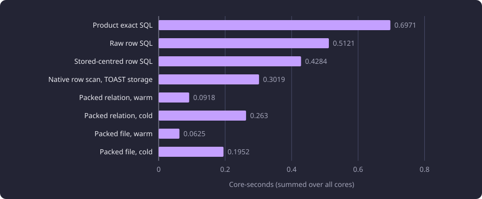

# Packed exact semantic search

Eight exact semantic scan layouts and two packed serving reads measured core-seconds, wall time and peak memory with identical results on four fixed vectors.

**Evidence status:** Comparative. **Run dates:** 28 to 31 October 2026.

## The question

The exact semantic read scores every stored chunk vector against a query and keeps the best score of each course. PostgreSQL was the dominant CPU consumer for search, so the read's representation decides a large part of the search cost. A cheaper read is usable only when it returns the same courses, the same scores, the same order and the same threshold outcomes as the product read.

The experiment asked which stored representation makes that read cheapest, and what the cheapest representation costs in memory, cold reads and serving work. It measured six representations in eight warm and cold rows, then placed the packed relation and a packed file inside a serving-shaped composition. [Exact and approximate semantic retrieval](/docs/experiments/search-and-translation/semantic-retrieval.md) covers the earlier centred SQL and HNSW comparison.

## Catalogue and conditions

The catalogue held 11,086 represented courses and 58,962 completed chunk vectors under one embedding configuration. The packed relation assigned one dense group number to each canonical representative triple, which gave 11,086 groups. Four stored chunk vectors were frozen as queries. One came from learning outcomes and three from content, all English at chunk index 0, each from a different canonical course. They are query inputs, not a semantic-quality oracle. At the 0.3 threshold the product read returned 240, 168, 479 and 592 groups.

The isolated scans ran in a PostgreSQL 18.6 container with pgvector 0.8.6, a 1.5 GB hard memory limit, no swap and `shared_buffers=256MB`. Every row used the same four query vectors, one BLAS thread (`OPENBLAS_NUM_THREADS=1`) and no HNSW index. Each value is the median of three warm samples and two cold samples per query. The host was a four-core aarch64 Neoverse N1 server with 24.1 GB of RAM.

## The scan variants

Every value in this report is the statistic its run recorded. The isolated rows are medians of three warm and two cold samples per query. The packed serving-path rows are the values of their stated runs. The matched endpoint rows are means of three samples with the minimum and maximum. No value is converted from one statistic to the other. A core-second is one second of CPU on one core. A total core-second value sums the processes the measurement covers, and a database core-second value covers the database container.

| Variant | Core-s | Database core-s | Wall s | Sampled peak MB | Read path |
|---|---:|---:|---:|---:|---|
| Product exact SQL | 0.6971 | 0.6616 | 0.632 | 615 | One row per chunk, hub subtraction in SQL |
| Raw row SQL | 0.5121 | 0.4875 | 0.487 | 615 | Hub subtraction in SQL, layout and grouping control |
| Stored-centred row SQL | 0.4284 | 0.4076 | 0.407 | 615 | Centring removed from the read |
| Native row scan, TOAST storage | 0.3019 | 0.2944 | 0.106 | 615 | Fused subtraction and SIMD over stored rows |
| Packed relation, warm | 0.0918 | 0.0851 | 0.087 | 615 | Block streaming from the relation |
| Packed relation, cold | 0.2630 | 0.2163 | 0.894 | 615 | Shared buffers and page cache dropped |
| Packed file, warm | 0.0625 | 0.0574 | 0.060 | 856 | One 526 KB block buffer |
| Packed file, cold | 0.1952 | 0.1161 | 1.626 | 619 | `pread` with per-block `fadvise` |

The chart shows the core-seconds of the eight rows. The two packed rows are the lowest pair in both states.



The packed relation uses 7.6 times fewer core-seconds than the product SQL on the same four queries at the 0.3 threshold. The packed file uses 11.2 times fewer warm and 3.6 times fewer cold. The product SQL reads one row per chunk and subtracts the hub in SQL. The raw row SQL is the layout and grouping control with the subtraction in SQL. The stored-centred row SQL reads a column that already holds the centred vector. The native row scan fuses the subtraction and uses SIMD over the stored rows.

The packed relation streams 461 block rows and computes the best score of each group inside the extension. The packed file reads the same blocks from a file with `pread`. The sampled cgroup peak was 615 MB on six rows, 856 MB on the warm packed file and 619 MB on the cold packed file. The 1.5 GB container recorded no OOM kill and no `memory.failcnt` increment, and no run needed a 4 GB resident pool.

## Exactness

Every variant matched all 58,962 chunk identities on each of the four queries. The set, order and score were equal on every identity, the maximum score delta was `0.0`, and no threshold outcome flipped at 0.0, 0.3 or 0.5. The 32 recorded parity checks reported `all_group_scores_equal: true`.

| Query | Threshold 0.0 | Threshold 0.3 | Threshold 0.5 |
|---|---:|---:|---:|
| vector-1 | 8,586 | 240 | 8 |
| vector-2 | 8,548 | 168 | 8 |
| vector-3 | 7,995 | 479 | 27 |
| vector-4 | 7,420 | 592 | 266 |

The table holds the group counts at or above each threshold. The product read and every variant returned these counts. The 0.0 column holds the groups whose best score was not negative. The three thresholds are measured values, and `SEMANTIC_SEARCH_MIN_SCORE` sets the serving threshold, whose example is 0.30.

## The packed relation

The build writes three tables. `course_embedding_search_groups` holds one row per canonical representative triple with its dense group number. `course_embedding_search_blocks` holds one row per block with the block number, the vector count, the group number and float64 squared norm of each vector, and one `bytea` of the centred float32 vectors. `course_embedding_search_meta` holds one row with the group count.

| Part | Value |
|---|---:|
| Groups | 11,086 |
| Block rows | 461 |
| Vectors per block | Up to 128 |
| Components per vector | 1,024 |
| Stored vector payload | 241.5 MB (241,508,352 bytes) |
| Packed relation | 251.9 MB (251,904,000 bytes) |
| Toast relation | 250.9 MB (250,904,576 bytes) |
| Packed file | 242.2 MB (242,217,760 bytes) |
| Block read buffer | 526 KB |

The relation is 251.9 MB, of which 250.9 MB is its toast relation. A block row holds up to 128 chunk vectors. The extension scans every block and keeps the best score of each group. It returns one row for each group that has a vector, and the repository applies the threshold.

The extension receives the query vector already hub-centred, the query squared norm and the group count. It recomputes each score as `1 - (1 - score)` so that the float rounding matches the score the product read returns.

The product uses the packed relation through a PostgreSQL extension, described in [the packed exact read](/docs/backend/search-and-discovery/search.md#the-packed-exact-read). Its repository calls `course_embedding_search_scan` once per query, joins the returned group numbers to their identities and the course activity state, applies the threshold and orders by canonical group and version. The active-only scope adds `AND c.is_active`. The repository reads no meta row per query, and the build's group count is passed to the scan.

```sql
SELECT g.group_id, g.sisu_course_unit_id, g.representative_source_hash, s.score
FROM course_embedding_search_scan(
    'course_embedding_search_blocks'::regclass,
    :centred_query,
    inner_product(CAST(:centred_query AS vector), CAST(:centred_query AS vector)),
    :group_count
) AS s
JOIN course_embedding_search_groups AS g ON g.group_no = s.group_no
JOIN courses AS c ON c.group_id = g.group_id
WHERE s.score >= :min_score
ORDER BY g.group_id, g.sisu_course_unit_id
```

`:centred_query` is the query vector after the hub subtraction.

## The packed read in the serving path

The packed relation and the packed file were placed in the same experiment-only composition. The real supervisor, router and worker processes served loopback HTTP, the semantic read was replaced in the experiment composition without changing product code, and the web cap was 1.9 GB. Warm runs sent two rounds over four concurrent threads. Cold runs were a four-thread batch with the relation's buffers and page cache dropped once before the batch, and a one-thread sequence with an eviction before every relation request or the file's per-block `POSIX_FADV_DONTNEED`.

The shared serving measurement method, including the load and memory accounting, is on [Runtime, storage and serving experiments](/docs/experiments/runtime-storage-and-serving/README.md).

| Variant | Requests | Wall s | Total core-s | Core-s per request | Database core-s per request | Web core-s per request | Parity |
|---|---:|---:|---:|---:|---:|---:|---|
| Packed relation, warm, four threads | 8 | 2.50 | 6.402 | 0.800 | 0.215 | 0.527 | Exact, 1,515 results, score delta 0.0 |
| Packed file, warm, four threads | 8 | 2.42 | 5.860 | 0.732 | 0.147 | 0.526 | Exact, same result list |
| Packed relation, cold, one thread | 3 | 0.95 | 1.004 | 0.335 | 0.101 | 0.185 | Exact |
| Packed file, cold, one thread | 3 | 3.01 | 0.961 | 0.320 | 0.097 | 0.174 | Exact |
| Packed relation, cold batch, four threads | 4 | 2.12 | 4.940 | 1.235 | 0.311 | 0.854 | Same scan function as the warm run |
| Packed file, cold batch, four threads | 4 | 6.24 | 5.616 | 1.404 | 0.430 | 0.905 | Same scan function as the warm run |

The endpoint adds the query embedding call, the lexical matchers, result projection and JSON and gzip serialization to the scan. The serving costs are therefore larger than the isolated rows and are not comparable with them. The file is cheaper in warm and one-thread cold core-seconds, and its warm wall is shorter. Its one-thread cold wall is 3.01 seconds for three requests against 0.95 seconds for the relation. The cold batch raises the cost per request to 1.235 core-seconds for the relation and 1.404 for the file.

## The product endpoint

The search endpoint was compared between the earlier tree, which predates the packed read, and the product tree, on the same three request bodies per case, the same database and embedding provider, and one BLAS thread. Four cases ran, a title query and a code query in the active-only and including-inactive scopes. Each case sent the same three distinct query texts on both sides, one text per sample. The three texts differ in length and in the number of courses they return, so the range covers their different difficulty. The product tree holds a query embedding cache, so each product sample is a genuine miss with its own cache event. The earlier tree has no query embedding cache and computes the same three texts once each. A row is the mean of three server core-seconds with its minimum and maximum, and the range spans the three texts, not repeated timings of one text.

| Search case | Earlier tree | Product tree | Change |
|---|---:|---:|---:|
| Title, active only | 0.5014 (0.4047 to 0.6510) | 0.2762 (0.2246 to 0.3738) | -44.9% |
| Code, active only | 0.3797 (0.3666 to 0.3887) | 0.1984 (0.1866 to 0.2089) | -47.8% |
| Title, including inactive | 0.8111 (0.7806 to 0.8326) | 0.2288 (0.2001 to 0.2455) | -71.8% |
| Code, including inactive | 0.7996 (0.7918 to 0.8059) | 0.2249 (0.2188 to 0.2328) | -71.9% |

The response bytes and result counts were equal on every case. The product rows ran on a tree with the shared query embedding cache and the earlier rows on a tree without it, but every measured product sample is a miss, so the cache saves nothing in these rows. The fall covers the whole product search path between the two trees, not the packed scan alone. The four search rows belong to the 101-row matched endpoint matrix priced in [Serving request cost and admission curves](/docs/experiments/runtime-storage-and-serving/serving-request-cost-and-admission.md).

## Where the backend CPU goes

A profile of 30 packed searches over one kept-alive connection attached to the PostgreSQL postmaster and all of its backends split the sampled backend CPU into three components.

| Component | Share of sampled backend CPU |
|---|---:|
| PostgreSQL | 54.25% |
| libc | 32.80% |
| `course_embedding_search` | 12.21% |

Observed: the extension's dot loop is 12.21 percent of sampled backend CPU, and the two hottest libc program counters lie inside one SIMD copy loop. Within the PostgreSQL share, the largest symbols were:

| Symbol | Share of sampled backend CPU |
|---|---:|
| `heap_hot_search_buffer` | 11.54% |
| `hash_search_with_hash_value` | 9.29% |
| `heap_page_prune_opt` | 2.69% |
| `LWLockAcquire` | 1.98% |
| `index_fetch_heap` | 1.36% |
| `heap_fetch_toast_slice` | 1.20% |
| `HeapTupleSatisfiesVisibility` | 0.84% |

Interpreted: the container libc slice disassembles to the 0x40-stride `ldp` and `stp` copy loop, so the libc share is the detoast and vector copy around the scan, not the scan. The PostgreSQL heap and hash work and the libc copy loop are larger shares. The scan is the smaller part of the sampled backend cost. The 12.21 percent is the extension's share of the sampled backend CPU in this run, not an absolute bound on what a faster dot loop can save, because a changed program leaves a different profile. The profile describes one 30-search run on the packed relation, not the row SQL.

## What was not adopted

### The packed file

The packed file was faster than the relation in every isolated core-second row: 0.0625 against 0.0918 warm and 0.1952 against 0.2630 cold. In the serving path it was also cheaper in core-seconds, 5.860 against 6.402 total for eight warm requests and 0.961 against 1.004 for three cold requests. It was not adopted. The file and the relation are alternative representations of the same vectors, so a product path keeps one. The file needs a mounted file and a bounded read buffer outside PostgreSQL storage, and its cold wall is worse: 1.626 against 0.894 seconds isolated and 3.01 against 0.95 seconds for three one-thread requests. The product keeps the relation.

### Identity and activity in the extension row

The extension returns only the group number and the score. A probe asked whether returning the group identity and the course activity flag from the extension would remove the join. The whole semantic repository call, including the join that looks the example query's 240 groups up by primary key and course identity, cost 0.0026 to 0.0060 web core-seconds. Removing a 240-row join would not repay an extension version and a migration, so the return shape did not change.

### The approximate index

The approximate HNSW line was dropped. No measured candidate bound or `ef_search` value returned the exact set for all four vectors, and the representation question measured here does not reopen it. [Exact and approximate semantic retrieval](/docs/experiments/search-and-translation/semantic-retrieval.md) owns the HNSW measurements and recall values.

## The isolated row and the all-group row

The isolated warm packed relation row is 0.0918 core-seconds at the 0.3 threshold. It is the median over the four query vectors, whose group counts at that threshold are 240, 168, 479 and 592, so it is not the cost of the 240-group example query alone. The product packed scan's all-group row is 0.1469 to 0.1474 database core-seconds at `min_score=-1`, returning all 11,086 groups.

The rows measure different work. The first is a total over database and client work for four queries at one threshold, with 168 to 592 groups returned per query. The second is database work alone for the same four vectors with every group returned and no threshold. A matched probe on the same warm relation separated those effects.

| Read | Threshold | Groups | Database core-s | Client core-s |
|---|---:|---:|---:|---:|
| Direct client | 0.3 | 240 | 0.0865 | 0.0005 |
| Repository | 0.3 | 240 | 0.0905 | 0.0036 |
| Direct client | -1.0 | 11,086 | 0.0907 | 0.0072 |
| Repository | -1.0 | 11,086 | 0.1409 | 0.0623 |

The direct client at 0.3 returns the 240 groups for 0.0865 database core-seconds, which reproduces the database cost of the experiment's vector-1 sample at 0.0849. That sample records 0.0062 client core-seconds, and its 0.0911 total is 0.8 percent from the 0.0918 table total. The repository at the same threshold costs 0.0905 database and 0.0036 client core-seconds, because it joins each group to its result row and maps the rows.

At `min_score=-1`, the repository returns all 11,086 groups for 0.1409 database and 0.0623 client core-seconds. The 0.1409 is four percent below the product row's 0.1469 and within the run variation the probe records. The direct client returns the same groups for 0.0907 database core-seconds, so the repository's join raises the all-group database cost from 0.0907 to 0.1409, and its result mapping raises the client cost from 0.0072 to 0.0623.

The isolated row and the all-group row therefore measure different work. The threshold, the result count and the client boundary account for the difference, and the matched probe reproduces both ends of it.

## What the results establish

The packed relation is the representation the product serves. It uses 7.6 times fewer core-seconds than the exact SQL at the 0.3 threshold, and it matched every measured course, score, order and threshold outcome. The packed file is cheaper in core-seconds in every isolated and one-thread serving state, but it was not adopted because it is an alternative representation that needs a mounted file and has a worse cold wall.

The exactness is empirical on four stored vectors and one catalogue snapshot. It covers every chunk identity and every group score, the set, the returned order and the three threshold counts in the table. It does not prove exactness for every query or every threshold.

The endpoint comparison shows the product search path is 44.9 to 71.9 percent cheaper than the earlier tree on the four cases. The endpoint includes the query embedding call, the lexical matchers and serialization, and it covers the whole search path between the trees, so the fall is not the packed scan's share alone. Interpreted: the database profile puts the extension's dot loop at 12.21 percent of the sampled backend CPU on that workload, a share of the sample rather than a bound on what a faster scan can save.

## Limits

- The four query vectors are fixed stored chunk vectors on one catalogue snapshot. They are not a random sample of queries, languages or thresholds, and they establish no semantic quality.
- The isolated scan starts after the query vector exists. It excludes the embedding request, the lexical matchers, result projection and response serialization.
- The serving-path rows use an experiment-only composition. The product endpoint rows use the product tree, but the endpoint comparison does not decompose its stages.
- The cold rows drop the container's shared buffers and the relation's or file's page cache. They are not a host-wide page-cache drop after a reboot.
- The backend profile covers one 30-search run on the packed relation. Its shares are of sampled backend CPU, not of the whole serving stack, and such a share is not an upper bound on what a changed program can save.
- The packed relation is a second representation of the vectors and needs an update path for every embedding generation.

## Baselines

| Baseline | Value and conditions |
|---|---|
| Product exact SQL, isolated | 0.6971 core-s, 0.632 s wall, 615 MB sampled peak, 1.5 GB container, one BLAS thread, 0.3 threshold |
| Product packed scan, all groups | 0.1469 to 0.1474 database core-s and 0.0625 to 0.0658 client core-s, 11,086 groups |
| Packed relation, warm | 0.0918 core-s, 0.087 s wall, 615 MB sampled peak |
| Packed file, warm | 0.0625 core-s, 0.060 s wall, 856 MB sampled peak |
| Search endpoint, earlier tree, four cases | 0.3797 to 0.8111 core-s, mean of three per case |
| Search endpoint, product tree, four cases | 0.1984 to 0.2762 core-s, mean of three per case |

## Open questions

- Whether a product path that keeps only the packed file can meet the relation's cold wall. Untested.
- Whether a different block size, a separate norm layout or a different payload type lowers the remaining libc copy and heap cost. Untested.
- Whether the exactness holds for other query vectors, languages, thresholds and catalogue snapshots. Untested.
- Whether the relation's update path for a new embedding generation costs less than a full rebuild at this catalogue size. Untested.
- Whether returning identity and activity from the extension becomes worthwhile at a wider result set than the measured 168 to 592 groups. Untested.
