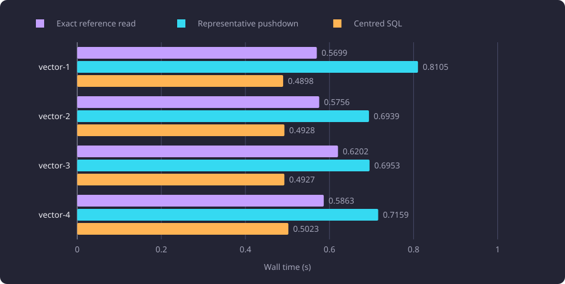
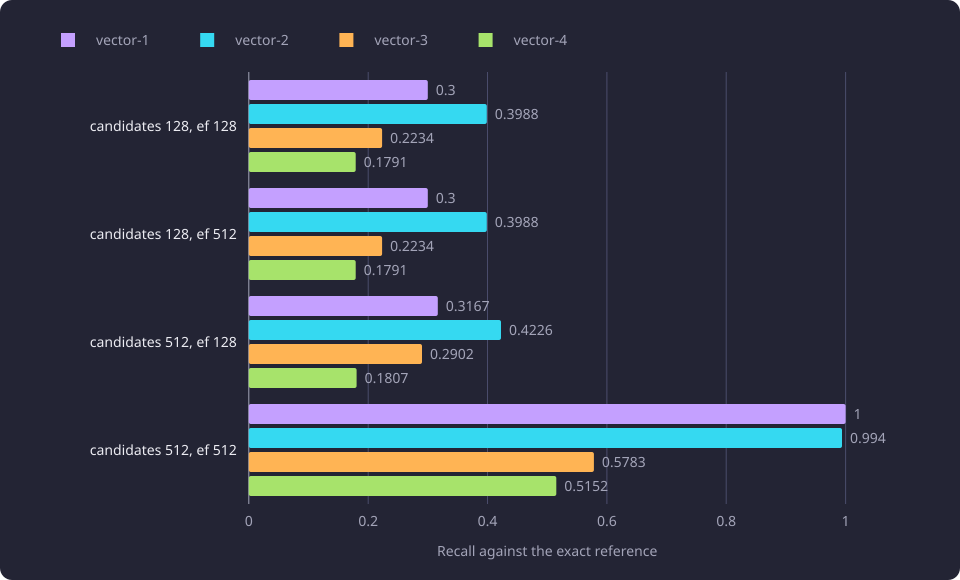

# Exact and approximate semantic retrieval

Five semantic reads ran over one fixed catalogue snapshot and four stored query vectors, and a served request measured the endpoint that serves the read.

**Evidence status:** Comparative. **Run dates:** 21 and 28 October 2026.

## The question

The comparison asked whether an exact semantic read can be cheaper without changing its result, and what recall a bounded approximate index loses against the exact read. A second measurement asked what the read costs inside the served search request.

Five reads ran on the same fixed vectors and the same catalogue snapshot:

- the product's semantic read, used as the exact reference
- a representative-filter pushdown that applies the representative grouping and identity filter inside SQL
- a centred SQL read over a fixture column that stores the hub-subtracted vector
- a bounded exact NumPy read over every compatible chunk
- an approximate HNSW index over the centred vectors, at two candidate bounds and two `ef_search` values

The comparison measured result sets, order, score differences and recall, with read time and the memory and storage each fixture used. HNSW is a graph index for approximate nearest-neighbour search. The fixed-vector reads did not measure the query embedding request, which the served request includes. The embedding runtime is measured in [Machine translation as retrieval-preserving transformation](/docs/experiments/search-and-translation/translation-and-retrieval.md).

## Catalogue and fixed queries

The catalogue copy held 11,086 represented courses, of which 4,543 were active, and 58,962 compatible teaching-text [chunks](/docs/reference/glossary.md#capture-and-data-preparation). A chunk was compatible when it was completed, carried a vector, and matched the embedding configuration hash of the run.

Four stored descriptive chunk vectors were frozen before the comparison. Each came from a different canonical course, one from learning outcomes and three from content, all English at chunk index 0. They are query inputs for a vector-query measurement. They are not embeddings of any lexical string, and they are not a semantic-quality oracle.

The exact read returned 240, 168, 479 and 592 courses for the four vectors at the 0.3 threshold, after the representative filter. The comparison included active and inactive courses. The product order places active courses first, then descending score, then canonical identity.

## Scoring and centring

The [embedding hub](/docs/reference/glossary.md#capture-and-data-preparation) is the mean of the catalogue's unit chunk vectors. Semantic search subtracts the hub from the query vector and from each stored vector, then measures cosine similarity. The score for one course is the maximum over its representative chunks.

```text
hub = mean of the catalogue's unit chunk vectors
score(q, course) = max over chunk vectors v of course of cos(v - hub, q - hub)
cos(a, b) = (a . b) / (||a|| ||b||)
```

The product's semantic read is the packed exact scan described in [Packed exact semantic search](/docs/experiments/search-and-translation/packed-exact-semantic-search.md). It returns one score for each stored group, where a group is a canonical course identity with its representative version, and the score is the greatest centred cosine among the group's chunks. Every group at or above the threshold is kept. `SEMANTIC_SEARCH_MIN_SCORE` sets the threshold, and the example sets 0.30. A score runs from -1 to 1, and an unrelated course scores close to zero after centring.

| Read | What it did | Vector index |
|---|---|---|
| Exact reference | The product search service with a test provider, the representative filter and the product order | None |
| Representative pushdown | The representative grouping and identity join inside SQL | None |
| Centred SQL | A fixture column holding `embedding - hub` | None |
| Bounded exact NumPy | Scored every compatible chunk in batches of 512 and kept each chunk identity's maximum | None |
| Approximate HNSW | An index on the centred column, at two candidate bounds and two `ef_search` values | One HNSW index |

The reference in this comparison was the product's semantic read through its search service, with a test provider that returned the fixed query vector, so no embedding request ran. The centred SQL leg read a fixture column that already held `embedding - hub`. The approximate leg built an HNSW index on that centred column with `vector_cosine_ops`, `m` 16 and `ef_construction` 64. The exact, pushdown and centred SQL reads ran without a vector index, and the HNSW leg built the only one.

## Exact reads compared

The three exact alternatives were compared with the reference on set, order and score. The maximum score delta is the largest difference between a returned score and the exact score. Recall is the share of the reference's course results that a read returned.

| Query | Source field | Exact results | Pushdown set and order | Pushdown max score delta | Centred SQL set and order | NumPy set and order | NumPy max score delta | NumPy recall |
|---|---|---:|---|---:|---|---|---:|---:|
| vector-1 | outcomes | 240 | same | 0.0 | same | same | 1.42e-7 | 1.0 |
| vector-2 | content | 168 | same | 0.0 | same | same | 1.87e-7 | 1.0 |
| vector-3 | content | 479 | same | 0.0 | same | same | 1.37e-7 | 1.0 |
| vector-4 | content | 592 | same | 0.0 | same | same | 2.98e-7 | 1.0 |

The pushdown preserved the exact set, order and scores on all four vectors, with a maximum score delta of 0.0. The centred SQL read matched the exact set and order on all four. The bounded NumPy read matched set and order on all four, with score differences below 3.1e-7. No threshold crossing and no set difference occurred in any of the three.

| Query | Exact reference read (s) | Representative pushdown (s) | Centred SQL read (s) |
|---|---:|---:|---:|
| vector-1 | 0.5699 | 0.8105 | 0.4898 |
| vector-2 | 0.5756 | 0.6939 | 0.4928 |
| vector-3 | 0.6202 | 0.6953 | 0.4927 |
| vector-4 | 0.5863 | 0.7159 | 0.5023 |

The pushdown was slower than the reference on every query, from 0.6939 s to 0.8105 s against 0.5699 s to 0.6202 s, so it is equivalent on these cases and not a measured speed benefit. The centred SQL medians were 0.4898 s, 0.4928 s, 0.4927 s and 0.5023 s, about 0.08 s to 0.13 s faster per query than the reference. Across the three reads the medians span 0.4898 s to 0.8105 s. The recorded medians come from three passes after one warmup.

The chart shows the single-query wall time for the three reads.



The NumPy pass median was 17.78 s of fixture read and 3.93 s of arithmetic over 58,962 chunks in 116 batches. One pass scored all four queries, so the figures are not a single-query latency. At this corpus size the shared read is far slower than the centred SQL read.

## The approximate index

One index was built on the centred vector column with `vector_cosine_ops`, `m` 16 and `ef_construction` 64. The build took 95.8 s, and the index occupied 369.65 MB. The query plan used the index on all 16 checks.

The candidate bound is the SQL `LIMIT` on chunk rows. `ef_search` is the size of the dynamic candidate list the HNSW search explores. Neither value is a course result cutoff. Candidate course counts are before the 0.3 score threshold. Set equality and recall compare the final course results after that threshold with the exact results, the same 240, 168, 479 and 592 courses from the reference.

| Candidates | `ef_search` | Query | Candidate chunks | Candidate courses | Exact results | Recall | Same set |
|---:|---:|---|---:|---:|---:|---:|---|
| 128 | 128 | vector-1 | 128 | 72 | 240 | 0.3000 | no |
| 128 | 128 | vector-2 | 128 | 67 | 168 | 0.3988 | no |
| 128 | 128 | vector-3 | 128 | 107 | 479 | 0.2234 | no |
| 128 | 128 | vector-4 | 128 | 106 | 592 | 0.1791 | no |
| 128 | 512 | vector-1 | 128 | 72 | 240 | 0.3000 | no |
| 128 | 512 | vector-2 | 128 | 67 | 168 | 0.3988 | no |
| 128 | 512 | vector-3 | 128 | 107 | 479 | 0.2234 | no |
| 128 | 512 | vector-4 | 128 | 106 | 592 | 0.1791 | no |
| 512 | 128 | vector-1 | 135 | 76 | 240 | 0.3167 | no |
| 512 | 128 | vector-2 | 133 | 71 | 168 | 0.4226 | no |
| 512 | 128 | vector-3 | 171 | 139 | 479 | 0.2902 | no |
| 512 | 128 | vector-4 | 130 | 107 | 592 | 0.1807 | no |
| 512 | 512 | vector-1 | 512 | 312 | 240 | 1.0000 | yes |
| 512 | 512 | vector-2 | 512 | 336 | 168 | 0.9940 | no |
| 512 | 512 | vector-3 | 512 | 277 | 479 | 0.5783 | no |
| 512 | 512 | vector-4 | 512 | 305 | 592 | 0.5152 | no |

No approximation added a course that the reference did not contain, and every retained candidate had the exact score. The losses are candidate omissions and their order effects.

The two bounds interact. At candidate 128, `ef_search` 128 and 512 produced the same candidate count and the same recall on every vector, because the `LIMIT` stopped the scan at 128 chunks and the larger `ef_search` added no candidates. At candidate 512 and `ef_search` 128 the scan returned 130 to 171 chunks, so `ef_search` bounded the scan below the candidate cap. Recall there was 0.3167, 0.4226, 0.2902 and 0.1807.

Only the largest setting, candidate 512 with `ef_search` 512, reached recall 1.0000 and the exact set, and only for vector-1. The other three queries at that setting returned recall 0.9940, 0.5783 and 0.5152, and none had the same set. At every setting except 512/512, recall was between 0.1791 and 0.4226, and the approximate read omitted 58 to 82 percent of the exact results.

No approximate configuration was exact. The matrix holds no candidate bound or `ef_search` value that returned the exact set for all four queries, including the setting where one query reached recall 1.0000. The index was the failed alternative of the line.

The chart groups recall by configuration and query.



The comparison reports set equality and recall, not a separate order count.

## The served search request

A run on 28 October 2026 measured the served search endpoint, not the fixed-vector reads above. The measured call posted this body to the search route:

```json
{"query": "machine learning", "display_language": "en"}
```

The run used one selected dataset and one serving generation, and every request was read-only. Each label ran two warm-up calls and five measured calls, and the table reports the median of the five.

The semantic method performed a full represented-summary read on every query before the change. The represented summaries are the rows of every represented course that the semantic method pairs with its vector hits. After the change, the semantic method takes those rows from the same lookup projection the lexical methods already read, so that read no longer runs inside each semantic query.

| Measurement | Before (ms) | After the change (ms) | Final run (ms) | Body digest |
|---|---:|---:|---:|---|
| `search` median | 1,783.9 | 898.6 | 858.6 | identical |

The body digest after the change matched the baseline. The final run ran under a new serving generation, and its body differs from the baseline only in the serving dataset identity that every dataset response carries.

The request median fell from 1,783.9 ms to 898.6 ms, and the final run measured 858.6 ms. The fall is consistent with removing the per-query represented-summary read. The endpoint median covers the whole request and response, and the measurement does not decompose its stages, so the fall is not attributed to one stage alone. The change was kept.

The served request and the vector reads above have different boundaries. The served request carries one query embedding call, one semantic read and the response body, and its median covers all of them. The vector-read timings start after the query vector exists and cover one database read. The two sets of values are not comparable and do not add.

The diagram shows the two measurement boundaries.


The packed relation's own serving cost is measured in [Packed exact semantic search](/docs/experiments/search-and-translation/packed-exact-semantic-search.md).

## Memory and storage

The memory table covers the three retrieval fixtures. It reports the on-disk chunk relation, the peak resident set of the fixture backend and the process-wide peak resident set, in MB. The fixture ran under a container memory cap of 805.31 MB with no swap, and each leg's cgroup peak read 805.31 MB.

| Leg | Chunk relation (MB) | Backend peak RSS (MB) | Process peak RSS (MB) |
|---|---:|---:|---:|
| exact | 341.27 | 105.90 | 217.86 |
| centred NumPy | 341.27 | 92.45 | 240.42 |
| HNSW | 341.27 | 88.85 | 206.85 |

The 341.27 MB chunk relation is storage on disk, not SQL query working memory. The cgroup figure includes the fixture's page cache and index files. The backend figure covers one fixture backend per leg, not every backend or worker process. The process peak is process-wide and includes the fixture copy stream, the NumPy arrays in the centred leg and the case payloads.

The HNSW index occupies 369.65 MB on top of the 341.27 MB relation. The exact, centred NumPy and HNSW fixtures reported `temp_bytes` 0 at setup, so no temporary spill was recorded.

## What the results establish

Observed: the pushdown preserved the exact set, order and scores on all four vectors and was slower than the reference on every one. The centred SQL read and the bounded NumPy read matched the exact set and order on all four, and the NumPy scores stayed within 3.1e-7 of the exact scores. No approximate setting returned the exact set for more than one vector.

Interpreted: the centred column stores the hub-subtracted vector, so the read no longer subtracts it per row, and the result is unchanged. It was the only read that was both exact and cheaper on this sample. The NumPy leg pays a full corpus read on every pass, which costs more than the arithmetic it saves at this corpus size. The approximate index loses results because its candidate list is fixed while the number of chunks that reach a qualifying course varies by query.

No read from this comparison was selected as a product change. The product read kept subtracting the hub per row until the packed relation, measured later, became the product's semantic read, described in [Packed exact semantic search](/docs/experiments/search-and-translation/packed-exact-semantic-search.md). No candidate bound, `ef_search` value or recall result is a product setting, and no approximate configuration was exact enough to replace the exact read.

## Limitations

- The exact reference ran on a fixture copy of the compatible chunk rows from one catalogue snapshot, and four fixed stored vectors are its queries. The comparison establishes exactness and cost, not semantic quality or the relevance of any result set.
- One NumPy pass scored all four queries, so its 17.78 s and 3.93 s are not a single-request latency.
- The vector-read medians start after the query vector exists and cover one database read, so they exclude the embedding request and do not add to the served median.
- The approximate leg reports recall and candidate counts, not query latency, so its recall is not weighed against its cost.
- The memory figures are fixture measures. The backend figure covers one backend per leg, and the cgroup peak includes page cache and index files.
- Database and CPU cache warmth was not controlled, so small differences between the reads are not separated from run-to-run variation.
- The served run used one query text, one serving generation and no concurrent load, and its median does not decompose the request.

## Baselines

A follow-up compares against these inputs, settings and medians.

| Quantity | Value |
|---|---|
| Corpus | 11,086 represented courses, 4,543 active, 58,962 compatible chunks |
| Query set | Four stored chunk vectors, English, chunk index 0 |
| Score threshold | 0.3 |
| Exact reference read median | 0.5699 s to 0.6202 s per query |
| Centred SQL read median | 0.4898 s to 0.5023 s per query |
| Bounded NumPy pass | 17.78 s of fixture read and 3.93 s of arithmetic over 116 batches |
| HNSW index | `m` 16, `ef_construction` 64, build 95.8 s, 369.65 MB |
| Served `search` median | 1,783.9 ms before the change, 898.6 ms after, 858.6 ms in the final run |

## Setup details

The work ran on a 4-core aarch64 server with 24.1 GB of RAM. The embedding service is CPU-only, and the retrieval experiment used stored vectors, so no model inference ran during the retrieval measurements.

| Item | Value |
|---|---|
| Python | 3.14.3 |
| NumPy | 2.4.6, one BLAS thread |
| PostgreSQL | 18.6, aarch64 |
| pgvector | 0.8.6 |
| Fixture memory cap | 805.31 MB, no swap |
| Query sample limit | 60 s |
| Warmup and recorded passes | One warmup, three recorded passes |
| Query vector | BGE-M3, 1,024 components, unit length |
| Parallel query workers | 0 |

Each fixture ran in a disposable PostgreSQL container with no network and no published port. The catalogue snapshot was read with `transaction_read_only=on` and a 30 s statement timeout. The fixture copy and the index were written only inside the disposable database, and the stored schema and data were not changed. Each leg ran one client process, and no concurrent load was measured.

## Open questions

Each question below is untested.

- Whether an index on the centred expression, rather than a separate centred column, preserves exactness at a lower read cost.
- Whether the centred read's advantage holds on a larger corpus or under concurrent load.
- Whether a candidate bound chosen per query from the expected result count can hold recall above a stated floor at a read cost below the exact scan.
- Whether the exactness of the pushdown and the centred read on these four vectors holds for other stored vectors and other thresholds.
- Whether the served-search fall holds for other queries, other languages or concurrent load.
