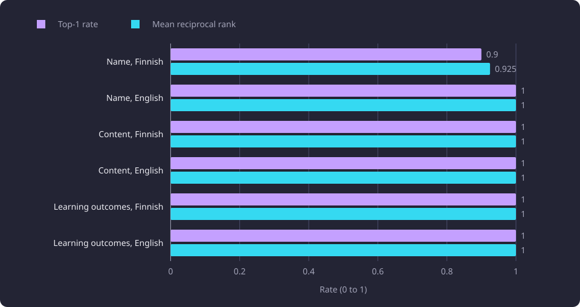

# Machine translation as retrieval-preserving transformation

The TranslateGemma 12B evaluation asked whether machine translations keep their official counterparts retrievable by embedding similarity.

**Evidence status:** Observational. **Run date:** 13 September 2026.

The evaluation measures retrieval utility. It measures whether a translated [teaching text](/docs/reference/glossary.md#capture-and-data-preparation) field points at the official text in the other language strongly enough for an embedding to retrieve it. Fluency, adequacy, terminology and reader preference are outside the measurement.

The [translation stage](/docs/backend/text-and-vectors/translation.md) fills a missing name, content or learning-outcomes field from the same field in the other language. The [embedding service](/docs/backend/text-and-vectors/embeddings.md) embeds the [effective text](/docs/backend/text-and-vectors/teaching-text.md#official-text-translation-and-effective-text), which is the official text when it exists and otherwise a translation that is not stale. A translation that moves too far in embedding space can make [semantic search](/docs/backend/search-and-discovery/search.md) miss the course even when a reader would accept it.

## The question

The evaluation asks whether a generated translation is close enough to its official counterpart that the counterpart ranks first among the official texts of the same field and target language. The generated text is the query. The official text in the other language is the only correct answer. The other nine official texts in the cell are distractors.

That construction is a retrieval proxy. A retrieval proxy is a stand-in task that scores a translation by whether retrieval finds the right official text, rather than by human judgement. Here the proxy is within-cell retrieval, with 10 official targets in competition and the paired target as the correct one.

An embedding is a vector of numbers that represents the meaning of a text. Cosine similarity measures the angle between two vectors and ranges from -1 to 1. BGE-M3 returns 1,024-component vectors, and the product's semantic search measures cosine similarity. Comparison and recommendations subtract the hub of the field, the outcomes hub for learning outcomes, while semantic search subtracts the embedding hub, a mean of catalogue unit vectors. The proxy uses raw cosine and subtracts neither hub.

The proxy cannot read the translation. A fluent translation can use different vocabulary and rank below a distractor. A poor translation can stay close to the official text and rank first. The result is evidence about retrieval utility only.

## The evaluation setup

The evaluation used one translation model and one retrieval scorer, with no second translation candidate.

### The six cells

The evaluation crossed three fields with two target languages. A cell is one field and one target language. Each cell held 10 cases. For a Finnish target the source was English, and for an English target the source was Finnish. The source and target had to be official text in the same field of the same representative version.

| Field | Target language | Source language | Cases |
|---|---|---:|---:|
| Name | Finnish | English | 10 |
| Name | English | Finnish | 10 |
| Content | Finnish | English | 10 |
| Content | English | Finnish | 10 |
| Learning outcomes | Finnish | English | 10 |
| Learning outcomes | English | Finnish | 10 |

### Cohort and selection

The catalogue snapshot held 11,086 courses and 58,962 teaching-text chunks. Of the courses, 4,543 were active. The cohort covered every canonical course, active and inactive, once through its [representative version](/docs/backend/catalogue/representative-versions.md). A case entered a cell only when the representative version held official text in the source language and official text in the target language for the same field. A field with official text in one language only could not supply a label and was not a case.

Within each cell, candidates were ordered by an evaluation ID. The ID is a one-way hash of the split seed, the course unit id, the field and the target language, so it is stable and carries no readable identity. The first candidate for a target text hash was kept, and further exact duplicates of the same target text were dropped, so no cell held the same official target twice. The first 10 remaining candidates became the cases. The split is deterministic, not a random sample.

The result was 60 cases, 10 per cell. At the run, the translation selection held 9,916 pending representative cells with a same-field source, covering 5,171,027 source characters.

### Leakage isolation

Leakage isolation means keeping the official target text and every identity field out of the input the translation model sees. The generated text is the model's answer. The official target text is the label. The two were kept apart.

| Item | What it held |
|---|---|
| Translation input | Evaluation ID, field, source and target language, source text, source text hash |
| Translation output | Evaluation ID, source text hash, generated text, model identity, generation time, elapsed seconds |
| Scoring labels | Evaluation ID, course and group identity, activity flag, field, languages, source text hash, source character count, official target text, target text hash |

The translation input held no target text, target hash, course or group identity, activity flag or URL. The output held no target text or course identity. The labels stayed with the scoring process. The translation process had no database or embedding access during the evaluation. Scoring read the labels and used the one embedding provider.

Scoring validated the candidate model, the input hash, the label hash, the case order, the source hashes, the field and the target language before it made an embedding request. It also computed the output hash to bind the scored result. A mismatch stopped the run.

No evaluation artifact wrote a database row or overwrote official text. The generated text had to be non-blank and free of NUL, and the run did not sanitize, normalize or repair it.

### Translation model and decoding

The model was TranslateGemma 12B, instruction-tuned. The artifact used Q5_K_M, a 5-bit quantization. It ran through ROCm on an AMD Radeon RX 9070 XT (16 GB model). VRAM is the GPU's own memory, and ROCm is its compute stack.

| Setting | Value |
|---|---|
| Model | google/translategemma-12b-it, instruction-tuned, Q5_K_M |
| Runtime | llama.cpp, with 49 of 49 layers offloaded to the GPU |
| Context | 16,384 tokens |
| Requests in flight | 1 |
| Temperature | 0 |
| Output cap | 8,192 tokens |
| Request timeout | 600 seconds |
| Attempts per request | 3, the first included |
| Retry delay | 1 second before the first retry, doubled for each further retry |
| Prompt | The model's official chat template with source and target language codes, no custom prompt |
| Top-p and top-k | Not set, so the runtime defaults applied |
| Streaming | Off |

The runtime was started and passed its health check before the first case. Each case was one request, and the cases ran one at a time in split order. Context is the token window of one request. Offloading means the layers ran on the GPU rather than the CPU. Each elapsed time covers the complete provider call, including any retry inside it, not the model load or the health check.

### Embedding and scoring

The scorer used BGE-M3 on the CPU. The scoring ran on a 4-core aarch64 server with 24.1 GB of RAM.

| Setting | Value |
|---|---|
| Model | BAAI/bge-m3, Q8_0 artifact |
| Vector dimension | 1,024 |
| Pooling | CLS |
| Normalization (`EMBEDDING_NORMALIZATION`) | 2 (unit length) |
| Threads | 2 |
| Context | 2,048 tokens |
| Logical batch | 2,048 |
| Physical batch | 2,048 |
| Parallel requests | 1 |
| Texts per request | 32 |
| Request timeout | 600 seconds |
| Attempts per request | 3, the first included |
| Retry delay | 0.5 seconds before the first retry, doubled for each further retry |
| Similarity | Raw cosine, no hub subtraction |
| Chunking | None, each generated text and each official target is one input |

Scoring embedded the 60 generated texts and the 60 official target texts in one list, through four requests of at most 32 texts. It then ranked each generated text against the 10 official targets of its own cell. CLS pooling uses the first token's vector as the text vector. The normalization setting scales each vector to unit length. The logical and physical batch values are the runtime's token capacities.

The configuration hash covers the model, the artifact checksum, the dimension, the pooling, the normalization and the runtime revision. It excludes the request timeout, the context and the batch size. A change to one of the covered values changes vector identity. A change to the excluded values changes how the work is sent.

The product's embedding stage makes 1,200-character chunks with a 120-character overlap, and semantic search subtracts the embedding hub before ranking them. A chunk is one piece of a field's text. The proxy does neither. It embeds each generated text and each official target as one input and compares raw cosine. Its values are not the product's hub-centred scores. Raw BGE-M3 vectors share a common direction, so raw cosines are high even for unrelated texts. The absolute values are not a quality scale.

### What was measured

| Measured | Not measured |
|---|---|
| Within-cell top-1 and mean reciprocal rank | Fluency, adequacy, terminology or reader preference |
| Mean paired cosine | Full-catalogue search |
| Per-case generation time | End-to-end wall clock |
| Embedding peak memory, idle CPU and warm latency | Translation runtime memory or VRAM use |

## Measured retrieval and throughput

### Retrieval

Top-1 rate is the share of cases whose paired official target had the highest cosine in its cell. A tie counts as top-1 because only a strictly higher cosine ranks above. Mean reciprocal rank is the mean of one divided by the rank of the paired target over the 10 cases. Mean paired cosine is the mean cosine between a generated text and its own official target.

| Field | Target | Source | Cases | Top-1 | Top-1 rate | Mean reciprocal rank | Mean paired cosine |
|---|---|---|---|---:|---:|---:|---:|
| Name | Finnish | English | 10 | 9 | 0.900 | 0.925 | 0.6940 |
| Name | English | Finnish | 10 | 10 | 1.000 | 1.000 | 0.8627 |
| Content | Finnish | English | 10 | 10 | 1.000 | 1.000 | 0.8840 |
| Content | English | Finnish | 10 | 10 | 1.000 | 1.000 | 0.9114 |
| Learning outcomes | Finnish | English | 10 | 10 | 1.000 | 1.000 | 0.9154 |
| Learning outcomes | English | Finnish | 10 | 10 | 1.000 | 1.000 | 0.8971 |

Five cells returned top-1 on all 10 cases. The Finnish name cell returned nine of 10 and a mean reciprocal rank of 0.925. Nine first places and a fourth place produce that value, because the fourth place contributes 0.25 to the sum.

The overall result was 59 of 60 top-1, a rate of 0.9833, and an overall mean reciprocal rank of 0.9875.

The mean paired cosine was lowest in the Finnish name cell, 0.6940. The other five cells ranged from 0.8627 to 0.9154. Observed: the one miss and the lowest paired cosine fall in the same cell. The evaluation does not establish a cause.

The chart plots the top-1 rate and the mean reciprocal rank for the six cells.



The acceptance floors were an overall top-1 rate of at least 0.90, a top-1 rate of at least 0.80 in every cell, and a projected duration below 604,800 seconds. The result cleared all three. The lowest cell rate was 0.900, above the 0.800 floor.

### Throughput and projection

Measured generation time was 156.008147444 seconds across the 60 cases, from 29,633 source characters. The time is the sum of the per-case provider call times, so it is one timing sample.

| Quantity | Value |
|---|---:|
| Cases in the sample | 60 |
| Measured generation time | 156.008147444 seconds |
| Source characters in the sample | 29,633 |
| Pending cells in the full workload | 9,916 |
| Source characters in the full workload | 5,171,027 |
| Projection by item | 25,782.9465 seconds |
| Projection by character | 27,223.7824 seconds |
| Selected projection | 27,223.8 seconds |
| Acceptance ceiling | 604,800 seconds |

```text
projected_by_item = 156.008147444 s / 60 * 9,916 = 25,782.9465 s
projected_by_characters = 156.008147444 s / 29,633 * 5,171,027 = 27,223.7824 s
projected = max(25,782.9465 s, 27,223.7824 s) = 27,223.8 s
```

The projection rests on these assumptions.

- The measured time is the sum of per-case provider calls. It excludes model load, the health check, transfer, import, embedding and the surrounding controller work.
- One request ran at a time, so the projection scales linearly.
- The sample's per-item and per-character rates and its retry incidence hold for the full pending set.
- The full pending set has the same mix of fields and source lengths as the sample.
- The larger of the item and character projections is used, so the estimate is conservative on those two axes.

The selected value is the character-based projection because it was larger. It is 27,223.8 seconds, below the 604,800-second ceiling, or seven days.

Interpretation: the projection says the full pending workload fits the ceiling if the sample rate holds. It is not a measured full-run duration.

## Batch sizes and the embedding runtime

The scored run made every embedding request to the CPU-only BGE-M3 service on a llama.cpp runtime. The runtime used two threads on aarch64. The selected launch used the configured `EMBEDDING_CONTEXT_SIZE` value of 2,048 tokens as the context and as both the logical and physical batch sizes.

| Measure | Value |
|---|---:|
| Peak resident memory | 2,044.0 MB |
| Idle CPU | 0.017% |
| Warm p95 | 0.074 seconds |
| 120-text probe | 89.4 seconds |

Peak resident memory is the highest resident memory of the embedding process. Idle CPU is the CPU use while the service was idle. Warm p95 is the 95th percentile of request latency after warmup, and it covers one embedding request rather than a search. The 120-text probe is the time to embed 120 texts.

A launch that leaves the logical and physical batch sizes unset embeds no text longer than 512 tokens whole. Some generated and official texts exceed 512 tokens, so the batch capacity decides whether they can be embedded in full. Setting the context and both batch sizes to 2,048 embeds each text whole, and the scored run embedded every generated and official target text whole.

Scoring observed contention on the embedding service. `EMBEDDING_REQUEST_TIMEOUT_SECONDS` validates as a finite value greater than 0 and at most 600 seconds, and the scoring run used 600 seconds. The timeout, the context and the batch sizes are outside the configuration hash that identifies vector semantics.

## What the result supports

Interpretation: TranslateGemma 12B preserved retrieval on this cohort. The result supports its use for the translation stage, within the limits below. It does not show that the translations are good by human standards, and it does not show that 12B is the best available model.

The Finnish name cell is the weak point in this cohort. With 10 cases, one case moves the cell rate by 0.10. The cell is above the 0.80 floor. The result does not show why the miss happened.

The proxy is easier than the product's full search. It chooses among 10 official targets, not among 11,086 courses or 58,962 chunks. It uses raw cosine and whole fields, not the product's hub-centred chunk search. A translation that passes here can rank poorly in the full search. The [exact and approximate semantic retrieval](/docs/experiments/search-and-translation/semantic-retrieval.md) report covers the product's search read path, and the [lexical matching equivalence and collation](/docs/experiments/search-and-translation/lexical-matching-and-collation.md) report covers the lexical side.

The absolute cosine values are not a quality scale. The paired values are high because the vectors share a common direction. The ranking, not the absolute value, is the result.

## Baselines and the candidate ladder

The baseline is TranslateGemma 12B in Q5_K_M at temperature 0, one request at a time, with the 16,384-token context and the 8,192-token output cap. It produced 59 of 60 top-1, a mean reciprocal rank of 0.9875, and 156.008147444 seconds for 60 cases. The 60-case sample projects to 27,223.8 seconds for the full pending workload.

Embedding used BGE-M3 Q8_0 with 1,024 components, CLS pooling, unit normalization and two threads. The context and batch capacity were both 2,048 tokens. The selected launch used 2,044.0 MB peak resident memory, 0.017% idle CPU, 0.074 seconds warm p95 and 89.4 seconds for 120 texts.

| Step | Candidate | Outcome |
|---|---|---|
| 1 | TranslateGemma 12B, Q5_K_M | Run |
| 2 | TranslateGemma 27B, Q4_K_M, a 4-bit quantization | Not acquired or run |
| 3 | Conditional fine-tuning | Not started |

The 27B candidate was the next step only if 12B failed a floor, and conditional fine-tuning followed only if both candidates failed. The 12B run missed no floor, so neither step was reached. Fine-tuning means further training of the model on translation data. The line therefore has no 27B measurement and no fine-tuned measurement.

## Limitations

- The split is deterministic and balanced by cell. It is not a random sample of the catalogue's field and length mix.
- The scorer used the generated text exactly as returned. It did not strip alternatives, notes or trailing whitespace.

## Open questions

- Whether TranslateGemma 27B at Q4_K_M raises the Finnish name cell or the overall mean reciprocal rank above the 12B result. Untested.
- Whether a conditional fine-tune changes the result. Untested.
- Whether these translations preserve retrieval in the product's chunked, hub-centred semantic search over the full catalogue. Untested.
- Whether a human rating of fluency, terminology and adequacy agrees with the retrieval proxy. Untested.
- Whether the full pass duration, which was not recorded, matched the 27,223.8-second projection. Untested.

After the evaluation, the 12B model ran the full translation pass over every missing representative field. The pass filled every translatable gap, and the remaining per-language absence is source absence, not a failed translation. After the import, all 58,962 chunks across 11,086 representative versions were embedded, and a rerun over the same data generated nothing. The translation run produced and transferred no vectors. The full pass recorded no end-to-end duration, so 27,223.8 seconds is a projection, not a measured duration. The evaluation itself wrote no database row and overwrote no official text, and its 60-case output was not imported.
