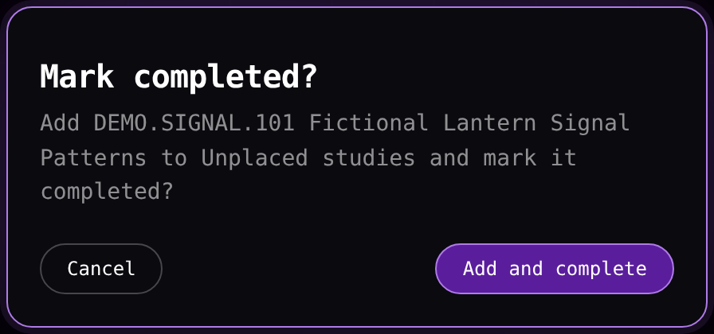
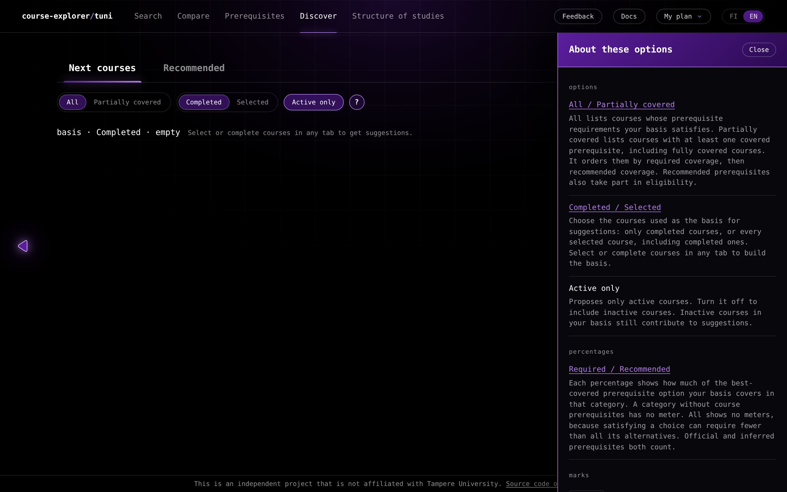
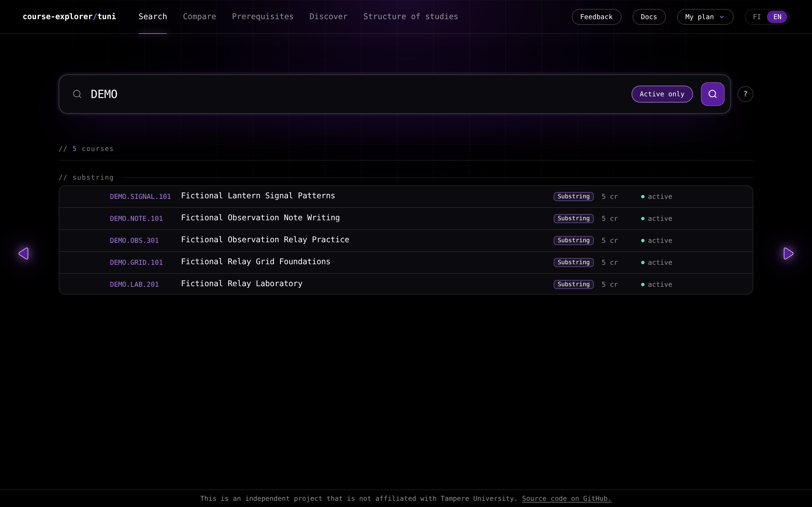

# Quickstart

course-explorer is a read-only web app for exploring a university course catalogue, and a first session touches its tabs and their shared state.

## A first session

The steps use the features a site serves, so a step that names **Compare** or **Recommended** applies on a site that serves the embedding features.

1. **Search for a course.** Type a code fragment, a name, or a topic into the field on the **Search** tab and press Enter. The results name every method that matched each course. [Searching for courses](/docs/guides/search.md) explains the four methods and how to read a result.

2. **Mark a course completed.** Activating a course card opens its [course menu](/docs/reference/glossary.md#browser-app), which holds the same actions in every tab. Choose **Mark completed**. A selected course is completed in place. For a course that is not selected, the dialog **Mark completed?** asks whether to add the course to **Unplaced studies**, with **Cancel** and **Add and complete**. [Shared course state](#shared-course-state) describes both outcomes and the notices they show.

3. **Compare two courses.** Choose **Add to comparison** from the course menu of one course, then of a second course. The two take the slots A and B on the **Compare** tab, which reports five percentages and one verdict. [Comparing two courses](/docs/guides/compare.md) explains the meters and the verdict.

4. **Open a prerequisite graph.** Choose **Open prerequisite graph** from any course menu. The **Prerequisites** tab opens with that course at the top and follows the requirements the catalogue lists before it. [Exploring prerequisites](/docs/guides/prerequisites.md) covers the graph and the route with the fewest new credits.

5. **Look at what comes next.** Open the **Discover** tab to see the courses that your completed or selected courses reach, and, on a site that serves the embedding features, the courses whose teaching text resembles them. [Discovering courses](/docs/guides/discover.md) explains the lists and the basis they share.

6. **Start a structure of studies.** Open the **Structure of studies** tab and select **Add programme** to append a degree programme or module to the end of the ordered programme list, before **Unplaced studies**. While the list is empty, the same area offers the **Import** control described in [Profiles and language](/docs/guides/profiles-and-language.md#importing-a-file). [Planning a structure of studies](/docs/guides/structure-of-studies.md) covers the official structure and its programmes, and [Editing a structure of studies](/docs/guides/editing-structure-of-studies.md) covers the drawer, dragging, moving, removing and resetting.

## Shared course state

The selection and the completion belong to the profile and are read by every tab, so a course selected on **Search** is selected on **Compare**, **Prerequisites**, **Discover**, and **Structure of studies** as well.

The app keeps the eight most recent successful reads, so returning to one of them shows its result at once.

Every course card opens that same menu. Its title shows the course code in purple, with the credits and the active or inactive status on the same row, above the course's full name. The name follows the chosen language when the catalogue holds one for it, and it wraps to its full text.

A grey divider separates the title from the actions: **Add to comparison** on a site that serves comparison, **Open prerequisite graph**, the Unplaced studies action, **Mark completed** or **Remove completion**, and **Open in Sisu**.

The Unplaced studies action follows the course's own state. A course that is not selected offers **Add to Unplaced studies**. A course that a programme or module holds offers **Move to Unplaced studies**, and below it **Remove from** and the name of that programme or module. A selected course that no programme or module holds offers **Remove from Unplaced studies**, and one that already sits in the Unplaced studies list offers **Move to Unplaced studies**.

**Mark completed** completes a selected course in place and reports **Marked course DEMO.X as completed** in a bottom notice. For a course that is not selected it opens the dialog **Mark completed?**, which asks whether to add the course to **Unplaced studies** and complete it. **Add and complete** does both and reports **Added DEMO.X to Unplaced studies and marked it completed** with the words **Unplaced studies** as a link to that list. **Cancel** changes nothing. Clearing the completion reports **Removed completion of course DEMO.X** in a bottom notice and leaves the course selected.

In **Structure of studies**, the **Complete** control on a course card completes the course directly, and in a module drawer it places the course in the rule and completes it, without that dialog.

Marking a course completed records the completion in the profile and changes nothing in the catalogue, so the completion serves the app's own calculations. **Open in Sisu** is the one action that leaves the app, and it opens the official page of the course.

**Add to Unplaced studies** selects a course and places it under [**Unplaced studies**](/docs/guides/structure-of-studies.md#unplaced-studies) in the structure of studies, whether or not the programme list holds a programme. The action shows a bottom notice that names the course it added. **Move to Unplaced studies** reports **Moved DEMO.X to Unplaced studies**, and a move out of a holder also names that holder. **Remove from Unplaced studies** reports **Removed DEMO.X from Unplaced studies**. The words **Unplaced studies** in these notices open that list. For a course that a programme or module holds, **Move to Unplaced studies** in a menu outside Structure of studies asks **Move to Unplaced studies?** with **DEMO.X is already in your plan. Move it to Unplaced studies?**, and **Move** confirms the move. Inside Structure of studies the move happens at once.

**Add to comparison** shows a bottom notice that names the course it added, with the word **comparison** as a link to the Compare tab. The route panel and a member list add all their missing courses, and their notice states how many courses were added, or reads **No courses added. Selection unchanged.**, and its **Unplaced studies** words open that list. A notice that added no course carries no link.

The **?** buttons of **Search**, **Compare**, **Prerequisites**, **Discover** and **Structure of studies** open their help drawers. The profile panel and the empty import area of **Structure of studies** carry their own **?** controls. Each drawer places its links inside the heading, term or explanation they belong to. The link wording follows the profile language, and the destination page, like the rest of the wiki, is in English and opens in the same browser tab.

## The top bar and the tab controls

On desktop the top bar holds a button for each tab the site serves, **Feedback**, **Docs**, the profile control, and the language control.

On a phone the app has no top bar and no footer. A bar at the bottom holds one button for each served tab and **More**, and the tab content begins at the top of the window. **More** opens a sheet with the profile control, a row for the language control, **Feedback** and **Docs**, and the footer notice, and the sheet grows upward when you open the profile list. The bar hides while the open tab scrolls down and returns at the top, on an upward scroll, or after an overlay closes. [Using the app on a phone](/docs/guides/phone.md) describes the bar, the **More** sheet and the option sheets of each tab.

At a desktop width an arrow at each side of the tab area moves one tab back or forward, and the left and right arrow keys do the same. At a phone width the arrows are absent: swipe horizontally in the tab content to move between the tabs. The tabs form a ring, so the last tab leads back to the first, and a move takes the shorter way round. A tab the site does not serve is absent from the top bar and from the ring, and a stored **Compare** opens **Search** on a site that serves no comparison.

**Docs** opens the documentation wiki inside the app. On desktop its one-row header carries the search and **GitHub**, and the page list sits beside the article. On a phone the header keeps the brand, **Docs** and **Return to app**, and a menu opens the page list and **GitHub**. **GitHub** opens the project's source code repository in a new browser tab.

On desktop the footer at the bottom of the window states **This is an independent project that is not affiliated with Tampere University.** and links **Source code on GitHub.** to the project's source code repository, which opens in a new browser tab. On a phone the same notice and link sit at the end of the **More** sheet.

The profile control switches between the named profiles and shows how many courses each one has selected and completed, and the language control switches the interface between FI and EN. [Profiles and language](/docs/guides/profiles-and-language.md) covers both.

## Where to go next

- [Searching for courses](/docs/guides/search.md) for the four match methods, the result marks, and the activity option.
- [Comparing two courses](/docs/guides/compare.md) for the two slots, the five meters, and the verdict.
- [Exploring prerequisites](/docs/guides/prerequisites.md) for the prerequisite graph, its toggles, and the minimum route.
- [Discovering courses](/docs/guides/discover.md) for next courses, recommended courses, and the basis.
- [Planning a structure of studies](/docs/guides/structure-of-studies.md) for the official structure and its modules.
- [Editing a structure of studies](/docs/guides/editing-structure-of-studies.md) for the drawer, dragging, moving, removing and resetting.
- [Importing a Sisu plan](/docs/guides/sisu-import.md) for capturing a plan in Sisu or importing a supported plan PDF as a profile.
- [Profiles and language](/docs/guides/profiles-and-language.md) for named profiles and the interface language.
- [Sending feedback](/docs/guides/feedback.md) for the feedback form, its images and its publication choice.
- [Using the app on a phone](/docs/guides/phone.md) for the bottom bar, the **More** sheet, and the option sheets of each tab.

The [documentation home](/docs/README.md) introduces the tabs and the shared course state, and the [Glossary](/docs/reference/glossary.md) defines every term the documentation uses.
