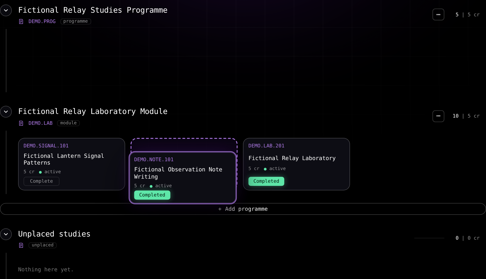
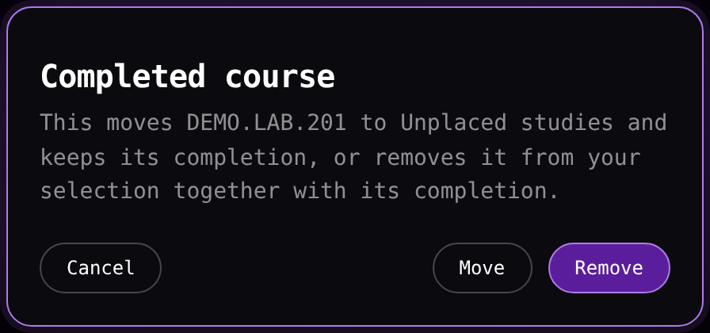

# Editing a structure of studies

The Structure of studies tab places courses and modules in the tree, orders the cards of each grid, and restores a part to its official content.

## Placing courses from the drawer

Select the name of a module row to open its drawer. Selecting another row while the drawer is open changes the drawer to that row. On desktop the drawer opens at the right of the window below the top bar. It leads with the rule of that module and its credit totals, then the search, then the content.

The content sits under the rule that applies to it, and the app labels that rule. A module or a programme with target credits states that credit extent as its rule, such as `180 cr`. The credits of a row count the courses placed under it, and the drawer states each total with the words **selected** and **completed**. A drawer with no content reads **This module is empty.**, **This programme is empty.** when the row is a programme, or **No option selected yet.** for a choice where nothing is picked.

On a phone the drawer is a sheet above the tab bar with a **Close** control at its head and one scroll for all its content, with a visible scrollbar when the content is taller than the sheet. Each row places its code and its credit or kind first and its full name below them, the search results open inside the sheet, and **Reset this module** ends the same scroll. Escape closes the search first while it is open. With the search closed and no dialog or picker open, Escape closes the drawer and returns focus to the row that opened it. [Using the app on a phone](/docs/guides/phone.md) describes the phone shell and this sheet.

The search field reads **Add a course, module or programme**. The buttons **All**, **Courses**, **Modules** and **Programmes** narrow the results to one kind. A course result shows its code, its name and its credits, and a module or programme result shows its official code and its name. Each result section holds every match and scrolls inside the drawer.

Tab moves from the last course result to the first module result and back, the arrow keys move one row, Home and End go to the first and last result, and a result that is out of view can be reached from the keyboard.

Pick a course result to place it in the module that you opened, which closes the search. A module or a programme with one eligible version is placed the same way.

One with several opens the dialog **Choose module version** over the results, which names the module and asks you to choose the version to add. Every eligible version is listed with its code, its name, its validity bounds, its curriculum periods, its full version identity and **+ add**, and the list scrolls inside the dialog. Choose a version to place it, and **Cancel** closes the dialog and returns the cursor to the search field, with its results, its search text and its category in place. The app never picks a version for you.

A course is placed there as a card with a dashed outline. A module arrives with its own content, its row carries the **added** mark, the courses that its official structure proves required are placed in it and selected, and the app reports that it was added, together with how many of your courses moved with it when any did.

Adding a module reads its structure before it is placed, and the row shows as busy until the read finishes. If the course or the module is already in that module, the app reports **Already in this module**, or **Already in this programme** when the row is a programme.

A rule that offers alternatives is decided in the drawer too. The section heading is the rule label, and its rows are the options. Select a row to choose it and select it again to drop it. The first selection reports **Selection made**, and a change to a selection that already exists reports **Selection changed**. A course that loses its place leaves the selection unless it is completed, and a completed course is held in the selection under Unplaced studies.

## Dragging courses and card order

You can drag a course card to another programme, module or **Unplaced studies**, or drag it within its own grid to change the order of its cards. On a desktop, press the card and hold it in place for a moment, then move the pointer. The card shows a pickup highlight when the hold completes, and it lifts and starts the drag when the pointer moves 4 pixels. Moving more than 8 pixels before the hold completes cancels the press. On a touch screen the hold lasts about a quarter of a second, and the card lifts when you move your finger after it. A hold that you release in place counts as a click, and a quick tap, a scroll and a tab swipe keep their ordinary behavior until the card lifts.

While the card is lifted it follows your pointer or finger, and the holder that overlaps the card most is the place it can land. A dashed outline marks where the card lands, and the other cards move aside around that place. An empty programme or module accepts a card, and a collapsed row accepts it at its header and opens while it is the target. Moving the pointer or finger near the top or bottom of the tab scrolls the tab, and the scroll continues while you hold it over the header or footer above or below the tab. The tab and the bottom bar on a phone stay where they are during the drag, and a lifted touch card owns the movement, so the page itself stays in place.

Release the card over a holder to move it there, or press Escape or cancel the touch to leave everything as it was. The released card settles from its lifted position into its place, and the cards and module rows around it keep their own movement. A drag never asks you to confirm the move, even when the course is completed or the move crosses programmes. A completed course keeps its completion and its selection wherever you drop it. A click that places a course into another holder asks with **Move here?**, as described below.

The order of the cards is saved in your profile. A reload, a switch to another profile and back, an exported profile and a saved-data file keep it. A card order that you changed also counts as a change when a removal would otherwise ask only about the content of a module. Resetting a part clears the order of the cards that part holds, and resetting **Unplaced studies** clears the order of the cards it holds, while every other part keeps its own order.

## One place for a course

A course shows on one card at a time. Adding or replacing a programme, or adding a module, that officially holds a course shown elsewhere moves the course into that programme or module, and keeps its completion and its selection.

Before that addition writes anything, one dialog lists every course that moves and the place each one is in, and **Move** applies the whole addition when it lists nothing. When it lists courses, the answer is **Keep**, which applies the addition and leaves each listed course where it is shown, or **Pull**, which applies it and moves them in. These two answers mean the same everywhere they appear, including a programme replacement and a reset.

When the addition moves the module itself and lists nothing to pull, the dialog reads **Move here?** and names the module and the containing programme or module that holds it, or **the programme list** when the list of programmes holds the module. With a pull list its title reads **Move this module into** followed by the holder's name and a question mark, or **Move these courses and modules into** followed by that name when it lists courses as well.

**Cancel**, Escape, and a click outside the dialog change nothing, and the **Add programme** picker stays open so you can pick again. There is no dialog when nothing moves.

A course that the added programme or module officially holds and that sits directly in **Unplaced studies** moves without being listed, while a programme or module that already has a place keeps everything it holds, the courses in Unplaced studies included. **Replace programme** shows the same list inside its own confirmation, which also names the place that already holds the replacement programme when a place does.

## Moving a course that already has a place

Every course and module appears in one place at a time. Selecting one that already has a place into another holder with a click opens **Move here?**, which names the course or module and the containing programme or module that shows it, such as a module, Unplaced studies, or **the programme list** when the ordered list of programmes holds it. A choice's own title is never used as a place name. Select **Move** to place it there, or **Cancel** to leave the structure as it is.

A move of a module takes the whole of it along, so the alternatives you chose inside it, the courses and modules you added or took out there, and the completions all arrive with it, the place it leaves disappears, and nothing inside it returns to the official structure. A module that the programme list holds leaves that list when it is placed in a node, so it appears only in the place you put it.

A module that an addition or a replacement promotes to the top level of the list moves the same way, so a programme that you replace with a programme it contains keeps that programme and everything inside it. The move pulls no course out of another programme or a module, so a course that another programme or module shows stays there and nothing is added inside the moved item. A module that already has a place also offers the reset actions its own state allows beside **Move**, and **Reset** restores its official content while the courses it drops out of the tree stay selected under **Unplaced studies**, where **Reset all** leaves none.

A course or a module that sits directly in **Unplaced studies** moves into a programme or a module without a prompt of its own, because that list holds unplaced items by definition. A course that an addition pulls out of a programme or a module is listed for confirmation, and a click move from a programme or a module asks first.

## Removing a course

Courses are taken out in the drawer of the module that holds them. Select a course row in the drawer content to remove it from that module.

An uncompleted course leaves the selection with it. A completed course opens **Completed course**, which offers these outcomes:

- **Move** places the course under Unplaced studies and preserves its completion.
- **Remove** takes it out of the selection and removes its completion, so the course leaves both course sets in every tab.

A completed course that already sits under Unplaced studies carries **Cancel** and **Remove** alone, and the dialog states that the removal takes the course out of your selection together with its completion, because keeping a course loose there changes nothing.

**Cancel**, or Escape, closes the dialog and leaves everything as it is.

> [!WARNING]
> **Remove** in the **Completed course** dialog removes the completion itself. The course is then neither selected nor completed anywhere in the app.

Select a module row in the drawer content to remove that module and the courses that it contributes from the displayed structure. A completed course among them preserves its completion and appears under Unplaced studies, and an uncompleted course among them leaves the selection. A module that holds completed courses, or whose contents differ from its official structure, asks first: **Delete** keeps that outcome, and **Delete all** drops those courses and their completions with the module. **Delete all** appears only when the module holds completed courses. **Cancel** sits alone at the left of the question, and the delete controls sit together at the right.

A module at its official structure with no completed course leaves at once without a question, and a saved choice or place that changes no content is not a difference. A degree programme nested inside another programme or a module follows the same rule as a module, with the word programme in its question.

## Resetting a part

The drawer of a module ends with **Reset this module**, and the drawer of a top-level programme ends with **Reset programme**, which is the same operation as the row menu's **Reset programme** and asks with the same question. A degree programme nested inside another programme or a module reads **Reset programme** as well, and its operation stays a module's.

A module or a programme resets through one compact question with **Cancel** at the left and **Reset** beside it, and **Reset all** joins them at the right only when the part holds completed courses. **Reset programme** asks from the row menu and from the drawer, and **Reset this module** asks from the drawer, at every press, whatever the part's contents and completions are.

When the reset returns a course to the part from another programme or module, a second question follows with **Cancel** at the left and **Keep** and **Pull** at the right. It lists every returned course with the place it is in. **Pull** returns those courses to the part, **Keep** leaves each of them where it is, and **Cancel** cancels the whole reset and changes nothing. A part that holds no completed course and returns a course asks only that second question. At any depth of a part, a course whose place there came from a choice or a module the reset clears stays where it is shown, and a course under **Unplaced studies** returns to the part without being asked about.

**Cancel**, Escape and a click outside a question change nothing.

**Reset** returns the choices and the places inside that part to the official ones, and a course inside the part goes back to its official place. A course whose official place is inside the part and which another programme or module shows returns there only when the second question is answered **Pull**, and **Keep** leaves it in that other programme or module.

A completed course inside the part keeps its completion, and when the restored content gives it no place it is listed under **Unplaced studies**.

**Reset all** applies the same restoration and also clears the completions that the part holds: a course that the part held before the reset comes back selected and uncompleted, a course returned from another place by **Pull** keeps its completion, and a completed course that leaves the restored content leaves your selection together with its completion. A completed course that another programme or **Unplaced studies** holds is not affected.

A reset reports **Programme reset to its official contents** or **Module reset to its official contents**, for the word its part carries.

A reset of Unplaced studies clears the places held there and the card order of the cards it holds, and it asks nothing. A course with an official place goes back to it, an uncompleted course that was placed there leaves the selection, and a completed course preserves its completion. The app reports **Unplaced studies reset**.

> [!CAUTION]
> A reset discards the choices and the places of the part that it resets. Replacing or deleting a programme discards them for that programme alone.
