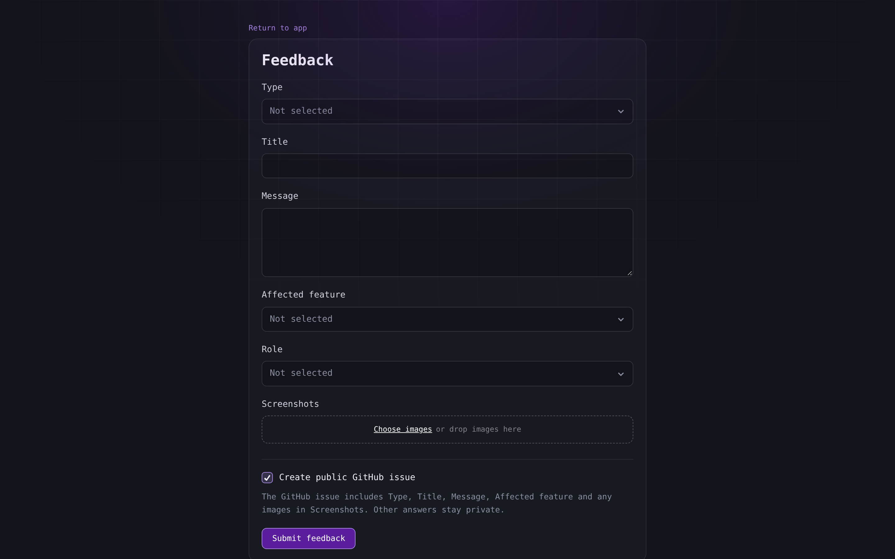
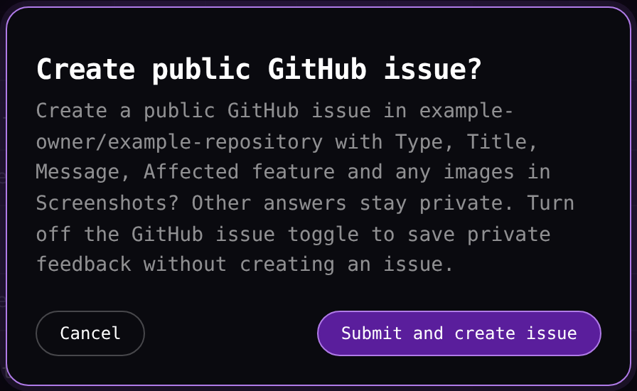
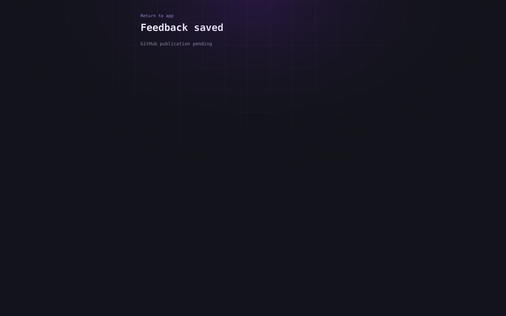

# Sending feedback

The feedback page collects a message in the app language, with optional images, and offers to turn it into a GitHub issue.

## Open the form

On desktop **Feedback** sits beside **Docs** in the top bar. On a phone it shares the language row of the **More** sheet with **Docs**. The page opens on its own and is not a tab, so the tab you were reading stays where it is. **Return to app** at the top of the page goes back to that tab.

The page fills the window with its own scroll and shows no top bar, footer or phone bottom bar. It keeps the language of the open profile. Its answers, images and publication choice belong to the open page, so leaving the page or reloading it starts an empty form.

## Fill the form

The form shows the site's configured questions in their configured order. With the example configuration the order is **Type**, **Title**, **Message**, **Affected feature**, **Role** and **Screenshots**. A select begins at **Not selected** until you choose one of its options.

In that configuration **Type**, **Title** and **Message** must be answered. Select **Submit feedback** and a missing answer shows **Answer this required question.** beside its field. The form sends nothing until every required question holds an answer.

The same configuration limits **Title** to 150 characters and **Message** to 10000. A longer title shows **The answer is too long. Maximum length: 150 characters.**, a longer message shows the same sentence with 10000 in place of 150, and the form sends nothing.

## Add images

The example configuration gives **Screenshots** room for up to three PNG or JPEG images, each at most 5 MiB. Select **Choose images** or drop the files on the area. Each chosen image becomes a row with its file name and a **Remove** button.

A fourth image shows **Too many images for Screenshots. Limit: 3.** An image above 5 MiB shows **An image for Screenshots exceeds the size limit of 5242880 bytes.** A file of another type shows **Choose a PNG or JPEG image for Screenshots.**

A refused image leaves the form as it was, and the images that already fitted stay in place.

## Choose publication

The toggle decides whether the feedback also becomes a GitHub issue. On a site whose destination is a public repository it reads **Create public GitHub issue**, and on a site whose destination is a private repository it reads **Create GitHub issue in a private repository**.

Before you change the toggle, it follows the options you choose. Choosing **Other** as the type turns it off, and choosing another type turns it on. A choice you make on the toggle stays in force for the rest of the form.

The line below the toggle names what an issue includes, for example **The GitHub issue includes Type, Title, Message, Affected feature and any images in Screenshots. Other answers stay private.** The **Role** answer stays out of the issue.

Select **Submit feedback** to open the confirmation.

- With the toggle on, the confirmation reads **Create public GitHub issue?** on a public destination, names the repository, and offers **Cancel** and **Submit and create issue**. On a private destination it reads **Create GitHub issue in a private repository?** and names that repository.
- With the toggle off, it reads **Submit feedback?** and states that no issue is created and the feedback is saved on this site. **Cancel** closes it, and **Submit feedback** sends the form.

**Cancel** writes nothing. Escape and a click outside the confirmation do the same.

## After sending

The page shows **Feedback saved** and one of two outcomes. **GitHub publication pending** means the feedback is stored and its issue is waiting to be created. **Saved as private feedback** means no issue is requested and the feedback is stored alone. **Return to app** leaves the page.

A pending GitHub publication is a stored request, and the saved page reports the stored choice rather than an issue.

## Limits and failed sends

The site sets how many submissions one browser may make in a rolling hour and how many the whole site may accept in the same hour. A submission beyond either limit shows **Too many feedback submissions. Try again later.** and creates nothing.

A submission whose answers and images together are larger than the site allows shows **Feedback is too large. Remove images or shorten the answers.**, and the form holds its answers and images.

A send that fails for another reason shows **Could not submit feedback. Your answers are still in the form.**, and the form holds its answers and images for another attempt.

A form that the site cannot load shows **Could not load feedback form. Reload the page to try again.** in place of the questions.
