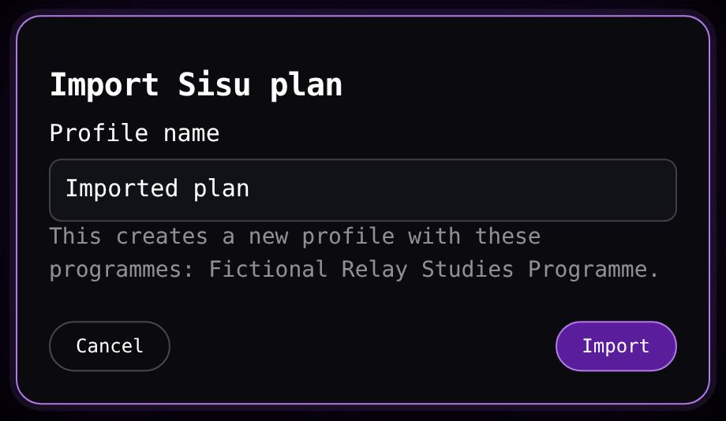

# Importing a Sisu plan

A plan from Sisu's structure of studies view imports into course-explorer as one profile that holds the same programmes, choices and completions.

## Printing the plan

1. Open your plan in Sisu's **Structure of studies** view.
2. Choose **⋯** beside **New study plan**, choose **Print study plan**, and save the print as a PDF. In the Finnish interface the path is **Opintojen rakenne** → **⋯** beside **Uusi opintosuunnitelma** → **Tulosta opintosuunnitelma**, then save the print as a PDF.

The import accepts the Finnish and English prints of one plan. It reads the supported print layout of the Sisu structure view. A scan, an image-only PDF, an encrypted PDF or another university's plan is not supported.

## Importing the PDF

1. Open the course-explorer profile menu. On desktop select the profile control in the top bar. On a phone open **More**, then select the profile row.
2. Drop the PDF onto the **Import** area, or select **Choose file** and pick it. While the **Structure of studies** tab holds no programme, its **Import** area below **Add programme** reads **Choose** and accepts the same file.
3. The dialog **Import Sisu plan** opens. It names the programmes it found, lists any module waiting for a version choice, and names every item it left out with the reason. An item that matches several official items also lists those candidates. Type a name for the profile in **Profile name**.
4. Select **Import**. The button is available once the name holds something, and the import creates the profile and opens it.
5. Open **Structure of studies** to see the imported plan.

The PDF is read in this browser. Its bytes, text and file details are not uploaded. The import reads the official catalogue and the official structures it needs from this site, and it makes no request to Kori. The file's text is not stored, and no profile is written before **Import**.

> [!WARNING]
> A Sisu plan PDF contains personal identity data. Keep the file to yourself and do not share it casually.

The importer matches course codes and module codes against the served catalogue. A module is first looked for among the official children of the parent shown in the plan, by exact code and then by exact official name. A module that is not an official child can join its captured parent only when its exact code names one catalogue module. Indentation orders the plan and suggests a parent, but it never creates an identity.

Exactly one eligible version of a matched module is recorded. A module with several eligible versions is left without a version, and **Structure of studies** shows its **Choose module version** prompt. No year is inferred from the PDF. A module whose identity is not unique is left out with its candidates named, and the import never chooses one of them. A module the parent's official scope does not resolve is named as having no official match, and the courses inside it that the catalogue holds are placed under **Unplaced studies**.

The match uses the served dataset. A plan from another academic year may name a course or module that the served catalogue or structure does not hold, or may use a different version. The dialog names each such item and creates no substitute for it.

## Capturing the plan

1. Open your plan in Sisu's **Structure of studies** view.
2. Expand every module of the plan, including both degrees under its education. The script refuses the download while any module is collapsed.
3. Open the developer console of that browser tab.
4. Copy the script with **Copy Sisu import script** in the profile menu, or in the empty **Structure of studies** import area, or select the whole block under [The script](#the-script) and copy it.
5. Paste the script into the console and run it.

The script reads the open page and asks the public Kori interface for the modules and courses the page shows, and it sends those requests without your Sisu login cookies. It makes no request to course-explorer. It finishes by downloading one file named `sisu-plan-capture.json`.

> [!WARNING]
> A browser warns before the first paste into its console, because pasted code runs with the access of the open page. Read the whole script before you run it and check that it only reads the page, asks the public Kori interface, and downloads one file.

## Importing the capture

1. Open the course-explorer profile menu. On desktop select the profile control in the top bar. On a phone open **More**, then select the profile row.
2. Drop `sisu-plan-capture.json` onto the **Import** area, or select **Choose file** and pick it. While the **Structure of studies** tab holds no programme, its **Import** area below **Add programme** reads **Choose** and accepts the same file.
3. The dialog **Import Sisu plan** opens. It names the captured programmes in Sisu's order, and it names every item whose identity the capture could not resolve under **Left out of the import:**. A module with no code whose official name places it is not named there. Type a name for the profile in **Profile name**.
4. Select **Import**. The button is available once the name holds something, and the import creates the profile and opens it.
5. Open **Structure of studies** to see the imported plan.



[Using the app on a phone](/docs/guides/phone.md) describes the **More** sheet that holds the profile control on a phone.

The profile holds the captured programmes, and the tab reads the official structure of each of them from the catalogue as it does for any other profile. The capture's status cells name each module's exact official version, and the import records those versions before the first read, so the captured plan reads the same versions Sisu showed. A plan that names two different versions of one module fails the import with **Sisu plan selects two versions of a module** and writes no profile. The captured choices and completions are placed on the tab's first read, and the profile is stored in this browser alone.

An uncoded captured module without a lookup result is matched by its exact official Finnish or English name among the direct children of its captured parent. A unique match is placed. No match or several matches are named in the placement notice and left out. The confirmation leaves this module's own outcome to that placement notice, and it lists the unresolved courses inside it. When the captured parent needs a version choice in **Structure of studies**, the tab matches the module by name after you choose that version.

A profile file or a saved-data file can hold a waiting capture together with saved choices or places. The tab places no such capture and performs no structure write, and the notice **Sisu import paused to preserve saved edits. Your profile is unchanged.** appears above the structure. The imported profile keeps its saved structure and pending capture as the file supplied them. A capture imported from Sisu into a new profile starts with no saved choices or places, so its choices are placed on the first **Structure of studies** read.

## What the import places, and what it names

The captured degrees become the top-level programmes of the tab in the order Sisu shows them. The education that holds them is a container and never a programme of its own. Every captured module and course choice is placed inside its programme, its modules and its choices, and a course that Sisu shows as completed is marked completed in the app as well.

A module that your plan selected and the programme's official rule does not name becomes an added module inside the module or programme that held it, with its own official content, so a free-choice module of your plan holds its place.

An item the import cannot place is named to you, never dropped without a word:

| Outcome | What it means |
|---|---|
| Named and left out | The item has no official match, or its identity is unresolved, so it is left out. A course the catalogue does not hold is left out together with its completion. |
| Named, left out, and its official candidates listed | The item matches several official items. The dialog names each candidate's code, name and group identity so you can tell same-name items apart. |
| Named as waiting for a version choice | The module has no code of its own and its captured parent has several eligible versions. After you choose the parent's version in **Structure of studies**, the tab matches the module by its exact official name. |
| Named, left out, and the courses it holds kept under **Unplaced studies** | The module is unresolved, its parent provides no readable official scope, or the catalogue holds no official structure for it, so the module is left out and the courses inside it that the catalogue holds are placed under **Unplaced studies** with their completions. |

An identity repeated in two different branches of one programme can refuse placement for either route. The confirmation lists a matched row where it can, while shared placement refuses the repeated identity: a capture import fails with a message and writes nothing, and a PDF import reports that row as an ambiguous official match. No arbitrary branch decides the structure. A notice above the tab reads **The import skipped some items** and names what the import left out, and it is visible until you close it.

## The script

```javascript
// Paste this into the browser console on the Sisu "Structure of studies" page with every module
// expanded. It downloads sisu-plan-capture.json: the plan tree markup and the anonymous Kori
// lookups that resolve the shown modules and courses. It reads the open page and makes anonymous
// GET requests to the public Kori API, nothing else.
(async () => {
  // Every module has to be expanded, or the markup does not hold the whole plan.
  if (document.querySelector('plan-module .collapse[aria-expanded="false"]'))
    throw new Error("Expand every module of the plan first.");

  // One anonymous Kori GET. A 404 means Kori has no record for the id, so it counts as no result.
  async function get(path) {
    const response = await fetch("https://sisu.tuni.fi/kori/api/" + path, {
      method: "GET",
      credentials: "omit", // do not send the Sisu login cookies
    });
    if (response.status === 404) return [];
    if (!response.ok) throw new Error("Kori returned HTTP " + response.status + ".");
    return response.json();
  }

  // The education row only wraps its degrees, so no lookup is made for its own identity.
  const own = (module, selector) =>
    [...module.querySelectorAll(selector)].some(
      (found) => found.closest("plan-module") === module,
    );
  const education = [...document.querySelectorAll("plan-module")].find(
    (module) =>
      module.parentElement.closest("plan-module") === null &&
      !own(module, ".graduate") &&
      !own(module, ".title.grouping-module") &&
      !own(module, '[id^="module-info-modal-open-"]'),
  );

  // Resolve every shown module version id to the group id of its Kori module.
  const statusIds = new Set();
  for (const cell of document.querySelectorAll("plan-module .status [id]")) {
    if (cell.closest("plan-module") !== education) statusIds.add(cell.id);
  }
  const modules = {};
  for (const statusId of statusIds) {
    const versionId = statusId.replace(/-statuscell.*$/, "");
    const body = await get("modules?id=" + versionId);
    modules[statusId] = body.map((module) => module.groupId);
  }

  // Resolve every shown course code to the Kori search hits for it.
  const codes = new Set();
  for (const code of document.querySelectorAll("course-unit-box .courseunit-code")) {
    codes.add(code.textContent.trim());
  }
  const courses = {};
  for (const code of codes) {
    const query = new URLSearchParams({
      fullTextQuery: code,
      universityId: "tuni-university-root-id",
      start: "0",
      limit: "50",
    });
    const body = await get("course-unit-search?" + query);
    if (body.truncated) throw new Error("Kori returned a partial result for " + code + ".");
    courses[code] = body.searchResults.map((result) => ({
      code: result.code,
      groupId: result.groupId,
    }));
  }

  // The plan tree markup is read by the importer to recover its hierarchy.
  const markup = [...document.querySelectorAll("plan-module")]
    .filter((module) => module.parentElement.closest("plan-module") === null)
    .map((module) => module.outerHTML)
    .join("");

  const file = { type: "tuni-course-explorer/sisu/1", markup, modules, courses };
  const blob = new Blob([JSON.stringify(file)], { type: "application/json" });
  const link = document.createElement("a");
  link.href = URL.createObjectURL(blob);
  link.download = "sisu-plan-capture.json";
  link.click();
  setTimeout(() => URL.revokeObjectURL(link.href), 0);
})();
```
