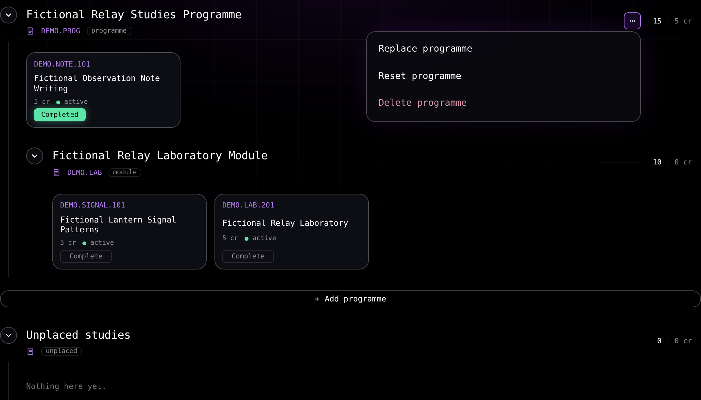

# Planning a structure of studies

The Structure of studies tab shows the official structure of each of its ordered programmes and the exact version of every module inside them.

A **?** control at the top right of the tree opens the help drawer for the tree and its editing actions. [Editing a structure of studies](/docs/guides/editing-structure-of-studies.md) describes the drawer, dragging, moving, removing and resetting.

## Adding a programme

The tab holds an ordered list of programmes, and each one is a degree programme or a module. The list starts empty, and **Add programme** sits between the last programme and **Unplaced studies**.

While the list is empty, the same area also shows an **Import** control that takes a profile file, the whole saved data, a Sisu capture or a supported Sisu plan PDF, through its own **Choose** prompt, drop target and the same confirmations as the profile menu. The area also carries **Copy Sisu import script** and a **?** help drawer for the import and the Sisu plan. A PDF that leaves a module without a version because several are eligible uses the same **Choose module version** list as any other structure read, and the import places the module after you choose. A grey rule separates it from **Unplaced studies**. The export list stays in the profile menu.

Select **Add programme** to open the picker. The filter narrows programmes and modules by name or by code, and each matching module or programme shows as one row with its official code and name.

A group with one eligible version is added when you choose its row. When it has several, the dialog **Choose module version** opens over the results with **Cancel**, and every eligible version of that module is listed with its validity bounds, its curriculum periods, its full version identity and **+ add**. Choose one to add it, or **Cancel** to return to your search. The app never picks a version for you. The version list scrolls inside the dialog.

Choosing a row adds it at the end of the list and reads its tree. The list holds every match and scrolls to the last one, and the keyboard reaches a match that is out of view: Tab and Shift+Tab step through the results, the arrow keys move one row, Home and End go to the first and last result, and Enter or Space activates the focused row.

The courses that its official structure proves required are placed in it and selected. A programme that the list already holds is refused with **Programme is already added**. A programme that already sits somewhere in your structure moves to the end of the list with everything you had put inside it, and it asks for that move first. The picker is open again after a course dialog that you cancel, so you can pick another programme.

Each programme row carries a **⋯** control, which opens its menu:

- **Replace programme** asks which programme takes its place, closes the picker, and then asks you to confirm.
- **Reset programme** restores that programme's official content.
- **Delete programme** removes it from the list and always asks first, whether or not the programme holds a change or a completed course. Deleting the last programme returns the tab to its empty list with **Add programme** and **Unplaced studies**.

**Replace programme** names the programme that leaves and the programme that takes its place, and it lists the courses that the replacement pulls out of another programme or module. When it lists a course, the answer is **Keep** or **Pull**, explained in [One place for a course](/docs/guides/editing-structure-of-studies.md#one-place-for-a-course). When it lists nothing, its only action beside **Cancel** is **Replace**. Only the replaced programme's own displayed contents leave the structure. A course you placed in another programme stays there, and the replacement lists it only when the replacement's own official content includes it.

When the replacement already sits somewhere in your structure, the dialog also names that place, because the replacement moves from there with everything inside it and pulls no course.

Choosing the programme and version that already fill the place you are replacing closes the picker, returns focus to the control that opened it, and changes nothing. If that place has no content to compare, the picker reports that the programme is unavailable and stays open.

**Delete programme** asks with **Cancel** at the left, then **Delete**, and it adds **Delete all** beside **Delete** when the programme holds completed courses. Only the deleted programme's own displayed contents leave the structure. A course placed in another programme stays there, even when its official home is in the deleted programme.

**Cancel**, Escape, and a click outside the dialog change nothing, and no other programme and no loose course is affected.

A completed course of the affected programme keeps its completion and takes its place in the replacement content, and one that would otherwise leave the affected part is listed under **Unplaced studies**. An uncompleted course of the affected programme leaves your selection. **Delete all** drops the programme's completed courses and their completions as well.

## Choosing an exact module version

A structure keeps one exact official version of each module. When the official read finds several eligible versions of a programme or a module and you have not chosen one, the tab shows a **Choose module version** list above the tree with every candidate of that group, its validity bounds, its curriculum periods, its full version identity and a **Select** action. A search row whose module group has several eligible versions opens the dialog **Choose module version**, described under [Adding a programme](#adding-a-programme).

The saved structure, choices and courses stay as they are while you choose. Select one to record that exact version and read its content. A root and a module reached inside a structure ask the same way.

Selecting a version writes only that choice. A pick that would select a second version of a module that already holds another one is refused with **Another version of this module is already selected** and changes nothing. Another profile can select a different version of the same module. A version that an imported profile or a Sisu capture names but the current academic year does not offer is shown as an error, and the app never chooses another version in its place.

Removing a programme, a module or a module inside another one forgets the version you chose for it, so adding it again offers every eligible version and takes the one you choose. A part that stays in your structure keeps its own version.

A reset inside a programme or module removes the parts inside it, and so it forgets their versions as well, while the programme or module you reset keeps its own version.

## Reading the tree

Each module of a programme is a row, expanded when the tab opens, with a control that collapses it. The programme itself is a row of the same kind. A row carries the module name, its code, whether it is a programme, a module, or Unplaced studies, and the credits of the courses placed under it, written as selected first and completed second, such as `15 | 5 cr`. Only a row at the top level of the list carries the programme menu. On a phone the **⋯** sits on the title row at the right, level with the expand control. The kind label follows the official type: a bare module at the top level reads **module** and holds the programme menu and reset of its position. A degree programme added inside a programme or a module shows the word programme where the row is labelled, and every control and every action on it matches a module.

A course is drawn as a card with its code, its name, its credits, and whether it is active. On a desktop screen all cards share one width and height. A two-line name occupies a fixed title area above the facts and the completion control, and a one-line name spreads the spare height equally between the code, the name, the facts and the **Complete** control.

On a phone each card has a minimum height, keeps the same balanced one-line spacing, and grows when a longer name wraps. The code, credits and **Complete** control sit inside the card.

Each card opens the [course menu](/docs/guides/README.md#shared-course-state). Each card also carries **Complete**, which marks that course completed in place without the **Mark completed?** dialog. A module box or a requirement box is marked only in the prerequisite graph. A completed card shows **Completed** and reads as completed in every other tab. A row name in the tree and in the drawer wraps in the same way, and the kind, code and credits sit inside the row.

Where a rule offers a choice between alternatives, the tree shows the alternatives you chose, and you pick among them in the drawer. A rule that only groups other rules adds no row of its own, so the tree shows the content it wraps.

An official reference that cannot be resolved is shown as a note in place of its content, for example **Module not found**, **Course is missing**, **This module has no rule**, or **Unresolved requirement**.

## Reading the rules

A module or a programme with target credits states that credit extent as its rule, such as `180 cr`. A rule that pairs a credit target with a choice shows both parts, joined by a middle dot, such as **min 20 cr · choose 1**. A rule whose every part is required reads **all required**.

[Editing a structure of studies](/docs/guides/editing-structure-of-studies.md#placing-courses-from-the-drawer) describes the drawer, which places a module's content under these rules and states the selected and completed credits.

## Unplaced studies

Unplaced studies is the last row of the tree. It holds the courses in your selection that no programme or module holds.

A course arrives there in one of these ways:

- The course menu item **Add to Unplaced studies** adds a course that is not selected yet, from any card in the app. A course that a programme or module holds offers **Move to Unplaced studies**, and **Remove from** with the name of that programme or module. A selected course that no programme or module holds offers **Remove from Unplaced studies**, and one that already sits in Unplaced studies offers **Move to Unplaced studies**.
- The **Mark completed?** dialog for a course that is not selected offers **Add and complete**, which adds the course to Unplaced studies and completes it. [Shared course state](/docs/guides/README.md#shared-course-state) describes the dialog and its notices.
- A completed course that is moved out of a module is listed under Unplaced studies with its completion.
- A selected course that no programme or module holds is listed there.

**Add to Unplaced studies** adds the course at once, whether or not the programme list holds a programme, and a course added while the programme list is empty appears in this list. The route panel and a member list add all their missing courses at once, and their notice states the number they added, or that the courses were already selected. [Shared course state](/docs/guides/README.md#shared-course-state) describes the bottom notices of these actions and their **Unplaced studies** link.

Select a course row in the Unplaced studies drawer to take that course out of the selection, as [Removing a course](/docs/guides/editing-structure-of-studies.md#removing-a-course) describes.

## Your edits and the official structure

The programmes, the choices, the places and the card order belong to the open [profile](/docs/guides/profiles-and-language.md), so the tab opens with them again the next time you visit it. The official structure that the server sends is the published structure, shared by every profile. Another profile holds its own structure, and **Reset programme** on a row is how one programme of the open profile returns to the official content.

How the tab projects the official rules, resolves your choices and places, and stores them in the profile is described in [Structure editor](/docs/frontend/structure-editor.md).
