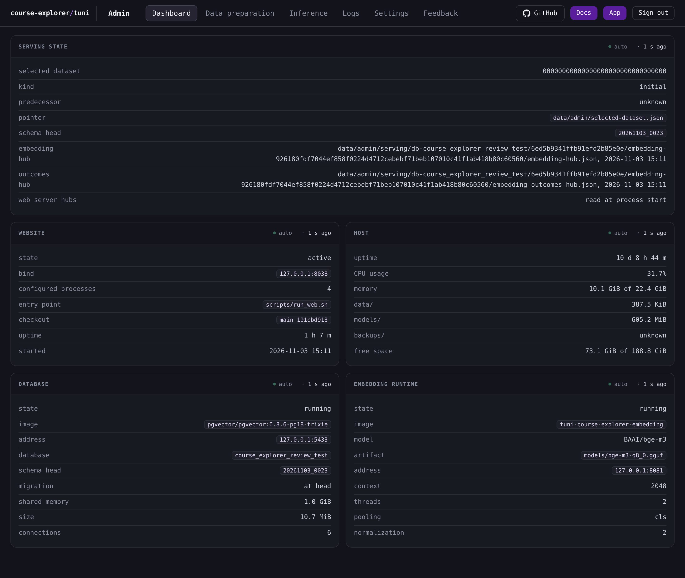

# Dashboard

The Dashboard tab reports the state of the serving site, the host, the database and the embedding runtime, and it warns when a hub file needs a web server restart.

## The five panels

One read fills all five panels, so their markers share one time. **Serving state** spans the width, and **Website** and **Host** sit above **Database** and **Embedding runtime**. The tab shows the state of the selected dataset and the services around it.

## Serving state

The panel describes the dataset the site serves.

| Row | Meaning |
|---|---|
| **selected dataset** | The id of the dataset the site serves. |
| **kind** | How the dataset entered the chain, **initial**, **returned** or **copied**. |
| **predecessor** | The dataset that precedes the selected dataset in the chain. |
| **pointer** | The file that names the selected dataset. |
| **schema head** | The database revision recorded by the dataset receipt, which can differ from the live database's own revision. |
| **embedding hub** | The file that holds the embedding hub, and the time it was last written. |
| **outcomes hub** | The file that holds the outcomes hub, and the time it was last written. |
| **web server hubs** | The value **read at process start** states that the web server reads the hub files when its process starts. |

The **embedding hub**, **outcomes hub** and **web server hubs** rows appear only on a site that serves the embedding features. On a site with them off, the panel shows its dataset rows and the note **Embedding features are off on this site.** instead of the three hub rows, and the read resolves no embedding directory. The hub rows report the file times of the configured embedding directory.

A hub file with no file time shows its path and **unknown** in place of the time. When the site has no Selected pointer and serves its configured database, the dataset rows read **unknown**. When the dataset state tree is a symlink or not a directory, the panel adds **The dataset state is unavailable: data/ or its dataset tree is a symlink or not a directory.** and every dataset row reads **unknown**.

The panel adds **Restart the web server to load the hub files written at {time}.** when an embedding directory hub file was written after the web server started. A site with the embedding features off reports no hub file, so the hint never appears there. The time is the writing time of a newer hub file of the configured embedding directory. The hint names only those two build files: it does not prove that every artifact file belongs to the same build, that the build succeeded or that the study fragments or packed search relation are current. A completed build reaches serving after the full supervisor restart that [Operations](/docs/operations/README.md#derived-files-served-data-and-the-web-restart) states, and `serving-artifacts --prune` runs after that restart succeeds. On a site that serves the embedding features the supervisor maps the shared stores in the opened set and every worker inherits them, and the recommendation handler reads the stored neighbour rows.

## Website

The panel describes the site's web service.

| Row | Meaning |
|---|---|
| **state** | The state of the service, such as active or inactive. |
| **bind** | The configured address and port the web server binds. |
| **configured processes** | The number of worker processes the settings configure, rather than a measured count. |
| **entry point** | The script the web service runs. |
| **checkout** | The branch and the first nine characters of the revision of the checkout the console reads. |
| **uptime** | How long the web service has run. |
| **started** | When the web service started, in UTC to the whole minute. |

**uptime** and **started** read **unknown** when the service is not active.

## Host

The panel describes the machine that runs the console.

| Row | Meaning |
|---|---|
| **uptime** | How long the host has run since it booted. |
| **CPU usage** | The share of CPU time that was not idle or waiting for I/O over a short sample, from 0% to 100%. |
| **memory** | Used memory of total memory. |
| **data/** | The size of the data directory. |
| **models/** | The size of the models directory. |
| **backups/** | The size of the backups directory. |
| **free space** | Free space of the filesystem that holds the checkout, of its total. |

A directory total reads **unknown** when that directory is absent or is not a real directory of the checkout.

## Database

The panel describes the database service and the database it serves.

| Row | Meaning |
|---|---|
| **state** | The state of the database container, such as running or absent. |
| **image** | The container image. |
| **address** | The configured host and port. |
| **database** | The database name. |
| **schema head** | The migration revision this checkout expects. |
| **migration** | **at head** when the database matches that revision, otherwise the database's own revision. |
| **shared memory** | The container's configured shared-memory size. |
| **size** | The database size. |
| **connections** | The number of connections to the database. |

When the container is not running, **size**, **connections** and **migration** read **unknown**, because no live database read runs. When the dataset state is unavailable, **database** names the configured database, because no Selected receipt resolves a served one.

## Embedding runtime

The panel describes the embedding container and the runtime it serves.

| Row | Meaning |
|---|---|
| **state** | The state of the embedding container, such as running or absent. |
| **image** | The container image. |
| **model** | The configured model name. |
| **artifact** | The configured model file the service loads. |
| **address** | The configured host and port. |
| **context** | The model's context size. |
| **threads** | The configured thread count. |
| **pooling** | The configured pooling method. |
| **normalization** | The configured normalization value. |

## How the tab refreshes

The whole tab follows one automatic read. The read runs when the console opens and then again after the configured interval. Every panel's marker shows **auto** and the time since the last successful read. A switch to another console tab does not start another read, and the return shows the report the read last returned.

An **unknown** value means the report had no value to give, where zero and false are values of their own.

## When the read fails

The five panels share one read, so a failure appears once, above the panels. A panel that has a previous report shows it. A panel with no previous report shows its heading, its **no read** marker and no rows.

The next successful read clears the failure, and the panels then fill from that report.
