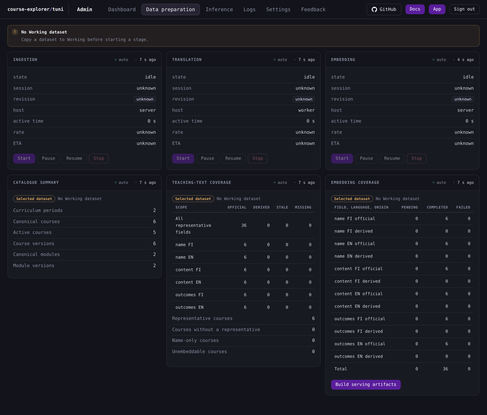
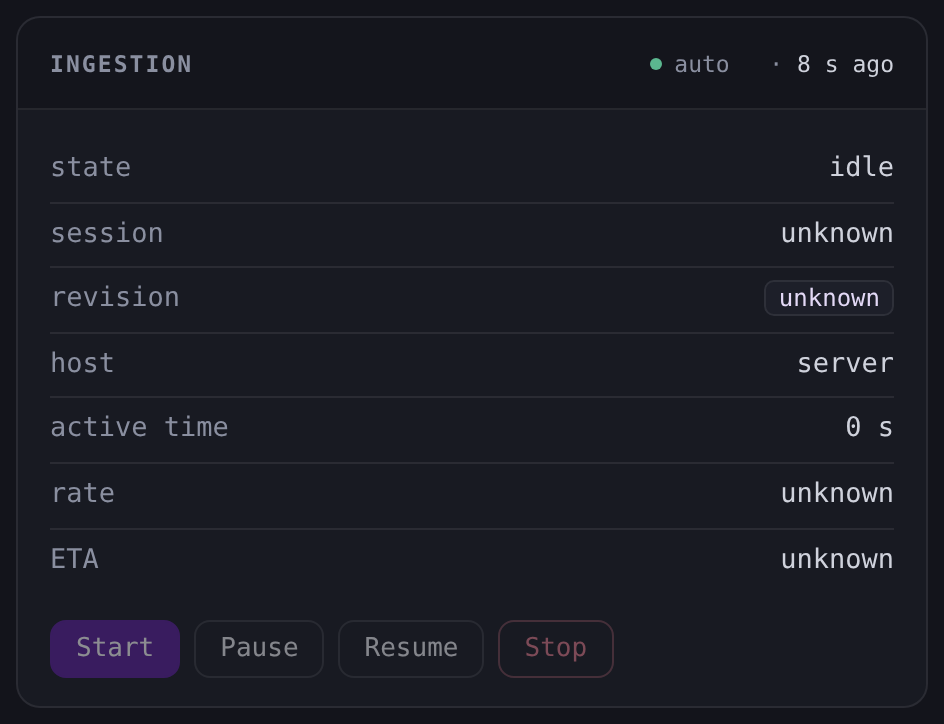
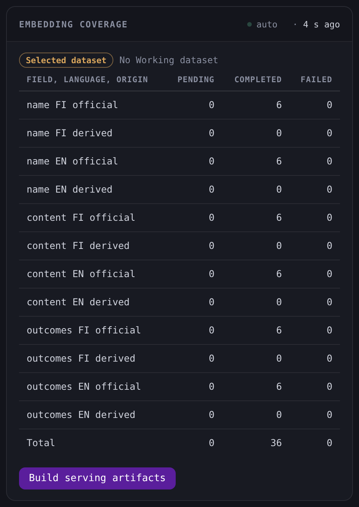

# Data preparation

The Data preparation tab holds the ingestion, translation and embedding stages with their controls, and the three reports that read Working first and fall back to Selected.

## The stage panels

The tab places the three stage panels in one row. Each panel reads its own status on the automatic interval and shows the same rows.

| Row | Meaning |
|---|---|
| **state** | The lifecycle state of the stage. |
| **session** | The identity of the current session. It reads **unknown** when the stage is idle. |
| **revision** | The checkout revision the session recorded. It reads **unknown** when the stage is idle. |
| **host** | **server** for ingestion and embedding, and **worker** for translation. |
| **active time** | The time the stage spent running, without the idle time between runs. |
| **rate** | The measured work per second. It reads **unknown** when no rate is measured. |
| **ETA** | The projected time to the end of the work. It reads **unknown** when no estimate exists. |

The status read reports a stage that was starting or running with no live process as **interrupted**, and [Stage lifecycle](/docs/operations/stage-lifecycle.md#the-durable-states) states every lifecycle state.

### What each stage counts

Ingestion shows **responses**, **verified responses**, **verification total** and **normalized**. The **verification total** row appears when the source reports a total, and a progress bar then shows verified responses of that total. **normalized** reads **yes** or **no**.

Embedding shows **desired**, **completed** and **remaining**. The remaining count is the pending chunks and the failed chunks together, and a progress bar shows completed chunks of the desired chunks.

Translation shows **desired**, **completed**, **remaining** and **reboot due**. The counts and the flag come from the last worker status the session recorded, and the panel's read does not contact the worker. Before the stage holds a worker status, each of them reads **unknown**. A progress bar shows completed of desired when both counts are known.

### The action row

Each stage panel has **Start**, **Pause**, **Resume** and **Stop**. The four actions need a Working dataset. When the console's inventory read reports none, the tab shows one **No Working dataset** notice with the copy hint, and every stage panel disables all four actions while its status rows and marker keep updating. Before the first successful inventory read, the actions are enabled and the stage owner reports its own guidance for a run without Working.

| Action | What it does |
|---|---|
| **Start** | Begins a fresh session, or continues the session the stage retained. |
| **Pause** | Ends the run at its next checkpoint and holds the session for a resume. |
| **Resume** | Continues the session the stage retained. |
| **Stop** | Ends the run, finalizes the work it finished, releases the resources the run started and returns the stage to idle. |

Only **Stop** asks for confirmation. Its dialog names the stage, for example **Stop Ingestion** with **Stop the Ingestion stage.** **Cancel**, Escape and a click outside the dialog close it and run nothing. The other three actions start without a confirmation.

While an action runs, the four buttons of that panel are disabled. The panel then shows the status the action returned, and a failed action shows a failure message in the same panel. A successful stop of translation also returns the worker's finished copy as the Working dataset, and [Worker sessions](/docs/operations/worker-sessions.md#pause-stop-and-the-return) describes the return.

## The reports

Below the stages are the **Catalogue summary**, **Teaching-text coverage** and **Embedding coverage** panels. Each reads its own command on the automatic interval, so its marker shows **auto** and the time since the last successful read. The read resolves Working first and falls back to Selected when Working is absent, and the panel names the role as a compact strip: **Working dataset**, a **Selected dataset** strip with a **No Working dataset** hint when it fell back, or **No dataset enrolled** with no report rows.

### Catalogue summary

The panel gives six counts of the dataset the read resolved: **Curriculum periods**, **Canonical courses**, **Active courses**, **Course versions**, **Canonical modules** and **Module versions**. **Canonical courses** and **Canonical modules** count each course and module once, and the version rows count their official versions.

### Teaching-text coverage

The table has one row for each field and language of the [representative versions](/docs/reference/glossary.md#courses-and-the-catalogue), and an **All representative fields** row that sums each column.

| Column | Meaning |
|---|---|
| **Scope** | The field and language of the row. |
| **Official** | Text the university published. |
| **Derived** | A translation. |
| **Stale** | A translation whose source text changed. A stale translation is never used. |
| **Missing** | No effective text for the field and language. |

Under the table are four course counts. **Representative courses** counts the courses with a representative version, and **Courses without a representative** counts the courses with none. **Name-only courses** counts the courses whose representative version has a name but no content or learning outcomes in either language. **Unembeddable courses** counts the courses whose representative version has no effective name, content or learning outcomes in either language.

### Embedding coverage

The table has one row for each field, language and origin, and a **Total** row. Its columns are **Field, language, origin**, **pending**, **completed** and **failed**. The first column names the field, the language and the origin the report gives for the chunk. The counts are chunks of the dataset the read resolved.

**Build serving artifacts** writes the serving artifact set of the served dataset. It writes every file of one build before the dataset tables change. [Serving artifact build](/docs/backend/text-and-vectors/serving-artifact-build.md#the-embedding-switch) states what each embedding mode writes, the transaction, and the hub pair and centroids computed from that dataset's stored vectors.

The three stage panels above write Working, so a completed stage run changes nothing the site serves and needs no build or restart. The build targets the Selected dataset, which is the configured database in bootstrap.

On a site that serves the embedding features, a dataset whose current embedding coverage is incomplete fails before any artifact file or derived table is written. [Administration commands](/docs/backend/interfaces/administration-commands.md#the-serving-artifact-command) states what a failed build restores. The build applies no inference coverage gate.

A successful build message names the paths and counts of the set the site serves. An embeddings-on build names the hub-pair path, the two hub files with the chunk count behind each, the search group and block counts, the centroid count, the neighbour-row count and the projectable study-root count. An embeddings-off build names the catalogue artifact path and the projectable study-root count and states that the switch is off, so the build wrote no embedding artifacts. Both messages state that the web server reads the artifacts at start and ask for a restart, and [Operations](/docs/operations/README.md#derived-files-served-data-and-the-web-restart) states that restart. The build starts at once and asks for no confirmation. It builds the Selected dataset, which is the configured database in bootstrap, and its hubs come from that dataset's stored vectors, so no second command is needed.

The **Build serving artifacts** button sits below the coverage table.

The supervisor opens the current artifact build once before it forks its workers. On a site that serves the embedding features that opened set holds the shared centroid and chunk stores of the configured embedding directory, and on a site with them off it holds the catalogue and the study fragments alone. A completed build reaches serving after the full supervisor restart that [Operations](/docs/operations/README.md#derived-files-served-data-and-the-web-restart) states, and the artifact command restarts no unit. The [Operator menu](/docs/operations/operator-menu.md#building-the-serving-artifacts) describes the same build for the command line.

## When a read fails

A failed stage status leaves the rows of the last successful read in place and shows the failure. A stage panel that has no successful read shows its heading, its **no read** marker and no rows. A report with no successful read shows its heading, the failure and **no read**, while a failure after a successful read leaves the last report in place. The next successful read clears the failure.
