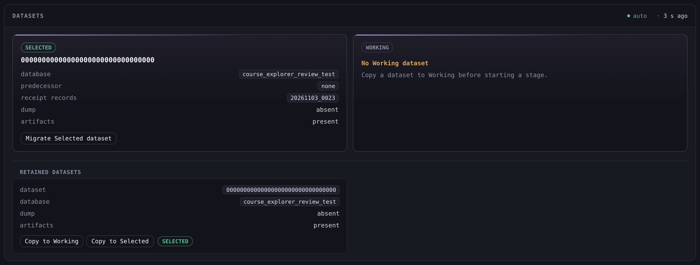

# Dataset roles

The Settings tab's Datasets panel shows both dataset roles, the retained chain and the copy, migration and deletion actions.

## The two roles

The panel names both dataset roles with the facts their receipts record.

| Row | Meaning |
|---|---|
| **dataset** | The dataset identity. |
| **database** | The database name. |
| **predecessor** | The dataset the receipt names as its source, or **none** for the initial dataset. |
| **receipt records** | The migration head the receipt records. |
| **dump** | The retained dump path, or **absent** when no dump is retained. |
| **artifacts** | **present** when the dataset's serving artifact namespace exists, otherwise **absent**. |

The Selected dataset is the one the site serves. The Working dataset is the one the pipeline stages read. Each role is one prominent card with its **SELECTED** or **WORKING** tag, its dataset identity as the headline and the facts below it, and its role action in the card. The two role cards and the retained cards sit two per row, and they become one per row before a fact value would wrap, so a value is never clipped.

When a successful inventory read reports no Working pointer, the Working card is an empty state with the title **No Working dataset** and the hint **Copy a dataset to Working before starting a stage.** The Data preparation and Inference tabs also carry one such notice above their panels. Before the first successful read, and while the read reports the dataset state unavailable, every role fact reads **unknown**.

## Bootstrap

A deployment with no Selected pointer serves its configured database directly. The panel states that no dataset is enrolled and names the configured database the site serves directly. The retained inventory reads **No dataset is retained.**, and the available actions are enrollment and the configured-database migration. The inventory shows no copy or delete control on any row, including a card that holds an initial receipt while the Selected pointer is absent.

## The retained inventory

A thin rule separates the two role cards from the **Retained datasets** list. That list holds the two role datasets and, besides them, one card per dataset that holds a dump, an artifact namespace or a present database. A receipt alone does not list a dataset that holds none of them. The dataset identity, the database, the dump and the artifacts are its fact rows, and the card holds its controls with its role pills immediately after them, in the slot the delete control would use.

**Copy to Working** and **Copy to Selected** appear on each row whose database is present while the inventory reports enrolled. The Selected card offers no deletion control. A bootstrap inventory shows no card control.

A busy stage disables **Copy to Working**, the Working dataset's **Delete** and **Migrate Working dataset**. **Copy to Selected** and **Migrate Selected dataset** are available, and the owner's own guard decides each action.

## Copy to Working

**Copy to Working** asks for confirmation first, and the dialog names the source dataset, its database and that serving is untouched.

**Confirm** creates one verified copy, assigns it to Working and reloads the inventory and the Dashboard read. The copy receives its own identity and database, and no serving artifact is built. Every stage must be idle, and an action that finds one busy is refused with its own guidance. A cancelled dialog posts nothing.

## Copy to Selected

**Copy to Selected** asks for confirmation first, and the dialog names the source dataset, its database and that serving restarts and is briefly unavailable.

**Confirm** sends the confirmed promotion, and the panel lists its five steps in order: **Copy dataset**, **Build serving artifacts**, **Switch Selected**, **Restart serving** and **Prove serving**. Each reported step is marked as current with an indeterminate marker and every earlier step as done. When the restart or the proof fails, the list adds **Restore previous selection** as the current step. [Datasets](/docs/operations/datasets.md#promotion-to-selected) states the promotion, its rollback and the resources it retains.

A successful terminal result is the only completion. It clears the step list and reloads the inventory and the Dashboard read. A refused, failed or interrupted request shows its owning guidance line, reloads both reads to reveal the actual selection, and never sends the promotion again. The promotion continues on the server when the browser leaves.

## Migrating a dataset

An enrolled deployment offers two migrations, and each asks for confirmation first. **Migrate Selected dataset** applies this checkout's migration head to the Selected dataset. **Migrate Working dataset** applies it to the Working dataset and additionally requires every stage idle.

A bootstrap deployment offers **Migrate configured database** instead, and its dialog names the configured database. The action refuses an enrolled deployment.

A successful migration reloads the inventory and the Dashboard read. [Datasets](/docs/operations/datasets.md) describes the chain, the receipts and the migration.

## Deleting a dataset

The Selected dataset offers no deletion. A non-Selected row offers **Delete**, and its dialog names the dataset identity and its database. A Working row's dialog additionally states that Working becomes absent.

**Confirm** drops that dataset's database, removes its retained dump and its derived artifact namespace, clears the Working pointer when the target was Working, and reloads the inventory. The receipt is retained. The owner resolves both roles and the chain again when the action runs, so a role that changed since the read is decided there.

A cancelled dialog posts nothing, and a failed deletion retains the row and shows its owning guidance line in the panel.

## Enrollment

In a bootstrap deployment, **Enroll or select dataset** asks for confirmation first. It migrates the configured database to this checkout's migration head, verifies it, writes the receipt and selects it. The panel then shows the enrolled roles and reloads the inventory. An enrolled deployment shows the selection as the Selected section and offers no enrollment control.

## When a read fails

The inventory read runs while the browser tab is visible, on the interval the console uses, whether or not the site has a Selected dataset. A failed read shows its owning guidance line in the panel and leaves the last successful inventory in place. A bootstrap deployment and a stopped database service both answer their own typed state rather than a failure.

The [Administration console](/docs/operations/admin-console/README.md) describes the sign-in, the header, the confirmation dialog and the read markers.
