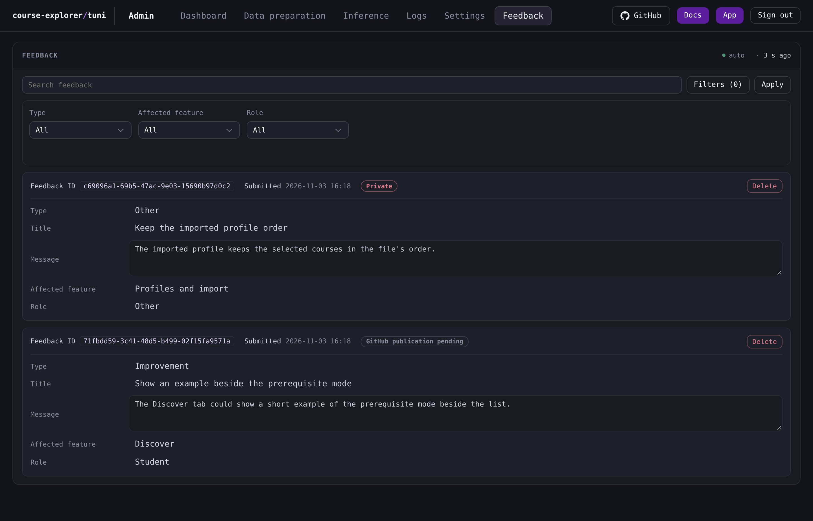

# Feedback

The Feedback tab lists the submissions stored in the feedback application store with their answers, images, publication state and local deletion.

## The listing

The panel owns one automatic read of the whole inbox. The read returns the current [feedback definition](/docs/reference/glossary.md#administration) and every stored submission, newest first by submission time and then by identity. The panel's marker shows the time since the last successful read, and the read runs again after the configured interval.

The search box and the filter controls never reach the server. They narrow the listing the panel already holds, in the browser, when **Apply** is selected. A successful automatic read therefore refreshes the whole listing under the narrowed view.

Each entry carries its feedback identity, its submission time in UTC to the whole minute, its publication state and, when one is recorded, its issue link and its safe failure description. A successful read that finds no submission shows **No feedback matches the current search and filters.**

## Search and filters

The search box **Search feedback** matches a literal, case-insensitive substring of every current text and textarea answer. The characters `%` and `_` match themselves.

Below the search box, one picker appears for each configured select field, in the feedback definition's order, with **All** as its empty choice. The **Filters ({count})** button shows the number of pickers that hold a choice, and it opens and closes the picker row. **Clear filters** clears every picker and is disabled while no picker holds a choice. Clearing the pickers leaves the typed search text in place.

**Apply** commits the typed text and the chosen options. The committed result orders a submission first by the earliest text field in the feedback definition's order that contains the search text, then by submission time newest first, then by identity. The chosen options combine with AND.

## The entry

The answers appear in the feedback definition's order. A text answer shows its stored value, a textarea answer shows a read-only field, and a select answer shows the current English option label or, when the configured option is gone, the stored value. An attachment field whose configured field is gone is omitted.

The publication state appears as one tag:

| Tag | Meaning |
|---|---|
| **Private** | The submission chose no publication. |
| **GitHub publication pending** | The submission awaits its one publication attempt. |
| **Issue created** | The issue exists and the command reported it. |
| **Issue created with incomplete attachments** | The issue exists and the command reported an incomplete attachment upload. |
| **Publication failed before issue creation** | No issue was created. |
| **Publication outcome unconfirmed** | The row was claimed for an attempt and no confirmed outcome was recorded. |

**Open GitHub issue** opens the recorded issue link in another browser tab. A recorded safe failure shows one fixed description in place of a message: **Some designated images were not uploaded.**, **Check the destination repository before taking further action.**, **The GitHub CLI could not be started.** or **The configured publication fields or stored images could not be read.**

**Download attachments ({count})** reads every stored image of that submission and builds one archive in the browser. The control shows **Preparing the archive…** while the reads run.

## Image reads

Each stored image has one control named by its filename, in the field's fixed row. The control's accessible name is **View {name}** and it reports whether the image is shown. Selecting it reads that one image with its feedback identity and its attachment identity, and the image appears below the row with its filename. Selecting the control again closes the image. Only PNG and JPEG images are stored, so every attachment has a control.

The image read is explicit. It runs only when its control is selected, and it appends one command-log entry. The bytes arrive as one transient report and are never written to a file or kept in the listing.

## Deletion

**Delete** opens **Delete feedback**. The dialog names the exact feedback identity and submission time, and it states that the deletion removes the local feedback and its stored images and does not delete a GitHub issue or GitHub-hosted images. **Cancel**, Escape and a click outside the dialog close it and delete nothing. **Confirm** deletes the submission.

The deletion locks the submission row first. It removes the record, its attachment metadata and its stored image files, then the panel reloads the listing. A deletion applies to a submission in any publication state, and it either wins before a publication attempt or waits for an attempt already under way. A sender schedules no work because a record was deleted. A failed deletion shows its failure in the panel and leaves the entry.

## Publication states

A submission that chooses publication starts in **GitHub publication pending**, and one that chooses no publication starts in **Private**. The state table above lists the labels an entry shows. [Feedback publication states](/docs/backend/feedback-publication-states.md) states the claim before the attempt, the four outcomes of one attempt, and why no state returns to pending.

## When a read fails

A failed listing read shows its failure in the panel and leaves the last successful listing and its marker in place. The next successful read clears the failure. A failed image read shows its failure in the entry, and a failed deletion shows its failure in the panel. A request refused because the session has ended returns the console to the sign-in screen.

The [Administration console](/docs/operations/admin-console/README.md) describes the sign-in, the header, the confirmation dialog and the read markers.
